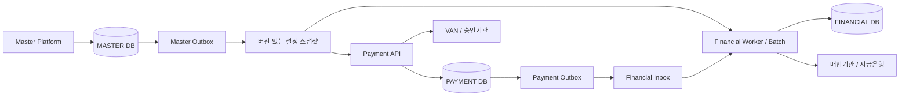

# 00. Architecture Overview

## 목적

결제 승인계가 정산계의 부하·장애에 영향을 받지 않고, 중복·지연·재처리에도 금융 효과가 보존되는 시스템 경계를 정의한다.

## 범위

Master / Transaction / Financial 플랫폼, 핵심 도메인, 연동 및 배포 경계를 다룬다. 상세 Aggregate와 테이블 설계는 하위 문서에서 정의한다.

## 핵심 규칙

| 플랫폼 | 책임 | 원본 DB |
|---|---|---|
| Master | Business, Merchant, MerchantSite, Contract, MID, 개통, 기관 기준정보, 정책 버전 | MASTER |
| Transaction | Payment, Authorization, 결제 취소, 환불 요청·거래 실행, Routing 실행 결과 | PAYMENT |
| Financial | Acquisition, Settlement, AgentSettlement, Payable, Payout, Reconciliation, Adjustment | FINANCIAL |

- 운영 환경은 MASTER/PAYMENT/FINANCIAL을 독립 DB 인스턴스 또는 클러스터로 분리한다. 한 인스턴스의 스키마 분리는 개발 편의용이며 운영 장애 격리의 증거가 아니다.
- 다른 플랫폼의 데이터는 버전 있는 이벤트·스냅샷으로 로컬 투영한다. PAYMENT와 FINANCIAL 사이 직접 DB 조회·쓰기를 모두 금지한다.
- Domain First 및 Hexagonal 구조를 적용한다. Domain은 JPA Entity, jOOQ generated class, Spring Batch, Controller/기관 DTO에 의존하지 않는다.
- Spring Modulith는 애플리케이션 내부 경계를 검사하고 Gradle은 빌드 의존성을 제한한다. 전체 시스템을 단일 Modulith 트랜잭션으로 취급하지 않는다.
- Business가 Merchant/Agent/Seller 역할을 가질 수 있다. MID는 계약 단위 계정이며 Business, 카드사 가맹점번호, GID와 구분한다.
- 계약 승인 후 Production MID를 발급한다. Sandbox Identifier는 별도 개념이다. Seller는 Marketplace/지급대행 요구가 구체화될 때 상세화한다.
- 정책 정의는 MASTER가 소유한다. 정책 적용 결과·거래 시점 버전은 거래 소유 플랫폼이 보존한다.
- 환불은 결제수단별 승인취소·계좌환불과 구분한다. 거래 상태의 원본은 PAYMENT, 실제 지급 실행의 원본은 FINANCIAL로 두고 ID로 연결한다.

## 예시 흐름

승인 결과를 PAYMENT에 확정하고 Outbox를 함께 커밋한다. FINANCIAL은 이벤트로 자체 거래 투영을 만들고, 매입 확인 및 정책에 따라 정산한다. Settlement 완료 → Payable 확정 → Payout 실행은 서로 다른 업무 상태다. 승인 성공을 매입·정산·지급 성공으로 간주하지 않는다.

## 금지사항

- SQL JOIN 관계만으로 서로 다른 라이프사이클을 한 Aggregate에 묶는 것.
- 관리자나 Batch가 다른 도메인의 Repository를 직접 호출하는 것.
- 동기식 정산 완료를 승인 응답의 선행 조건으로 만드는 것.
- 이 문서를 구현 완료 또는 운영 인증 완료의 증거로 사용하는 것.

## 구현 체크리스트

- [ ] 도메인별 원본 DB, 공개 Application API/Port, 이벤트 소유자를 지정했다.
- [ ] 승인·매입·정산·지급·환불의 상태와 책임을 구분했다.
- [ ] 실제 배포 및 DB 연결이 [01](01-runtime-deployment-architecture.md)·[02](02-database-ownership-and-transaction.md)를 따른다.
- [ ] 모듈 경계 검사와 [10](10-architecture-invariants.md)의 자동 검증을 적용했다.
- [ ] 실서비스 진입에 필요한 미결정 항목과 책임자를 기록했다.
