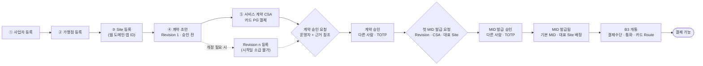

# 1. 업무 흐름

가맹점이 결제를 받으려면 등록, 계약 승인, MID 발급, 개통을 차례로 거쳐야 한다. B1~B2에서 MID 발급까지 만들었고, 개통은 B3에서 만든다.

## 단계별 규칙

| 단계 | 누가 | 지키는 규칙 | 남는 기록 |
|---|---|---|---|
| ①~⑤ 등록 (B1) | 운영자 1인 | 사업자등록번호는 숫자 10자리, 화면과 감사에는 마스킹 값만. 같은 요청을 다시 보내면 이전 결과를 돌려줌(멱등). 계약 시작일은 오늘(한국 시간 0시) 이후만. | MASTER 변경 이력, ADMIN 감사 |
| Revision 개정 (B2-1) | 운영자 | 소급 시작 거절(`CONTRACT_START_RETROACTIVE`). 등록 즉시 "승인 전"으로 표시되고 등록자가 기록됨. | `contract_revision.registered_by` |
| 계약 승인 (B2-2) | 요청 운영자 → 승인자 | 요청자와 승인자는 다른 사람. 그 Revision을 등록한 사람도 승인할 수 없음(D-MOPS-008). 업무 근거 참조 필수. 가맹점당 미해결 승인은 한 건. | MASTER 승인 근거 행, ADMIN 승인·실행 행 |
| 첫 MID 발급 (B2-3) | 요청 운영자 → 승인자 | MID가 0개일 때만. 승인된 Revision과 그 계약의 CSA, 계약 범위 안 ACTIVE Site가 있어야 함. Revision 등록자 규칙은 적용하지 않음. 동시에 두 건이 와도 MID는 하나. | `merchant_account`, `default_designation`, Site 배정, Snapshot |
| 승인 기한 | 시스템 | 승인 후 실행 창 안에서만 실행. ADMIN 실행 창(Demo 1시간)은 MASTER 최대 창(Demo 24시간) 이하여야 기동됨. 시계 오차 허용 1분. | Demo 값, 운영값 아님 (LIVE Gate L-16) |

> 화면이 "발급 가능"으로 보여 주는 판단은 안내일 뿐이다. 최종 판정은 항상 MASTER가 실행 순간에 다시 한다. 예를 들어 시작일이 미래인 Revision은 승인 실행 때 거절될 수 있다.

## B3 이후 (개요)

B3~B5의 승인 분류는 D-MOPS-007 ③으로 확정됐다. 상세 설계는 명세 §9.12 이후를 따른다.

| 배치 | 2인 승인 | 1인 |
|---|---|---|
| B3 개통 | 결제수단 개통 승인(PRIMARY Site 적용 확인 동반), Site 적용 확인, Site 심사 APPROVED, 통화 활성화, 카드 Route 개통 승인, 재개 | 개통 등록(UNDER_REVIEW로 남음), Site 심사 REJECTED |
| B4 한도·수수료 | 한도 상향·종료, 수수료·정산 정책 배정·배정 종료 | 한도 하향 |
| B5 중지·종료 | — | 결제수단·Route 중지/종료, Site 확인 철회, 통화 종료 (안전 방향 즉시) |
