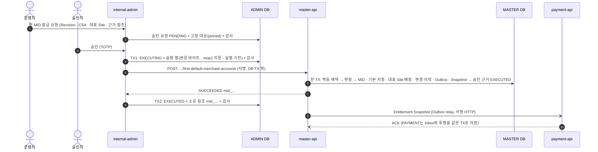

# 2. 서비스 흐름

관리자 콘솔(internal-admin)은 승인 절차를 맡고, 실제 업무 효과는 데이터를 소유한 master-api가 자기 DB의 한 트랜잭션에서 만든다. 두 앱은 서명된 HTTP로만 대화한다.

## 첫 MID 발급 한 건의 흐름

계약 승인도 같은 모양이다. 호출 경로만 `…/contract-revision-approvals`이고, MASTER가 만드는 효과는 Revision 승인과 권리 revision 증가다.

| 구분 | ADMIN endpoint | MASTER endpoint | ADMIN 승인 종류 |
|---|---|---|---|
| 계약 승인 | `POST /api/approvals/merchant-contract-approval` | `POST /internal/v1/admin/merchant-operations/contract-revision-approvals` | `MERCHANT_CONTRACT_APPROVAL` |
| 첫 MID 발급 | `POST /api/approvals/merchant-first-mid` | `POST /internal/v1/admin/merchant-operations/first-default-merchant-accounts` | `MERCHANT_FIRST_MID_ISSUANCE` |
| 결정 조회 | (회복 작업) | `…/approval-decisions` | — |
| 기한 확인 | (회복 작업) | `…/approval-deadline-confirmations` | — |

## 같은 요청을 두 번 실행하지 않는 장치

- **멱등 키** — 요청 키는 `mop1.<approvalId>`. MASTER는 `admin_request`의 (명령, 키) UNIQUE로 같은 키를 한 번만 실행하고, 다시 오면 저장된 결과를 돌려준다. 같은 키에 다른 내용이 오면 409.
- **승인 지문** — 명령 이름, 승인 ID, 요청자, 승인자, 승인 시각, 기한, 근거 참조, 대상 필드를 줄 단위로 이어 SHA-256을 낸 `mop1:…` 값. ADMIN과 MASTER가 같은 바이트로 독립 계산하고, 따로 계산한 기대값을 양쪽 시험에 고정했다. 첫 줄이 명령 이름이라 계약 승인 지문을 MID 발급에 쓸 수 없다.
- **승인 ID 1회 사용** — MASTER `admin_approval_evidence`의 PK가 승인 ID. 성공이든 거절이든 한 행만 남고, 같은 승인 ID를 다른 명령에 쓰면 `APPROVAL_ID_ALREADY_USED`로 거절.
- **동시 발급** — 가맹점 행을 잠근 뒤 기존 MID를 확인하고, `default_designation`의 PK(merchant_id)가 2차로 막는다. 실제 MySQL에서 두 건을 동시에 보내 MID 1개와 `DEFAULT_ALREADY_ISSUED` 1건이 나오는 것을 시험했다.

## 응답을 잃어버렸을 때 회복 순서

응답이 오지 않으면 성공했을 수도 있으므로 ADMIN은 결과를 `EXECUTION_UNKNOWN`으로 두고 회복 작업이 아래 순서로 확인한다. 시간이 지났다는 이유만으로 실패로 단정하지 않는다.

1. **결정 조회** — MASTER에 이 승인 ID의 결정이 있는지 묻는다(NONE 또는 DECIDED). 있으면 그 결과를 적용하고 끝낸다. NONE은 효과 없음의 근거가 아니다.
2. **기한 확인** — 실행 기한이 지났으면 실행 요청 대신 기한 확인만 보낸다. MASTER가 `APPROVAL_EXPIRED`를 확정해 저장하므로 늦게 도착한 실행이 효과를 만들 수 없다.
3. **참여자 재확인** — 요청자·승인자 계정이 아직 유효한지 다시 본다.
4. **무결성 플래그** — 이전에 이상 신호가 기록됐으면 더 보내지 않는다(조회만).
5. **같은 바이트 재전송** — 저장해 둔 본문을 바이트 그대로 다시 보낸다. MASTER는 멱등 키로 이전 결과를 돌려준다.

### MASTER 응답별 ADMIN 처리

| 응답 | ADMIN 상태 | 이어지는 동작 |
|---|---|---|
| SUCCEEDED, 참조가 이 승인의 대상과 일치 | EXECUTED | 완료. 소유 참조(`ctr_…#n` 또는 `mid_…`) 저장 |
| SUCCEEDED, 참조가 다른 대상 | EXECUTION_UNKNOWN | 무결성 플래그 `REFERENCE_MISMATCH`, 경보 1회, 사람 검토 항목 1건, 재전송 중단 (C-34) |
| REJECTED (업무 거절) | OWNER_REJECTED | 거절 코드 표시. 예: `APPROVER_IS_REVISION_REGISTRANT`, `DEFAULT_ALREADY_ISSUED` |
| 409 (같은 키, 다른 내용) | EXECUTION_UNKNOWN | 무결성 플래그, 재전송 중단 |
| 400 · 413 (본문 형식 오류) | EXECUTION_UNKNOWN | 재전송 중단 (`OWNER_MALFORMED`), 조회·기한 확인만 |
| 401 · 404 | EXECUTION_UNKNOWN | 경보, 설정·키 확인 필요 |
| 503 · timeout | EXECUTION_UNKNOWN | backoff(Demo 30초 → 최대 30분)로 회복 순서 반복 |

기한 뒤에도 확정할 수 없는 건(조회 NONE + 기한 확인 400 지속·409)은 자동 종결하지 않고 `OWNER_UNRESOLVABLE` finding 1회와 경보를 남긴다(C-28).
