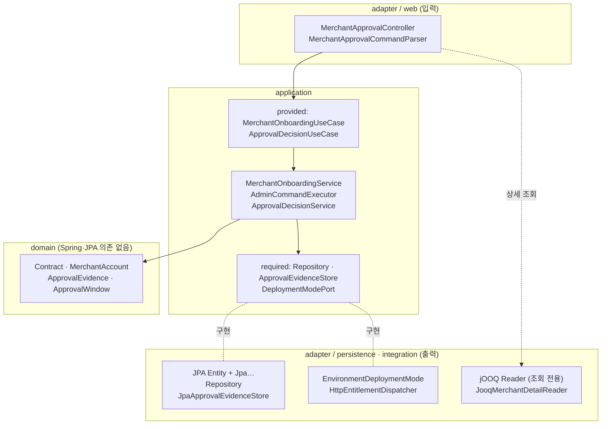

# 3. 시스템 구성

앱 다섯 개가 각자 DB 하나를 소유한다. 다른 앱의 DB를 직접 읽거나 쓰지 않고, 필요한 데이터는 서명 HTTP, Outbox/Inbox, 전문, 파일로 주고받는다.

| 앱 | DB | 맡는 일 | 온보딩에서의 역할 |
|---|---|---|---|
| `internal-admin` | ADMIN | 관리자 계정·TOTP·세션, 승인함, 감사, 운영 명령 중계. React 화면을 같은 출처로 제공 | 등록 화면, 승인 요청·승인함, 2-TX 실행, 응답 유실 회복 |
| `master-api` | MASTER | 사업자·가맹점·Site·계약·MID·개통·한도의 정본, Entitlement Snapshot 발행 | 등록·개정·승인·MID 발급 명령, 승인 근거 저장, 결정 조회·기한 확인 |
| `payment-api` | PAYMENT | 주문·결제·취소, 결제창, 가맹점 Webhook | MASTER Snapshot을 받아 결제 가능 여부 판단 (B3 개통 뒤 실제로 쓰임) |
| `financial-batch` | FINANCIAL | 결제 사실 수신, 매입 파일 생성·전송·확정 | 직접 관련 없음 |
| `institution-simulator` | Simulator | 가상 카드 인증, VAN, 매입사 | 실제 기관 대신 사용 |

## 앱 안의 계층 (헥사고날)

- **Domain**은 순수 Kotlin이다. 계약 Revision 승인, 소급 시작 판정, 승인 창 계산 같은 규칙이 여기에 있다.
- **Application**은 트랜잭션 경계를 정하고 Port로만 저장소와 외부를 부른다. `AdminCommandExecutor`가 멱등 예약, 판정, 효과, 승인 근거, 완료를 한 트랜잭션으로 묶는다.
- **JPA**는 업무 상태 저장에 쓴다. 엔티티는 adapter에만 있고 도메인 객체와 분리돼 있다. 승인 근거처럼 바뀌면 안 되는 기록은 `@Immutable` 엔티티로 즉시 flush해 UNIQUE 충돌을 같은 트랜잭션 안에서 잡는다.
- **jOOQ**는 화면용 상세·목록 조회(CQRS 읽기)에 쓴다.
- ArchUnit과 Spring Modulith 시험이 계층 규칙과 근거 없는 MID 발급 경로의 호출자를 막는다.
- Kafka/Redis는 쓰지 않는다. 멱등·경합은 MASTER `admin_request` UNIQUE(operation, key), 행 잠금, 업무 UNIQUE가 지킨다([ADR-001](../repository/ADR-001-KAFKA-REDIS-DEFERRAL.md)).

## 온보딩의 핵심 테이블

| DB | 테이블 | 역할 |
|---|---|---|
| ADMIN | `admin_approval_request` | 2인 승인 요청과 상태. 대상(가맹점)당 미해결 승인 하나를 생성 열 UNIQUE로 보장 |
| ADMIN | `admin_merchant_ops_command` | 요청 시점에 고정한 대상(pinned). 승인자가 본 것과 실행되는 것이 같도록 함 (V9) |
| ADMIN | `admin_owner_execution` | 보낸 본문 바이트, 지문, 기한, 시도 횟수, 무결성 플래그, 소유 참조 |
| ADMIN | `admin_ops_reconciliation_finding` | 사람이 검토할 이상 항목(`OWNER_UNRESOLVABLE` 등) |
| ADMIN | `admin_audit_event` | 요청·승인·실행·조회 감사. 근거 참조 값은 남기지 않음 |
| MASTER | `admin_request` | 관리 명령 멱등 기록, (명령, 키) UNIQUE |
| MASTER | `admin_approval_evidence` | 승인 근거. 승인 ID당 한 행, 추가만 가능 (V9/V10) |
| MASTER | `contract_revision` · `contract_revision_approval` | 계약 Revision과 승인 기록 |
| MASTER | `merchant_account` · `default_designation` · `merchant_account_site_assignment` | MID, 기본 MID 지정(가맹점당 하나), MID–Site 배정 |
| MASTER | `outbox_event` · `entitlement_snapshot_issue` | 업무 효과와 같은 트랜잭션으로 쌓이는 발행 대기열과 권리 Snapshot |

## 8대 원칙과 증거 (B2 기준)

| 원칙 | 어떻게 지켰는지 |
|---|---|
| Financial Consistency | MID는 가맹점당 기본 하나, 발급과 개통 분리(개통은 B3) |
| Transaction Safety | MID·기본 지정·배정·이력·Outbox·Snapshot·승인 근거를 MASTER 한 트랜잭션에서 처리. 장애 주입 시험 21건으로 중간 실패 시 전부 취소됨을 확인 |
| Idempotency | `mop1.<approvalId>` 키, 같은 바이트 재전송, 같은 키 다른 내용은 409 |
| Concurrency Control | 가맹점 행 잠금 + PK 2차 방어, 실제 MySQL 경합 시험 |
| Recoverability | 결정 조회 → 기한 확인 → 재전송 순서, 응답 유실 실제 HTTP 시험 |
| Reconciliation | "근거 행이 있으면 실행 효과가 있고, 그 반대도 성립" 불변식 시험, 사람 검토 항목 |
| Auditability | ADMIN 감사(대상 열 포함), MASTER 변경 이력, 근거 값 비노출 단언 |
| Observability | 승인 실행 지표(명령 이름 label), 무결성 경보는 처음 1회만 |

검증 상태(B2): 전체 게이트 MOPS-gate5 PASS(fingerprint `f436e31a…`, 백엔드 시험 4,326건·화면 시험 259건), Verifier VERIFIED, 독립 리뷰 지적 반영. Demo에서 새 가맹점으로 등록부터 MID 발급까지 확인했다. 실제 기관·운영 DB는 쓰지 않았고 Demo 값은 운영값이 아니다.
