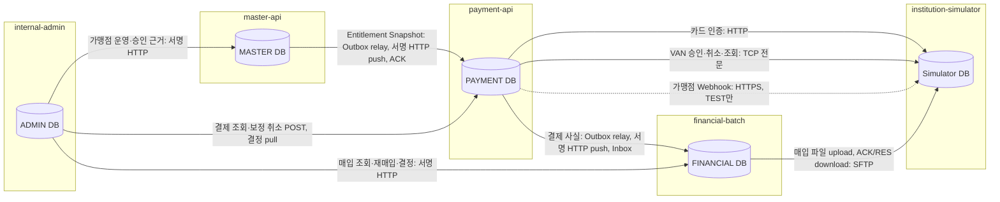

> 검증: paycore_master·paycore_payment·paycore_financial·paycore_admin schema from Demo MySQL 8.4.11 컨테이너 `paycore-demo-mysql-1`(compose project paycore-demo, `~/paycore-demo/db.sh`로 기동)의 information_schema·mysql 권한 표 추출, paycore_simulator schema from Demo MySQL 8.4.11 컨테이너 `paycore-demo-simulator-mysql-1`(compose project paycore-demo, `~/paycore-demo/db.sh`로 기동)의 information_schema·mysql 권한 표 추출, 2026-11-11T00:32:21+09:00. 적용 migration: flyway_schema_history 전 버전 success=1, 각 행 checksum이 HEAD 1b5538d의 파일 CRC32와 모두 일치(86/86).

# PayCore DB 개요 (초안)

## 생성 기준

- 작성일: 2026-11-10
- 기준은 git HEAD `1b5538d`(브랜치 `feat/foundation-setup`)이다. 초안 작성 시(HEAD `89c6fac`) 미커밋이던 아래 migration은 1b5538d에 커밋됐다.
  - MASTER `V9__admin_approval_evidence.sql`(schema), `V10__admin_approval_evidence_privileges.sql`(권한)
  - ADMIN `V9__merchant_ops_approval.sql`(schema), `V10__merchant_ops_approval_privileges.sql`(권한)
- 정본은 각 앱의 Flyway migration이다. 모든 버전을 순서대로 끝까지 적용한 **최종 스키마**를 기준으로 정리했다.
- **검증본**: Demo MySQL(Flyway 적용 완료, checksum이 HEAD 파일과 86/86 일치)의 information_schema·권한 표와 기계적으로 대조했다(2026-11-11). 표 수·열·타입·NULL·기본값·PK·UK·인덱스·CHECK·FK·runtime 권한이 일치했고, 차이는 각 파일 머리 아래 정정과 부록 V에 적었다. Mermaid는 렌더링해 보지 않았다.
- 테스트 전용 migration(`src/test/resources/db/testmigration|testprivilege|testprobe`, V900/V901/V950)은 최종 스키마에서 뺐다.

### Flyway 위치 관례

모든 앱이 위치 두 곳을 쓰고, 두 위치의 버전 번호는 하나의 순서로 이어진다(각 앱 `application.yml`의 `spring.flyway.locations`).

- `db/migration/<db>`: 업무 schema
- `db/runtime-privilege/<db>`: runtime 계정의 표·열 단위 GRANT

위치를 나누는 이유는 jOOQ 생성기가 업무 schema만 적용하기 때문이다. migration은 별도 migration 계정(DB ALL, GRANT OPTION 없음)으로 실행하고, 세션 시간대는 `+00:00`이다.

## DB 목록

| DB | 소유 앱 | 담당 업무 | migration 범위 | 테이블 수 | 상세 |
|---|---|---|---|---|---|
| MASTER | master-api | 사업자·가맹점·Site·계약·MID(merchant_account)·Assignment, 결제수단·통화·카드 Route 활성화, 거래 한도·정책 버전, Entitlement Snapshot 발행, Admin 승인 근거 | V1~V10. **V8은 파일 없음**(의도적으로 비운 번호) | 29 | [master.md](master.md) |
| PAYMENT | payment-api | 주문·결제(Payment), 멱등 요청, 결제창·인증 세션, 승인·취소 Attempt와 기관 관찰, 한도 사용량, 회복 일정, 가맹점 Webhook, Outbox/Inbox, Entitlement 투영, 운영자 결정, 금융 사실 Relay | V1~V34(V8_1 포함) | 41 | [payment.md](payment.md) |
| FINANCIAL | financial-batch | 결제 사실 Inbox와 투영, 보류(Hold), 매입 파일 생성·전송·응답·확정·재매입·전송 보류, Spring Batch metadata | V1~V20 | 업무 22 + BATCH_* 9 = 31 | [financial.md](financial.md) |
| ADMIN | internal-admin | 관리자 계정·역할·등록 코드·세션(Spring Session), 승인 요청, 감사, 소유 서비스 실행·대사 발견, 결제·매입·가맹점 운영 명령 | V1~V10 | 15 | [admin.md](admin.md) |
| Simulator | institution-simulator | 가상 기관: 카드 인증, VAN 승인·취소 원장, 조회 로그, 가맹점 Webhook 수신기, 매입사(SFTP 파일 수신·결과) | V1~V12 | 13 | [simulator.md](simulator.md) |

- 테이블 수에는 Flyway가 만드는 `flyway_schema_history`를 넣지 않았다.
- 전체 테이블은 130개다. MASTER 29, PAYMENT 41, FINANCIAL 31(BATCH_* 9 포함), ADMIN 15, Simulator 13.

### migration 파일 목록 요약

각 DB 파일 머리에 버전별 표가 있다.

| DB | schema(`db/migration`) | 권한(`db/runtime-privilege`) |
|---|---|---|
| MASTER | V1, V3, V5, V7, V9* | V2, V4, V6, V10* |
| PAYMENT | V1, V3, V5, V7, V8_1, V9, V11, V12, V14, V15, V17, V18, V20, V21, V23, V25, V27, V29, V31, V32 | V2, V4, V6, V8, V10, V13, V16, V19, V22, V24, V26, V28, V30, V33, V34 |
| FINANCIAL | V1, V2, V4, V5, V7, V9, V10, V12, V14, V16, V17, V19 | V3, V6, V8, V11, V13, V15, V18, V20 |
| ADMIN | V1, V3, V5, V7, V9* | V2, V4, V6, V8, V10* |
| Simulator | V1, V2, V3, V5, V6, V8, V10, V11 | V4, V7, V9, V12 |

`*`는 초안 작성 시 미커밋이던 파일이다(현재 1b5538d에 커밋됨).

#### MASTER V8은 비어 있다

- MASTER에는 V8 파일이 없다. 그래서 빈 migration이 아니라 **비운 번호**다.
- MASTER V9 2행 주석과 `docs/repository/MERCHANT-OPS-002-MERCHANT-ONBOARDING.md` C-21에 근거가 있다. 관례는 schema가 홀수, privilege가 짝수 번호다. V7(institution_code_format)은 privilege 짝이 없다.
- 그래서 V8을 비우고 V9·V10을 썼다. 이후 V8을 추가하는 것은 금지이고, outOfOrder는 쓰지 않는다.
- 테스트 `MasterApiMainMigrationsBootSpec.kt`와 `MasterApiContextSmokeSpec.kt`도 "V8은 의도적으로 비운다"고 기대한다.

## DB 사이 연결 방식

공통 원칙은 다음과 같다.

- 각 앱은 **자기 DB 하나에만** datasource와 계정을 가진다.
- DB 사이에는 FK도, 직접 SQL도, 공유 Entity도 없다.
- 연결은 모두 앱 사이의 HTTP·TCP·SFTP 통신이다.
- 각 DB 파일의 "논리 참조" 표는 다른 DB를 가리키는 ID를 값으로만 들고 있다.

| # | 방향 | 수단 | 송신 측 근거 | 수신·저장 측 | 근거 파일 |
|---|---|---|---|---|---|
| 1 | MASTER → PAYMENT | Entitlement Snapshot. MASTER `outbox_event`·`entitlement_snapshot_issue`를 relay가 서명 HTTP POST로 push한다 | `master/merchant/adapter/integration/HttpEntitlementDispatcher.kt` | `POST /internal/v1/entitlement-snapshots`. PAYMENT `inbox_event`와 `entitlement_head/snapshot/mid_owner` 투영을 같은 로컬 TX로 쓴 뒤 ACK한다. MASTER는 `entitlement_snapshot_ack`에 결과를 기록한다 | `payment/entitlement/adapter/web/EntitlementInboxController.kt`, ADR-001 |
| 2 | PAYMENT → FINANCIAL | 결제 사실(승인·취소). PAYMENT `outbox_event`(FINANCIAL_FACT)를 `financial_fact_relay`가 DB TX 밖에서 서명 HTTP POST로 push한다 | `payment/payment/adapter/integration/HttpFinancialFactDispatcher.kt` | `POST /internal/v1/payment-facts`. FINANCIAL `payment_fact_inbox`와 투영(`payment_fact_*`)을 같은 로컬 TX로 쓴다. PAYMENT는 ACK를 받으면 `financial_fact_relay_ack`와 `outbox_event.publish_status=PUBLISHED`를 기록한다 | `financial/paymentfact/adapter/web/PaymentFactSignature.kt`, FIN-FACT-RELAY-001 |
| 3 | ADMIN → MASTER | 가맹점 조회·운영 명령, 승인 실행. 서명 HTTP를 쓴다 | `admin/merchantops/adapter/integration/HttpMasterOpsGateway.kt` | `/internal/v1/admin/merchant-searches`, `/merchants`, `/merchant-operations`. MASTER `admin_approval_evidence`(V9)가 ADMIN 승인 근거를 받는다 | MERCHANT-OPS-002 §9.3 |
| 4 | ADMIN → PAYMENT | 결제 조회, 운영자 보정 취소 명령(POST), 결정 pull(`GET /internal/v1/admin/operator-decisions/after/{watermark}`) | `admin/paymentops/adapter/integration/HttpPaymentOpsGateway.kt` | PAYMENT `operator_approval_decision`, `operator_cancel_rejection` 등 | `payment/payment/adapter/web/admin/OperatorDecisionController.kt` |
| 5 | ADMIN → FINANCIAL | 매입 파일 조회, 재매입 실행, 결정 기한 확인. 서명 HTTP를 쓰고, 조작용 키는 따로 둔다 | `admin/financialops/adapter/integration/HttpFinancialOpsGateway.kt` | `/internal/v1/admin/acquisition-file-searches`, `/acquisition-files`, `/acquiring-operations/...`. FINANCIAL `acquisition_reacquisition_approval`, `acquisition_ops_decision` 등 | `financial/acquiring/adapter/web/admin/*Controller.kt` |
| 6 | PAYMENT → Simulator(인증) | HTTP `POST /sim/v1/authentications`, `GET /sim/v1/authentication-results/{resultRef}`. 고객 브라우저는 `/sim/authenticate/{id}`로 접속한다 | `payment/payment/adapter/integration/institution/SimulatorCardAuthenticationAdapter.kt` | Simulator `authentication_transaction`, `lookup_log` | `simulator/authentication/adapter/web/SimulatorApiController.kt` |
| 7 | PAYMENT → Simulator(VAN 승인·취소·조회) | TCP socket 전문(`sim-van-1`/`sim-van-2`)이고 HTTP가 아니다 | `institution/SimulatorVanAuthorizationAdapter.kt`, `SimulatorVanCancellationAdapter.kt`, `VanSocketConnector.kt` | Simulator `van_ledger_entry`, `van_cancel_entry`, `van_pending_decision`, `van_evidence_use`, `van_inquiry_log` | `simulator/van/adapter/integration/VanTcpServer.kt` |
| 8 | PAYMENT → 가맹점(Simulator 수신기) | Webhook HTTPS POST. `outbox_event`를 `merchant_webhook_*` 표로 fan-out한 뒤 전송한다. 대상 URL은 설정값이며 TEST 환경만이다 | `payment/payment/adapter/integration/HttpMerchantWebhookSender.kt` | 로컬 E2E에서는 Simulator `POST /sim/merchant/v1/webhooks/{receiverId}`가 받아 `merchant_webhook_receipt`에 쓴다 | `simulator/merchant/adapter/web/MerchantWebhookReceiverController.kt`, WEBHOOK-001 |
| 9 | FINANCIAL ↔ Simulator(매입사) | SFTP다. FINANCIAL이 매입 파일을 inbox에 upload(push)하고, outbox의 ACK/RES 파일을 read(pull)한다 | `financial/acquiring/adapter/integration/SftpAcquirerFileChannel.kt` | Simulator `acquirer_received_file`, `acquirer_result_line`, `acquirer_outbound_file` 등. FINANCIAL `acquisition_transmission_*`, `acquisition_response`, `acquisition_record_result` | `simulator/acquirer/adapter/integration/AcquirerSftpServer.kt` |

확인하지 못한 연결은 다음과 같다.

- FINANCIAL ↔ MASTER: 직접 연결하는 코드를 찾지 못했다. FINANCIAL 표에 MASTER 가맹점·정책 버전 값이 있으나, 이 값은 PAYMENT 결제 사실에 실려 온 사본으로 보인다. 정확한 출처는 확인 못함.
- MASTER → PAYMENT의 Credential 투영(`merchant_api_credential`): 운영 수신 경로(MASTER-CREDENTIAL-001)가 아직 없다. 현재는 Demo 명령(`demo_credential_issuance`)만 쓴다.
- Simulator·REAL 격리 관련 사항:
  - Simulator의 인증·VAN 원장 표에는 `environment='TEST'` CHECK가 있다.
  - payment-api는 SIMULATOR backend를 TEST 환경에서만 허용한다.
  - financial-batch는 LIVE 파일 전송을 거부한다(simulator.md 참고).

## 데이터 흐름도

화살표는 호출을 시작하는 방향이다. 응답(ACK, 결과)은 같은 연결로 돌아온다. 점선은 설정에 따라 Simulator 수신기를 쓰는 경우(로컬 E2E)를 나타낸다.

## 공통 관찰

- **권한**: runtime 계정의 DELETE 권한은 ADMIN `admin_session`·`admin_session_attributes`(Spring Session 만료 정리) 두 표에만 있고, 그 밖의 표에는 없다(실제 DB 확인 — 초안의 "다섯 DB 모두 DELETE 없음"을 정정). 업무 이력 표 다수는 SELECT·INSERT만 가진 append-only 표다. UPDATE는 상태를 가진 표에만 표 단위 또는 열 단위로 준다. 트리거는 없다. 표별 상세는 각 DB 파일의 "권한 요약"에 있다.
- **비밀 값**: migration에 비밀번호·키 원문은 없다. 비밀 성격의 열(예: ADMIN TOTP 암호문)은 열 정의만 적었다.
- **시각 기본값**: 대부분의 시각 열은 앱이 UTC로 값을 넣는다. `DEFAULT NOW(3)`인 열은 다음 두 개뿐이다(각 파일의 애매한 점 참고).
  - PAYMENT `operator_approval_decision.recorded_at`
  - FINANCIAL `acquisition_ops_decision.recorded_at`

## 검증 요약(검증본 추가)

| DB | 표(초안) | 표(실제) | 열 | 인덱스 | CHECK | FK | FK 암묵 인덱스 |
|---|---|---|---|---|---|---|---|
| MASTER | 29 | 29 | 283 | 100 | 115 | 41 | 31 |
| PAYMENT | 41 | 41 | 531 | 122 | 206 | 39 | 14 |
| FINANCIAL | 31 | 31 | 323 | 72 | 97 | 31 | 14 |
| ADMIN | 15 | 15 | 148 | 33 | 38 | 7 | 0 |
| Simulator | 13 | 13 | 165 | 39 | 50 | 4 | 1 |

- 시각 기본값 `DEFAULT NOW(3)`은 실제로도 두 열뿐이다. 그 밖의 DB 기본값은 MASTER `outbox_event.priority`·`attempt_count`(0)와 PAYMENT `outbox_event.merchant_notification_status`('PENDING')다.
- CASCADE FK는 ADMIN `fk_admin_session_attributes_session`(ON DELETE CASCADE) 하나이고, 나머지 FK는 모두 NO ACTION이다.
- 계정: 각 DB에 runtime 계정·runtime role(잠금)·migration 계정·grantor(localhost, 잠금)가 있다. runtime 계정의 기본 role이 `<db>_runtime`이다. `grant_runtime_column_update` procedure는 MASTER에만 없다.
- 열 단위 UPDATE 권한 건수: ADMIN 44, FINANCIAL 43, PAYMENT 4(outbox_event), Simulator 4(acquirer_work_item), MASTER 0.