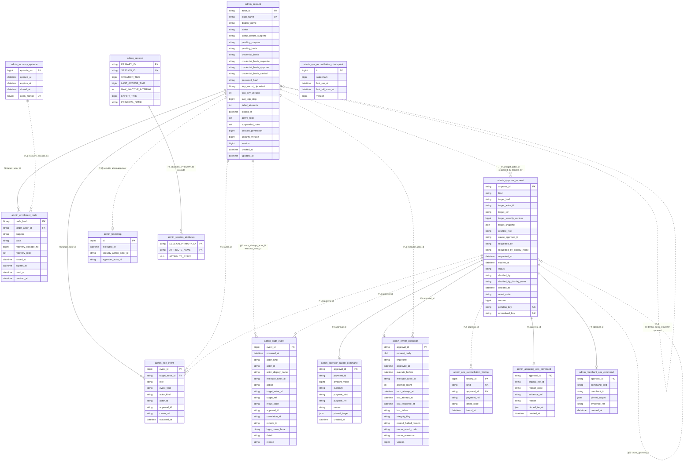

> 검증: paycore_admin schema from Demo MySQL 8.4.11 컨테이너 `paycore-demo-mysql-1`(compose project paycore-demo, `~/paycore-demo/db.sh`로 기동)의 information_schema·mysql 권한 표 추출, 2026-11-11T00:32:21+09:00. 적용 migration: flyway_schema_history 전 버전 success=1, 각 행 checksum이 HEAD 1b5538d의 파일 CRC32와 모두 일치(86/86).

# ADMIN DB 테이블 명세서 (초안)

초안은 git HEAD 89c6fac + 당시 미커밋 migration(MASTER V9/V10, ADMIN V9/V10) 기준이었다. 이 파일들은 이후 커밋 1b5538d에 포함됐고, 검증본은 HEAD 1b5538d 기준이며 그 migration도 포함했다. 이 문서는 ADMIN migration V1~V10을 버전 순서대로 모두 적용한 **최종 스키마**를 정리한다. 용도 설명은 SQL 주석, JPA Entity, `docs/repository` 명세를 근거로 했고, 근거가 없는 부분은 "확인 못함"으로 적었다.

- 작성일: 2026-11-10
- 소유 앱: `apps/internal-admin` (DB 이름 `paycore_admin` — `docker/mysql/init/01-owned-databases.sh`, D-ADMIN-005)
- DBMS: MySQL 8.4 (InnoDB, 기본 `utf8mb4` / `utf8mb4_0900_bin`, 시각은 `DATETIME(3)` UTC)
- Flyway locations: `classpath:db/migration/admin,classpath:db/runtime-privilege/admin` (두 디렉터리의 버전이 한 순서로 섞인다: 홀수 = schema, 짝수 = runtime 권한)
- migration 범위: V1 ~ V10
- `application.yml` 변경(초안 시 working tree, 현재 1b5538d에 커밋됨): `paycore.admin.merchant-ops.approval.*`(execution-window 1h, deadline-grace 2m, backoff-initial 30s, backoff-max 30m, master-max-execution-window 24h — Demo 값) 추가뿐이다. **`spring.flyway` 설정은 바뀌지 않았다.**

### migration 파일 목록

| 버전 | 파일 경로 | 종류 | 요약 | 커밋 여부 |
|---|---|---|---|---|
| V1 | `apps/internal-admin/src/main/resources/db/migration/admin/V1__admin_core.sql` | schema | 계정·역할 이벤트·등록 코드·승인 요청·감사·부트스트랩·복구 회차 7개 표 생성 (ADMIN-BOOT-001) | 커밋됨 |
| V2 | `apps/internal-admin/src/main/resources/db/runtime-privilege/admin/V2__admin_runtime_privileges.sql` | 권한 | V1 표의 runtime 표 단위·열 단위 권한 | 커밋됨 |
| V3 | `apps/internal-admin/src/main/resources/db/migration/admin/V3__admin_session.sql` | schema | Spring Session JDBC 표 2개(`admin_session`, `admin_session_attributes`) | 커밋됨 |
| V4 | `apps/internal-admin/src/main/resources/db/runtime-privilege/admin/V4__admin_session_runtime_privileges.sql` | 권한 | 세션 표 2개 전체 DML | 커밋됨 |
| V5 | `apps/internal-admin/src/main/resources/db/migration/admin/V5__owner_service_approval.sql` | schema | 승인 요청에 대상 종류·`target_ref`·`unresolved_key` 추가, 운영자 보정 취소 명령·실행 행·대사 checkpoint·대사 발견 표 생성, 감사에 `target_ref` 추가 (ADMIN-PAYMENT-OPS-001) | 커밋됨 |
| V6 | `apps/internal-admin/src/main/resources/db/runtime-privilege/admin/V6__owner_service_approval_privileges.sql` | 권한 | V5 새 표 권한 | 커밋됨 |
| V7 | `apps/internal-admin/src/main/resources/db/migration/admin/V7__acquiring_ops_approval.sql` | schema | 재매입 승인 종류(`ACQ_REACQUISITION`)·대상 `ACQUISITION_FILE` CHECK 확장, `unresolved_key` 식 확장, 지문 `acd1` 허용, 재매입 명령 표 생성 (ACQ-ADMIN-001) | 커밋됨 |
| V8 | `apps/internal-admin/src/main/resources/db/runtime-privilege/admin/V8__acquiring_ops_approval_privileges.sql` | 권한 | 재매입 명령 표 INSERT-only | 커밋됨 |
| V9 | `apps/internal-admin/src/main/resources/db/migration/admin/V9__merchant_ops_approval.sql` | schema | 가맹점 승인 종류 2개·대상 `MERCHANT` CHECK 확장, `unresolved_key`에 `MERCHANT:` 추가, 지문 `mop1` 허용, 대사 발견 종류 `OWNER_UNRESOLVABLE` 추가, 가맹점 명령 표 생성 (MERCHANT-OPS-002 B2-2) | 커밋됨(1b5538d) |
| V10 | `apps/internal-admin/src/main/resources/db/runtime-privilege/admin/V10__merchant_ops_approval_privileges.sql` | 권한 | 가맹점 명령 표 INSERT-only | 커밋됨(1b5538d) |

---

## 1. 테이블 목록

| 테이블 | 용도 | 도입 버전 | 변경 버전 |
|---|---|---|---|
| `admin_account` | 관리자 계정(Aggregate root): 로그인 이름, 상태, 비밀번호 해시, TOTP 암호문, 현재 역할 집합 | V1 | — |
| `admin_role_event` | 역할 부여·회수·정지·재활성 이벤트(append-only, 이력 원천) | V1 | — |
| `admin_enrollment_code` | 1회용 등록·재설정·복구 코드(SHA-256만 저장) | V1 | — |
| `admin_approval_request` | 2인 승인 요청(계정·Payment·매입 파일·가맹점 대상) | V1 | V5, V7, V9 |
| `admin_audit_event` | 관리자 감사(append-only) | V1 | V5 |
| `admin_bootstrap` | 부트스트랩 1회 실행 고정 행(id = 1) | V1 | — |
| `admin_recovery_episode` | 오프라인 복구 회차(열린 회차는 하나) | V1 | — |
| `admin_session` | Spring Session JDBC 세션 | V3 | — |
| `admin_session_attributes` | Spring Session JDBC 세션 속성 | V3 | — |
| `admin_operator_cancel_command` | 운영자 보정 취소 요청 고정 값(INSERT-only) | V5 | — |
| `admin_owner_execution` | 소유 서비스(PAYMENT·FINANCIAL·MASTER) 실행 행: 저장 본문·지문·재시도 상태 | V5 | V7, V9 |
| `admin_ops_reconciliation_checkpoint` | 운영 결정 대사 checkpoint(단일 행 id = 1) | V5 | — |
| `admin_ops_reconciliation_finding` | 운영 대사 발견(INSERT-only) | V5 | V9 |
| `admin_acquiring_ops_command` | 재매입 요청 고정 값(INSERT-only) | V7 | — |
| `admin_merchant_ops_command` | 가맹점 승인 요청 고정 값(INSERT-only) | V9 | — |

총 15개 표. (Flyway가 만드는 `flyway_schema_history`는 제외.)

---

## 2. 테이블 상세

### 2.1 `admin_account`

용도: 관리자 계정. actor ID = `adm_` + ULID(불변·재사용 금지 — DELETE 권한 없음), login_name 변경 기능 없음. 현재 활성·정지 역할 집합은 `admin_role_event`와 같은 TX에서 갱신하는 현재값이다. JPA: `JpaAdminAccountEntity`.

| 컬럼명 | 타입 | NULL | 기본값 | 키 | 설명 |
|---|---|---|---|---|---|
| actor_id | VARCHAR(30) | NOT NULL | — | PK | `adm_` + ULID |
| login_name | VARCHAR(64) | NOT NULL | — | UK | 로그인 이름(생성 불변) |
| display_name | VARCHAR(100) | NOT NULL | — | | 표시명 |
| status | VARCHAR(24) | NOT NULL | — | | 계정 상태 |
| status_before_suspend | VARCHAR(24) | NULL | — | | 정지 직전 상태(정지 해제 때 돌아갈 상태) |
| pending_purpose | VARCHAR(24) | NULL | — | | 등록 대기 사유 |
| pending_basis | VARCHAR(40) | NULL | — | | 대기 코드의 발급 근거(`enc_…`, `apr_…`, `episode:<n>`) |
| credential_basis | VARCHAR(40) | NOT NULL | — | | 현재 자격을 만든 코드의 발급 근거 ID |
| credential_basis_requester | VARCHAR(30) | NULL | — | | 발급 근거 요청자 actor ID(논리 참조) |
| credential_basis_approver | VARCHAR(30) | NULL | — | | 발급 근거 승인자 actor ID(논리 참조) |
| credential_basis_carried | VARCHAR(1000) | NULL | — | | ENROLL 재발급 시 등록 완료 전까지 배제할 이전 발급자들(쉼표 구분, 최대 32명) |
| password_hash | VARCHAR(100) | NULL | — | | BCrypt 해시(값은 비밀 — 생략) |
| totp_secret_ciphertext | VARBINARY(64) | NULL | — | | TOTP 비밀 암호문(AES-GCM, 비밀 값 — 생략) |
| totp_key_version | INT | NULL | — | | TOTP 암호 키 버전 |
| last_totp_step | BIGINT | NULL | — | | 마지막으로 소비한 TOTP step(재사용 방지) |
| failed_attempts | INT | NOT NULL | — | | 로그인 실패 횟수 |
| locked_at | DATETIME(3) | NULL | — | | 잠금 시각 |
| active_roles | SET('VIEWER','OPERATOR','APPROVER','SECURITY_ADMIN','UNMASK') | NOT NULL | — | | 현재 활성 역할 |
| suspended_roles | SET('VIEWER','OPERATOR','APPROVER','SECURITY_ADMIN','UNMASK') | NOT NULL | — | | 정지된 역할 |
| session_generation | BIGINT | NOT NULL | — | | 세션 세대(세션 무효화 권위 값) |
| security_version | BIGINT | NOT NULL | — | | 보안 버전(승인 요청의 대상 버전 비교에 사용) |
| version | BIGINT | NOT NULL | — | | 낙관적 잠금 버전 |
| created_at | DATETIME(3) | NOT NULL | — | | 생성 시각(생성 불변) |
| updated_at | DATETIME(3) | NOT NULL | — | | 수정 시각 |

- 인덱스·UNIQUE: `pk_admin_account (actor_id)`, `uk_admin_account_login_name (login_name)`
- CHECK:
  - `ck_admin_account_status`: status ∈ {`PENDING_ENROLLMENT`, `ACTIVE`, `LOCKED`, `SUSPENDED`}
  - `ck_admin_account_status_before_suspend`: NULL 또는 {`PENDING_ENROLLMENT`, `ACTIVE`, `LOCKED`}
  - `ck_admin_account_pending_purpose`: NULL 또는 {`ENROLL`, `PASSWORD_RESET`, `TOTP_REENROLL`, `RECOVERY`}
  - `ck_admin_account_counters`: failed_attempts, session_generation, security_version, version ≥ 0
  - `ck_admin_account_pending_pair`: pending_purpose와 pending_basis는 함께 NULL이거나 함께 값 있음
  - `ck_admin_account_pending_status`: pending_purpose가 있으면 status = `PENDING_ENROLLMENT`
  - `ck_admin_account_suspend_pair`: (status = `SUSPENDED`) ⇔ (status_before_suspend IS NOT NULL)
  - `ck_admin_account_credential_basis`: pending_basis가 있으면 pending_basis = credential_basis
  - `ck_admin_account_credential_issuers`: approver가 있으면 requester도 있고 approver ≠ requester
  - `ck_admin_account_credential_not_self`: requester·approver는 자기 자신(actor_id)이 아님
- FK: 없음(다른 표가 이 표를 참조)
- 권한(runtime): 표 단위 SELECT, INSERT + 열 단위 UPDATE(`actor_id`, `login_name`, `created_at` **제외** 모든 열 — 3회 나눠 부여). DELETE 없음. 트리거 없음.

### 2.2 `admin_role_event`

용도: 역할 이벤트 **append-only** 이력 원천. `cause_ref` = 재설정 승인 ID 또는 복구 회차. JPA: `JpaAdminRoleEventEntity`(`@Immutable`).

| 컬럼명 | 타입 | NULL | 기본값 | 키 | 설명 |
|---|---|---|---|---|---|
| event_id | BIGINT | NOT NULL | AUTO_INCREMENT | PK | 이벤트 ID |
| target_actor_id | VARCHAR(30) | NOT NULL | — | FK | 대상 계정 |
| role | VARCHAR(16) | NOT NULL | — | | 역할 |
| event_type | VARCHAR(16) | NOT NULL | — | | 이벤트 종류 |
| actor_kind | VARCHAR(20) | NOT NULL | — | | 행위자 종류 |
| actor_id | VARCHAR(30) | NULL | — | | 행위자 actor ID(논리 참조) |
| approval_id | VARCHAR(30) | NULL | — | | 근거 승인 ID(논리 참조) |
| cause_ref | VARCHAR(40) | NULL | — | | 원인 참조(재설정 승인 ID 또는 복구 회차) |
| occurred_at | DATETIME(3) | NOT NULL | — | | 발생 시각 |

- 인덱스: `pk_admin_role_event (event_id)`, `ix_admin_role_event_target (target_actor_id, event_id)`
- CHECK: role ∈ {`VIEWER`, `OPERATOR`, `APPROVER`, `SECURITY_ADMIN`, `UNMASK`}; event_type ∈ {`GRANT`, `REVOKE`, `SUSPEND`, `REACTIVATE`}; actor_kind ∈ {`ADMIN`, `SYSTEM_BOOTSTRAP`, `SYSTEM_RECOVERY`}
- FK: `fk_admin_role_event_target`: target_actor_id → `admin_account(actor_id)` (ON DELETE/UPDATE 지정 없음 = RESTRICT/NO ACTION)
- 권한: SELECT, INSERT만 — **append-only**(UPDATE·DELETE·잠금 읽기 1142). 트리거 없음.

### 2.3 `admin_enrollment_code`

용도: 1회용 등록 코드. 원문은 저장하지 않고 SHA-256만 PK. 대상당 활성 코드 1개는 발급 TX가 이전 코드를 `revoked_at`으로 폐기해 지킨다. 소비는 조건부 원자 UPDATE(`… WHERE used_at IS NULL AND revoked_at IS NULL AND expires_at > ?`). JPA: `JpaEnrollmentCodeEntity`.

| 컬럼명 | 타입 | NULL | 기본값 | 키 | 설명 |
|---|---|---|---|---|---|
| code_hash | BINARY(32) | NOT NULL | — | PK | 코드 SHA-256(원문 없음) |
| target_actor_id | VARCHAR(30) | NOT NULL | — | FK | 대상 계정 |
| purpose | VARCHAR(24) | NOT NULL | — | | 목적 |
| basis | VARCHAR(40) | NOT NULL | — | | 발급 근거(`enc_…`/`apr_…`/`episode:<n>`) |
| recovery_episode_no | BIGINT | NULL | — | | 복구 회차 번호(논리 참조) |
| recovery_roles | SET('SECURITY_ADMIN','APPROVER') | NULL | — | | 복구 시점 SA·APPROVER 보유 집합(RECOVERY 코드에만) |
| issued_at | DATETIME(3) | NOT NULL | — | | 발급 시각 |
| expires_at | DATETIME(3) | NOT NULL | — | | 만료 시각 |
| used_at | DATETIME(3) | NULL | — | | 사용 시각 |
| revoked_at | DATETIME(3) | NULL | — | | 폐기 시각 |

- 인덱스: `pk_admin_enrollment_code (code_hash)`, `ix_admin_enrollment_code_target (target_actor_id)`, `ix_admin_enrollment_code_episode (recovery_episode_no)`
- CHECK: purpose ∈ {`ENROLL`, `PASSWORD_RESET`, `TOTP_REENROLL`, `RECOVERY`}; `ck_…_recovery`: purpose = `RECOVERY`이면 recovery_episode_no·recovery_roles NOT NULL; `ck_…_recovery_roles`: recovery_roles는 RECOVERY에만. (역방향 — 회차 번호 ⇒ RECOVERY — 은 두지 않음: 복구 작업 B의 ENROLL 코드도 회차 번호를 기록)
- FK: `fk_admin_enrollment_code_target`: target_actor_id → `admin_account(actor_id)` (ON DELETE 지정 없음)
- 권한: SELECT, INSERT + 열 단위 UPDATE(`used_at`, `revoked_at`만). DELETE 없음.

### 2.4 `admin_approval_request`

용도: 2인 승인 요청. ADMIN 소유 6종(계정 대상)과 소유 서비스 4종(PAYMENT·FINANCIAL·MASTER가 실행)을 한 표에 둔다. 같은 (종류, 계정 대상) PENDING은 하나(`pending_key`), Payment·매입 파일·가맹점 대상은 미해결 승인 하나(`unresolved_key`). 대상 FK는 의도적으로 두지 않는다(S 잠금으로 인한 1213 교착 — SQL 주석). JPA: `JpaApprovalRequestEntity`(생성 열 2개는 매핑하지 않음).

| 컬럼명 | 타입 | NULL | 기본값 | 키 | 설명 |
|---|---|---|---|---|---|
| approval_id | VARCHAR(30) | NOT NULL | — | PK | `apr_` + ULID |
| kind | VARCHAR(40) | NOT NULL | — | | 승인 종류 |
| target_kind | VARCHAR(16) | NOT NULL | 없음(V5에서 기존 행을 `ADMIN_ACCOUNT`로 채운 뒤 DROP DEFAULT) | | 대상 종류 |
| target_actor_id | VARCHAR(30) | NULL (V5에서 NOT NULL → NULL) | — | | 계정 대상 actor ID(논리 참조) |
| target_ref | VARCHAR(64) | NULL | — | | 계정 외 대상 ID: paymentId / 매입 원 파일 ID / merchantId |
| target_security_version | BIGINT | NOT NULL | — | | 대상 버전(계정 = security_version, Payment = balanceRevision, 파일·가맹점 = 0) |
| target_snapshot | JSON | NOT NULL | — | | 대상 스냅샷(소유 서비스 종류는 명령 표 `pinned_target`의 표시용 사본) |
| granted_role | VARCHAR(16) | NULL | — | | ROLE_GRANT 대상 역할 |
| cause_approval_id | VARCHAR(30) | NULL | — | | 원인 승인 ID(ROLE_REACTIVATE — 논리 참조) |
| requested_by | VARCHAR(30) | NOT NULL | — | | 요청자 actor ID(논리 참조) |
| requested_by_display_name | VARCHAR(100) | NOT NULL | — | | 요청자 표시명 |
| requested_at | DATETIME(3) | NOT NULL | — | | 요청 시각 |
| expires_at | DATETIME(3) | NOT NULL | — | | 만료 시각 |
| status | VARCHAR(20) | NOT NULL | — | | 상태 |
| decided_by | VARCHAR(30) | NULL | — | | 결정자 actor ID(논리 참조) |
| decided_by_display_name | VARCHAR(100) | NULL | — | | 결정자 표시명 |
| decided_at | DATETIME(3) | NULL | — | | 결정 시각 |
| result_code | VARCHAR(48) | NULL | — | | 결과 코드 |
| version | BIGINT | NOT NULL | — | | 낙관적 잠금 버전 |
| pending_key | VARCHAR(80) | (생성 열) | GENERATED STORED: status = `PENDING`이면 `CONCAT(kind, ':', target_actor_id)`, 아니면 NULL | UK | 계정 대상 중복 PENDING 차단(Payment 등은 target_actor_id NULL이라 NULL) |
| unresolved_key | VARCHAR(80) | (생성 열) | GENERATED STORED(V9 최종 식): status ∈ {PENDING, EXECUTING, EXECUTION_UNKNOWN}이면 target_kind별 `PAYMENT:<ref>` / `ACQFILE:<ref>` / `MERCHANT:<ref>`, 아니면 NULL | UK | 대상당 미해결 승인 하나 |

- 인덱스·UNIQUE: `pk_admin_approval_request (approval_id)`, `uk_admin_approval_request_pending (pending_key)`, `uk_admin_approval_request_unresolved (unresolved_key)`, `ix_admin_approval_request_status (status, expires_at)`, `ix_admin_approval_request_target (target_actor_id)`, `ix_admin_approval_request_requester (requested_by, requested_at)`, `ix_admin_approval_request_target_ref (target_kind, target_ref)`
- CHECK(최종 — V9):
  - `ck_admin_approval_request_kind`: kind ∈ {`ROLE_GRANT`, `ACCOUNT_UNLOCK`, `ACCOUNT_REACTIVATE`, `TOTP_REENROLL`, `PASSWORD_RESET`, `ROLE_REACTIVATE`, `OPERATOR_CORRECTION_CANCEL`, `ACQ_REACQUISITION`, `MERCHANT_CONTRACT_APPROVAL`, `MERCHANT_FIRST_MID_ISSUANCE`}
  - `ck_admin_approval_request_status`(V5): status ∈ {`PENDING`, `EXECUTING`, `EXECUTION_UNKNOWN`, `EXECUTED`, `REJECTED`, `WITHDRAWN`, `EXPIRED`, `INVALIDATED`, `OWNER_REJECTED`} (`APPROVED`는 쓰지 않음 — I-20)
  - `ck_admin_approval_request_granted_role`: NULL 또는 역할 5종
  - `ck_admin_approval_request_target`: 다음 넷 중 하나
    - `ADMIN_ACCOUNT`: kind가 소유 서비스 4종이 아님, target_actor_id NOT NULL, target_ref NULL
    - `PAYMENT`: kind = `OPERATOR_CORRECTION_CANCEL`, target_actor_id NULL, target_ref NOT NULL
    - `ACQUISITION_FILE`: kind = `ACQ_REACQUISITION`, target_actor_id NULL, target_security_version = 0, target_ref ~ `^ACQ[.][A-Z0-9]{1,32}[.](TEST|LIVE)[.][0-9]{8}[.][0-9]{3}$`
    - `MERCHANT`: kind ∈ {`MERCHANT_CONTRACT_APPROVAL`, `MERCHANT_FIRST_MID_ISSUANCE`}, target_actor_id NULL, target_security_version = 0, target_ref ~ `^mer_[0-9A-HJKMNP-TV-Z]{26}$`
  - `ck_admin_approval_request_owner_states`: status ∈ {EXECUTING, EXECUTION_UNKNOWN}이면 kind는 소유 서비스 4종(`OPERATOR_CORRECTION_CANCEL`, `ACQ_REACQUISITION`, `MERCHANT_CONTRACT_APPROVAL`, `MERCHANT_FIRST_MID_ISSUANCE`)
- FK: 없음(대상·요청자 FK를 의도적으로 두지 않음 — V1 주석). 이 표를 참조하는 FK는 명령 표 3개·실행 행.
- 권한: SELECT, INSERT + 열 단위 UPDATE(`status`, `decided_by`, `decided_by_display_name`, `decided_at`, `result_code`, `version`만). V5 이후 추가 열(`target_kind`, `target_ref`)도 생성 불변(UPDATE 1143). DELETE 없음.
- 변경 이력: V5(대상 종류·target_ref·unresolved_key·CHECK 확장), V7(재매입 종류·파일 대상), V9(가맹점 종류·대상).

### 2.5 `admin_audit_event`

용도: 관리자 감사 **append-only**. 비밀번호·코드·시크릿·세션 ID·CSRF 토큰을 담지 않는다. 미인증 시도의 login_name은 HMAC-SHA256으로만 남긴다. JPA: `JpaAdminAuditEventEntity`(`@Immutable`).

| 컬럼명 | 타입 | NULL | 기본값 | 키 | 설명 |
|---|---|---|---|---|---|
| event_id | BIGINT | NOT NULL | AUTO_INCREMENT | PK | 이벤트 ID |
| occurred_at | DATETIME(3) | NOT NULL | — | | 발생 시각 |
| actor_kind | VARCHAR(20) | NOT NULL | — | | 행위자 종류 |
| actor_id | VARCHAR(30) | NULL | — | | 행위자 actor ID(논리 참조) |
| actor_display_name | VARCHAR(100) | NULL | — | | 행위자 표시명 |
| executor_actor_id | VARCHAR(30) | NULL | — | | 실행자 actor ID(논리 참조) |
| action | VARCHAR(48) | NOT NULL | — | | 동작 코드 |
| target_actor_id | VARCHAR(30) | NULL | — | | 대상 계정(논리 참조) |
| target_ref | VARCHAR(64) | NULL | — | | (V5) 계정 외 대상: paymentId / 파일 ID / merchantId |
| result_code | VARCHAR(48) | NOT NULL | — | | 결과 코드 |
| approval_id | VARCHAR(30) | NULL | — | | 관련 승인 ID(논리 참조) |
| correlation_id | VARCHAR(64) | NOT NULL | — | | 상관 ID |
| remote_ip | VARCHAR(45) | NULL | — | | 원격 IP |
| login_name_hmac | BINARY(32) | NULL | — | | 미인증 시도 login_name의 HMAC |
| detail | VARCHAR(500) | NULL | — | | 고정 요약(자유 문구 없음) |
| reason | VARCHAR(500) | NULL | — | | 마스킹 해제 사유(UNMASK 행에만) |

- 인덱스: `pk_admin_audit_event (event_id)`, `ix_admin_audit_event_actor (actor_id, event_id)`, `ix_admin_audit_event_time (occurred_at, event_id)`
- CHECK: actor_kind ∈ {`ADMIN`, `ANONYMOUS`, `SYSTEM_BOOTSTRAP`, `SYSTEM_RECOVERY`, `SYSTEM_JOB`}
- FK: 없음
- 권한: SELECT, INSERT만 — **append-only**. 트리거 없음.

### 2.6 `admin_bootstrap`

용도: 부트스트랩 1회성 고정 행. 계정 생성과 같은 TX에 INSERT, 동시 실행 패자는 PK 1062. JPA Entity 없음 — `JpaBootstrapStore`가 native INSERT. ADMIN-BOOT-002(두 번째 SA)는 이 표 열을 바꾸지 않았다(SA-B는 감사·역할 이벤트로 추적).

| 컬럼명 | 타입 | NULL | 기본값 | 키 | 설명 |
|---|---|---|---|---|---|
| id | TINYINT | NOT NULL | — | PK | 항상 1 |
| executed_at | DATETIME(3) | NOT NULL | — | | 실행 시각 |
| security_admin_actor_id | VARCHAR(30) | NOT NULL | — | | 부트스트랩 SA(SA-A) actor ID(논리 참조) |
| approver_actor_id | VARCHAR(30) | NOT NULL | — | | 부트스트랩 APPROVER actor ID(논리 참조) |

- CHECK: `ck_admin_bootstrap_single_row`: id = 1
- FK: 없음
- 권한: SELECT, INSERT만 — **append-only**.
- seed: migration에 계정·부트스트랩 행 INSERT는 없다. 부트스트랩은 1회성 명령(`OneShotCommandRunner`)이 런타임에 수행한다. 계정 비밀번호·코드 값: (비밀 값 — 생략).

### 2.7 `admin_recovery_episode`

용도: 오프라인 복구 회차. 열린 회차는 하나(`open_marker` UNIQUE — 닫히면 NULL). JPA Entity 없음 — `JpaRecoveryEpisodeStore`가 native SQL.

| 컬럼명 | 타입 | NULL | 기본값 | 키 | 설명 |
|---|---|---|---|---|---|
| episode_no | BIGINT | NOT NULL | — | PK | 회차 번호(`MAX + 1`로 앱이 채번) |
| opened_at | DATETIME(3) | NOT NULL | — | | 시작 시각 |
| expires_at | DATETIME(3) | NOT NULL | — | | 만료 시각 |
| closed_at | DATETIME(3) | NULL | — | | 종료 시각 |
| open_marker | TINYINT | (생성 열) | GENERATED STORED: closed_at IS NULL이면 1, 아니면 NULL | UK | 열린 회차 하나 |

- 인덱스·UNIQUE: `pk_admin_recovery_episode (episode_no)`, `uk_admin_recovery_episode_open (open_marker)`
- CHECK: 없음 / FK: 없음
- 권한: SELECT, INSERT + 열 단위 UPDATE(`closed_at`만).

### 2.8 `admin_session`

용도: Spring Session JDBC 세션 표(Spring Session 4.1.1 `schema-mysql.sql` 열 그대로, 표 이름만 소문자). 업무 사실이 아니다(세션 무효화 권위는 `admin_account.session_generation`). Hibernate·jOOQ 대상 아님.

| 컬럼명 | 타입 | NULL | 기본값 | 키 | 설명 |
|---|---|---|---|---|---|
| PRIMARY_ID | CHAR(36) | NOT NULL | — | PK | 내부 PK |
| SESSION_ID | CHAR(36) | NOT NULL | — | UK | 세션 ID |
| CREATION_TIME | BIGINT | NOT NULL | — | | 생성 시각(epoch ms) |
| LAST_ACCESS_TIME | BIGINT | NOT NULL | — | | 마지막 접근 |
| MAX_INACTIVE_INTERVAL | INT | NOT NULL | — | | 최대 비활성 초 |
| EXPIRY_TIME | BIGINT | NOT NULL | — | | 만료 시각 |
| PRINCIPAL_NAME | VARCHAR(100) | NULL | — | | principal 이름(어떤 값이 들어가는지 — actor ID인지 등 — 확인 못함) |

- 인덱스: `pk_admin_session (PRIMARY_ID)`, `uk_admin_session_session_id (SESSION_ID)`, `ix_admin_session_expiry (EXPIRY_TIME)`, `ix_admin_session_principal (PRINCIPAL_NAME)`
- 권한: SELECT, INSERT, UPDATE, DELETE(전체 DML — 만료 정리 cron이 DELETE). `ROW_FORMAT = DYNAMIC`.

### 2.9 `admin_session_attributes`

용도: Spring Session JDBC 세션 속성.

| 컬럼명 | 타입 | NULL | 기본값 | 키 | 설명 |
|---|---|---|---|---|---|
| SESSION_PRIMARY_ID | CHAR(36) | NOT NULL | — | PK, FK | 세션 내부 PK |
| ATTRIBUTE_NAME | VARCHAR(200) | NOT NULL | — | PK | 속성 이름 |
| ATTRIBUTE_BYTES | BLOB | NOT NULL | — | | 직렬화 값 |

- PK: `(SESSION_PRIMARY_ID, ATTRIBUTE_NAME)`
- FK: `fk_admin_session_attributes_session`: SESSION_PRIMARY_ID → `admin_session(PRIMARY_ID)` **ON DELETE CASCADE** (ADMIN DB의 유일한 CASCADE)
- 권한: SELECT, INSERT, UPDATE, DELETE.

### 2.10 `admin_operator_cancel_command`

용도: 운영자 보정 취소(`OPERATOR_CORRECTION_CANCEL`) 요청 고정 값(INSERT-only). `pinned_target`이 승인 TX1 비교의 권위 값. 사유·근거는 여기에만 저장(로그·지표·감사 detail에 없음). JPA: `JpaOperatorCancelCommandEntity`(`@Immutable`).

| 컬럼명 | 타입 | NULL | 기본값 | 키 | 설명 |
|---|---|---|---|---|---|
| approval_id | VARCHAR(30) | NOT NULL | — | PK, FK | 승인 ID |
| payment_id | VARCHAR(64) | NOT NULL | — | | 대상 Payment ID(PAYMENT DB — 논리 참조) |
| amount_minor | BIGINT | NOT NULL | — | | 취소 금액(최소 단위) |
| currency | CHAR(3) | NOT NULL | — | | 통화 |
| purpose_kind | VARCHAR(40) | NOT NULL | — | | 목적 종류 |
| purpose_ref | VARCHAR(200) | NOT NULL | — | | 목적 근거 참조 |
| reason | VARCHAR(500) | NOT NULL | — | | 사유(자유 문구) |
| pinned_target | JSON | NOT NULL | — | | 고정 대상(권위 값) |
| created_at | DATETIME(3) | NOT NULL | — | | 생성 시각 |

- CHECK: amount_minor > 0; currency ~ `^[A-Z]{3}$`; purpose_kind ∈ {`INCIDENT_OR_RECON_CORRECTION`, `MERCHANT_TERMINATED_OBLIGATION`}
- FK: `fk_admin_operator_cancel_command_approval`: approval_id → `admin_approval_request(approval_id)` (ON DELETE 지정 없음)
- 권한: SELECT, INSERT만 — INSERT-only.

### 2.11 `admin_owner_execution`

용도: 소유 서비스 실행 행(승인 TX1이 INSERT). 저장 본문을 바이트 그대로 재전송하고, 시도·응답·무결성 상태를 기록한다. JPA: `JpaOwnerExecutionEntity`(`@Version`).

| 컬럼명 | 타입 | NULL | 기본값 | 키 | 설명 |
|---|---|---|---|---|---|
| approval_id | VARCHAR(30) | NOT NULL | — | PK, FK | 승인 ID |
| request_body | MEDIUMBLOB | NOT NULL | — | | 저장 본문(불변, 재전송은 이 바이트 그대로) |
| fingerprint | VARCHAR(69) | NOT NULL | — | | 지문(`oct1:`/`acd1:`/`mop1:` + 64 hex) |
| approved_at | DATETIME(3) | NOT NULL | — | | 승인 시각(불변) |
| execute_before | DATETIME(3) | NOT NULL | — | | 실행 기한(불변) |
| executor_actor_id | VARCHAR(30) | NOT NULL | — | | 실행자 = 승인자(불변, 논리 참조) |
| attempt_count | INT | NOT NULL | — | | 보낸 명령 수 |
| next_attempt_at | DATETIME(3) | NOT NULL | — | | 다음 시도 시각 |
| last_attempt_at | DATETIME(3) | NULL | — | | 마지막 시도 |
| last_response_at | DATETIME(3) | NULL | — | | 마지막 응답 |
| last_failure | VARCHAR(48) | NULL | — | | 마지막 실패 분류 |
| integrity_flag | VARCHAR(48) | NULL | — | | 무결성 플래그(한 번 서면 유지) |
| resend_halted_reason | VARCHAR(48) | NULL | — | | 재전송 중단 사유 |
| owner_result_code | VARCHAR(48) | NULL | — | | 소유 서비스 거절 코드 |
| owner_reference | VARCHAR(64) | NULL | — | | 소유 서비스 참조(`pcn_…` 취소 / 매입 파일 ID / `ctr_…#n` 계약 Revision / `mid_…` MID — 도메인 코드 기준, DB CHECK 없음) |
| version | BIGINT | NOT NULL | — | | `@Version` |

- 인덱스: `pk_admin_owner_execution (approval_id)`, `ix_admin_owner_execution_next (next_attempt_at)`
- CHECK: attempt_count ≥ 1; execute_before > approved_at; `ck_admin_owner_execution_fingerprint`(V9 최종): fingerprint ~ `^(oct1|acd1|mop1):[0-9a-f]{64}$` (V5 `oct1`, V7 `+acd1`, V9 `+mop1`)
- FK: `fk_admin_owner_execution_approval`: approval_id → `admin_approval_request(approval_id)` (ON DELETE 지정 없음)
- 권한: SELECT, INSERT + 열 단위 UPDATE(`attempt_count`, `next_attempt_at`, `last_attempt_at`, `last_response_at`, `last_failure`, `integrity_flag`, `resend_halted_reason`, `owner_result_code`, `owner_reference`, `version`). 불변 열(`request_body`, `fingerprint`, `approved_at`, `execute_before`, `executor_actor_id`) UPDATE 1143. DELETE 없음.

### 2.12 `admin_ops_reconciliation_checkpoint`

용도: 운영 결정 대사(PAYMENT 운영 결정 목록 증분 조회)의 checkpoint 단일 행. V5가 행 `(1, 0, NULL, NULL, 0)`을 INSERT한다. JPA: `JpaReconciliationCheckpointEntity`(`@Version`).

| 컬럼명 | 타입 | NULL | 기본값 | 키 | 설명 |
|---|---|---|---|---|---|
| id | TINYINT | NOT NULL | — | PK | 항상 1 |
| watermark | BIGINT | NOT NULL | — | | 증분 watermark |
| last_run_at | DATETIME(3) | NULL | — | | 마지막 실행 |
| last_full_scan_at | DATETIME(3) | NULL | — | | 마지막 전체 스캔 |
| version | BIGINT | NOT NULL | — | | `@Version` |

- CHECK: id = 1; watermark ≥ 0
- 권한: 표 단위 SELECT만 + 열 단위 UPDATE(`watermark`, `last_run_at`, `last_full_scan_at`, `version`). runtime INSERT·DELETE 없음(1142).

### 2.13 `admin_ops_reconciliation_finding`

용도: 운영 대사 발견(INSERT-only). UNIQUE(kind, approval_id)로 같은 발견을 반복 INSERT하지 않는다(1062 = 이미 기록됨). `ORPHAN_DECISION`은 ADMIN에 없는 approvalId일 수 있어 승인 FK가 없다. JPA: `JpaReconciliationFindingEntity`(`@Immutable`).

| 컬럼명 | 타입 | NULL | 기본값 | 키 | 설명 |
|---|---|---|---|---|---|
| finding_id | BIGINT | NOT NULL | AUTO_INCREMENT | PK | 발견 ID |
| kind | VARCHAR(32) | NOT NULL | — | UK(1) | 발견 종류 |
| approval_id | VARCHAR(64) | NOT NULL | — | UK(2) | 승인 ID(FK 없음 — 소유 서비스에만 있는 ID일 수 있음) |
| payment_ref | VARCHAR(64) | NULL | — | | 대상 참조(이름은 payment지만 `OWNER_UNRESOLVABLE`에서는 merchantId가 들어간다 — `MerchantOpsApprovalService`) |
| detail_code | VARCHAR(200) | NULL | — | | 상세 코드 |
| found_at | DATETIME(3) | NOT NULL | — | | 발견 시각 |

- 인덱스·UNIQUE: `pk_admin_ops_reconciliation_finding (finding_id)`, `uk_admin_ops_reconciliation_finding (kind, approval_id)`
- CHECK(V9 최종): kind ∈ {`ORPHAN_DECISION`, `FINGERPRINT_MISMATCH`, `STATE_DIVERGENCE`, `MISSING_DECISION`, `UNRESOLVED_WITH_DECISION`, `DECISION_FOR_UNAPPROVED`, `OWNER_UNRESOLVABLE`}(V9에서 `OWNER_UNRESOLVABLE` 추가)
- FK: 없음
- 권한: SELECT, INSERT만 — INSERT-only.

### 2.14 `admin_acquiring_ops_command`

용도: 재매입(`ACQ_REACQUISITION`) 요청 고정 값(INSERT-only). `pinned_target`(레코드별 세대·상태·예상 순액)이 승인 TX1 비교의 권위 값. 사유 문구는 여기에만(FINANCIAL에는 사유 코드·근거 참조만). 카드사 값 없음. JPA: `JpaAcquiringOpsCommandEntity`(`@Immutable`).

| 컬럼명 | 타입 | NULL | 기본값 | 키 | 설명 |
|---|---|---|---|---|---|
| approval_id | VARCHAR(30) | NOT NULL | — | PK, FK | 승인 ID |
| original_file_id | VARCHAR(64) | NOT NULL | — | | 원 매입 파일 ID(FINANCIAL — 논리 참조) |
| reason_code | VARCHAR(32) | NOT NULL | — | | 사유 코드 |
| evidence_ref | VARCHAR(128) | NOT NULL | — | | 근거 참조 |
| reason | VARCHAR(500) | NOT NULL | — | | 사유 문구 |
| pinned_target | JSON | NOT NULL | — | | 고정 대상(권위 값) |
| created_at | DATETIME(3) | NOT NULL | — | | 생성 시각 |

- CHECK: original_file_id ~ `^ACQ[.][A-Z0-9]{1,32}[.](TEST|LIVE)[.][0-9]{8}[.][0-9]{3}$`; reason_code ∈ {`INSTITUTION_CONFIRMED_ERROR`, `DATA_CORRECTED_AT_SOURCE`, `INSTITUTION_REQUESTED`}; evidence_ref ~ `^[A-Za-z0-9._:#/-]{1,128}$`
- FK: `fk_admin_acquiring_ops_command_approval`: approval_id → `admin_approval_request(approval_id)` (ON DELETE 지정 없음)
- 권한: SELECT, INSERT만 — INSERT-only.

### 2.15 `admin_merchant_ops_command` (V9)

용도: 가맹점 2인 승인(`MERCHANT_CONTRACT_APPROVAL`, `MERCHANT_FIRST_MID_ISSUANCE`) 요청 고정 값(INSERT-only). `pinned_target`(가맹점·계약·Revision·Scope·기간·등록자)이 승인 TX1 비교의 권위 값. `evidence_ref`는 여기에만 둔다(pinned·승인 행 사본·감사·로그·목록·상세에 없음 — APPROVER·요청자만 `/justification`). 사업자등록번호·채널 식별값·자유 문구 없음. JPA: `JpaMerchantOpsCommandEntity`(`@Immutable`, 1b5538d 커밋).

| 컬럼명 | 타입 | NULL | 기본값 | 키 | 설명 |
|---|---|---|---|---|---|
| approval_id | VARCHAR(30) | NOT NULL | — | PK, FK | 승인 ID |
| command_kind | VARCHAR(32) | NOT NULL | — | | 명령 종류 |
| merchant_id | VARCHAR(30) | NOT NULL | — | | 가맹점 ID(MASTER — 논리 참조) |
| pinned_target | JSON | NOT NULL | — | | 고정 대상(권위 값) |
| evidence_ref | VARCHAR(128) | NOT NULL | — | | 업무 근거 참조(필수 — D-MOPS-008 ①) |
| created_at | DATETIME(3) | NOT NULL | — | | 생성 시각 |

- CHECK: command_kind ∈ {`CONTRACT_APPROVAL`, `FIRST_MID_ISSUANCE`}; merchant_id ~ `^mer_[0-9A-HJKMNP-TV-Z]{26}$`; evidence_ref ~ `^[A-Za-z0-9._:#/-]{1,128}$`
- FK: `fk_admin_merchant_ops_command_approval`: approval_id → `admin_approval_request(approval_id)` (ON DELETE 지정 없음)
- 권한: SELECT, INSERT만 — INSERT-only (V10).

---

## 3. 권한 요약

DB 계정·role (`docker/mysql/init/01-owned-databases.sh`, 비밀번호는 환경변수 — (비밀 값 — 생략)):

| 계정/role | 권한 |
|---|---|
| `paycore_admin_migration`@'%' | `paycore_admin.*` ALL PRIVILEGES(GRANT OPTION 없음) + `paycore_admin_privilege`의 두 procedure EXECUTE. Flyway 전용(`spring.flyway.user`) |
| `paycore_admin`@'%' (runtime 계정) | DB 단위 권한 없음. 기본 role `paycore_admin_runtime`만 |
| `paycore_admin_runtime` (role) | 아래 표의 표 단위·열 단위 권한만 |
| `paycore_admin_grantor`@'localhost' | ACCOUNT LOCK. `paycore_admin.*` SELECT, INSERT, UPDATE, DELETE WITH GRANT OPTION. procedure DEFINER |

procedure: `paycore_admin_privilege.set_runtime_table_privileges(table, privileges)`(허용 집합으로 교체 — GRANT 후 여집합 REVOKE), `paycore_admin_privilege.grant_runtime_column_update(table, columns)`(열 UPDATE 부여, 1회 8열 상한).

runtime role(`paycore_admin_runtime`) 표별 권한:

| 테이블 | SELECT | INSERT | UPDATE | DELETE | 비고 | 부여 버전 |
|---|---|---|---|---|---|---|
| admin_account | O | O | 열 단위(actor_id·login_name·created_at 제외 전부) | X | | V2 |
| admin_role_event | O | O | X | X | append-only | V2 |
| admin_enrollment_code | O | O | 열 단위(used_at, revoked_at) | X | | V2 |
| admin_approval_request | O | O | 열 단위(status, decided_by, decided_by_display_name, decided_at, result_code, version) | X | | V2 |
| admin_audit_event | O | O | X | X | append-only | V2 |
| admin_bootstrap | O | O | X | X | append-only | V2 |
| admin_recovery_episode | O | O | 열 단위(closed_at) | X | | V2 |
| admin_session | O | O | O | O | 전체 DML | V4 |
| admin_session_attributes | O | O | O | O | 전체 DML | V4 |
| admin_operator_cancel_command | O | O | X | X | INSERT-only | V6 |
| admin_owner_execution | O | O | 열 단위(attempt_count, next_attempt_at, last_attempt_at, last_response_at, last_failure, integrity_flag, resend_halted_reason, owner_result_code, owner_reference, version) | X | | V6 |
| admin_ops_reconciliation_checkpoint | O | X | 열 단위(watermark, last_run_at, last_full_scan_at, version) | X | 행은 V5가 생성 | V6 |
| admin_ops_reconciliation_finding | O | O | X | X | INSERT-only | V6 |
| admin_acquiring_ops_command | O | O | X | X | INSERT-only | V8 |
| admin_merchant_ops_command | O | O | X | X | INSERT-only | V10 |

트리거: ADMIN migration에 트리거는 없다. append-only·INSERT-only는 DB 권한 + JPA `@Immutable`(해당 Entity가 있는 표) 두 겹으로 지킨다.

---

## 4. ERD (Mermaid)

실선 = DB FK, 점선 = FK 없는 논리 참조(같은 DB 안).

참고: FK 관계 중 명령 표·실행 행은 `approval_id`가 PK이자 FK라 1 : 0..1(`||--o|`)로 그렸다(실선). `admin_ops_reconciliation_checkpoint`는 다른 표와 관계가 없다.

---

## 5. 논리 참조 (FK 없음)

| 컬럼 | 참조 대상 | 근거 |
|---|---|---|
| admin_account.credential_basis_requester / credential_basis_approver | ADMIN `admin_account.actor_id` | V1 주석(D-ADMIN1-014·015), CHECK `ck_admin_account_credential_*` |
| admin_account.credential_basis, pending_basis | ADMIN `admin_approval_request.approval_id`(`apr_…`) 또는 발급 ID(`enc_…`) 또는 `episode:<n>`(`admin_recovery_episode.episode_no`) | `PendingEnrollment.kt`, `CredentialBasis.kt` 주석 |
| admin_role_event.actor_id | ADMIN `admin_account.actor_id` | V1 컬럼 의미, `JpaAdminRoleEventEntity` |
| admin_role_event.approval_id, cause_ref | ADMIN `admin_approval_request.approval_id` / 복구 회차 | V1 주석("원인 참조 = 재설정 승인 ID 또는 복구 회차") |
| admin_enrollment_code.basis | `enc_…` / `apr_…` / `episode:<n>` | `EnrollmentCodeStore.kt` 주석 |
| admin_enrollment_code.recovery_episode_no | ADMIN `admin_recovery_episode.episode_no` | V1 주석(§4.9.2), 인덱스 `ix_admin_enrollment_code_episode` |
| admin_approval_request.target_actor_id, requested_by, decided_by | ADMIN `admin_account.actor_id` | V1 주석(대상·요청자 FK 의도적 미설정 — S2 리뷰 M-1) |
| admin_approval_request.cause_approval_id | ADMIN `admin_approval_request.approval_id` | 컬럼 의미(`ApprovalKind.ROLE_REACTIVATE needsCause`) |
| admin_approval_request.target_ref (target_kind = PAYMENT) | PAYMENT DB의 paymentId | V5 주석 |
| admin_approval_request.target_ref (ACQUISITION_FILE) | FINANCIAL DB의 원 매입 파일 ID | V7 주석·CHECK |
| admin_approval_request.target_ref (MERCHANT) | MASTER DB의 merchantId(`mer_…`) | V9 주석·CHECK |
| admin_approval_request.target_security_version | 계정 `security_version` / PAYMENT balanceRevision / 0 | V5 주석(I-13), V7·V9 CHECK |
| admin_audit_event.actor_id, executor_actor_id, target_actor_id | ADMIN `admin_account.actor_id` | V1 컬럼 의미 |
| admin_audit_event.approval_id | ADMIN `admin_approval_request.approval_id` | V1 컬럼 의미 |
| admin_audit_event.target_ref | PAYMENT paymentId / FINANCIAL 파일 ID / MASTER merchantId | V5 주석, `MerchantOpsApprovalService` 주석("감사 target_ref = merchantId") |
| admin_bootstrap.security_admin_actor_id, approver_actor_id | ADMIN `admin_account.actor_id` | V1, ADMIN-BOOT-002 §5 |
| admin_session.PRINCIPAL_NAME | 확인 못함(관리자 식별값으로 추정되나 코드에서 설정 위치 확인 못함) | — |
| admin_operator_cancel_command.payment_id | PAYMENT DB의 paymentId | V5 |
| admin_owner_execution.executor_actor_id | ADMIN `admin_account.actor_id`(= 승인자) | V5 주석 |
| admin_owner_execution.owner_reference | PAYMENT 취소 ID(`pcn_…`) / FINANCIAL 파일 ID / MASTER 계약 Revision(`ctr_…#n`) / MASTER MID(`mid_…`) | `OwnerExecution.kt` 정규식 |
| admin_owner_execution.fingerprint | MASTER `admin_approval_evidence`의 지문(`mop1`), FINANCIAL 결정 내용 hash(`acd1`) — 값 대조용 | V7·V9 주석, MERCHANT-OPS-002 C-23 |
| admin_ops_reconciliation_finding.approval_id | ADMIN `admin_approval_request.approval_id` 또는 소유 서비스에만 있는 approvalId(ORPHAN) | V5 주석 |
| admin_ops_reconciliation_finding.payment_ref | PAYMENT paymentId, `OWNER_UNRESOLVABLE`에서는 MASTER merchantId | V5, `MerchantOpsApprovalService.kt:481` |
| admin_acquiring_ops_command.original_file_id | FINANCIAL DB의 원 매입 파일 ID | V7 |
| admin_merchant_ops_command.merchant_id | MASTER DB의 merchantId | V9 |

---

## 6. DB 간 연결

- **직접 SQL 접근 없음(확인)**: `application.yml`의 datasource는 ADMIN DB 하나(`PAYCORE_ADMIN_DB_URL`)뿐이고 주석에 "다른 소유 DB 접속 정보는 두지 않는다"고 적혀 있다. `apps/internal-admin/src/main/kotlin`에서 `paycore_master`·`paycore_payment`·`paycore_financial` 문자열 검색 결과 0건. DB 계정도 `paycore_admin_*`만 `paycore_admin`에 권한이 있다(init 스크립트 주석 "cross-DB 접근 금지").
- **연결 방식 = 서명된 HTTP 내부 채널**(`/internal/v1/admin/...`). 모든 gateway는 DB TX 안에서 호출되면 `IllegalStateException`(외부 호출은 TX 밖). 각 채널은 별도 키·permit.

| 대상 | adapter (근거 파일) | 용도·경로 |
|---|---|---|
| PAYMENT | `paymentops/adapter/integration/HttpPaymentOpsGateway.kt` (서명 `AdminCallSigner`) | 대상 조회 `GET /internal/v1/admin/payments/{id}/operator-cancel-target`, 실행 `POST /internal/v1/admin/operator-cancellations`, 결정 조회 `GET …/operator-cancellations/{approvalId}`, 기한 확인 `POST …/{approvalId}/deadline-confirmation`, 대사 `GET /internal/v1/admin/operator-decisions/after/{watermark}`, 거래 검색·상세 `/internal/v1/admin/payment-searches`, `/internal/v1/admin/payments/{id}` |
| FINANCIAL | `financialops/adapter/integration/HttpFinancialOpsGateway.kt` (조회 키와 조작 전용 키 분리 — `FinancialCallSigner`) | 매입 파일 검색·상세·레코드 `/internal/v1/admin/acquisition-file-searches`, `/internal/v1/admin/acquisition-files/...`, 재매입 대상 `…/{fileId}/reacquisition-targets`, 실행 `POST /internal/v1/admin/acquiring-operations/reacquisitions`, 결정 조회·기한 확인 `/internal/v1/admin/acquiring-operations/decisions/{approvalId}[/deadline-confirmation]` |
| MASTER | `merchantops/adapter/integration/HttpMasterOpsGateway.kt` (`MasterCallSigner`) | 검색·상세·이력 `/internal/v1/admin/merchant-searches`, `/internal/v1/admin/merchants/{id}[/history/after/{seq}]`, 등록 명령 `POST /internal/v1/admin/merchant-operations/{kind}`, 승인 실행 `POST …/merchant-operations/contract-revision-approvals`·`…/first-default-merchant-accounts`, 기한 확인 `…/approval-deadline-confirmations`, 결정 조회 `…/approval-decisions` (초안 시 미커밋 변경 — 1b5538d에 커밋됨) |

- **OWNER_SERVICE 2-TX 모델**(`approval/application/OwnerServiceApprovalService.kt`, `MerchantOpsApprovalService.kt`, 재매입은 `AcquiringOpsApprovalService`):
  1. A(TX 밖): 소유 서비스에서 대상 재조회(비권위).
  2. TX1(ADMIN 로컬 TX): 승인 행 잠금 → 판정·TOTP 소비·pinned vs 현재 비교 → 저장 본문·지문 생성 → `admin_owner_execution` INSERT → 승인 행 `EXECUTING` → 감사.
  3. C(TX 밖): 저장 바이트를 그대로 소유 서비스에 POST.
  4. TX2: 결과 반영(`OwnerOutcomeApplier` — 회복 job과 같은 규칙). TX2 실패·결과 불명이면 `EXECUTING`/`EXECUTION_UNKNOWN` 유지, 회복 job이 결정 조회 → 기한 확인 → 같은 바이트 재전송 순으로 수렴.
- 소유 서비스 쪽 짝: MASTER는 `V9__admin_approval_evidence.sql`의 `admin_approval_evidence` 표에 승인 근거(지문 `mop1`)를 저장한다 — ADMIN `admin_owner_execution.fingerprint`와 값 대조(MERCHANT-OPS-002 C-23). 키는 `mop1.<approvalId>`, 상관 ID `mop.<approvalId>`.

---

## 7. 애매한 점·문서와 SQL 불일치

1. **V1 주석 vs V5**: V1 `admin_approval_request` 주석은 소유 서비스 상태로 "APPROVED·EXECUTING·EXECUTION_UNKNOWN"을 나중에 넓힌다고 했지만, V5는 `APPROVED`를 쓰지 않는다(I-20)고 정하고 넣지 않았다. 최종 스키마에 `APPROVED` 없음(주석 간 불일치, 동작 문제 아님).
2. **V9 주석 "앱은 B2-3 전까지 `MERCHANT_FIRST_MID_ISSUANCE`를 만들지 않는다"**: working tree에는 이미 `MerchantApprovalOperation.ISSUE_FIRST_DEFAULT_MERCHANT_ACCOUNT`, `PinnedFirstMidTarget`, `MerchantFirstMidDomainSpec` 등 B2-3 코드가 있다(초안 시 미커밋 — 현재 커밋 1b5538d "첫 Default MID 발급 2인"에 포함). 실제 스키마의 `ck_admin_approval_request_kind`·`ck_admin_merchant_ops_command_kind`는 `MERCHANT_FIRST_MID_ISSUANCE`·`FIRST_MID_ISSUANCE`를 허용하므로 V9 주석만 낡았다. B2-3 검증 완료 여부는 이 대조로 판단하지 않음.
3. **`admin_ops_reconciliation_finding.payment_ref` 이름**: 이름은 payment지만 `OWNER_UNRESOLVABLE` 발견에서는 merchantId가 들어간다(`MerchantOpsApprovalService.kt:481`). 컬럼 이름과 실제 값의 의미가 다르다.
4. **`admin_approval_request.target_security_version` 이름**: 계정 대상은 security_version, Payment는 balanceRevision, 파일·가맹점은 항상 0(CHECK)이라 이름과 의미가 대상 종류별로 다르다.
5. **`approval_id` 길이 차이**: 승인 표는 VARCHAR(30)인데 `admin_ops_reconciliation_finding.approval_id`는 VARCHAR(64)이다(ORPHAN 발견은 ADMIN에 없는 ID일 수 있다는 V5 주석으로 보아 의도로 보이나 64자 선택 근거는 확인 못함).
6. **`admin_owner_execution.owner_reference` 형식**: DB CHECK가 없고 도메인 정규식(`OwnerExecution.kt`)만 지킨다.
7. **근거 참조 카드 번호 패턴 거부**: 문서(ACQ-ADMIN-001 I-23, MERCHANT-OPS-002 rev 0.6.5)는 `evidence_ref`의 카드 번호 모양 거부를 말하지만 DB CHECK는 문자 집합 정규식뿐이다(카드 패턴 검사는 앱 계층만 — 문서도 DB 이중 방어는 "기록만"이라 적음).
8. **ADMIN-BOOT-001 §4.2.2 표 설명 vs SQL**: `admin_enrollment_code`를 "발급 승인 ID" 보유로 적었지만 실제 열은 `basis`(승인 ID `apr_…` 외에 발급 ID `enc_…`, `episode:<n>`도 들어감). `admin_account` 설명에는 V1에 있는 `credential_basis*`, `status_before_suspend`, `pending_*`, `suspended_roles` 열이 빠져 있다(문서가 요약이라 생긴 누락으로 보임).
9. **JPA Entity가 없는 표**: `admin_bootstrap`, `admin_recovery_episode`는 Entity 없이 `EntityManager` native SQL로, `admin_session*`은 Spring Session JDBC로만 접근한다. `admin_session.PRINCIPAL_NAME`에 어떤 값이 저장되는지는 확인 못함.
10. **`admin_approval_request.target_kind` 기본값**: V5가 기존 행 채움용으로 `DEFAULT 'ADMIN_ACCOUNT'`를 주었다가 바로 DROP DEFAULT 했으므로 최종 스키마에 기본값 없음(INSERT 시 앱이 반드시 명시 — 생략하면 1364).

---

## 부록 V. 실제 스키마 대조 결과(검증본 추가)

- 대상: `paycore_admin`. 추출 시각 2026-11-11T00:32:21+09:00. 비교 스크립트(저장소 밖 일회성 도구): `compare.py`(열·타입·NULL·기본값·생성 열·PK 열·인덱스 이름과 열 순서·CHECK 이름과 값 목록·FK 대상·runtime role 표/열 권한), `privsum.py`(권한 요약 표).
- 실제 개수(flyway_schema_history 제외): 표 15, 열 148, 인덱스 33(PRIMARY 15 포함), CHECK 38, FK 7. 트리거 0, VIEW 0, EVENT 0.
- **PK 이름**: SQL의 `CONSTRAINT pk_<표> PRIMARY KEY`는 MySQL에서 무시되고 실제 이름은 항상 `PRIMARY`다. 본문의 `pk_*` 표기는 SQL 원문 이름이며 information_schema에는 없다(PK 열 구성은 전 표 일치).
- 본문에 이름 없이 내용만 적은 CHECK·FK도 값 목록·대상 표는 모두 실제와 일치했다(이름 목록은 information_schema.CHECK_CONSTRAINTS로 조회).

- FK 암묵 인덱스: 없음(모든 FK 열이 명시 인덱스 앞부분으로 덮인다).

### "애매한 점·문서와 SQL 불일치" 항목의 실제 스키마 판정

| # | 판정 | 실제 스키마 근거 |
|---|---|---|
| 1 | 맞음 | `ck_admin_approval_request_status`에 APPROVED 없음(PENDING·EXECUTING·EXECUTION_UNKNOWN·EXECUTED·REJECTED·WITHDRAWN·EXPIRED·INVALIDATED·OWNER_REJECTED) |
| 2 V9 주석 | **갱신** | 스키마는 이미 `MERCHANT_FIRST_MID_ISSUANCE`(요청 종류)·`FIRST_MID_ISSUANCE`(명령 종류)를 허용. 관련 코드는 1b5538d에 커밋됨 → V9 2행 주석("B2-3 전까지 만들지 않는다")만 낡음 |
| 5 | 맞음 | approval_id: 승인·실행·가맹점 명령 표 varchar(30), `admin_ops_reconciliation_finding` varchar(64) |
| 8 ADMIN-BOOT-001 | SQL 쪽 맞음 | `admin_enrollment_code` 열 = code_hash, target_actor_id, purpose, basis, recovery_episode_no, recovery_roles, issued_at, expires_at, used_at, revoked_at(별도 "발급 승인 ID" 열 없음) |
| 10 | 맞음 | `target_kind` 기본값 없음 |
| (권한) | 맞음 | runtime DELETE는 `admin_session`·`admin_session_attributes`만, `fk_admin_session_attributes_session` ON DELETE CASCADE(전 DB 유일한 CASCADE) |
