> 검증: paycore_financial schema from Demo MySQL 8.4.11 컨테이너 `paycore-demo-mysql-1`(compose project paycore-demo, `~/paycore-demo/db.sh`로 기동)의 information_schema·mysql 권한 표 추출, 2026-11-11T00:32:21+09:00. 적용 migration: flyway_schema_history 전 버전 success=1, 각 행 checksum이 HEAD 1b5538d의 파일 CRC32와 모두 일치(86/86).

# FINANCIAL DB 테이블 명세서 (초안)

초안은 git HEAD 89c6fac + 당시 미커밋 migration(MASTER V9/V10, ADMIN V9/V10) 기준이었다. 이 파일들은 이후 커밋 1b5538d에 포함됐고, 검증본은 HEAD 1b5538d 기준이며 그 migration도 전체 문서 세트에 포함했다. FINANCIAL migration은 모두 커밋된 파일이다.

- 작성일: 2026-11-10
- 소유 앱: `apps/financial-batch` (DB 이름 `paycore_financial` — `docker/mysql/init/01-owned-databases.sh` 기준)
- Flyway locations: `classpath:db/migration/financial,classpath:db/runtime-privilege/financial` (두 디렉터리가 하나의 버전 순서를 공유)
- migration 범위: V1 ~ V20 (업무 schema 12개 + runtime 권한 8개)
- 공통 규칙(V2 머리 주석): 키·식별 열은 `utf8mb4_0900_bin`(입력 그대로 비교), 시각은 UTC `DATETIME(3)`, 금액은 통화 minor unit 정수(`BIGINT`). 모든 업무 표는 `ENGINE=InnoDB DEFAULT CHARSET=utf8mb4 COLLATE=utf8mb4_0900_bin`. PAYMENT 표를 참조하지 않는다(cross-DB FK·SQL 없음).
- 시험 전용(최종 스키마에서 제외): `src/test/resources/db/testmigration/financial/V900__tech_smoke.sql`(표 `tech_smoke_batch_out` — TECH-001 smoke 전용), `src/test/resources/db/testprivilege/financial/V901__tech_smoke_runtime_privileges.sql`.

### migration 파일 목록

경로 접두: `M/` = `apps/financial-batch/src/main/resources/db/migration/financial/`, `P/` = `apps/financial-batch/src/main/resources/db/runtime-privilege/financial/`

| 버전 | 파일 경로 | 종류 | 요약 |
|---|---|---|---|
| V1 | `M/V1__spring_batch_metadata.sql` | schema | Spring Batch 6.0.5 공식 `schema-mysql.sql` 그대로(BATCH_* 9표 + SEQ 초기 행) |
| V2 | `M/V2__payment_fact_inbox.sql` | schema | 결제 사실 Inbox·결제별 stream·승인/취소 투영·보류 표 생성 |
| V3 | `P/V3__financial_runtime_privileges.sql` | 권한 | V1·V2 표의 runtime 표·열 단위 권한 |
| V4 | `M/V4__payment_fact_hold_release.sql` | schema | ORIGINAL_UNKNOWN 보류 해제 판정 기록 표 |
| V5 | `M/V5__acquisition_submission.sql` | schema | 매입 lane·봉인 파일·바이트·레코드·상계·제외 표 |
| V6 | `P/V6__acquiring_runtime_privileges.sql` | 권한 | V4·V5 표 권한 |
| V7 | `M/V7__acquisition_transmission.sql` | schema | 파일 전송 축 열·CHECK 추가, 전송 시도·결과 표 |
| V8 | `P/V8__acquiring_transmission_runtime_privileges.sql` | 권한 | `acquisition_file` 전송 축 열 UPDATE, 시도·결과 표 권한 |
| V9 | `M/V9__acquisition_transmission_superseded.sql` | schema | 전송 결과 `observed` 열, SUPERSEDED·사유 추가(CHECK 재정의) |
| V10 | `M/V10__acquisition_response.sql` | schema | 기관 ACK·결과 응답 기록, 레코드 결과, 취소 매입 불요 표 |
| V11 | `P/V11__acquiring_response_runtime_privileges.sql` | 권한 | `acquisition_file` 수신·결과 축 열 UPDATE, V10 표 권한 |
| V12 | `M/V12__acquisition_reacquisition_approval.sql` | schema | 재매입 2인 승인 기록 표 |
| V13 | `P/V13__acquiring_reacquisition_runtime_privileges.sql` | 권한 | 승인 표 SELECT만(입력 경로 전 INSERT 차단) |
| V14 | `M/V14__acquisition_accepted_record.sql` | schema | 응답 격리 사유 TRANSMISSION_QUARANTINED 추가, 매입 확정 표지 표 |
| V15 | `P/V15__acquiring_accepted_runtime_privileges.sql` | 권한 | 매입 확정 표지 표 권한 |
| V16 | `M/V16__acquisition_file_admin_index.sql` | schema(색인) | `acquisition_file(business_date, file_id)` 색인(ACQ-VIEW-001) |
| V17 | `M/V17__acquisition_reacquisition_execution.sql` | schema | 운영 결정 표, 승인 표 키 재정의, 재매입 불요 표 |
| V18 | `P/V18__acquiring_reacquisition_execution_runtime_privileges.sql` | 권한 | 결정·승인·재매입 불요 표 SELECT, INSERT(승인 표 INSERT 개방) |
| V19 | `M/V19__acquisition_transmission_withhold.sql` | schema | 전송 상태 TRANSMISSION_WITHHELD 추가, 전송 보류 근거 표, 결과 CHECK 재정의 |
| V20 | `P/V20__acquiring_transmission_withhold_runtime_privileges.sql` | 권한 | 전송 보류 근거 표 권한 |

---

## 1. 테이블 목록

업무 표 22개 + Spring Batch metadata 9개(BATCH_*).

| 테이블 | 용도 | 도입 버전 | 변경 버전 |
|---|---|---|---|
| `payment_fact_inbox` | PAYMENT 결제 사실 수신 증거·원문(Inbox) | V2 | V3(권한) |
| `payment_fact_stream` | 결제(Payment)별 직렬화 행·첫 사실 신원·반영 건수 | V2 | V3(권한) |
| `payment_fact_authorization` | 승인 사실 투영(확정 승인 거래 1건 = 1행) | V2 | V3(권한) |
| `payment_fact_cancellation` | 취소 사실 투영(확정 취소 거래 1건 = 1행) | V2 | V3(권한) |
| `payment_fact_hold` | 사실 정합성 보류(append-only) | V2 | V3(권한) |
| `payment_fact_hold_release` | ORIGINAL_UNKNOWN 보류의 해제 판정 기록 | V4 | V6(권한) |
| `acquisition_lane` | (매입사, 환경)별 봉인 직렬화·마지막 봉인 업무일 | V5 | V6(권한) |
| `acquisition_file` | 봉인 매입 파일(Aggregate) — 합계·hash·전송/수신/결과 축 | V5 | V6, V7, V8, V11, V16, V19 |
| `acquisition_file_content` | 봉인 파일 바이트(MEDIUMBLOB) | V5 | V6(권한) |
| `acquisition_file_record` | 파일 레코드 = membership(SALE/CANCEL 줄) | V5 | V6(권한) |
| `acquisition_netting` | 전송 전 취소의 상계 기록 | V5 | V6(권한) |
| `acquisition_exclusion` | 전송 전 전액 취소 승인의 매입 제외 기록 | V5 | V6(권한) |
| `acquisition_transmission_attempt` | SFTP 전송 시도(점유) 기록 | V7 | V8(권한) |
| `acquisition_transmission_outcome` | 전송 시도 결과 기록 | V7 | V8(권한), V9, V19 |
| `acquisition_response` | 기관 ACK·결과 응답 파일 처리 기록(바이트 보존) | V10 | V11(권한), V14 |
| `acquisition_record_result` | 레코드별 결과(append-only 결정 로그) | V10 | V11(권한) |
| `acquisition_cancel_not_required` | "취소 매입 불요" 기록(원 SALE 거절 시) | V10 | V11(권한) |
| `acquisition_reacquisition_approval` | 재매입 2인 승인 기록(FINANCIAL 재검사 결과) | V12 | V13(권한), V17, V18(권한) |
| `acquisition_accepted_record` | 매입 확정 표지(거래·종류당 세대를 넘어 ACCEPTED 하나) | V14 | V15(권한) |
| `acquisition_ops_decision` | ADMIN 승인 ID별 최초 확정 운영 결정 | V17 | V18(권한) |
| `acquisition_reacquisition_not_required` | 실행 시점 순액 0인 재매입 대상의 "재매입 불요" 종결 | V17 | V18(권한) |
| `acquisition_transmission_withhold` | 재매입 파일 전송 보류 근거 | V19 | V20(권한) |
| `BATCH_JOB_INSTANCE` 외 8개 | Spring Batch JobRepository metadata | V1 | V3(권한) |

---

## 2. 테이블 상세

표기: NULL 열의 `N` = NOT NULL, `Y` = NULL 허용. 기본값이 없으면 `-`. 문자열 열은 모두 `utf8mb4_0900_bin`.

### 2.1 `payment_fact_inbox`

용도: PAYMENT → FINANCIAL 결제 사실 수신 증거와 재처리 원문. 같은 이벤트·같은 업무 효과는 한 번만 기록되고 재전송은 저장된 결과로 응답(DUPLICATE). Entity `JpaPaymentFactInboxEntity`(@Immutable).

| 컬럼명 | 타입 | NULL | 기본값 | 키 | 설명 |
|---|---|---|---|---|---|
| id | BIGINT AUTO_INCREMENT | N | - | PK | 내부 순번 |
| event_id | CHAR(36) | N | - | UK | 이벤트 ID |
| effect_key | VARCHAR(128) | N | - | UK | 업무 효과 키(예: `PaymentAuthorized:{transactionId}`) |
| event_type | VARCHAR(64) | N | - | | 이벤트 종류 |
| schema_version | INT | N | - | | 스키마 버전(≥1) |
| producer | VARCHAR(64) | N | - | | 생산자 |
| aggregate_type | VARCHAR(32) | N | - | | 원 Aggregate 종류 |
| aggregate_id | VARCHAR(64) | N | - | | 원 Aggregate ID |
| aggregate_version | BIGINT | N | - | | 원 Aggregate 버전(≥0) |
| occurred_at | DATETIME(3) | N | - | | 발생 시각 |
| outcome | VARCHAR(16) | N | - | | APPLIED·HELD·UNSUPPORTED |
| payment_id | VARCHAR(64) | Y | - | | 지원 이벤트일 때만 |
| transaction_id | VARCHAR(64) | Y | - | | 지원 이벤트일 때만 |
| payload | JSON | N | - | | 받은 봉투(MySQL 정규화 저장 — 원문 바이트 증거는 payload_sha256) |
| payload_sha256 | CHAR(64) | N | - | | 원문 SHA-256(소문자 hex) |
| signing_key_id | VARCHAR(32) | N | - | | 서명 키 ID(키 값은 저장하지 않음) |
| received_at | DATETIME(3) | N | - | | 수신 시각 |

- 인덱스/UNIQUE: `uk_payment_fact_inbox_event(event_id)`, `uk_payment_fact_inbox_effect(effect_key)`, `ix_payment_fact_inbox_outcome(outcome, id)`, `ix_payment_fact_inbox_payment(payment_id)`
- CHECK: outcome ∈ {APPLIED, HELD, UNSUPPORTED}; outcome = UNSUPPORTED 이거나 payment_id·transaction_id 모두 NOT NULL; schema_version ≥ 1 AND aggregate_version ≥ 0; payload_sha256 `^[0-9a-f]{64}$`
- FK: 없음
- 권한: runtime SELECT, INSERT (append-only). 트리거 없음.

### 2.2 `payment_fact_stream`

용도: 같은 Payment의 사실(승인·취소)을 이 행의 FOR UPDATE로 직렬화. 첫 사실의 신원을 남기고 뒤 사실의 신원이 다르면 IDENTITY_MISMATCH 보류. 첫 사실 TX에서 IODKU로 생성. Entity `JpaPaymentFactStreamEntity`(@Version).

| 컬럼명 | 타입 | NULL | 기본값 | 키 | 설명 |
|---|---|---|---|---|---|
| payment_id | VARCHAR(64) | N | - | PK | 결제 ID |
| environment | VARCHAR(8) | N | - | | TEST·LIVE |
| merchant_account_id | VARCHAR(64) | N | - | | 가맹점 계정(MID) |
| merchant_site_id | VARCHAR(64) | N | - | | 사이트 |
| merchant_order_id | VARCHAR(64) | N | - | | 가맹점 주문번호 |
| fact_count | INT | N | - | | 반영한 사실 수(APPLIED + HELD) |
| created_at | DATETIME(3) | N | - | | 생성 시각 |
| updated_at | DATETIME(3) | N | - | | 갱신 시각 |
| version | BIGINT | N | - | | 낙관적 잠금 버전 |

- 인덱스/UNIQUE: PK만
- CHECK: environment ∈ {TEST, LIVE}; fact_count ≥ 0; version ≥ 0
- FK: 없음(아래 표들이 이 표를 참조)
- 권한: runtime SELECT, INSERT + 열 UPDATE(fact_count, updated_at, version). 신원 열 UPDATE는 1143 거부. DELETE 없음.

### 2.3 `payment_fact_authorization`

용도: 승인 사실 투영(PaymentAuthorized v1). 업무 키 = transaction_id. 정책·권리 버전은 원승인 고정값(수수료·VAT Snapshot 근거). 카드번호·Secret·인증 증거·기관 계약계정은 없음. Entity `JpaAuthorizedPaymentFactEntity`(@Immutable).

| 컬럼명 | 타입 | NULL | 기본값 | 키 | 설명 |
|---|---|---|---|---|---|
| transaction_id | VARCHAR(64) | N | - | PK | PAYMENT 승인 거래 ID |
| payment_id | VARCHAR(64) | N | - | FK | → payment_fact_stream |
| authorization_id | VARCHAR(64) | N | - | | 승인 ID |
| environment | VARCHAR(8) | N | - | | TEST·LIVE |
| merchant_account_id | VARCHAR(64) | N | - | | MID |
| merchant_site_id | VARCHAR(64) | N | - | | 사이트 |
| merchant_order_id | VARCHAR(64) | N | - | | 가맹점 주문번호 |
| amount_minor | BIGINT | N | - | | 승인 금액(≥1) |
| currency | CHAR(3) | N | - | | 통화 코드 |
| plan_kind | VARCHAR(12) | N | - | | LUMP_SUM·INSTALLMENT |
| installment_months | INT | Y | - | | 할부 개월(2~99) |
| card_type | VARCHAR(8) | N | - | | CREDIT·CHECK |
| issuer_code | VARCHAR(32) | N | - | | 발급사 코드 |
| acquirer_code | VARCHAR(32) | N | - | | 매입사 코드 |
| approval_number | VARCHAR(32) | N | - | | 승인번호 |
| provider_transaction_id | VARCHAR(64) | N | - | | 기관 거래 ID |
| institution_transaction_date | DATE | N | - | | 기관 거래일 |
| institution_business_date | DATE | Y | - | | 기관 영업일 |
| approved_at | DATETIME(3) | N | - | | 승인 시각 |
| policy_assignment_version | VARCHAR(160) | N | - | | 원승인 정책 할당 버전 |
| entitlement_version | VARCHAR(128) | N | - | | 원승인 권리 버전 |
| source_event_id | CHAR(36) | N | - | UK | 원 Inbox 이벤트 ID |
| effect_key | VARCHAR(128) | N | - | UK | `PaymentAuthorized:{transactionId}` |
| received_at | DATETIME(3) | N | - | | 수신 시각 |

- 인덱스/UNIQUE: `uk_payment_fact_authorization_event(source_event_id)`, `uk_payment_fact_authorization_effect(effect_key)`, `ix_payment_fact_authorization_payment(payment_id)`
- CHECK: amount_minor ≥ 1; currency `^[A-Z]{3}$`; environment ∈ {TEST, LIVE}; (plan_kind = LUMP_SUM AND installment_months IS NULL) OR (plan_kind = INSTALLMENT AND installment_months 2~99); card_type ∈ {CREDIT, CHECK}
- FK: `fk_payment_fact_authorization_stream` payment_id → payment_fact_stream(payment_id) (ON DELETE/UPDATE 지정 없음 = RESTRICT)
- 권한: runtime SELECT, INSERT (append-only)

### 2.4 `payment_fact_cancellation`

용도: 취소 사실 투영(PaymentCancelled v1). 원승인을 FK 없이 가리켜 원승인보다 먼저 온 취소도 보류(ORIGINAL_UNKNOWN)로 남긴다. Entity `JpaCancelledPaymentFactEntity`(@Immutable).

| 컬럼명 | 타입 | NULL | 기본값 | 키 | 설명 |
|---|---|---|---|---|---|
| transaction_id | VARCHAR(64) | N | - | PK | PAYMENT 취소 거래 ID |
| original_transaction_id | VARCHAR(64) | N | - | | 원승인 거래 ID(논리 참조) |
| payment_id | VARCHAR(64) | N | - | FK | → payment_fact_stream |
| authorization_id | VARCHAR(64) | N | - | | 승인 ID |
| cancellation_id | VARCHAR(64) | N | - | | 취소 ID |
| environment | VARCHAR(8) | N | - | | TEST·LIVE |
| merchant_account_id | VARCHAR(64) | N | - | | MID |
| merchant_site_id | VARCHAR(64) | N | - | | 사이트 |
| merchant_order_id | VARCHAR(64) | N | - | | 가맹점 주문번호 |
| amount_minor | BIGINT | N | - | | 취소 금액(≥1) |
| currency | CHAR(3) | N | - | | 통화 |
| scope | VARCHAR(8) | N | - | | FULL·PARTIAL |
| authorized_amount_minor | BIGINT | N | - | | 원승인 금액 |
| return_sequence | INT | N | - | | 반환 순번(≥1) |
| cumulative_returned_minor | BIGINT | N | - | | 누적 반환액(≥ amount_minor) |
| return_status_after | VARCHAR(24) | N | - | | 취소 뒤 반환 상태(값 집합 CHECK 없음) |
| cancel_approval_number | VARCHAR(32) | Y | - | | 취소 승인번호 |
| provider_transaction_id | VARCHAR(64) | N | - | | 기관 거래 ID |
| original_provider_transaction_id | VARCHAR(64) | N | - | | 원승인 기관 거래 ID |
| institution_transaction_date | DATE | N | - | | 기관 거래일 |
| institution_business_date | DATE | Y | - | | 기관 영업일 |
| cancelled_at | DATETIME(3) | N | - | | 취소 시각 |
| policy_assignment_version | VARCHAR(160) | N | - | | 정책 할당 버전 |
| entitlement_version | VARCHAR(128) | N | - | | 권리 버전 |
| initiator_kind | VARCHAR(8) | N | - | | MERCHANT·OPERATOR |
| original_plan_kind | VARCHAR(12) | N | - | | 원승인 LUMP_SUM·INSTALLMENT |
| original_installment_months | INT | Y | - | | 원승인 할부 개월 |
| original_card_type | VARCHAR(8) | N | - | | 원승인 CREDIT·CHECK |
| original_known_at_receipt | BOOLEAN | N | - | | 수신 시점에 원승인 투영이 있었는가(이후 불변) |
| source_event_id | CHAR(36) | N | - | UK | 원 Inbox 이벤트 ID |
| effect_key | VARCHAR(128) | N | - | UK | `PaymentCancelled:{transactionId}` |
| received_at | DATETIME(3) | N | - | | 수신 시각 |

- 인덱스/UNIQUE: `uk_payment_fact_cancellation_event(source_event_id)`, `uk_payment_fact_cancellation_effect(effect_key)`, `ix_payment_fact_cancellation_payment(payment_id)`, `ix_payment_fact_cancellation_original(original_transaction_id)`
- CHECK: amount_minor ≥ 1 AND authorized_amount_minor ≥ 1 AND cumulative_returned_minor ≥ amount_minor; currency `^[A-Z]{3}$`; environment ∈ {TEST, LIVE}; scope ∈ {FULL, PARTIAL}; return_sequence ≥ 1; initiator_kind ∈ {MERCHANT, OPERATOR}; original_plan_kind/개월 모양(LUMP_SUM ⇒ NULL, INSTALLMENT ⇒ 2~99); original_card_type ∈ {CREDIT, CHECK}
- FK: `fk_payment_fact_cancellation_stream` payment_id → payment_fact_stream (RESTRICT)
- 권한: runtime SELECT, INSERT (append-only)

### 2.5 `payment_fact_hold`

용도: 투영과 같은 TX에 사유마다 한 행 남기는 보류(append-only). 해제는 이 표를 바꾸지 않고 `payment_fact_hold_release`에 기록. Entity `JpaPaymentFactHoldEntity`(@Immutable).

| 컬럼명 | 타입 | NULL | 기본값 | 키 | 설명 |
|---|---|---|---|---|---|
| id | BIGINT AUTO_INCREMENT | N | - | PK | 보류 ID |
| transaction_id | VARCHAR(64) | N | - | UK(복합) | 보류 대상 거래 |
| fact_kind | VARCHAR(16) | N | - | | AUTHORIZATION·CANCELLATION |
| payment_id | VARCHAR(64) | N | - | FK | → payment_fact_stream |
| reason | VARCHAR(40) | N | - | UK(복합) | 보류 사유 |
| source_event_id | CHAR(36) | N | - | | 원 Inbox 이벤트 ID |
| opened_at | DATETIME(3) | N | - | | 보류 시각 |

- 인덱스/UNIQUE: `uk_payment_fact_hold_reason(transaction_id, reason)`, `ix_payment_fact_hold_payment(payment_id)`
- CHECK: fact_kind ∈ {AUTHORIZATION, CANCELLATION}; reason ∈ {ORIGINAL_UNKNOWN, ORIGINAL_MISMATCH, RETURN_SEQUENCE_CONFLICT, RETURN_EXCEEDS_AUTHORIZED, AUTHORIZATION_CONFLICT, IDENTITY_MISMATCH}
- FK: `fk_payment_fact_hold_stream` payment_id → payment_fact_stream (RESTRICT)
- 권한: runtime SELECT, INSERT (append-only)

### 2.6 `payment_fact_hold_release`

용도: ORIGINAL_UNKNOWN 보류의 자동 해제 판정(D-FFR-003). 원승인이 와서 MATCH면 RELEASED, 아니면 REVIEW_REQUIRED. 보류 하나에 판정 하나. Entity `JpaPaymentFactHoldReleaseEntity`(@Immutable).

| 컬럼명 | 타입 | NULL | 기본값 | 키 | 설명 |
|---|---|---|---|---|---|
| id | BIGINT AUTO_INCREMENT | N | - | PK | |
| hold_id | BIGINT | N | - | UK, FK | → payment_fact_hold |
| payment_id | VARCHAR(64) | N | - | FK | → payment_fact_stream |
| cancellation_transaction_id | VARCHAR(64) | N | - | FK | → payment_fact_cancellation |
| authorization_transaction_id | VARCHAR(64) | N | - | FK | → payment_fact_authorization |
| decision | VARCHAR(16) | N | - | | RELEASED·REVIEW_REQUIRED |
| mismatch_reasons | VARCHAR(160) | Y | - | | REVIEW_REQUIRED일 때만 — 불일치 이름을 쉼표로 이은 값(금액·키 원문 없음) |
| decided_by | VARCHAR(8) | N | - | | INBOX·SWEEP |
| decided_at | DATETIME(3) | N | - | | 판정 시각 |

- 인덱스/UNIQUE: `uk_payment_fact_hold_release_hold(hold_id)`, `ix_payment_fact_hold_release_payment(payment_id)`
- CHECK: decision ∈ {RELEASED, REVIEW_REQUIRED}; RELEASED ⇒ mismatch_reasons NULL, REVIEW_REQUIRED ⇒ `^[A-Z_]{1,40}(,[A-Z_]{1,40}){0,4}$`; decided_by ∈ {INBOX, SWEEP}
- FK: hold_id → payment_fact_hold(id); payment_id → payment_fact_stream; authorization_transaction_id → payment_fact_authorization(transaction_id); cancellation_transaction_id → payment_fact_cancellation(transaction_id) (모두 RESTRICT)
- 권한: runtime SELECT, INSERT (append-only)

### 2.7 `acquisition_lane`

용도: (매입사, 환경)당 한 행. 같은 lane의 봉인을 FOR UPDATE로 직렬화하고 업무일 순서를 기억(D 봉인 전 D+1 거부). Entity `JpaAcquisitionLaneEntity`(@Version).

| 컬럼명 | 타입 | NULL | 기본값 | 키 | 설명 |
|---|---|---|---|---|---|
| acquirer_code | VARCHAR(32) | N | - | PK(복합) | 매입사 코드 |
| environment | VARCHAR(8) | N | - | PK(복합) | TEST·LIVE |
| last_sealed_business_date | DATE | Y | - | | 마지막 봉인 업무일 |
| created_at | DATETIME(3) | N | - | | |
| updated_at | DATETIME(3) | N | - | | |
| version | BIGINT | N | - | | 낙관적 잠금 |

- CHECK: acquirer_code `^[A-Z0-9]{1,32}$`; environment ∈ {TEST, LIVE}; version ≥ 0
- FK: 없음
- 권한: runtime SELECT, INSERT + 열 UPDATE(last_sealed_business_date, updated_at, version)

### 2.8 `acquisition_file`

용도: 봉인 매입 파일(Aggregate). (매입사, 환경, 업무일, 버전) UNIQUE — 정기 파일 버전 1, 재매입은 2 이상 + original_file_id. 전송·수신·결과는 서로 다른 축(TRANSMITTED만 "매입 요청" 근거, RECEIVED(ACK)는 매입 확정 아님). Entity `JpaAcquisitionFileEntity`(@Version, 2-D부터 @Immutable 아님).

| 컬럼명 | 타입 | NULL | 기본값 | 키 | 설명 |
|---|---|---|---|---|---|
| file_id | VARCHAR(64) | N | - | PK | 파일 ID |
| acquirer_code | VARCHAR(32) | N | - | UK(복합), FK | → acquisition_lane |
| environment | VARCHAR(8) | N | - | UK(복합), FK | → acquisition_lane |
| business_date | DATE | N | - | UK(복합) | 업무일 |
| file_version | INT | N | - | UK(복합) | 1~999 |
| original_file_id | VARCHAR(64) | Y | - | FK | 재매입 원 파일(→ 자기 표) |
| sender_id | VARCHAR(16) | N | - | | 송신자 ID |
| cutoff_policy_version | VARCHAR(64) | N | - | | 마감 정책 버전 |
| cutoff_at | DATETIME(3) | N | - | | 마감 시각 |
| sealed_at | DATETIME(3) | N | - | | 봉인 시각 |
| record_count | INT | N | - | | = sale_count + cancel_count |
| sale_count | INT | N | - | | |
| sale_amount_minor | BIGINT | N | - | | |
| cancel_count | INT | N | - | | |
| cancel_amount_minor | BIGINT | N | - | | |
| net_amount_minor | BIGINT | N | - | | = sale − cancel |
| content_sha256 | CHAR(64) | N | - | | 봉인 바이트 SHA-256 |
| content_bytes | INT | N | - | | 바이트 수(≥1) |
| transmission_state | VARCHAR(24) | N | - | | 전송 축 |
| receipt_state | VARCHAR(24) | N | - | | 수신 축 |
| result_state | VARCHAR(24) | N | - | | 결과 축 |
| transmission_lease_until | DATETIME(3) | Y | - | | V7 — TRANSMITTING일 때만 |
| transmitted_at | DATETIME(3) | Y | - | | V7 — TRANSMITTED일 때만 |
| created_at | DATETIME(3) | N | - | | |
| updated_at | DATETIME(3) | N | - | | |
| version | BIGINT | N | - | | 낙관적 잠금 |

(실제 열 순서: V7이 transmission_lease_until·transmitted_at을 result_state 뒤에 추가.)

- 인덱스/UNIQUE: `uk_acquisition_file_lane_date_version(acquirer_code, environment, business_date, file_version)`, `ix_acquisition_file_business_date(business_date, file_id)`(V16, INPLACE·LOCK=NONE)
- CHECK(최종):
  - `ck_acquisition_file_version`: file_version 1~999 AND (file_version = 1) ⇔ (original_file_id IS NULL)
  - `ck_acquisition_file_counts`: 건수 ≥ 0, record = sale + cancel, 금액 ≥ 0, net = sale − cancel
  - content_sha256 `^[0-9a-f]{64}$`; content_bytes ≥ 1
  - `ck_acquisition_file_transmission`(V19 최종): {SEALED, TRANSMITTING, TRANSMITTED, TRANSMISSION_UNKNOWN, TRANSMISSION_QUARANTINED, TRANSMISSION_WITHHELD}
  - `ck_acquisition_file_receipt`: {NONE, RECEIVED, FILE_REJECTED, RECEIPT_CONFLICT}
  - `ck_acquisition_file_result`: {AWAITING, COMPLETE, DEADLINE_PASSED}
  - `ck_acquisition_file_transmission_lease`(V7): (state = TRANSMITTING) ⇔ lease NOT NULL
  - `ck_acquisition_file_transmitted_at`(V7): (state = TRANSMITTED) ⇔ transmitted_at NOT NULL
  - version ≥ 0
- FK: `fk_acquisition_file_lane`(acquirer_code, environment) → acquisition_lane; `fk_acquisition_file_original` original_file_id → acquisition_file(file_id) (모두 RESTRICT)
- 권한: runtime SELECT, INSERT(V6) + 열 UPDATE(V8: transmission_state, transmission_lease_until, transmitted_at, updated_at, version; V11: receipt_state, result_state). 식별·봉인·합계·hash 열 UPDATE는 1143.

### 2.9 `acquisition_file_content`

용도: 봉인 바이트(상태 변경 때 BLOB를 읽지 않게 파일 행과 분리). 재시작은 같은 바이트로 재전송. Demo 크기 전제(MEDIUMBLOB ≤ 16 MiB). Entity `JpaAcquisitionFileContentEntity`(@Immutable).

| 컬럼명 | 타입 | NULL | 기본값 | 키 | 설명 |
|---|---|---|---|---|---|
| file_id | VARCHAR(64) | N | - | PK, FK | → acquisition_file |
| content | MEDIUMBLOB | N | - | | 파일 전체 바이트 |
| content_sha256 | CHAR(64) | N | - | | SHA-256 |

- CHECK: content_sha256 `^[0-9a-f]{64}$`
- FK: file_id → acquisition_file (RESTRICT)
- 권한: SELECT, INSERT (append-only)

### 2.10 `acquisition_file_record`

용도: 파일 레코드 = membership(파일 v1 D 줄과 같은 값). UNIQUE(transaction_id, record_type, generation)로 같은 거래의 같은 세대 매입이 한 번뿐(이중 매입 DB 방어). 재매입은 generation ≥ 1 + reacquisition_of. Entity `JpaAcquisitionFileRecordEntity`(@Immutable).

| 컬럼명 | 타입 | NULL | 기본값 | 키 | 설명 |
|---|---|---|---|---|---|
| file_id | VARCHAR(64) | N | - | PK(복합), FK | → acquisition_file |
| seq | INT | N | - | PK(복합) | 파일 내 순번(≥1) |
| record_type | VARCHAR(8) | N | - | UK(복합) | SALE·CANCEL |
| transaction_id | VARCHAR(64) | N | - | UK(복합) | 승인/취소 거래 ID(논리 참조) |
| original_transaction_id | VARCHAR(64) | Y | - | | CANCEL의 원승인 거래 |
| merchant_ref | VARCHAR(64) | N | - | | 가맹점 참조(Demo = MID, D-ACQ-008) |
| approval_number | VARCHAR(64) | N | - | | 승인번호 |
| provider_transaction_id | VARCHAR(64) | N | - | | 기관 거래 ID |
| original_provider_transaction_id | VARCHAR(64) | Y | - | | CANCEL의 원 기관 거래 ID |
| institution_transaction_date | DATE | N | - | | |
| event_at | DATETIME(3) | N | - | | 승인/취소 시각 |
| currency | CHAR(3) | N | - | | KRW만 |
| approved_amount_minor | BIGINT | N | - | | 원승인 금액 |
| netted_cancel_amount_minor | BIGINT | N | - | | 상계 취소액 |
| record_amount_minor | BIGINT | N | - | | 레코드 금액 |
| plan_kind | VARCHAR(12) | N | - | | LUMP_SUM·INSTALLMENT |
| installment_months | INT | Y | - | | 2~99 |
| card_type | VARCHAR(8) | N | - | | 값 CHECK 없음 |
| issuer_code | VARCHAR(32) | N | - | | |
| generation | INT | N | - | UK(복합) | 0 = 첫 매입, ≥1 = 재매입 |
| reacquisition_of | VARCHAR(64) | Y | - | | 원 레코드 `{fileId}#{seq}`(논리 참조) |

- 인덱스/UNIQUE: `uk_acquisition_file_record_transaction(transaction_id, record_type, generation)`, `ix_acquisition_file_record_original(original_transaction_id)`
- CHECK: seq ≥ 1; currency = 'KRW'; 모양 — SALE: 원거래 열 NULL, approved ≥ 1, netted ≥ 0, record ≥ 1, record = approved − netted / CANCEL: 원거래 열 NOT NULL, netted = 0, 1 ≤ record ≤ approved; plan/개월 모양; generation ≥ 0 AND (generation = 0) ⇔ (reacquisition_of IS NULL)
- FK: file_id → acquisition_file (RESTRICT)
- 권한: SELECT, INSERT (append-only)

### 2.11 `acquisition_netting`

용도: membership 확정 전에 받은 취소를 원승인 매입에서 뺀 상계 기록(D-ACQ-002·012). 취소 하나는 한 번만 상계. 레코드 상계면 (file_id, seq), 전액 취소 제외면 둘 다 NULL. Entity `JpaAcquisitionNettingEntity`(@Immutable).

| 컬럼명 | 타입 | NULL | 기본값 | 키 | 설명 |
|---|---|---|---|---|---|
| cancellation_transaction_id | VARCHAR(64) | N | - | PK | 취소 거래(논리 참조) |
| original_transaction_id | VARCHAR(64) | N | - | | 원승인 거래(논리 참조) |
| amount_minor | BIGINT | N | - | | 상계액(≥1) |
| currency | CHAR(3) | N | - | | KRW |
| file_id | VARCHAR(64) | Y | - | FK(복합) | → acquisition_file_record |
| seq | INT | Y | - | FK(복합) | |
| decided_at | DATETIME(3) | N | - | | |

- 인덱스: `ix_acquisition_netting_original(original_transaction_id)`
- CHECK: amount_minor ≥ 1; currency = 'KRW'; (file_id IS NULL) = (seq IS NULL)
- FK: (file_id, seq) → acquisition_file_record(file_id, seq) (RESTRICT)
- 권한: SELECT, INSERT (append-only)

### 2.12 `acquisition_exclusion`

용도: 전송 전 전액 취소 승인의 매입 제외(D-ACQ-002). 승인 하나에 한 행. Entity `JpaAcquisitionExclusionEntity`(@Immutable).

| 컬럼명 | 타입 | NULL | 기본값 | 키 | 설명 |
|---|---|---|---|---|---|
| transaction_id | VARCHAR(64) | N | - | PK | 승인 거래(논리 참조) |
| acquirer_code | VARCHAR(32) | N | - | FK(복합) | → acquisition_lane |
| environment | VARCHAR(8) | N | - | FK(복합) | |
| reason | VARCHAR(40) | N | - | | FULLY_CANCELLED_BEFORE_SUBMISSION |
| approved_amount_minor | BIGINT | N | - | | ≥1 |
| netted_amount_minor | BIGINT | N | - | | = approved |
| currency | CHAR(3) | N | - | | KRW |
| business_date | DATE | N | - | | |
| decided_at | DATETIME(3) | N | - | | |

- CHECK: reason ∈ {FULLY_CANCELLED_BEFORE_SUBMISSION}; approved ≥ 1 AND netted = approved; currency = 'KRW'
- FK: (acquirer_code, environment) → acquisition_lane (RESTRICT)
- 권한: SELECT, INSERT (append-only)

### 2.13 `acquisition_transmission_attempt`

용도: SFTP 전송 시도. 점유 TX(SEALED → TRANSMITTING + lease)가 INSERT. 결과 행 없는 시도 = 진행 중/중단. resume_state = 진전 없이 끝났을 때 돌아갈 상태. Entity `JpaAcquisitionTransmissionAttemptEntity`(@Immutable).

| 컬럼명 | 타입 | NULL | 기본값 | 키 | 설명 |
|---|---|---|---|---|---|
| file_id | VARCHAR(64) | N | - | PK(복합), FK | → acquisition_file |
| attempt_no | INT | N | - | PK(복합) | ≥1 |
| resume_state | VARCHAR(24) | N | - | | SEALED·TRANSMISSION_UNKNOWN |
| content_sha256 | CHAR(64) | N | - | | 보낸 바이트 hash |
| claimed_at | DATETIME(3) | N | - | | 점유 시각 |
| lease_until | DATETIME(3) | N | - | | lease 만료(> claimed_at) |

- CHECK: attempt_no ≥ 1; resume_state ∈ {SEALED, TRANSMISSION_UNKNOWN}; lease_until > claimed_at; sha256 형식
- FK: file_id → acquisition_file (RESTRICT)
- 권한: SELECT, INSERT (append-only)

### 2.14 `acquisition_transmission_outcome`

용도: 전송 시도 결과(시도당 한 행). lease가 지나 이어받힌 뒤 늦게 끝난 시도는 SUPERSEDED + observed로 감사 기록(파일 상태 불변). Entity `JpaAcquisitionTransmissionOutcomeEntity`(@Immutable).

| 컬럼명 | 타입 | NULL | 기본값 | 키 | 설명 |
|---|---|---|---|---|---|
| file_id | VARCHAR(64) | N | - | PK(복합), FK(복합) | → acquisition_transmission_attempt |
| attempt_no | INT | N | - | PK(복합), FK(복합) | |
| outcome | VARCHAR(24) | N | - | | 결과 종류 |
| observed | VARCHAR(24) | Y | - | | V9 — SUPERSEDED일 때 그 시도가 관찰한 결과 |
| evidence | VARCHAR(32) | Y | - | | DELIVERED일 때만 |
| reason | VARCHAR(32) | Y | - | | NOT_DELIVERED·UNKNOWN일 때만 |
| resulting_state | VARCHAR(24) | N | - | | 결과 후 파일 전송 상태 |
| decided_at | DATETIME(3) | N | - | | |

- CHECK(최종):
  - outcome ∈ {DELIVERED, NOT_DELIVERED, UNKNOWN, CONTENT_MISMATCH, SUPERSEDED}
  - observed: (outcome = SUPERSEDED) ⇔ observed NOT NULL; 값 ∈ {DELIVERED, NOT_DELIVERED, UNKNOWN, CONTENT_MISMATCH}
  - evidence: (outcome = DELIVERED) ⇔ evidence NOT NULL; 값 ∈ {RENAMED_AND_VERIFIED, VERIFIED_FINAL_PRESENT, RENAMED}
  - reason: (outcome ∈ {NOT_DELIVERED, UNKNOWN}) ⇔ reason NOT NULL; 값 ∈ {CONNECT_FAILED, HOST_KEY_REJECTED, AUTHENTICATION_FAILED, UPLOAD_FAILED, RENAME_REFUSED, RENAME_OUTCOME_UNKNOWN, VERIFY_FAILED, RENAMED_BUT_ABSENT, LEASE_EXHAUSTED, INTERNAL_ERROR}
  - resulting_state(V19 최종) ∈ {SEALED, TRANSMITTED, TRANSMISSION_UNKNOWN, TRANSMISSION_QUARANTINED} 또는 (outcome = SUPERSEDED AND resulting_state ∈ {TRANSMITTING, TRANSMISSION_WITHHELD})
- FK: (file_id, attempt_no) → acquisition_transmission_attempt (RESTRICT)
- 권한: SELECT, INSERT (append-only)

### 2.15 `acquisition_response`

용도: 기관 ACK·결과 응답 파일 처리 기록. (매입사, 이름, SHA-256)로 처리 여부를 기록하고 받은 바이트를 보존(격리 응답 확인·재현 근거). file_id는 FINANCIAL에 그 파일이 있을 때만. Entity `JpaAcquisitionResponseEntity`(@Immutable).

| 컬럼명 | 타입 | NULL | 기본값 | 키 | 설명 |
|---|---|---|---|---|---|
| id | BIGINT AUTO_INCREMENT | N | - | PK | |
| acquirer_code | VARCHAR(32) | N | - | UK(복합) | |
| environment | VARCHAR(8) | N | - | | TEST·LIVE |
| file_name | VARCHAR(128) | N | - | UK(복합) | 응답 파일 이름 |
| content_sha256 | CHAR(64) | N | - | UK(복합) | |
| content_bytes | INT | N | - | | = LENGTH(content) |
| content | MEDIUMBLOB | N | - | | 받은 바이트 |
| kind | VARCHAR(8) | N | - | | ACK·RESULT |
| file_id | VARCHAR(64) | Y | - | FK | → acquisition_file |
| sequence_no | INT | N | - | | 1~99 |
| disposition | VARCHAR(16) | N | - | | APPLIED·QUARANTINED |
| quarantine_reason | VARCHAR(24) | Y | - | | 격리 사유 |
| ack_outcome | VARCHAR(24) | Y | - | | ACK 결과 |
| ack_reason_code | VARCHAR(32) | Y | - | | ACK 거절 사유 코드 |
| institution_at | DATETIME(3) | Y | - | | 기관 시각 |
| evidence | VARCHAR(24) | Y | - | | 반영 근거 |
| observed_at | DATETIME(3) | N | - | | 관찰 시각 |

- 인덱스/UNIQUE: `uk_acquisition_response_name_hash(acquirer_code, file_name, content_sha256)`, `ix_acquisition_response_file(file_id)`
- CHECK(최종):
  - acquirer_code `^[A-Z0-9]{1,32}$`; environment ∈ {TEST, LIVE}
  - file_name `^(ACK|RES)[.]ACQ[.][A-Z0-9]{1,32}[.](TEST|LIVE)[.][0-9]{8}[.][0-9]{3}[.][0-9]{2}[.]dat$`
  - sha256 형식; content_bytes = LENGTH(content); kind ∈ {ACK, RESULT}; sequence_no 1~99
  - disposition ∈ {APPLIED, QUARANTINED} AND (QUARANTINED ⇔ quarantine_reason NOT NULL) AND (QUARANTINED 이거나 file_id NOT NULL)
  - quarantine_reason(V14 최종) ∈ {FORMAT_INVALID, NAME_MISMATCH, UNKNOWN_FILE, NAME_REUSED, HASH_MISMATCH, COUNT_MISMATCH, RECORD_MISMATCH, RECEIPT_CONFLICT, ACK_CONFLICT, AFTER_CONFLICT, TRANSMISSION_QUARANTINED}
  - ack: ack_outcome NOT NULL ⇒ kind = ACK AND 값 ∈ {RECEIVED, FILE_REJECTED, RECEIPT_CONFLICT}; ack_reason_code NOT NULL ⇒ ack_outcome NOT NULL AND ≠ RECEIVED
  - evidence NOT NULL ⇒ disposition = APPLIED AND 값 ∈ {ACK_HASH_MATCH, RESULT_HASH_MATCH}
- FK: file_id → acquisition_file (RESTRICT)
- 권한: SELECT, INSERT (append-only)

### 2.16 `acquisition_record_result`

용도: 레코드(파일, 순번)마다 행 번호 1..n으로 쌓는 결과 로그. 상태는 행에서 계산(CONFLICT 있음 → CONFLICT, 결정 행 → 그 결과, UNKNOWN 행만 → UNKNOWN). ACCEPTED 인정 시각 = FINANCIAL 수신 시각(D-ACQ-010). Entity `JpaAcquisitionRecordResultEntity`(@Immutable).

| 컬럼명 | 타입 | NULL | 기본값 | 키 | 설명 |
|---|---|---|---|---|---|
| file_id | VARCHAR(64) | N | - | PK(복합), FK(복합) | → acquisition_file_record |
| seq | INT | N | - | PK(복합), FK(복합) | |
| entry_no | INT | N | - | PK(복합) | ≥1 |
| result | VARCHAR(16) | N | - | | ACCEPTED·REJECTED·UNKNOWN·CONFLICT |
| observed_result | VARCHAR(16) | Y | - | | CONFLICT일 때 들어온 결과 |
| reason_code | VARCHAR(32) | Y | - | | 거절 사유 코드 |
| source | VARCHAR(16) | N | - | | RESULT_FILE·FILE_REJECTED·DEADLINE |
| response_id | BIGINT | Y | - | FK | → acquisition_response |
| recognized_at | DATETIME(3) | N | - | | 인정 시각 |

- CHECK: entry_no ≥ 1; source ∈ {RESULT_FILE, FILE_REJECTED, DEADLINE} AND (source = DEADLINE ⇔ response_id NULL); reason_code `^[A-Z0-9_]{1,32}$` 또는 NULL; 모양 — ACCEPTED: observed·reason NULL, source = RESULT_FILE / REJECTED: reason NOT NULL, source ∈ {RESULT_FILE, FILE_REJECTED} / UNKNOWN: observed·reason NULL, source = DEADLINE / CONFLICT: observed ∈ {ACCEPTED, REJECTED}, (observed = REJECTED ⇔ reason NOT NULL), source ∈ {RESULT_FILE, FILE_REJECTED}
- FK: (file_id, seq) → acquisition_file_record; response_id → acquisition_response(id) (RESTRICT)
- 권한: SELECT, INSERT (append-only)

### 2.17 `acquisition_cancel_not_required`

용도: "취소 매입 불요"(D-ACQ-009 — 원 SALE REJECTED·파일 거절). 전송 후 취소 하나에 한 행, 원 SALE 레코드를 가리킴. 상계·CANCEL 레코드와의 배타는 trigger 없이 앱 판정. Entity `JpaAcquisitionCancelNotRequiredEntity`(@Immutable).

| 컬럼명 | 타입 | NULL | 기본값 | 키 | 설명 |
|---|---|---|---|---|---|
| cancellation_transaction_id | VARCHAR(64) | N | - | PK | 취소 거래(논리 참조) |
| original_transaction_id | VARCHAR(64) | N | - | | 원승인 거래(논리 참조) |
| original_file_id | VARCHAR(64) | N | - | FK(복합) | → acquisition_file_record |
| original_seq | INT | N | - | FK(복합) | |
| amount_minor | BIGINT | N | - | | ≥1 |
| currency | CHAR(3) | N | - | | KRW |
| business_date | DATE | N | - | | |
| decided_at | DATETIME(3) | N | - | | |

- 인덱스: `ix_acquisition_cancel_not_required_original(original_transaction_id)`
- CHECK: amount_minor ≥ 1; currency = 'KRW'
- FK: (original_file_id, original_seq) → acquisition_file_record(file_id, seq) (RESTRICT)
- 권한: SELECT, INSERT (append-only)

### 2.18 `acquisition_reacquisition_approval`

용도: 재매입 2인 승인 기록 — ADMIN 서명 채널 승인 명령을 FINANCIAL이 다시 검사한 결과(요청자 ≠ 승인자, 대상 = REJECTED·UNKNOWN·파일 거절 레코드의 최신 generation). V17부터 승인 하나 = 같은 원 파일 레코드 묶음. Entity `JpaAcquisitionReacquisitionApprovalEntity`(@Immutable).

| 컬럼명 | 타입 | NULL | 기본값 | 키 | 설명 |
|---|---|---|---|---|---|
| approval_id | VARCHAR(64) | N | - | PK(복합), FK | → acquisition_ops_decision(approval_id) |
| file_id | VARCHAR(64) | N | - | PK(복합), FK(복합), UK(복합) | → acquisition_file_record |
| seq | INT | N | - | PK(복합), FK(복합), UK(복합) | |
| transaction_id | VARCHAR(64) | N | - | UK(복합) | |
| record_type | VARCHAR(8) | N | - | UK(복합) | SALE·CANCEL |
| target_generation | INT | N | - | | 대상 세대(≥0) |
| new_generation | INT | N | - | UK(복합 2개) | = target + 1 |
| target_status | VARCHAR(16) | N | - | | REJECTED·UNKNOWN·FILE_REJECTED |
| reacquisition_of | VARCHAR(64) | N | - | | = CONCAT(file_id, '#', seq) |
| requested_by | VARCHAR(64) | N | - | | 요청 운영자(ADMIN 측 ID) |
| approved_by | VARCHAR(64) | N | - | | 승인 운영자(≠ 요청자) |
| reason_code | VARCHAR(32) | N | - | | 사유 코드(길이 ≥1) |
| evidence_ref | VARCHAR(128) | N | - | | 근거 참조(길이 ≥1) |
| channel | VARCHAR(16) | N | - | | ADMIN_SIGNED |
| recorded_at | DATETIME(3) | N | - | | |

- PK(최종, V17): (approval_id, file_id, seq) — V12의 PK(approval_id) 대체
- 인덱스/UNIQUE: `uk_acquisition_reacquisition_approval_generation(transaction_id, record_type, new_generation)`(V12), `uk_acquisition_reacquisition_approval_record(file_id, seq, new_generation)`(V17)
- CHECK: requested_by <> approved_by; target_generation ≥ 0 AND new_generation = target_generation + 1; record_type ∈ {SALE, CANCEL}; target_status ∈ {REJECTED, UNKNOWN, FILE_REJECTED}; reacquisition_of = CONCAT(file_id, '#', seq); channel = 'ADMIN_SIGNED'; CHAR_LENGTH(evidence_ref) ≥ 1 AND CHAR_LENGTH(reason_code) ≥ 1
- FK: (file_id, seq) → acquisition_file_record; approval_id → acquisition_ops_decision(approval_id)(V17) (RESTRICT)
- 권한: V13에서 SELECT만 → V18에서 SELECT, INSERT (append-only). 기록은 서명 채널 → FINANCIAL 재검사 → 결정 행과 같은 로컬 TX로만 생긴다(V18 주석).

### 2.19 `acquisition_accepted_record`

용도: 매입 확정 표지(D-ACQ-014). ACCEPTED 결과 행을 쓰는 TX가 함께 INSERT. PK(거래, 종류)로 세대를 넘어 ACCEPTED 하나만 허용. Entity `JpaAcquisitionAcceptedRecordEntity`(@Immutable).

| 컬럼명 | 타입 | NULL | 기본값 | 키 | 설명 |
|---|---|---|---|---|---|
| transaction_id | VARCHAR(64) | N | - | PK(복합) | |
| record_type | VARCHAR(8) | N | - | PK(복합) | SALE·CANCEL |
| file_id | VARCHAR(64) | N | - | FK(복합) | → acquisition_record_result |
| seq | INT | N | - | FK(복합) | |
| entry_no | INT | N | - | FK(복합) | |
| generation | INT | N | - | | ≥0 |
| accepted_at | DATETIME(3) | N | - | | |

- CHECK: record_type ∈ {SALE, CANCEL}; generation ≥ 0
- FK: (file_id, seq, entry_no) → acquisition_record_result (RESTRICT). FK 대상 행이 ACCEPTED인지는 DB가 강제하지 않음(앱 규칙).
- 권한: SELECT, INSERT (append-only)

### 2.20 `acquisition_ops_decision`

용도: ADMIN 승인 ID별 최초 확정 결정(append-only, UNIQUE approval_id — D-ADMIN-007 양쪽 검사의 FINANCIAL 자기 기록). 같은 승인 ID 재전송은 이 행을 재생. 사유 원문은 넣지 않고 내용 hash만. Entity `JpaAcquisitionOpsDecisionEntity`(@Immutable).

| 컬럼명 | 타입 | NULL | 기본값 | 키 | 설명 |
|---|---|---|---|---|---|
| seq | BIGINT AUTO_INCREMENT | N | - | PK | |
| approval_id | VARCHAR(64) | N | - | UK | ADMIN 승인 ID |
| kind | VARCHAR(24) | N | - | | REACQUISITION |
| decision | VARCHAR(16) | N | - | | EXECUTED·NOT_REQUIRED·REJECTED |
| rejection_code | VARCHAR(48) | Y | - | | REJECTED일 때만 |
| target_ref | VARCHAR(64) | N | - | | 대상 참조 — 코드상 원 파일 ID(`ReacquisitionExecutionService`: `targetRef = command.originalFileId.value`) |
| result_file_id | VARCHAR(64) | Y | - | FK | EXECUTED일 때 봉인한 재매입 파일 |
| content_hash | CHAR(69) | N | - | | `acd1:` + SHA-256 hex |
| requested_by | VARCHAR(64) | N | - | | |
| approved_by | VARCHAR(64) | N | - | | |
| approved_at | DATETIME(3) | N | - | | |
| execute_before | DATETIME(3) | N | - | | 실행 기한(> approved_at) |
| decided_at | DATETIME(3) | N | - | | |
| recorded_at | DATETIME(3) | N | (NOW(3)) | | DB 기록 시각 |
| origin | VARCHAR(24) | N | - | | EXECUTION_COMMAND·DEADLINE_CONFIRMATION |

- 인덱스/UNIQUE: `uk_acquisition_ops_decision_approval(approval_id)`, `ix_acquisition_ops_decision_recorded(recorded_at, seq)`
- CHECK: kind ∈ {REACQUISITION}; 모양 — EXECUTED: result_file_id NOT NULL, rejection_code NULL / NOT_REQUIRED: 둘 다 NULL / REJECTED: result_file_id NULL, rejection_code `^[A-Z][A-Z0-9_]{0,47}$`; content_hash `^acd1:[0-9a-f]{64}$`; origin = EXECUTION_COMMAND 또는 (DEADLINE_CONFIRMATION AND decision = REJECTED AND rejection_code = 'APPROVAL_EXECUTION_EXPIRED'); execute_before > approved_at
- FK: result_file_id → acquisition_file(file_id) (RESTRICT)
- 권한: SELECT, INSERT (append-only)

### 2.21 `acquisition_reacquisition_not_required`

용도: 실행 시점 순액 0(그 사이 전액 취소)인 재매입 대상의 "재매입 불요" 종결(D-ACQA-004). 거래·종류당 하나. Entity `JpaAcquisitionReacquisitionNotRequiredEntity`(@Immutable).

| 컬럼명 | 타입 | NULL | 기본값 | 키 | 설명 |
|---|---|---|---|---|---|
| transaction_id | VARCHAR(64) | N | - | PK(복합) | |
| record_type | VARCHAR(8) | N | - | PK(복합) | SALE·CANCEL |
| approval_id | VARCHAR(64) | N | - | FK(복합) | → acquisition_reacquisition_approval |
| file_id | VARCHAR(64) | N | - | FK(복합) | |
| seq | INT | N | - | FK(복합) | |
| approved_amount_minor | BIGINT | N | - | | ≥1 |
| cancelled_amount_minor | BIGINT | N | - | | = approved |
| currency | CHAR(3) | N | - | | KRW |
| decided_at | DATETIME(3) | N | - | | |

- CHECK: record_type ∈ {SALE, CANCEL}; approved ≥ 1 AND cancelled = approved; currency = 'KRW'
- FK: (approval_id, file_id, seq) → acquisition_reacquisition_approval (RESTRICT)
- 권한: SELECT, INSERT (append-only)

### 2.22 `acquisition_transmission_withhold`

용도: 재매입 파일 봉인 뒤 전송 전에 그 레코드가 다른 세대에서 매입 확정되었으면 파일을 TRANSMISSION_WITHHELD(종결 — 자동 해제·재전송 없음, 대사)로 두고 레코드마다 근거를 남김(D-ACQ-014). Entity `JpaAcquisitionTransmissionWithholdEntity`(@Immutable).

| 컬럼명 | 타입 | NULL | 기본값 | 키 | 설명 |
|---|---|---|---|---|---|
| file_id | VARCHAR(64) | N | - | PK(복합), FK(복합) | 보류한 파일 레코드 |
| seq | INT | N | - | PK(복합), FK(복합) | |
| transaction_id | VARCHAR(64) | N | - | | |
| record_type | VARCHAR(8) | N | - | | SALE·CANCEL |
| accepted_file_id | VARCHAR(64) | N | - | FK(복합) | 확정된 다른 세대 레코드 |
| accepted_seq | INT | N | - | FK(복합) | |
| accepted_generation | INT | N | - | | ≥0 |
| prior_state | VARCHAR(24) | N | - | | 보류 직전 전송 축 |
| withheld_at | DATETIME(3) | N | - | | |

- CHECK: record_type ∈ {SALE, CANCEL}; accepted_file_id <> file_id; accepted_generation ≥ 0; prior_state ∈ {SEALED, TRANSMITTING, TRANSMISSION_UNKNOWN}
- FK: (file_id, seq) → acquisition_file_record; (accepted_file_id, accepted_seq) → acquisition_file_record (RESTRICT)
- 권한: SELECT, INSERT (append-only)

### 2.23 Spring Batch metadata (BATCH_*)

V1 = `spring-batch-core 6.0.5` `schema-mysql.sql`을 그대로 복사(원본 SHA-256 주석 기재, 수정 금지). FINANCIAL DB 같은 schema에 둬서 chunk TX와 업무 쓰기가 같은 로컬 TX로 커밋된다(D-ACQ-007). Boot `spring.batch.jdbc.initialize-schema: never`. 문자셋·collation 지정 없음(서버 기본).

| 테이블 | 컬럼(타입, NULL) | 키·제약 |
|---|---|---|
| `BATCH_JOB_INSTANCE` | JOB_INSTANCE_ID BIGINT N, VERSION BIGINT Y, JOB_NAME VARCHAR(100) N, JOB_KEY VARCHAR(32) N | PK JOB_INSTANCE_ID; UK `JOB_INST_UN`(JOB_NAME, JOB_KEY) |
| `BATCH_JOB_EXECUTION` | JOB_EXECUTION_ID BIGINT N, VERSION BIGINT Y, JOB_INSTANCE_ID BIGINT N, CREATE_TIME DATETIME(6) N, START_TIME DATETIME(6) Y(DEFAULT NULL), END_TIME DATETIME(6) Y(DEFAULT NULL), STATUS VARCHAR(10) Y, EXIT_CODE VARCHAR(2500) Y, EXIT_MESSAGE VARCHAR(2500) Y, LAST_UPDATED DATETIME(6) Y | PK JOB_EXECUTION_ID; FK `JOB_INST_EXEC_FK` → BATCH_JOB_INSTANCE |
| `BATCH_JOB_EXECUTION_PARAMS` | JOB_EXECUTION_ID BIGINT N, PARAMETER_NAME VARCHAR(100) N, PARAMETER_TYPE VARCHAR(100) N, PARAMETER_VALUE VARCHAR(2500) Y, IDENTIFYING CHAR(1) N | PK 없음; FK `JOB_EXEC_PARAMS_FK` → BATCH_JOB_EXECUTION |
| `BATCH_STEP_EXECUTION` | STEP_EXECUTION_ID BIGINT N, VERSION BIGINT N, STEP_NAME VARCHAR(100) N, JOB_EXECUTION_ID BIGINT N, CREATE_TIME DATETIME(6) N, START_TIME·END_TIME DATETIME(6) Y, STATUS VARCHAR(10) Y, COMMIT_COUNT·READ_COUNT·FILTER_COUNT·WRITE_COUNT·READ_SKIP_COUNT·WRITE_SKIP_COUNT·PROCESS_SKIP_COUNT·ROLLBACK_COUNT BIGINT Y, EXIT_CODE·EXIT_MESSAGE VARCHAR(2500) Y, LAST_UPDATED DATETIME(6) Y | PK STEP_EXECUTION_ID; FK `JOB_EXEC_STEP_FK` → BATCH_JOB_EXECUTION |
| `BATCH_STEP_EXECUTION_CONTEXT` | STEP_EXECUTION_ID BIGINT N, SHORT_CONTEXT VARCHAR(2500) N, SERIALIZED_CONTEXT TEXT Y | PK; FK `STEP_EXEC_CTX_FK` → BATCH_STEP_EXECUTION |
| `BATCH_JOB_EXECUTION_CONTEXT` | JOB_EXECUTION_ID BIGINT N, SHORT_CONTEXT VARCHAR(2500) N, SERIALIZED_CONTEXT TEXT Y | PK; FK `JOB_EXEC_CTX_FK` → BATCH_JOB_EXECUTION |
| `BATCH_STEP_EXECUTION_SEQ` | ID BIGINT N, UNIQUE_KEY CHAR(1) N | UK `UNIQUE_KEY_UN`; 초기 행 (0, '0') |
| `BATCH_JOB_EXECUTION_SEQ` | ID BIGINT N, UNIQUE_KEY CHAR(1) N | UK `UNIQUE_KEY_UN`; 초기 행 (0, '0') |
| `BATCH_JOB_INSTANCE_SEQ` | ID BIGINT N, UNIQUE_KEY CHAR(1) N | UK `UNIQUE_KEY_UN`; 초기 행 (0, '0') |

FK는 모두 ON DELETE 지정 없음(RESTRICT). 권한(V3): 아래 권한 요약 표 참조. DELETE 없음(Batch의 delete* DAO는 명시 호출 시에만 — 정리 정책은 별도 작업).

---

## 3. 권한 요약

계정(`docker/mysql/init/01-owned-databases.sh`, `application.yml`):
- migration 계정 `paycore_financial_migration`@'%': `paycore_financial.*` ALL, GRANT OPTION 없음. Flyway 전용(`spring.flyway.user`). 권한 procedure EXECUTE.
- runtime 계정 `paycore_financial`@'%': DB 단위 권한 없음(이전 DB ALL은 REVOKE). 기본 role `paycore_financial_runtime`@'%'의 표·열 단위 권한만.
- grantor `paycore_financial_grantor`@'localhost'(ACCOUNT LOCK): procedure DEFINER(SELECT, INSERT, UPDATE, DELETE WITH GRANT OPTION).
- procedure: `paycore_financial_privilege.set_runtime_table_privileges`(표 단위 권한 교체 — 여집합 REVOKE), `paycore_financial_privilege.grant_runtime_column_update`(열 UPDATE 추가). 받는 쪽은 runtime role 고정. FINANCIAL만 `BATCH_*` 표·대문자 열 이름 허용.
- 비밀번호는 환경변수로 주입(비밀 값 — 생략).

아래 표는 role `paycore_financial_runtime`의 최종 권한. migration 계정은 전 표 ALL이므로 생략. 어느 표에도 DELETE 없음, 트리거 없음.

| 테이블 | SELECT | INSERT | UPDATE | append-only | 근거 |
|---|---|---|---|---|---|
| payment_fact_inbox | O | O | - | 예 | V3 |
| payment_fact_stream | O | O | 열: fact_count, updated_at, version | 아니오 | V3 |
| payment_fact_authorization | O | O | - | 예 | V3 |
| payment_fact_cancellation | O | O | - | 예 | V3 |
| payment_fact_hold | O | O | - | 예 | V3 |
| payment_fact_hold_release | O | O | - | 예 | V6 |
| acquisition_lane | O | O | 열: last_sealed_business_date, updated_at, version | 아니오 | V6 |
| acquisition_file | O | O | 열: transmission_state, transmission_lease_until, transmitted_at, updated_at, version, receipt_state, result_state | 아니오 | V6, V8, V11 |
| acquisition_file_content | O | O | - | 예 | V6 |
| acquisition_file_record | O | O | - | 예 | V6 |
| acquisition_netting | O | O | - | 예 | V6 |
| acquisition_exclusion | O | O | - | 예 | V6 |
| acquisition_transmission_attempt | O | O | - | 예 | V8 |
| acquisition_transmission_outcome | O | O | - | 예 | V8 |
| acquisition_response | O | O | - | 예 | V11 |
| acquisition_record_result | O | O | - | 예 | V11 |
| acquisition_cancel_not_required | O | O | - | 예 | V11 |
| acquisition_reacquisition_approval | O | O(V18부터; V13은 SELECT만) | - | 예 | V13, V18 |
| acquisition_accepted_record | O | O | - | 예 | V15 |
| acquisition_ops_decision | O | O | - | 예 | V18 |
| acquisition_reacquisition_not_required | O | O | - | 예 | V18 |
| acquisition_transmission_withhold | O | O | - | 예 | V20 |
| BATCH_JOB_INSTANCE | O | O | - | - | V3 |
| BATCH_JOB_EXECUTION | O | O | 열: START_TIME, END_TIME, STATUS, EXIT_CODE, EXIT_MESSAGE, VERSION, CREATE_TIME, LAST_UPDATED | - | V3 |
| BATCH_JOB_EXECUTION_PARAMS | O | O | - | - | V3 |
| BATCH_STEP_EXECUTION | O | O | 열 15개: START_TIME, END_TIME, STATUS, COMMIT_COUNT, READ_COUNT, FILTER_COUNT, WRITE_COUNT, EXIT_CODE, EXIT_MESSAGE, VERSION, READ_SKIP_COUNT, PROCESS_SKIP_COUNT, WRITE_SKIP_COUNT, ROLLBACK_COUNT, LAST_UPDATED | - | V3 |
| BATCH_JOB_EXECUTION_CONTEXT | O | O | 열: SHORT_CONTEXT, SERIALIZED_CONTEXT | - | V3 |
| BATCH_STEP_EXECUTION_CONTEXT | O | O | 열: SHORT_CONTEXT, SERIALIZED_CONTEXT | - | V3 |
| BATCH_JOB_INSTANCE_SEQ | O | - | 열: ID | - | V3 |
| BATCH_JOB_EXECUTION_SEQ | O | - | 열: ID | - | V3 |
| BATCH_STEP_EXECUTION_SEQ | O | - | 열: ID | - | V3 |

---

## 4. ERD

BATCH_* 표는 ERD에서 생략했다(2.23절 표 참조 — 내부 FK: JOB_INSTANCE → JOB_EXECUTION → {PARAMS, STEP_EXECUTION, JOB_EXECUTION_CONTEXT}, STEP_EXECUTION → STEP_EXECUTION_CONTEXT, SEQ 3표는 독립). 실선 = DB FK, 점선 = FK 없는 논리 참조(같은 DB 안). 다른 DB 대상 논리 참조는 5절 표에만 둔다.

```mermaid
erDiagram
    payment_fact_stream {
        varchar payment_id PK
        varchar environment
        varchar merchant_account_id
        int fact_count
        bigint version
    }
    payment_fact_inbox {
        bigint id PK
        char event_id UK
        varchar effect_key UK
        varchar outcome
        varchar payment_id
        varchar transaction_id
    }
    payment_fact_authorization {
        varchar transaction_id PK
        varchar payment_id FK
        char source_event_id UK
        bigint amount_minor
        varchar acquirer_code
    }
    payment_fact_cancellation {
        varchar transaction_id PK
        varchar original_transaction_id
        varchar payment_id FK
        char source_event_id UK
        bigint amount_minor
    }
    payment_fact_hold {
        bigint id PK
        varchar transaction_id
        varchar payment_id FK
        varchar reason
        char source_event_id
    }
    payment_fact_hold_release {
        bigint id PK
        bigint hold_id FK
        varchar payment_id FK
        varchar cancellation_transaction_id FK
        varchar authorization_transaction_id FK
        varchar decision
    }
    acquisition_lane {
        varchar acquirer_code PK
        varchar environment PK
        date last_sealed_business_date
    }
    acquisition_file {
        varchar file_id PK
        varchar acquirer_code FK
        varchar environment FK
        date business_date
        int file_version
        varchar original_file_id FK
        varchar transmission_state
        varchar receipt_state
        varchar result_state
    }
    acquisition_file_content {
        varchar file_id PK
        mediumblob content
    }
    acquisition_file_record {
        varchar file_id PK
        int seq PK
        varchar transaction_id
        varchar record_type
        int generation
        varchar reacquisition_of
    }
    acquisition_netting {
        varchar cancellation_transaction_id PK
        varchar original_transaction_id
        varchar file_id FK
        int seq FK
    }
    acquisition_exclusion {
        varchar transaction_id PK
        varchar acquirer_code FK
        varchar environment FK
    }
    acquisition_transmission_attempt {
        varchar file_id PK
        int attempt_no PK
        varchar resume_state
    }
    acquisition_transmission_outcome {
        varchar file_id PK
        int attempt_no PK
        varchar outcome
        varchar resulting_state
    }
    acquisition_response {
        bigint id PK
        varchar file_name UK
        varchar file_id FK
        varchar kind
        varchar disposition
    }
    acquisition_record_result {
        varchar file_id PK
        int seq PK
        int entry_no PK
        varchar result
        bigint response_id FK
    }
    acquisition_cancel_not_required {
        varchar cancellation_transaction_id PK
        varchar original_file_id FK
        int original_seq FK
    }
    acquisition_accepted_record {
        varchar transaction_id PK
        varchar record_type PK
        varchar file_id FK
        int seq FK
        int entry_no FK
    }
    acquisition_ops_decision {
        bigint seq PK
        varchar approval_id UK
        varchar decision
        varchar target_ref
        varchar result_file_id FK
    }
    acquisition_reacquisition_approval {
        varchar approval_id PK
        varchar file_id PK
        int seq PK
        varchar transaction_id
        int new_generation
    }
    acquisition_reacquisition_not_required {
        varchar transaction_id PK
        varchar record_type PK
        varchar approval_id FK
        varchar file_id FK
        int seq FK
    }
    acquisition_transmission_withhold {
        varchar file_id PK
        int seq PK
        varchar accepted_file_id FK
        int accepted_seq FK
    }

    payment_fact_stream ||--o{ payment_fact_authorization : "FK payment_id"
    payment_fact_stream ||--o{ payment_fact_cancellation : "FK payment_id"
    payment_fact_stream ||--o{ payment_fact_hold : "FK payment_id"
    payment_fact_stream ||--o{ payment_fact_hold_release : "FK payment_id"
    payment_fact_hold ||--o| payment_fact_hold_release : "FK hold_id"
    payment_fact_authorization ||--o{ payment_fact_hold_release : "FK authorization_transaction_id"
    payment_fact_cancellation ||--o{ payment_fact_hold_release : "FK cancellation_transaction_id"
    payment_fact_stream ||..o{ payment_fact_inbox : "논리 payment_id"
    payment_fact_inbox ||..o| payment_fact_authorization : "논리 source_event_id"
    payment_fact_inbox ||..o| payment_fact_cancellation : "논리 source_event_id"
    payment_fact_inbox ||..o{ payment_fact_hold : "논리 source_event_id"
    payment_fact_authorization ||..o{ payment_fact_cancellation : "논리 original_transaction_id"

    acquisition_lane ||--o{ acquisition_file : "FK acquirer_code environment"
    acquisition_lane ||--o{ acquisition_exclusion : "FK acquirer_code environment"
    acquisition_file ||--o{ acquisition_file : "FK original_file_id"
    acquisition_file ||--|| acquisition_file_content : "FK file_id"
    acquisition_file ||--o{ acquisition_file_record : "FK file_id"
    acquisition_file ||--o{ acquisition_transmission_attempt : "FK file_id"
    acquisition_transmission_attempt ||--o| acquisition_transmission_outcome : "FK file_id attempt_no"
    acquisition_file ||--o{ acquisition_response : "FK file_id"
    acquisition_file_record ||--o{ acquisition_netting : "FK file_id seq"
    acquisition_file_record ||--o{ acquisition_record_result : "FK file_id seq"
    acquisition_response ||--o{ acquisition_record_result : "FK response_id"
    acquisition_file_record ||--o{ acquisition_cancel_not_required : "FK original_file_id seq"
    acquisition_record_result ||--o| acquisition_accepted_record : "FK file_id seq entry_no"
    acquisition_file ||--o{ acquisition_ops_decision : "FK result_file_id"
    acquisition_ops_decision ||--o{ acquisition_reacquisition_approval : "FK approval_id"
    acquisition_file_record ||--o{ acquisition_reacquisition_approval : "FK file_id seq"
    acquisition_reacquisition_approval ||--o| acquisition_reacquisition_not_required : "FK approval_id file_id seq"
    acquisition_file_record ||--o| acquisition_transmission_withhold : "FK file_id seq"
    acquisition_file_record ||--o{ acquisition_transmission_withhold : "FK accepted_file_id seq"

    payment_fact_authorization ||..o{ acquisition_file_record : "논리 transaction_id"
    payment_fact_cancellation ||..o{ acquisition_file_record : "논리 transaction_id"
    payment_fact_cancellation ||..o| acquisition_netting : "논리 cancellation_transaction_id"
    payment_fact_authorization ||..o| acquisition_exclusion : "논리 transaction_id"
    payment_fact_cancellation ||..o| acquisition_cancel_not_required : "논리 cancellation_transaction_id"
    acquisition_file_record ||..o{ acquisition_file_record : "논리 reacquisition_of"
    acquisition_file ||..o{ acquisition_ops_decision : "논리 target_ref"
```

---

## 5. 논리 참조 (FK 없음)

| 컬럼 | 참조 대상 | 근거 |
|---|---|---|
| payment_fact_inbox.payment_id / transaction_id | 같은 DB payment_fact_stream.payment_id, payment_fact_authorization/cancellation.transaction_id (원천은 PAYMENT 결제·거래) | V2 주석(지원 이벤트일 때만 존재), 색인 ix_payment_fact_inbox_payment |
| payment_fact_inbox.event_id / aggregate_id / aggregate_version | PAYMENT Outbox 이벤트·Aggregate (다른 DB) | V2 주석 "PAYMENT Outbox → 서명된 내부 HTTP push" |
| payment_fact_inbox.signing_key_id | 설정의 relay 서명 키 ID(DB 표 아님) | `PaymentFactSignature.kt`, payment-api `FinancialFactRelaySettings.kt` |
| payment_fact_*.source_event_id | 같은 DB payment_fact_inbox.event_id | V2 열 정의(같은 CHAR(36)), effect key 규칙 |
| payment_fact_stream/authorization/cancellation.payment_id, authorization_id, cancellation_id, transaction_id | PAYMENT DB 결제·승인·취소·거래 사실 | V2 주석 "PAYMENT 표를 참조하지 않는다(cross-DB FK·SQL 없음)" |
| merchant_account_id / merchant_site_id / merchant_order_id | MASTER(가맹점·MID·사이트)·PAYMENT(주문) | V2 열 이름 — 대상 표 확인 못함 |
| policy_assignment_version / entitlement_version | MASTER·PAYMENT 정책·권리 버전 | V2 주석(원승인 고정값) — 대상 표 확인 못함 |
| payment_fact_cancellation.original_transaction_id | 같은 DB payment_fact_authorization.transaction_id | V2 주석(FK 없이 먼저 도착한 취소 보류 — D-ACQ-002) |
| payment_fact_hold.transaction_id | 같은 DB payment_fact_authorization/cancellation.transaction_id (fact_kind로 구분) | V2 정의 |
| acquirer_code / issuer_code (투영·lane·file·response) | Simulator 가상 매입사·발급사 코드(설정) | V5·V10 CHECK, Simulator `VirtualAcquirers.kt` — 표 확인 못함 |
| acquisition_file_record.transaction_id | 같은 DB payment_fact_authorization(SALE) / payment_fact_cancellation(CANCEL) | V5 주석(파일 v1 D 줄 = 결제 사실 값) |
| acquisition_file_record.original_transaction_id | payment_fact_authorization.transaction_id | V5 CHECK(CANCEL만 NOT NULL) |
| acquisition_file_record.reacquisition_of | 같은 표의 원 레코드 `{fileId}#{seq}` | V12 주석·approval CHECK `CONCAT(file_id,'#',seq)` |
| acquisition_file_record.merchant_ref | MID(Demo — D-ACQ-008) | V5 주석 |
| acquisition_netting.cancellation_transaction_id / original_transaction_id | payment_fact_cancellation / payment_fact_authorization | V5 주석 |
| acquisition_exclusion.transaction_id | payment_fact_authorization | V5 주석("승인 하나에 한 행") |
| acquisition_cancel_not_required.cancellation_transaction_id / original_transaction_id | payment_fact_cancellation / payment_fact_authorization | V10 주석 |
| acquisition_response.file_name | Simulator 매입사 SFTP outbox의 ACK/RES 파일 이름 | V10 CHECK·주석, `SftpAcquirerFileChannel.listOutbox` |
| acquisition_record_result.reason_code / acquisition_response.ack_reason_code | 기관(Simulator 매입사) 응답 코드 | V10 |
| acquisition_accepted_record.transaction_id / record_type | acquisition_file_record의 (transaction_id, record_type) | V14 주석 |
| acquisition_reacquisition_approval.approval_id / acquisition_ops_decision.approval_id | ADMIN DB 운영 승인 ID(다른 DB) | V12·V17 주석(ADMIN 서명 채널), ACQ-ADMIN-001 §6(ADMIN `admin_acquiring_ops_command` 언급 — 정확한 대상 표 확인 못함) |
| requested_by / approved_by | ADMIN 운영자 ID(다른 DB) | V12·V17 — 대상 표 확인 못함 |
| acquisition_reacquisition_approval.evidence_ref | 운영 근거 참조(형식 D-OPS-004) | V12, ACQ-ADMIN-001 — 대상 확인 못함 |
| acquisition_ops_decision.target_ref | 같은 DB acquisition_file.file_id(원 파일) | `ReacquisitionExecutionService.kt:222` |
| acquisition_reacquisition_not_required.transaction_id | acquisition_file_record.transaction_id | V17 정의 |
| acquisition_transmission_withhold.transaction_id / record_type | acquisition_accepted_record PK | V19 주석 |
| acquisition_file.cutoff_policy_version | 매입 마감 정책 버전(설정) | V5 주석(D-ACQ-003 마감 = 버전 설정) — 대상 확인 못함 |

---

## 6. DB 간 연결

FINANCIAL은 다른 DB에 직접 SQL·FK를 두지 않는다(V2·V5 주석). 연결은 모두 앱 간 통신이다.

| 연결 | 방향 | 방식 | FINANCIAL 쪽 기록 표 | 근거 |
|---|---|---|---|---|
| 결제 사실 relay (PAYMENT → FINANCIAL) | PAYMENT가 push | 서명된 내부 HTTP POST `/internal/v1/payment-facts` (JSON). PAYMENT Outbox → `HttpFinancialFactDispatcher` → FINANCIAL `PaymentFactInboxController`. Inbox + 투영 + 보류를 같은 로컬 TX(D-ACQ-001). 서버 포트·주소는 환경변수(내부망 바인딩, mTLS는 LIVE Gate) | payment_fact_inbox, payment_fact_stream, payment_fact_authorization, payment_fact_cancellation, payment_fact_hold, payment_fact_hold_release | V2 주석; `apps/financial-batch/.../paymentfact/adapter/web/PaymentFactInboxController.kt`, `PaymentFactSignature.kt`(PATH); `apps/payment-api/.../payment/adapter/integration/HttpFinancialFactDispatcher.kt`, `FinancialFactRelaySettings.kt`; `application.yml` server 주석 |
| 매입 파일 전송 (FINANCIAL → Simulator 매입사) | FINANCIAL이 push(업로드) | SFTP(Apache MINA SSHD, 공개키 인증·host key 지문 고정 — D-ACQ-006). 매입사 inbox에 시도별 임시명 업로드 후 `{fileId}.dat`로 rename. 외부 호출은 DB TX 밖(점유 TX → SFTP → 결과 TX) | acquisition_file, acquisition_transmission_attempt, acquisition_transmission_outcome, acquisition_transmission_withhold | V7 주석; `apps/financial-batch/.../acquiring/adapter/integration/SftpAcquirerFileChannel.kt`(writeInbox·renameInbox); Simulator `apps/institution-simulator/.../acquirer/adapter/integration/AcquirerSftpPolicy.kt` |
| 매입 응답 수신 (Simulator 매입사 → FINANCIAL) | FINANCIAL이 pull | 같은 SFTP 연결로 매입사 outbox의 ACK/RES 파일 목록·바이트 읽기(listOutbox·readOutbox). 처리 여부는 (매입사, 이름, SHA-256)로 FINANCIAL이 기록 | acquisition_response, acquisition_record_result, acquisition_accepted_record, acquisition_cancel_not_required, acquisition_file(receipt/result 축) | V10 주석(§5.1); `SftpAcquirerFileChannel.kt`, `acquiring/application/required/AcquirerFileChannel.kt` |
| ADMIN 운영 조작·조회 (ADMIN → FINANCIAL) | ADMIN(internal-admin)이 호출 | 서명된 내부 HTTP(ADMIN 조작 전용 서명 채널 — D-ACQA-001). 경로 `/internal/v1/admin/acquiring-operations/reacquisitions`(POST), `/acquiring-operations/decisions/{approvalId}`(GET), `/decisions/{approvalId}/deadline-confirmation`(POST), `/acquisition-files/{fileId}/reacquisition-targets`(POST), `/acquisition-file-searches`(POST), `/acquisition-files/{fileId}`(GET), `/acquisition-files/{fileId}/record-searches`(POST). FINANCIAL이 승인 명령을 재검사(D-ADMIN-007) 후 결정 행과 같은 로컬 TX로 기록. 조회는 jOOQ(`JooqAcquisitionFileViewReader`) | acquisition_ops_decision, acquisition_reacquisition_approval, acquisition_reacquisition_not_required (조회: acquisition_file 등) | V12·V17·V18 주석; `apps/financial-batch/.../acquiring/adapter/web/admin/AdminAcquiringOperationsController.kt`, `AdminAcquisitionController.kt`, `AdminChannelAuthenticationFilter.kt`; `apps/internal-admin/.../financialops/adapter/integration/HttpFinancialOpsGateway.kt` |
| MASTER | - | 직접 연결 코드 확인 못함(가맹점·정책 값은 PAYMENT 결제 사실 payload로만 들어옴) | - | V2 열 정의 |

---

## 7. 애매한 점·문서와 SQL 불일치

1. **ACQ-ADMIN-001 §6 migration 계획과 실제 번호 불일치**: 문서는 `V19__payment_fact_hold_review.sql`(`payment_fact_hold_review`), `V21__acquisition_quarantine_resolution.sql`(`acquisition_quarantine_resolution`, `acquisition_response_reapplication`), 권한 V20·V22를 계획으로 적었으나, 실제 V19는 `acquisition_transmission_withhold`, V20은 그 권한이다. 세 표는 SQL에 없다(문서에 "번호는 착수 시 재확인" 단서 있음 — 미구현 계획으로 보임).
2. **V2 머리 주석이 낡음**: "FINANCIAL은 아직 단일 계정(ALL)이라 append-only를 DB 권한으로 강제하지 못한다"고 하나, V3(FIN-DBACCOUNT-001)에서 표·열 단위 runtime 권한으로 바뀌었다(V3·application.yml 주석과 상충). V2 자체는 수정 금지 대상이라 남은 것으로 보임.
3. **V12 주석 "runtime 계정은 이 표에 SELECT만"**: V18에서 INSERT가 열렸다(V18 주석이 "결정된 개방"이라 명시). 최종 권한은 SELECT, INSERT.
4. **승인 표의 UNIQUE 두 개 공존**: V17은 `uk_..._record(file_id, seq, new_generation)`를 더했으나 V12의 `uk_..._generation(transaction_id, record_type, new_generation)`을 지우지 않았다. 최종 스키마에 둘 다 있음(의도인지 문서로 확인 못함 — ACQ-ADMIN-001 §6 표는 둘 다 나열하므로 의도로 보임).
5. **V17 PK 이름**: `DROP PRIMARY KEY` 뒤 `ADD CONSTRAINT pk_acquisition_reacquisition_approval PRIMARY KEY(...)` — MySQL에서 PK 이름은 항상 `PRIMARY`이므로 constraint 이름은 무시된다(다른 표의 `pk_*` 이름도 동일). 동작 영향 없음.
6. **`acquisition_ops_decision.recorded_at`만 DB 기본값 `(NOW(3))`**: 다른 시각 열은 모두 앱이 값을 준다. 세션 time_zone이 UTC여야 UTC 값이 된다(application.yml이 runtime 세션을 UTC로 맞춤). 
7. **`acquisition_file_record.card_type`·`payment_fact_cancellation.return_status_after`**: 값 집합 CHECK 없음(투영 표의 card_type은 CREDIT·CHECK CHECK가 있음).
8. **`acquisition_accepted_record` FK 대상 행의 result = ACCEPTED 여부, `acquisition_transmission_withhold`의 transaction_id·record_type 일치, 취소의 상계/CANCEL/취소 매입 불요 배타**는 DB 제약이 아니라 앱 판정(V10·V14·V19 주석).
9. **`acquisition_netting`의 FK**: (file_id, seq)만 FK이고 lane FK가 없다. 전액 취소 제외 행(file_id NULL)은 어느 파일에도 묶이지 않는다(V5 주석대로).
10. **`grant_runtime_column_update` procedure 주석**은 "소문자 이름"이라 적지만, FINANCIAL 설치본은 대문자 열 이름 패턴도 받는다(`01-owned-databases.sh`의 `financial_column_name_pattern`). 문서 문구 차이일 뿐.
11. **BATCH_* 표**: 문자셋·collation이 지정되지 않아 서버 기본값을 따른다(업무 표의 `utf8mb4_0900_bin` 규칙과 다름 — 공식 schema 그대로 복사한 결과).

---

## 부록 V. 실제 스키마 대조 결과(검증본 추가)

- 대상: `paycore_financial`. 추출 시각 2026-11-11T00:32:21+09:00. 비교 스크립트(저장소 밖 일회성 도구): `compare.py`(열·타입·NULL·기본값·생성 열·PK 열·인덱스 이름과 열 순서·CHECK 이름과 값 목록·FK 대상·runtime role 표/열 권한), `privsum.py`(권한 요약 표).
- 실제 개수(flyway_schema_history 제외): 표 31, 열 323, 인덱스 72(PRIMARY 27 포함), CHECK 97, FK 31. 트리거 0, VIEW 0, EVENT 0.
- **PK 이름**: SQL의 `CONSTRAINT pk_<표> PRIMARY KEY`는 MySQL에서 무시되고 실제 이름은 항상 `PRIMARY`다. 본문의 `pk_*` 표기는 SQL 원문 이름이며 information_schema에는 없다(PK 열 구성은 전 표 일치).
- 본문에 이름 없이 내용만 적은 CHECK·FK도 값 목록·대상 표는 모두 실제와 일치했다(이름 목록은 information_schema.CHECK_CONSTRAINTS로 조회).

### FK 때문에 MySQL이 암묵 생성한 인덱스(14개, 이름 = FK 제약 이름)

FK 열 앞부분을 덮는 명시 인덱스가 없어 생긴 인덱스다. 본문 인덱스 목록에는 없다.

| 표 | 인덱스(=FK) | 열 |
|---|---|---|
| BATCH_JOB_EXECUTION | `JOB_INST_EXEC_FK` | JOB_INSTANCE_ID |
| BATCH_JOB_EXECUTION_PARAMS | `JOB_EXEC_PARAMS_FK` | JOB_EXECUTION_ID |
| BATCH_STEP_EXECUTION | `JOB_EXEC_STEP_FK` | JOB_EXECUTION_ID |
| acquisition_accepted_record | `fk_acquisition_accepted_record_result` | file_id, seq, entry_no |
| acquisition_cancel_not_required | `fk_acquisition_cancel_not_required_record` | original_file_id, original_seq |
| acquisition_exclusion | `fk_acquisition_exclusion_lane` | acquirer_code, environment |
| acquisition_file | `fk_acquisition_file_original` | original_file_id |
| acquisition_netting | `fk_acquisition_netting_record` | file_id, seq |
| acquisition_ops_decision | `fk_acquisition_ops_decision_result_file` | result_file_id |
| acquisition_reacquisition_not_required | `fk_acquisition_reacquisition_not_required_approval` | approval_id, file_id, seq |
| acquisition_record_result | `fk_acquisition_record_result_response` | response_id |
| acquisition_transmission_withhold | `fk_acquisition_transmission_withhold_accepted` | accepted_file_id, accepted_seq |
| payment_fact_hold_release | `fk_payment_fact_hold_release_authorization` | authorization_transaction_id |
| payment_fact_hold_release | `fk_payment_fact_hold_release_cancellation` | cancellation_transaction_id |

### "애매한 점·문서와 SQL 불일치" 항목의 실제 스키마 판정

| # | 판정 | 실제 스키마 근거 |
|---|---|---|
| 1 ACQ-ADMIN-001 | 맞음 | `payment_fact_hold_review`·`acquisition_quarantine_resolution`·`acquisition_response_reapplication` 표 없음. 실제 V19 = `acquisition_transmission_withhold`(문서 206·207행은 계획으로 남음) |
| 3 | 맞음 | `acquisition_reacquisition_approval` runtime 권한 SELECT·INSERT |
| 4 | 맞음 | UNIQUE 두 개 공존: `uk_..._generation`(transaction_id, record_type, new_generation), `uk_..._record`(file_id, seq, new_generation). PK (approval_id, file_id, seq) |
| 5 | 맞음 | 모든 PK 이름이 `PRIMARY` |
| 6 NOW(3) | 기본값 맞음 | `acquisition_ops_decision.recorded_at` DEFAULT now(3). Demo 서버 시간대 UTC, financial-batch는 init-sqls로 세션 +00:00 |
| 7 | 맞음 | `acquisition_file_record`·`payment_fact_cancellation.return_status_after`에 해당 CHECK 없음. card_type CHECK는 `payment_fact_authorization`·`payment_fact_cancellation`에만 |
| 9 | 맞음 | `acquisition_netting` FK는 `fk_acquisition_netting_record`(file_id, seq)뿐, file_id NULL 허용 |
| 11 | 맞음 | BATCH_* 9표와 문자열 열 collation = 서버 기본 `utf8mb4_0900_ai_ci`(업무 22표는 `utf8mb4_0900_bin`) |
