> 검증: paycore_master schema from Demo MySQL 8.4.11 컨테이너 `paycore-demo-mysql-1`(compose project paycore-demo, `~/paycore-demo/db.sh`로 기동)의 information_schema·mysql 권한 표 추출, 2026-11-11T00:32:21+09:00. 적용 migration: flyway_schema_history 전 버전 success=1, 각 행 checksum이 HEAD 1b5538d의 파일 CRC32와 모두 일치(86/86).

# MASTER DB 테이블 명세서 (초안)

**생성 기준**: 초안은 git HEAD 89c6fac + 당시 미커밋 migration(MASTER V9/V10, ADMIN V9/V10) 기준이었다. 이 파일들은 이후 커밋 1b5538d에 포함됐고, 검증본은 HEAD 1b5538d 기준이며 그 migration도 포함했다.
이 문서는 migration SQL을 버전 순서대로 끝까지 적용한 **최종 스키마**를 정리한 것이다(뒤 버전의 ALTER/DROP/권한 교체 반영).

- 작성일: 2026-11-10
- 소유 앱: `apps/master-api` (DB 이름 `paycore_master` — `docker/mysql/init/01-owned-databases.sh:233`)
- Flyway locations: `classpath:db/migration/master,classpath:db/runtime-privilege/master` (`apps/master-api/src/main/resources/application.yml:30`). 두 디렉터리의 버전이 하나의 순서 공간을 쓴다(홀수 = 업무 schema, 짝수 = runtime 권한 관례).
- migration 범위: V1 ~ V10. **V8은 의도적으로 비운 번호**다. V7(기관 코드 형식 CHECK 변경)은 runtime 권한 변화가 없어 짝이 되는 privilege migration이 없고, V9 schema·V10 privilege로 홀짝 관례를 이어 가기 위해 V8을 비웠다. 근거: `V9__admin_approval_evidence.sql:2`, `docs/repository/MERCHANT-OPS-002-MERCHANT-ONBOARDING.md` C-21(682행) — "Flyway는 빈 번호 허용 — 이후 V8 추가 금지(outOfOrder 쓰지 않음)".
- 공통 규칙(V1 머리 주석): 모든 문자열 컬럼 `utf8mb4` + `utf8mb4_0900_bin`(입력 그대로 비교), 엔진 InnoDB, 시각은 UTC `DATETIME(3)`(DB 기본값 `CURRENT_TIMESTAMP` 미사용 — 앱이 UTC Instant로 씀), 서버 생성 ID = `<prefix>_` + ULID 26자(Crockford 대문자, 정규식 `[0-9A-HJKMNP-TV-Z]{26}`)를 CHECK로 강제, 같은 Merchant/Business 관계는 복합 FK로 이중 방어, **cross-DB FK 없음**(PAYMENT/FINANCIAL을 참조하지 않음).
- 트리거: 없음(migration 전체에서 `TRIGGER` 검색 결과 없음).
- 시험 전용 migration(최종 스키마에서 제외): `src/test/resources/db/testmigration/master/V900__tech_session_probe.sql`(표 `tech_session_probe`)과 `src/test/resources/db/testprivilege/master/V901__tech_session_probe_runtime_privileges.sql`(그 표에 SELECT, INSERT, UPDATE, DELETE)이 테스트 classpath에만 있다.

### migration 파일 목록

경로 접두사 `apps/master-api/src/main/resources/db/` 생략.

| 버전 | 파일 경로 | 종류 | 요약 | 커밋 여부 |
|---|---|---|---|---|
| V1 | `migration/master/V1__master_core.sql` | schema | 사업자·가맹점·Site·계약/Revision/승인/CSA·MID·Default·MID–Site 연결·개통 등록·변경 이력·관리 명령 멱등 기록·Outbox 15개 표 생성 (MASTER-DOMAIN-001) | 커밋됨 |
| V2 | `runtime-privilege/master/V2__master_runtime_privileges.sql` | privilege | V1 15개 표의 runtime 표 단위 권한 | 커밋됨 |
| V3 | `migration/master/V3__entitlement_snapshot.sql` | schema | 개통 상태 컬럼·전이 이력, Site 적용 확인/철회, 통화 단위·통화 활성화, Site 심사 결정, 권리 Snapshot 발행·ACK 표 생성, Outbox Relay 컬럼 추가 (MASTER-SNAPSHOT-001) | 커밋됨 |
| V4 | `runtime-privilege/master/V4__entitlement_runtime_privileges.sql` | privilege | V3 새 표 권한, `outbox_event`·`payment_method_activation`에 UPDATE 추가 | 커밋됨 |
| V5 | `migration/master/V5__authorization_terms.sql` | schema | 거래 한도 정책·정책 버전 등록부·정책 Assignment·카드사(매입사)/Route 개통과 이력 표 생성, `merchant_account` UNIQUE 추가, Snapshot 발행 `schema_version` 추가 (MASTER-SNAPSHOT-002) | 커밋됨 |
| V6 | `runtime-privilege/master/V6__authorization_terms_runtime_privileges.sql` | privilege | V5 새 표 권한 | 커밋됨 |
| V7 | `migration/master/V7__institution_code_format.sql` | schema | `card_route_activation`의 매입사·Route 코드 CHECK를 `^[A-Z0-9]{1,32}$`로 교체 (INST-CODE-001) | 커밋됨 |
| V8 | (없음) | — | 의도적 빈 번호(C-21) | — |
| V9 | `migration/master/V9__admin_approval_evidence.sql` | schema | 2인 승인 명령의 MASTER 승인 근거 표 `admin_approval_evidence` 생성 (MERCHANT-OPS-002 B2-2 §9.3) | 커밋됨(1b5538d) |
| V10 | `runtime-privilege/master/V10__admin_approval_evidence_privileges.sql` | privilege | `admin_approval_evidence`에 SELECT, INSERT | 커밋됨(1b5538d) |

---

## 테이블 목록

| 테이블 | 용도 | 도입 버전 | 변경 버전 |
|---|---|---|---|
| `business` | 사업 주체(법적 주체, 사업자등록번호 하나) | V1 | — |
| `merchant` | 가맹점(Business 1:N), 권리 판정 입력 revision 보유 | V1 | — |
| `merchant_site` | 결제 채널(WEB host / APP 식별자) | V1 | — |
| `contract` | 계약(당사자 Business, 대상 Merchant 하나) | V1 | — |
| `contract_revision` | 계약 Revision(append-only, Scope·효력 기간) | V1 | — |
| `contract_revision_scope_site` | SITES Scope의 Site 목록 | V1 | — |
| `contract_revision_approval` | Revision 승인 사실 | V1 | — |
| `contract_service_agreement` | 서비스 계약(CSA), 계약당 서비스 종류 하나 | V1 | — |
| `merchant_account` | MID(계약 계정) | V1 | V5(UNIQUE 추가) |
| `default_designation` | Merchant의 현재 Default MID | V1 | — |
| `merchant_account_site_assignment` | MID–Site 연결(기간·역할·상태) | V1 | — |
| `payment_method_activation` | MID 단위 결제수단 개통(상태) | V1 | V3(상태·근거·버전·생성 컬럼, UNIQUE 교체) |
| `master_change_history` | 변경 이력(append-only 감사) | V1 | — |
| `admin_request` | 관리 명령 멱등 기록 | V1 | — |
| `outbox_event` | 통합 이벤트 Outbox | V1 | V3(Relay 컬럼·CHECK·인덱스) |
| `payment_method_activation_event` | 결제수단 개통 전이 이력 | V3 | — |
| `site_activation_confirmation` | Site 적용 확인 | V3 | — |
| `site_activation_confirmation_revocation` | Site 적용 확인 철회 | V3 | — |
| `currency_unit` | 통화 단위 기준정보(ISO 4217) | V3 | — |
| `currency_enablement` | MID별 통화 활성화 기간 | V3 | — |
| `merchant_site_review_decision` | Site PG 심사 결정 | V3 | — |
| `entitlement_snapshot_issue` | 권리 Snapshot 발행 기록 | V3 | V5(`schema_version`) |
| `entitlement_snapshot_ack` | PAYMENT Inbox 내구 커밋 확인(ACK) | V3 | — |
| `transaction_limit_policy` | 거래 한도 정책(CSA 기본 / MID Override) | V5 | — |
| `policy_version` | 수수료·정산 정책 버전 식별 등록부 | V5 | — |
| `policy_assignment` | (CSA, MID, 통화, 종류) → 정책 버전 | V5 | — |
| `card_route_activation` | 카드사(매입사)/Route 개통 | V5 | V7(CHECK 교체) |
| `card_route_activation_event` | 카드사 개통 전이 이력 | V5 | — |
| `admin_approval_evidence` | 2인 승인 명령의 MASTER 승인 근거 | V9 | — |

합계 29개 표(운영 schema). JPA Entity도 29개(`apps/master-api/src/main/kotlin/**/adapter/persistence/Jpa*Entity.kt`).

---

## 테이블별 명세

표기: NULL 열의 "N" = NOT NULL, "Y" = NULL 허용. 기본값 "—" = 없음. FK의 ON DELETE/ON UPDATE는 모든 FK에서 **지정 없음**(MySQL 기본 RESTRICT/NO ACTION). FK 열에 사용 가능한 인덱스가 없으면 MySQL이 FK 이름으로 인덱스를 암묵 생성한다(실제 DB 확인: MASTER에 31개 — 부록 V 목록).

### business

사업 주체(법적 주체). 국내 사업자등록번호로 하나(D-MD-008). 등록번호는 로그·이벤트·이력에 평문을 남기지 않는다(V1:18-19 주석).

| 컬럼명 | 타입 | NULL | 기본값 | 키 | 설명 |
|---|---|---|---|---|---|
| business_id | VARCHAR(64) | N | — | PK | `biz_` + ULID |
| registration_number | CHAR(10) | N | — | UK | 사업자등록번호 숫자 10자리(하이픈 등 다른 표기 거절) |
| display_name | VARCHAR(100) | N | — | | 표시 이름 |
| lifecycle | VARCHAR(16) | N | — | | ACTIVE / TERMINATED |
| created_at | DATETIME(3) | N | — | | 생성 시각(UTC) |
| created_by | VARCHAR(64) | N | — | | 생성 행위자 |
| version | BIGINT | N | — | | 낙관적 잠금 버전(≥0) |

- 인덱스/UNIQUE: `pk_business`(business_id), `uk_business_registration_number`(registration_number)
- CHECK: `ck_business_id`(`^biz_<ULID>$`), `ck_business_registration_number`(`^[0-9]{10}$`), `ck_business_lifecycle`(ACTIVE, TERMINATED), `ck_business_version`(≥0)
- FK: 없음
- 권한(runtime): SELECT, INSERT, UPDATE (V2:13 — INSERT = persist, UPDATE = `lockById` FOR UPDATE 직렬화)

### merchant

가맹점. Business 1:N. `entitlement_revision`은 결제 허용 판정 입력이 바뀔 때마다 같은 TX에서 +1하는 단조 값(JPA version과 별개, V1:36-37).

| 컬럼명 | 타입 | NULL | 기본값 | 키 | 설명 |
|---|---|---|---|---|---|
| merchant_id | VARCHAR(64) | N | — | PK, UK(복합) | `mer_` + ULID |
| business_id | VARCHAR(64) | N | — | FK, UK(복합) | 소속 Business |
| display_name | VARCHAR(100) | N | — | | 표시 이름 |
| lifecycle | VARCHAR(16) | N | — | | ACTIVE / TERMINATED |
| entitlement_revision | BIGINT | N | — | | 권리 판정 입력 revision(≥0, 단조 증가) |
| created_at | DATETIME(3) | N | — | | |
| created_by | VARCHAR(64) | N | — | | |
| version | BIGINT | N | — | | 낙관적 잠금 버전 |

- 인덱스/UNIQUE: `pk_merchant`(merchant_id), `uk_merchant_business`(merchant_id, business_id) — 복합 FK 대상
- CHECK: `ck_merchant_id`(`^mer_<ULID>$`), `ck_merchant_lifecycle`(ACTIVE, TERMINATED), `ck_merchant_entitlement_revision`(≥0), `ck_merchant_version`(≥0)
- FK: `fk_merchant_business` business_id → business.business_id
- 권한: SELECT, INSERT, UPDATE (V2:17 — `lockById` FOR UPDATE, entitlement_revision +1 갱신)

### merchant_site

결제 채널. Merchant 1:N. 채널 식별값은 활성 Site 사이에서 전역 하나(D-MD-008).

| 컬럼명 | 타입 | NULL | 기본값 | 키 | 설명 |
|---|---|---|---|---|---|
| merchant_site_id | VARCHAR(64) | N | — | PK, UK(복합) | `site_` + ULID |
| merchant_id | VARCHAR(64) | N | — | FK, UK(복합) | 소속 Merchant |
| channel_type | VARCHAR(8) | N | — | | WEB / APP |
| channel_identifier | VARCHAR(253) | N | — | | WEB: 소문자 host, APP: 소문자 앱 식별자 |
| lifecycle | VARCHAR(16) | N | — | | ACTIVE / TERMINATED |
| active_channel_key | VARCHAR(262) | Y | 생성 컬럼(STORED) | UK | `IF(lifecycle='ACTIVE', CONCAT(channel_type,'|',channel_identifier), NULL)` |
| created_at | DATETIME(3) | N | — | | |
| created_by | VARCHAR(64) | N | — | | |

- 인덱스/UNIQUE: `pk_merchant_site`(merchant_site_id), `uk_merchant_site_merchant`(merchant_site_id, merchant_id), `uk_merchant_site_active_channel`(active_channel_key)
- CHECK: `ck_merchant_site_id`(`^site_<ULID>$`), `ck_merchant_site_channel_type`(WEB, APP), `ck_merchant_site_channel_identifier`(`^[a-z0-9][a-z0-9._-]*$`), `ck_merchant_site_web_not_ip`(WEB이면 마지막 라벨이 10진 숫자 또는 `0x` 16진수인 값 거절 — IP 리터럴 금지, D-MD-014), `ck_merchant_site_lifecycle`(ACTIVE, TERMINATED)
- FK: `fk_merchant_site_merchant` merchant_id → merchant.merchant_id
- 권한: SELECT, INSERT (V2:20 — INSERT만, 잠금·갱신 경로 없음. 종료는 MASTER-LIFECYCLE-001)

### contract

계약. 당사자 = Business(D-MD-004), 대상 Merchant 하나(모든 Revision 공통, D-MD-013).

| 컬럼명 | 타입 | NULL | 기본값 | 키 | 설명 |
|---|---|---|---|---|---|
| contract_id | VARCHAR(64) | N | — | PK, UK(복합) | `ctr_` + ULID |
| business_id | VARCHAR(64) | N | — | FK, UK(복합) | 당사자 Business |
| merchant_id | VARCHAR(64) | N | — | FK, UK(복합) | 대상 Merchant |
| created_at | DATETIME(3) | N | — | | |
| created_by | VARCHAR(64) | N | — | | |
| version | BIGINT | N | — | | 낙관적 잠금 버전(자식 추가 시 PESSIMISTIC_FORCE_INCREMENT) |

- 인덱스/UNIQUE: `pk_contract`(contract_id), `uk_contract_business`(contract_id, business_id), `uk_contract_merchant`(contract_id, merchant_id)
- CHECK: `ck_contract_id`(`^ctr_<ULID>$`), `ck_contract_version`(≥0)
- FK: `fk_contract_business` business_id → business.business_id; `fk_contract_merchant` (merchant_id, business_id) → merchant(merchant_id, business_id)
- 권한: SELECT, INSERT, UPDATE (V2:23)

### contract_revision

계약 Revision(append-only, 내용 불변). Scope는 MERCHANT 또는 SITES, Scope 변경은 새 Revision. 효력 기간 [from, to).

| 컬럼명 | 타입 | NULL | 기본값 | 키 | 설명 |
|---|---|---|---|---|---|
| contract_id | VARCHAR(64) | N | — | PK, FK, UK(복합) | 계약 |
| revision_no | INT | N | — | PK, UK(복합) | Revision 번호(≥1) |
| business_id | VARCHAR(64) | N | — | FK | 당사자 Business |
| scope_kind | VARCHAR(16) | N | — | | MERCHANT / SITES |
| scope_merchant_id | VARCHAR(64) | N | — | FK, UK(복합) | Scope Merchant(= 계약 대상 Merchant) |
| effective_from | DATETIME(3) | N | — | | 효력 시작 |
| effective_to | DATETIME(3) | Y | — | | 효력 종료(배타) |
| registered_at | DATETIME(3) | N | — | | |
| registered_by | VARCHAR(64) | N | — | | 등록자(2인 승인의 요청자 확인에도 사용 — V9:6) |

- 인덱스/UNIQUE: `pk_contract_revision`(contract_id, revision_no), `uk_contract_revision_scope_merchant`(contract_id, revision_no, scope_merchant_id)
- CHECK: `ck_contract_revision_no`(≥1), `ck_contract_revision_scope_kind`(MERCHANT, SITES), `ck_contract_revision_period`(effective_to IS NULL OR effective_to > effective_from)
- FK: `fk_contract_revision_contract` (contract_id, business_id) → contract(contract_id, business_id); `fk_contract_revision_scope_merchant` (scope_merchant_id, business_id) → merchant(merchant_id, business_id); `fk_contract_revision_contract_merchant` (contract_id, scope_merchant_id) → contract(contract_id, merchant_id)
- 권한: SELECT, INSERT — **append-only** (V2:26)

### contract_revision_scope_site

SITES Scope의 Site 목록(append-only). Site는 Revision의 Scope Merchant 소속이어야 한다.

| 컬럼명 | 타입 | NULL | 기본값 | 키 | 설명 |
|---|---|---|---|---|---|
| contract_id | VARCHAR(64) | N | — | PK, FK | |
| revision_no | INT | N | — | PK, FK | |
| merchant_site_id | VARCHAR(64) | N | — | PK, FK | Scope에 포함된 Site |
| merchant_id | VARCHAR(64) | N | — | FK | Scope Merchant(복합 FK용) |

- 인덱스/UNIQUE: `pk_contract_revision_scope_site`(contract_id, revision_no, merchant_site_id)
- CHECK: 없음
- FK: `fk_contract_revision_scope_site_revision` (contract_id, revision_no, merchant_id) → contract_revision(contract_id, revision_no, scope_merchant_id); `fk_contract_revision_scope_site_site` (merchant_site_id, merchant_id) → merchant_site(merchant_site_id, merchant_id)
- 권한: SELECT, INSERT — **append-only** (V2:27)

### contract_revision_approval

Revision 승인 사실(append-only 확정 사실, Revision당 하나). 철회·재활성화는 MASTER-LIFECYCLE-001.

| 컬럼명 | 타입 | NULL | 기본값 | 키 | 설명 |
|---|---|---|---|---|---|
| contract_id | VARCHAR(64) | N | — | PK, FK | |
| revision_no | INT | N | — | PK, FK | |
| approved_at | DATETIME(3) | N | — | | 승인 시각 |
| approved_by | VARCHAR(64) | N | — | | 승인자 |

- 인덱스/UNIQUE: `pk_contract_revision_approval`(contract_id, revision_no)
- CHECK: 없음
- FK: `fk_contract_revision_approval_revision` (contract_id, revision_no) → contract_revision(contract_id, revision_no)
- 권한: SELECT, INSERT — **append-only** (V2:28)

### contract_service_agreement

서비스 계약(CSA). Contract 1:N, 1건 = 서비스 종류 1개.

| 컬럼명 | 타입 | NULL | 기본값 | 키 | 설명 |
|---|---|---|---|---|---|
| agreement_id | VARCHAR(64) | N | — | PK, UK(복합) | `csa_` + ULID |
| contract_id | VARCHAR(64) | N | — | FK, UK | 계약 |
| service_kind | VARCHAR(32) | N | — | UK(복합) | 현재 `CARD_PG_PAYMENT`만 |
| added_at | DATETIME(3) | N | — | | |
| added_by | VARCHAR(64) | N | — | | |

- 인덱스/UNIQUE: `pk_contract_service_agreement`(agreement_id), `uk_contract_service_agreement_kind`(contract_id, service_kind), `uk_contract_service_agreement_contract`(agreement_id, contract_id)
- CHECK: `ck_contract_service_agreement_id`(`^csa_<ULID>$`), `ck_contract_service_agreement_kind`(CARD_PG_PAYMENT)
- FK: `fk_contract_service_agreement_contract` contract_id → contract.contract_id
- 권한: SELECT, INSERT (V2:31 — INSERT만, CSA 철회는 MASTER-LIFECYCLE-001. 설계상 "append-only 확정 사실"로 명시되지는 않음)

### merchant_account

MID(계약 계정, 모두 Production MID — D-MD-003). 한 Merchant 소속, 발급 근거 = CSA + 승인된 Revision(불변).

| 컬럼명 | 타입 | NULL | 기본값 | 키 | 설명 |
|---|---|---|---|---|---|
| merchant_account_id | VARCHAR(64) | N | — | PK, UK(복합) | `mid_` + ULID |
| merchant_id | VARCHAR(64) | N | — | FK, UK(복합) | 소속 Merchant |
| business_id | VARCHAR(64) | N | — | FK | 소속 Business(복합 FK용) |
| issuing_contract_id | VARCHAR(64) | N | — | FK | 발급 근거 계약 |
| issuing_agreement_id | VARCHAR(64) | N | — | FK, UK(복합) | 발급 근거 CSA |
| issuing_revision_no | INT | N | — | FK | 발급 근거(승인된) Revision |
| lifecycle | VARCHAR(16) | N | — | | ACTIVE(발급 완료) / TERMINATED(비가역) |
| issued_at | DATETIME(3) | N | — | | |
| issued_by | VARCHAR(64) | N | — | | |
| version | BIGINT | N | — | | 낙관적 잠금 버전 |

- 인덱스/UNIQUE: `pk_merchant_account`(merchant_account_id), `uk_merchant_account_merchant`(merchant_account_id, merchant_id), `uk_merchant_account_issuing_agreement`(merchant_account_id, issuing_agreement_id) — **V5 추가**(policy_assignment 복합 FK 대상)
- CHECK: `ck_merchant_account_id`(`^mid_<ULID>$`), `ck_merchant_account_lifecycle`(ACTIVE, TERMINATED), `ck_merchant_account_version`(≥0)
- FK: `fk_merchant_account_merchant` (merchant_id, business_id) → merchant(merchant_id, business_id); `fk_merchant_account_contract` (issuing_contract_id, business_id) → contract(contract_id, business_id); `fk_merchant_account_contract_merchant` (issuing_contract_id, merchant_id) → contract(contract_id, merchant_id); `fk_merchant_account_agreement` (issuing_agreement_id, issuing_contract_id) → contract_service_agreement(agreement_id, contract_id); `fk_merchant_account_approved_revision` (issuing_contract_id, issuing_revision_no) → contract_revision_approval(contract_id, revision_no)
- 권한: SELECT, INSERT, UPDATE (V2:35 — UPDATE는 `lockById` FOR UPDATE. 발급 근거·소속 컬럼은 Entity `updatable=false`, 표 단위 권한은 열을 구분하지 않음)

### default_designation

Merchant의 현재 Default MID(Merchant당 최대 1). 교체·해제는 Q-MD-07 미결이라 경로 없음.

| 컬럼명 | 타입 | NULL | 기본값 | 키 | 설명 |
|---|---|---|---|---|---|
| merchant_id | VARCHAR(64) | N | — | PK, FK | Merchant |
| merchant_account_id | VARCHAR(64) | N | — | UK, FK | Default MID |
| designated_at | DATETIME(3) | N | — | | |
| designated_by | VARCHAR(64) | N | — | | |

- 인덱스/UNIQUE: `pk_default_designation`(merchant_id), `uk_default_designation_account`(merchant_account_id)
- CHECK: 없음
- FK: `fk_default_designation_account` (merchant_account_id, merchant_id) → merchant_account(merchant_account_id, merchant_id)
- 권한: SELECT, INSERT (V2:38 — 최초 Default 발급만)

### merchant_account_site_assignment

MID–Site 연결. 기간 [from, to) UTC, 소급 시작 금지, 상태 ACTIVE/SUSPENDED/ENDED. 열린 연결은 같은 MID–Site 하나, MID당 PRIMARY 하나(D-MD-005·007).

| 컬럼명 | 타입 | NULL | 기본값 | 키 | 설명 |
|---|---|---|---|---|---|
| assignment_id | VARCHAR(64) | N | — | PK | `asg_` + ULID |
| merchant_account_id | VARCHAR(64) | N | — | FK | MID |
| merchant_site_id | VARCHAR(64) | N | — | FK | Site |
| merchant_id | VARCHAR(64) | N | — | FK | 같은 Merchant(복합 FK용) |
| role | VARCHAR(16) | N | — | | PRIMARY / ADDITIONAL |
| status | VARCHAR(16) | N | — | | ACTIVE / SUSPENDED / ENDED |
| effective_from | DATETIME(3) | N | — | | |
| effective_to | DATETIME(3) | Y | — | | |
| created_at | DATETIME(3) | N | — | | |
| created_by | VARCHAR(64) | N | — | | |
| open_pair_key | VARCHAR(130) | Y | 생성 컬럼(STORED) | UK | 열린 연결이면 `merchant_account_id|merchant_site_id`, 아니면 NULL |
| open_primary_key | VARCHAR(64) | Y | 생성 컬럼(STORED) | UK | 열린 PRIMARY면 merchant_account_id, 아니면 NULL |

("열린" = effective_to IS NULL AND status <> 'ENDED')

- 인덱스/UNIQUE: `pk_merchant_account_site_assignment`(assignment_id), `uk_assignment_open_pair`(open_pair_key), `uk_assignment_open_primary`(open_primary_key), `ix_assignment_account`(merchant_account_id)
- CHECK: `ck_assignment_id`(`^asg_<ULID>$`), `ck_assignment_role`(PRIMARY, ADDITIONAL), `ck_assignment_status`(ACTIVE, SUSPENDED, ENDED), `ck_assignment_period`(to > from), `ck_assignment_not_retroactive`(effective_from >= created_at), `ck_assignment_ended_has_end`(ENDED면 effective_to NOT NULL)
- FK: `fk_assignment_account` (merchant_account_id, merchant_id) → merchant_account(merchant_account_id, merchant_id); `fk_assignment_site` (merchant_site_id, merchant_id) → merchant_site(merchant_site_id, merchant_id)
- 권한: SELECT, INSERT (V2:41 — 최초 PRIMARY만. 종료·중지·교체 UPDATE는 MASTER-LIFECYCLE-001이 추가 예정)

### payment_method_activation

MID 단위 결제수단 개통. V1은 상태 없는 "등록됨" 최소 저장이었고, V3에서 상태(UNDER_REVIEW/ACTIVE/SUSPENDED/TERMINATED)·근거·버전을 추가하고 기존 행을 UNDER_REVIEW로 채웠다. 재개통 = 새 행.

| 컬럼명 | 타입 | NULL | 기본값 | 키 | 설명 |
|---|---|---|---|---|---|
| activation_id | VARCHAR(64) | N | — | PK, UK(복합) | `act_` + ULID |
| merchant_account_id | VARCHAR(64) | N | — | FK, UK(복합) | MID |
| payment_method | VARCHAR(16) | N | — | UK(복합) | 현재 `CARD`만 |
| registered_at | DATETIME(3) | N | — | | 등록 시각 |
| registered_by | VARCHAR(64) | N | — | | |
| status | VARCHAR(16) | N | — | | (V3) UNDER_REVIEW / ACTIVE / SUSPENDED / TERMINATED |
| evidence_ref | VARCHAR(128) | Y | — | | (V3) 근거 참조. ACTIVE면 필수 |
| status_changed_at | DATETIME(3) | N | — | | (V3) 상태 변경 시각(기존 행 = registered_at) |
| version | BIGINT | N | — | | (V3) 낙관적 잠금 버전(기존 행 0) |
| open_method_key | VARCHAR(84) | Y | 생성 컬럼(STORED) | UK | (V3) TERMINATED가 아니면 `merchant_account_id|payment_method` |

- 인덱스/UNIQUE: `pk_payment_method_activation`(activation_id), `uk_payment_method_activation_open_method`(open_method_key), `uk_payment_method_activation_account`(activation_id, merchant_account_id, payment_method) — site_activation_confirmation 복합 FK 대상, `ix_payment_method_activation_account`(merchant_account_id). **V1의 `uk_payment_method_activation_account_method`(merchant_account_id, payment_method)는 V3에서 DROP**.
- CHECK: `ck_payment_method_activation_id`(`^act_<ULID>$`), `ck_payment_method_activation_method`(CARD), `ck_payment_method_activation_status`(4종), `ck_payment_method_activation_active_evidence`(ACTIVE면 evidence_ref NOT NULL), `ck_payment_method_activation_changed`(status_changed_at >= registered_at), `ck_payment_method_activation_version`(≥0)
- FK: `fk_payment_method_activation_account` merchant_account_id → merchant_account.merchant_account_id
- 권한: SELECT, INSERT, UPDATE (V2:44에서 SELECT, INSERT → **V4:10에서 UPDATE 추가** — 상태 전이 `@Version` 갱신과 lock FOR UPDATE)

### master_change_history

변경 이력(append-only 감사 — 변경 전후·사유·행위자). detail JSON에 등록번호 평문을 넣지 않는다(마스킹).

| 컬럼명 | 타입 | NULL | 기본값 | 키 | 설명 |
|---|---|---|---|---|---|
| id | BIGINT | N | AUTO_INCREMENT | PK | |
| request_record_id | VARCHAR(64) | N | — | | 관리 명령 요청 기록 ID(논리 참조 → admin_request.request_record_id) |
| operation | VARCHAR(48) | N | — | | 명령 이름 |
| aggregate_type | VARCHAR(48) | N | — | | 대상 Aggregate 종류 |
| aggregate_id | VARCHAR(64) | N | — | | 대상 Aggregate ID(다형 논리 참조) |
| change_type | VARCHAR(48) | N | — | | 변경 종류 |
| actor_ref | VARCHAR(64) | N | — | | 행위자 |
| occurred_at | DATETIME(3) | N | — | | |
| detail | JSON | N | — | | 변경 상세(마스킹) |

- 인덱스/UNIQUE: `pk_master_change_history`(id), `ix_master_change_history_aggregate`(aggregate_type, aggregate_id)
- CHECK: 없음
- FK: 없음
- 권한: SELECT, INSERT — **append-only** (V2:47)

### admin_request

관리 명령 멱등 기록. 범위 UNIQUE(operation, idempotency_key). 삭제 경로 없음(무기한 보존). PENDING은 같은 TX 안의 예약 상태(커밋된 PENDING은 없어야 함).

| 컬럼명 | 타입 | NULL | 기본값 | 키 | 설명 |
|---|---|---|---|---|---|
| id | BIGINT | N | AUTO_INCREMENT | PK | |
| operation | VARCHAR(48) | N | — | UK(복합) | 명령 이름 |
| idempotency_key | VARCHAR(64) | N | — | UK(복합) | 멱등 키(`[A-Za-z0-9._:-]{1,64}`). 원문은 로그·toString 금지 |
| request_record_id | VARCHAR(64) | N | — | | 요청 기록 ID — 앱이 `ids.newUuid()`로 생성(AdminCommandExecutor.kt:181). **UNIQUE 아님** |
| request_fingerprint | VARCHAR(80) | N | — | | 요청 내용 지문(같은 키·다른 내용 판정) |
| actor_ref | VARCHAR(64) | N | — | | 행위자 |
| result_kind | VARCHAR(16) | N | — | | PENDING / SUCCESS / REJECTED |
| result_code | VARCHAR(48) | Y | — | | 거절 코드 |
| result_reference | VARCHAR(64) | Y | — | | 성공 결과 참조(생성된 ID 등, 다형 논리 참조) |
| created_at | DATETIME(3) | N | — | | |
| updated_at | DATETIME(3) | N | — | | |
| version | BIGINT | N | — | | 낙관적 잠금 버전 |

- 인덱스/UNIQUE: `pk_admin_request`(id), `uk_admin_request_scope`(operation, idempotency_key)
- CHECK: `ck_admin_request_key`(`^[A-Za-z0-9._:-]{1,64}$`), `ck_admin_request_result`(PENDING → code·reference NULL / SUCCESS → code NULL·reference NOT NULL / REJECTED → code NOT NULL), `ck_admin_request_version`(≥0)
- FK: 없음
- 권한: SELECT, INSERT, UPDATE (V2:51 — `INSERT … ON DUPLICATE KEY UPDATE` 예약, lockByScope FOR UPDATE, complete)

### outbox_event

통합 이벤트 Outbox(같은 MASTER TX로 append). V3에서 Relay 컬럼(priority·claim·attempt·next_attempt_at·last_failure_code)과 QUARANTINED 상태가 추가됐다.

| 컬럼명 | 타입 | NULL | 기본값 | 키 | 설명 |
|---|---|---|---|---|---|
| id | BIGINT | N | AUTO_INCREMENT | PK | |
| event_id | CHAR(36) | N | — | UK | 이벤트 ID(UUID 형식 길이) |
| effect_key | VARCHAR(128) | N | — | UK | 효과 키(중복 발행 방지). 예: Snapshot은 `eventType:merchantId:revision:leaseSeq`(JpaEntitlementIssueStore.kt:31) |
| event_type | VARCHAR(64) | N | — | | |
| schema_version | INT | N | — | | ≥1 |
| event_category | VARCHAR(40) | N | — | | 코드상 값: `INTEGRATION_MASTER_REFERENCE`(AdminCommandExecutor.kt:393), `ENTITLEMENT_SNAPSHOT`(EntitlementSnapshotPublisher.kt:89) |
| producer | VARCHAR(64) | N | — | | |
| aggregate_type | VARCHAR(48) | N | — | | |
| aggregate_id | VARCHAR(64) | N | — | | Aggregate ID(Snapshot이면 merchant_id) |
| aggregate_version | BIGINT | N | — | | Snapshot이면 entitlement revision |
| occurred_at | DATETIME(3) | N | — | | |
| correlation_id | VARCHAR(128) | N | — | | 상관 ID |
| causation_id | VARCHAR(64) | N | — | | 원인 ID(관리 명령이면 request_record_id — AdminCommandExecutor.kt:375) |
| payload | JSON | N | — | | |
| publish_status | VARCHAR(16) | N | — | | PENDING / PUBLISHED / QUARANTINED |
| published_at | DATETIME(3) | Y | — | | PUBLISHED일 때만 값 |
| created_at | DATETIME(3) | N | — | | |
| priority | INT | N | 0 | | (V3) Relay 우선순위 |
| claim_owner | VARCHAR(64) | Y | — | | (V3) claim 보유자 |
| claim_until | DATETIME(3) | Y | — | | (V3) claim 만료 |
| attempt_count | INT | N | 0 | | (V3) 시도 횟수 |
| next_attempt_at | DATETIME(3) | N | — | | (V3) 다음 시도 시각(기존 행 = created_at, 이후 NOT NULL·기본값 없음) |
| last_failure_code | VARCHAR(48) | Y | — | | (V3) 마지막 실패 코드 |

- 인덱스/UNIQUE: `pk_outbox_event`(id), `uk_outbox_event_event_id`(event_id), `uk_outbox_event_effect_key`(effect_key), `ix_outbox_event_pending`(publish_status, id), `ix_outbox_event_relay`(event_category, publish_status, priority, id) — V3
- CHECK: `ck_outbox_event_schema_version`(≥1), `ck_outbox_event_publish_status`(V3에서 DROP 후 재생성: PENDING·QUARANTINED → published_at NULL, PUBLISHED → NOT NULL), `ck_outbox_event_claim`((claim_owner IS NULL) = (claim_until IS NULL)), `ck_outbox_event_attempt`(attempt_count ≥ 0)
- FK: 없음
- 권한: SELECT, INSERT, UPDATE (V2:54에서 SELECT, INSERT → **V4:7에서 UPDATE 추가** — Relay claim `FOR UPDATE SKIP LOCKED`, markPublished/Retry/Quarantined. 이벤트 내용 컬럼은 Entity `updatable=false`)

### payment_method_activation_event

결제수단 개통 전이 이력(append-only). 등록은 from_status NULL → UNDER_REVIEW. V3 이전 행의 등록 이력은 보충하지 않았다(master_change_history에 있음).

| 컬럼명 | 타입 | NULL | 기본값 | 키 | 설명 |
|---|---|---|---|---|---|
| activation_id | VARCHAR(64) | N | — | PK, FK | 개통 |
| seq | INT | N | — | PK | 순번(≥1) |
| from_status | VARCHAR(16) | Y | — | | 이전 상태(UNDER_REVIEW/ACTIVE/SUSPENDED, 등록이면 NULL) |
| to_status | VARCHAR(16) | N | — | | 새 상태(4종) |
| evidence_ref | VARCHAR(128) | Y | — | | 근거 참조(to ACTIVE면 필수) |
| reason | VARCHAR(200) | Y | — | | 사유 |
| actor_ref | VARCHAR(64) | N | — | | 행위자 |
| request_record_id | VARCHAR(64) | N | — | | 관리 명령 요청 기록 ID(논리) |
| occurred_at | DATETIME(3) | N | — | | |

- 인덱스/UNIQUE: `pk_payment_method_activation_event`(activation_id, seq)
- CHECK: `ck_payment_method_activation_event_seq`(≥1), `_to`(UNDER_REVIEW, ACTIVE, SUSPENDED, TERMINATED), `_from`(NULL 또는 UNDER_REVIEW, ACTIVE, SUSPENDED), `_active_evidence`(to ACTIVE면 evidence_ref NOT NULL)
- FK: `fk_payment_method_activation_event_activation` activation_id → payment_method_activation.activation_id
- 권한: SELECT, INSERT — **append-only** (V4:16)

### site_activation_confirmation

Site 적용 확인(append-only, D-MD-016). MID·Site 같은 Merchant, Activation은 같은 MID·같은 수단. "같은 (Activation, Site)의 유효 확인 하나"는 merchant 잠금 아래 domain이 판정하고, 같은 순번 동시 기록은 UNIQUE가 막는다.

| 컬럼명 | 타입 | NULL | 기본값 | 키 | 설명 |
|---|---|---|---|---|---|
| confirmation_id | VARCHAR(64) | N | — | PK | `sac_` + ULID |
| merchant_account_id | VARCHAR(64) | N | — | FK | MID |
| merchant_site_id | VARCHAR(64) | N | — | FK, UK(복합) | Site |
| merchant_id | VARCHAR(64) | N | — | FK | 같은 Merchant(복합 FK용) |
| payment_method | VARCHAR(16) | N | — | FK | CARD |
| activation_id | VARCHAR(64) | N | — | FK, UK(복합) | 결제수단 개통 |
| evidence_ref | VARCHAR(128) | N | — | | 근거 참조(기관 근거, 필수) |
| confirmed_at | DATETIME(3) | N | — | | |
| confirmed_by | VARCHAR(64) | N | — | | |
| request_record_id | VARCHAR(64) | N | — | | 관리 명령 요청 기록 ID(논리) |
| confirmation_seq | INT | N | — | UK(복합) | 같은 (Activation, Site) 안의 확인 순번(≥1) |

- 인덱스/UNIQUE: `pk_site_activation_confirmation`(confirmation_id), `uk_site_activation_confirmation_seq`(activation_id, merchant_site_id, confirmation_seq), `ix_site_activation_confirmation_activation`(activation_id)
- CHECK: `ck_site_activation_confirmation_seq`(≥1), `ck_site_activation_confirmation_id`(`^sac_<ULID>$`), `ck_site_activation_confirmation_method`(CARD)
- FK: `fk_site_activation_confirmation_account` (merchant_account_id, merchant_id) → merchant_account(merchant_account_id, merchant_id); `fk_site_activation_confirmation_site` (merchant_site_id, merchant_id) → merchant_site(merchant_site_id, merchant_id); `fk_site_activation_confirmation_activation` (activation_id, merchant_account_id, payment_method) → payment_method_activation(activation_id, merchant_account_id, payment_method)
- 권한: SELECT, INSERT — **append-only** (V4:17)

### site_activation_confirmation_revocation

Site 적용 확인 철회(append-only, 확인당 하나). 재확인은 새 확인 행.

| 컬럼명 | 타입 | NULL | 기본값 | 키 | 설명 |
|---|---|---|---|---|---|
| confirmation_id | VARCHAR(64) | N | — | PK, FK | 철회 대상 확인 |
| reason | VARCHAR(200) | N | — | | 사유 |
| evidence_ref | VARCHAR(128) | N | — | | 근거 참조 |
| revoked_at | DATETIME(3) | N | — | | |
| revoked_by | VARCHAR(64) | N | — | | |
| request_record_id | VARCHAR(64) | N | — | | 관리 명령 요청 기록 ID(논리) |

- 인덱스/UNIQUE: `pk_site_activation_confirmation_revocation`(confirmation_id)
- CHECK: 없음
- FK: `fk_site_activation_confirmation_revocation` confirmation_id → site_activation_confirmation.confirmation_id
- 권한: SELECT, INSERT — **append-only** (V4:18)

### currency_unit

통화 단위 기준정보(ISO 4217 표준 사실 — 허용 통화가 아님. 어떤 MID도 이 migration으로 활성화되지 않음).

| 컬럼명 | 타입 | NULL | 기본값 | 키 | 설명 |
|---|---|---|---|---|---|
| currency_code | CHAR(3) | N | — | PK | 통화 코드(대문자 3자) |
| minor_unit | INT | N | — | | 소수 자릿수(0~4) |

- 초기 데이터(V3:108): `('KRW', 0)`, `('USD', 2)`
- 인덱스/UNIQUE: `pk_currency_unit`(currency_code)
- CHECK: `ck_currency_unit_code`(`^[A-Z]{3}$`), `ck_currency_unit_minor`(0~4)
- FK: 없음
- 권한: SELECT만 (V4:24 — 값은 migration이 넣음)

### currency_enablement

MID별 통화 활성화 기록(D-MD-018). 기간 [from, to), 소급 시작 금지. 열린 기록은 같은 (MID, 통화) 하나. 종료는 effective_to·ended_* UPDATE.

| 컬럼명 | 타입 | NULL | 기본값 | 키 | 설명 |
|---|---|---|---|---|---|
| enablement_id | VARCHAR(64) | N | — | PK | `cur_` + ULID |
| merchant_account_id | VARCHAR(64) | N | — | FK | MID |
| currency_code | CHAR(3) | N | — | FK | 통화 |
| effective_from | DATETIME(3) | N | — | | |
| effective_to | DATETIME(3) | Y | — | | |
| evidence_ref | VARCHAR(128) | N | — | | 근거 참조 |
| created_at | DATETIME(3) | N | — | | |
| created_by | VARCHAR(64) | N | — | | |
| request_record_id | VARCHAR(64) | N | — | | 관리 명령 요청 기록 ID(논리) |
| ended_at | DATETIME(3) | Y | — | | 종료 기록 시각 |
| ended_by | VARCHAR(64) | Y | — | | 종료 행위자 |
| version | BIGINT | N | — | | 낙관적 잠금 버전 |
| open_currency_key | VARCHAR(68) | Y | 생성 컬럼(STORED) | UK | effective_to IS NULL이면 `merchant_account_id|currency_code` |

- 인덱스/UNIQUE: `pk_currency_enablement`(enablement_id), `uk_currency_enablement_open`(open_currency_key), `ix_currency_enablement_account`(merchant_account_id)
- CHECK: `ck_currency_enablement_id`(`^cur_<ULID>$`), `_period`(to > from), `_not_retroactive`(effective_from >= created_at), `_end_actor`(ended_at·ended_by 함께 NULL/NOT NULL), `_end_not_retroactive`(ended_at IS NULL OR effective_to >= ended_at), `_version`(≥0)
- FK: `fk_currency_enablement_account` merchant_account_id → merchant_account.merchant_account_id; `fk_currency_enablement_unit` currency_code → currency_unit.currency_code
- 권한: SELECT, INSERT, UPDATE (V4:13)

### merchant_site_review_decision

Site PG 심사 결정(append-only, D-MS-002(a)). 현재 상태 = seq 최대 결정, 없으면 PENDING(결정 값에 PENDING 없음).

| 컬럼명 | 타입 | NULL | 기본값 | 키 | 설명 |
|---|---|---|---|---|---|
| merchant_site_id | VARCHAR(64) | N | — | PK, FK | Site |
| seq | INT | N | — | PK | 결정 순번(≥1) |
| merchant_id | VARCHAR(64) | N | — | FK | 같은 Merchant(복합 FK용) |
| decision | VARCHAR(16) | N | — | | APPROVED / REJECTED / SUSPENDED |
| reason | VARCHAR(200) | N | — | | |
| evidence_ref | VARCHAR(128) | Y | — | | |
| decided_at | DATETIME(3) | N | — | | |
| decided_by | VARCHAR(64) | N | — | | |
| request_record_id | VARCHAR(64) | N | — | | 관리 명령 요청 기록 ID(논리) |

- 인덱스/UNIQUE: `pk_merchant_site_review_decision`(merchant_site_id, seq)
- CHECK: `ck_merchant_site_review_decision_seq`(≥1), `ck_merchant_site_review_decision_value`(APPROVED, REJECTED, SUSPENDED)
- FK: `fk_merchant_site_review_decision_site` (merchant_site_id, merchant_id) → merchant_site(merchant_site_id, merchant_id)
- 권한: SELECT, INSERT — **append-only** (V4:19)

### entitlement_snapshot_issue

권리 Snapshot 발행 기록(append-only). 변경 발행은 lease_seq 0, 같은 revision의 lease 갱신은 lease_seq+1. outbox_event_id = 같은 TX의 Outbox 이벤트(ENTITLEMENT_SNAPSHOT).

| 컬럼명 | 타입 | NULL | 기본값 | 키 | 설명 |
|---|---|---|---|---|---|
| merchant_id | VARCHAR(64) | N | — | PK, FK | Merchant |
| revision | BIGINT | N | — | PK | 발행 revision(≥1, merchant.entitlement_revision 값 — 논리) |
| lease_seq | BIGINT | N | — | PK | lease 순번(≥0) |
| content_hash | VARCHAR(80) | N | — | | 내용 지문 `ec1:<64 hex>` |
| issued_at | DATETIME(3) | N | — | | |
| lease_until | DATETIME(3) | N | — | | lease 만료(> issued_at) |
| priority | VARCHAR(8) | N | — | | HIGH / LOW |
| outbox_event_id | CHAR(36) | N | — | UK | 같은 TX의 outbox_event.event_id(**FK 없음 — 논리**) |
| schema_version | INT | N | — (V5에서 기본값 1로 추가 후 DROP DEFAULT) | | (V5) Snapshot schemaVersion(≥1, 기존 행 1) |

- 인덱스/UNIQUE: `pk_entitlement_snapshot_issue`(merchant_id, revision, lease_seq), `uk_entitlement_snapshot_issue_event`(outbox_event_id), `ix_entitlement_snapshot_issue_lease`(lease_until)
- CHECK: `_revision`(≥1), `_lease_seq`(≥0), `_lease`(lease_until > issued_at), `_priority`(HIGH, LOW), `_hash`(`^ec1:[0-9a-f]{64}$`), `_schema`(schema_version ≥ 1, V5)
- FK: `fk_entitlement_snapshot_issue_merchant` merchant_id → merchant.merchant_id
- 권한: SELECT, INSERT — **append-only** (V4:20)

### entitlement_snapshot_ack

PAYMENT Inbox 내구 커밋 확인(ACK, append-only). 같은 이벤트의 중복 ACK(응답 유실 후 재전송)는 무해하므로 UNIQUE 없음.

| 컬럼명 | 타입 | NULL | 기본값 | 키 | 설명 |
|---|---|---|---|---|---|
| id | BIGINT | N | AUTO_INCREMENT | PK | |
| outbox_event_id | CHAR(36) | N | — | FK | 확인 대상 발행(entitlement_snapshot_issue.outbox_event_id) |
| consumer | VARCHAR(64) | N | — | | ACK를 보낸 소비자(PAYMENT 응답의 `consumer` — HttpEntitlementDispatcher.kt:61) |
| outcome | VARCHAR(24) | N | — | | APPLIED / LEASE_EXTENDED / STALE / DUPLICATE / INTEGRITY_CONFLICT / UNSUPPORTED |
| applied_revision | BIGINT | N | — | | PAYMENT가 적용한 revision(≥0) |
| acked_at | DATETIME(3) | N | — | | |
| original_outcome | VARCHAR(24) | Y | — | | DUPLICATE일 때 PAYMENT가 처음 처리 때 저장한 outcome |

- 인덱스/UNIQUE: `pk_entitlement_snapshot_ack`(id), `ix_entitlement_snapshot_ack_event`(outbox_event_id)
- CHECK: `_original`(NULL 또는 outcome = DUPLICATE이고 original_outcome ∈ {APPLIED, LEASE_EXTENDED, STALE, INTEGRITY_CONFLICT, UNSUPPORTED}), `_outcome`(6종), `_revision`(≥0)
- FK: `fk_entitlement_snapshot_ack_issue` outbox_event_id → entitlement_snapshot_issue.outbox_event_id
- 권한: SELECT, INSERT — **append-only** (V4:21)

### transaction_limit_policy

거래 한도 정책(D-AUTH-006). 범위 = CSA 기본(CSA_DEFAULT: 계약·CSA) 또는 MID Override(MID_OVERRIDE). 건당·일 한도는 LIMITED(금액 ≥0) 또는 UNLIMITED를 명시. 효력은 Asia/Seoul 자정(UTC 15:00:00.000)만, 소급 시작 금지. 운영 수치는 migration에 넣지 않음(Demo 값은 시험 fixture에만).

| 컬럼명 | 타입 | NULL | 기본값 | 키 | 설명 |
|---|---|---|---|---|---|
| policy_id | VARCHAR(64) | N | — | PK | `tlp_` + ULID |
| merchant_id | VARCHAR(64) | N | — | FK | Merchant |
| scope_kind | VARCHAR(16) | N | — | | CSA_DEFAULT / MID_OVERRIDE |
| contract_id | VARCHAR(64) | Y | — | FK | CSA_DEFAULT일 때 계약 |
| agreement_id | VARCHAR(64) | Y | — | FK | CSA_DEFAULT일 때 CSA |
| merchant_account_id | VARCHAR(64) | Y | — | FK | MID_OVERRIDE일 때 MID |
| currency_code | CHAR(3) | N | — | FK | 통화 |
| per_tx_kind | VARCHAR(16) | N | — | | LIMITED / UNLIMITED |
| per_tx_amount | BIGINT | Y | — | | 건당 한도(LIMITED면 필수, ≥0) |
| daily_kind | VARCHAR(16) | N | — | | LIMITED / UNLIMITED |
| daily_amount | BIGINT | Y | — | | 일 한도(LIMITED면 필수, ≥0) |
| effective_from | DATETIME(3) | N | — | | |
| effective_to | DATETIME(3) | Y | — | | |
| reason | VARCHAR(200) | N | — | | 사유(필수) |
| created_at | DATETIME(3) | N | — | | |
| created_by | VARCHAR(64) | N | — | | |
| request_record_id | VARCHAR(64) | N | — | | 관리 명령 요청 기록 ID(논리) |
| ended_at | DATETIME(3) | Y | — | | |
| ended_by | VARCHAR(64) | Y | — | | |
| version | BIGINT | N | — | | 낙관적 잠금 버전 |
| open_scope_key | VARCHAR(100) | Y | 생성 컬럼(STORED) | UK | effective_to IS NULL이면 `scope_kind|COALESCE(agreement_id, merchant_account_id)|currency_code` |

- 인덱스/UNIQUE: `pk_transaction_limit_policy`(policy_id), `uk_transaction_limit_policy_open`(open_scope_key), `ix_transaction_limit_policy_merchant`(merchant_id)
- CHECK: `_id`(`^tlp_<ULID>$`), `_scope`(CSA_DEFAULT → contract·agreement NOT NULL, MID NULL / MID_OVERRIDE → contract·agreement NULL, MID NOT NULL), `_per_tx`·`_daily`(LIMITED → 금액 NOT NULL·≥0 / UNLIMITED → NULL), `_period`(to > from), `_seoul_midnight`(TIME(from) = '15:00:00', to도 같음), `_not_retroactive`(from >= created_at), `_end_actor`, `_end_not_retroactive`, `_version`(≥0)
- FK: `fk_transaction_limit_policy_merchant` merchant_id → merchant.merchant_id; `_contract` (contract_id, merchant_id) → contract(contract_id, merchant_id); `_agreement` (agreement_id, contract_id) → contract_service_agreement(agreement_id, contract_id); `_account` (merchant_account_id, merchant_id) → merchant_account(merchant_account_id, merchant_id); `_unit` currency_code → currency_unit.currency_code
- 권한: SELECT, INSERT, UPDATE (V6:5 — 종료 UPDATE·lock FOR UPDATE)

### policy_version

수수료·정산 정책 버전 식별 등록부(append-only, D-MS2-003). 내용 모델은 SETTLEMENT-CONTRACT-001. content_status UNDEFINED·DEMO 모두 "내용 없는 버전" — TEST/Simulator 전용, LIVE 허용 Gate에서 차단.

| 컬럼명 | 타입 | NULL | 기본값 | 키 | 설명 |
|---|---|---|---|---|---|
| policy_version_id | VARCHAR(64) | N | — | PK, UK(복합) | `pv_` + ULID |
| policy_kind | VARCHAR(24) | N | — | UK(복합) | FEE_SCHEDULE / SETTLEMENT_POLICY |
| policy_code | VARCHAR(32) | N | — | UK(복합) | 정책 코드(`[A-Z0-9_-]{1,32}`) |
| version_no | INT | N | — | UK(복합) | 버전 번호(≥1) |
| content_status | VARCHAR(16) | N | — | | UNDEFINED / DEMO |
| content_hash | CHAR(64) | Y | — | | 내용 해시(소문자 hex 64, NULL 허용) |
| reason | VARCHAR(200) | N | — | | |
| registered_at | DATETIME(3) | N | — | | |
| registered_by | VARCHAR(64) | N | — | | |
| request_record_id | VARCHAR(64) | N | — | | 관리 명령 요청 기록 ID(논리) |

- 인덱스/UNIQUE: `pk_policy_version`(policy_version_id), `uk_policy_version_code`(policy_kind, policy_code, version_no), `uk_policy_version_kind`(policy_version_id, policy_kind) — policy_assignment 복합 FK 대상
- CHECK: `_id`(`^pv_<ULID>$`), `_kind`(FEE_SCHEDULE, SETTLEMENT_POLICY), `_code`(`^[A-Z0-9_-]{1,32}$`), `_no`(≥1), `_content_status`(UNDEFINED, DEMO), `_content_hash`(NULL 또는 `^[0-9a-f]{64}$`)
- FK: 없음
- 권한: SELECT, INSERT — **append-only** (V6:14)

### policy_assignment

정책 Assignment(D-MD-018): (CSA, MID, 통화, 종류) → 정책 버전. CSA = MID 발급 CSA(복합 FK), 대상 버전의 종류 일치(복합 FK). 열린 행은 (MID, 통화, 종류) 하나.

| 컬럼명 | 타입 | NULL | 기본값 | 키 | 설명 |
|---|---|---|---|---|---|
| assignment_id | VARCHAR(64) | N | — | PK | `pas_` + ULID |
| merchant_id | VARCHAR(64) | N | — | FK | Merchant |
| agreement_id | VARCHAR(64) | N | — | FK | MID의 발급 CSA |
| merchant_account_id | VARCHAR(64) | N | — | FK | MID |
| currency_code | CHAR(3) | N | — | FK | 통화 |
| policy_kind | VARCHAR(24) | N | — | FK | 정책 종류 |
| policy_version_id | VARCHAR(64) | N | — | FK | 정책 버전 |
| effective_from | DATETIME(3) | N | — | | |
| effective_to | DATETIME(3) | Y | — | | |
| reason | VARCHAR(200) | N | — | | |
| created_at | DATETIME(3) | N | — | | |
| created_by | VARCHAR(64) | N | — | | |
| request_record_id | VARCHAR(64) | N | — | | 관리 명령 요청 기록 ID(논리) |
| ended_at | DATETIME(3) | Y | — | | |
| ended_by | VARCHAR(64) | Y | — | | |
| version | BIGINT | N | — | | 낙관적 잠금 버전 |
| open_assignment_key | VARCHAR(100) | Y | 생성 컬럼(STORED) | UK | effective_to IS NULL이면 `merchant_account_id|currency_code|policy_kind` |

- 인덱스/UNIQUE: `pk_policy_assignment`(assignment_id), `uk_policy_assignment_open`(open_assignment_key), `ix_policy_assignment_account`(merchant_account_id)
- CHECK: `_id`(`^pas_<ULID>$`), `_period`, `_not_retroactive`, `_end_actor`, `_end_not_retroactive`, `_version`(≥0)
- FK: `fk_policy_assignment_account` (merchant_account_id, merchant_id) → merchant_account(merchant_account_id, merchant_id); `fk_policy_assignment_issuing_agreement` (merchant_account_id, agreement_id) → merchant_account(merchant_account_id, issuing_agreement_id); `fk_policy_assignment_version` (policy_version_id, policy_kind) → policy_version(policy_version_id, policy_kind); `fk_policy_assignment_unit` currency_code → currency_unit.currency_code
- 권한: SELECT, INSERT, UPDATE (V6:8)

### card_route_activation

카드사(매입사)/Route 개통(D-MD-017, D-MS2-004): (MID, 수단, 매입사)당 종료 아닌 행 하나. route_ref는 PAYMENT 로컬 기관 프로파일 ID(SIMULATOR/REAL 권위는 PAYMENT), institution_merchant_ref는 기관 계약계정(내부 식별자 등급 — 로그·응답 원문 금지). 기관 Credential·키는 이 표에 없다.

| 컬럼명 | 타입 | NULL | 기본값 | 키 | 설명 |
|---|---|---|---|---|---|
| activation_id | VARCHAR(64) | N | — | PK | `cra_` + ULID |
| merchant_account_id | VARCHAR(64) | N | — | FK | MID |
| merchant_id | VARCHAR(64) | N | — | FK | 같은 Merchant(복합 FK용) |
| payment_method | VARCHAR(16) | N | — | | CARD |
| acquirer_code | VARCHAR(32) | N | — | | 매입사 코드(`[A-Z0-9]{1,32}`, V7) |
| route_ref | VARCHAR(64) | N | — | | PAYMENT 로컬 기관 프로파일 ID(`[A-Z0-9]{1,32}`, V7 — 열 길이 64 유지) |
| institution_merchant_ref | VARCHAR(64) | N | — | | 기관 계약계정(기관 가맹점번호 등, Secret 아님) |
| status | VARCHAR(16) | N | — | | UNDER_REVIEW / ACTIVE / SUSPENDED / TERMINATED |
| evidence_ref | VARCHAR(128) | Y | — | | 근거 참조(ACTIVE면 필수) |
| registered_at | DATETIME(3) | N | — | | |
| registered_by | VARCHAR(64) | N | — | | |
| status_changed_at | DATETIME(3) | N | — | | |
| request_record_id | VARCHAR(64) | N | — | | 관리 명령 요청 기록 ID(논리) |
| version | BIGINT | N | — | | 낙관적 잠금 버전 |
| open_route_key | VARCHAR(120) | Y | 생성 컬럼(STORED) | UK | TERMINATED가 아니면 `merchant_account_id|payment_method|acquirer_code` |

- 인덱스/UNIQUE: `pk_card_route_activation`(activation_id), `uk_card_route_activation_open`(open_route_key), `ix_card_route_activation_account`(merchant_account_id)
- CHECK: `_id`(`^cra_<ULID>$`), `_method`(CARD), **`ck_card_route_activation_acquirer_code`**(`^[A-Z0-9]{1,32}$`, V7), **`ck_card_route_activation_route_code`**(route_ref `^[A-Z0-9]{1,32}$`, V7), `_institution_ref`(`^[A-Za-z0-9._:-]{1,64}$`), `_status`(4종), `_active_evidence`(ACTIVE면 evidence_ref NOT NULL), `_changed`(status_changed_at >= registered_at), `_version`(≥0). V5의 `ck_card_route_activation_acquirer`(`[A-Z0-9_]{1,32}`)·`ck_card_route_activation_route`(`[A-Za-z0-9._:-]{1,64}`)는 **V7에서 DROP**.
- FK: `fk_card_route_activation_account` (merchant_account_id, merchant_id) → merchant_account(merchant_account_id, merchant_id)
- 권한: SELECT, INSERT, UPDATE (V6:11 — 상태 전이 `@Version`·lock FOR UPDATE)

### card_route_activation_event

카드사 개통 전이 이력(append-only). 등록은 from_status NULL → UNDER_REVIEW.

| 컬럼명 | 타입 | NULL | 기본값 | 키 | 설명 |
|---|---|---|---|---|---|
| activation_id | VARCHAR(64) | N | — | PK, FK | 카드사 개통 |
| seq | INT | N | — | PK | 순번(≥1) |
| from_status | VARCHAR(16) | Y | — | | |
| to_status | VARCHAR(16) | N | — | | |
| evidence_ref | VARCHAR(128) | Y | — | | |
| reason | VARCHAR(200) | Y | — | | |
| actor_ref | VARCHAR(64) | N | — | | |
| request_record_id | VARCHAR(64) | N | — | | 관리 명령 요청 기록 ID(논리) |
| occurred_at | DATETIME(3) | N | — | | |

- 인덱스/UNIQUE: `pk_card_route_activation_event`(activation_id, seq)
- CHECK: `_seq`(≥1), `_to`(4종), `_from`(NULL 또는 UNDER_REVIEW, ACTIVE, SUSPENDED), `_active_evidence`
- FK: `fk_card_route_activation_event_activation` activation_id → card_route_activation.activation_id
- 권한: SELECT, INSERT — **append-only** (V6:15)

### admin_approval_evidence

2인 승인 명령의 MASTER 승인 근거(INSERT-only, MERCHANT-OPS-002 B2-2 §9.3). 한 행 = 승인 하나(approval_id PK — 1회 사용). 성공(EXECUTED)과 저장된 거절(REJECTED) 모두 행을 남긴다. 예외: `APPROVAL_ID_ALREADY_USED`는 PK 충돌이라 행이 없다(admin_request 거절만). V9(1b5538d 커밋).

| 컬럼명 | 타입 | NULL | 기본값 | 키 | 설명 |
|---|---|---|---|---|---|
| approval_id | VARCHAR(30) | N | — | PK | ADMIN 승인 ID `apr_` + ULID |
| operation | VARCHAR(48) | N | — | | ApproveContractRevision / IssueFirstDefaultMerchantAccount |
| request_record_id | VARCHAR(64) | N | — | UK | 같은 TX의 admin_request.request_record_id(1:1, **FK 없음 — 논리**) |
| requested_by | VARCHAR(64) | N | — | | 요청자 `admin:adm_<ULID>` |
| approved_by | VARCHAR(64) | N | — | | 승인자 `admin:adm_<ULID>` |
| approved_at | DATETIME(3) | N | — | | 승인 시각 |
| execute_before | DATETIME(3) | N | — | | 실행 기한 |
| evidence_ref | VARCHAR(128) | N | — | | 근거 참조(`[A-Za-z0-9._:#/-]{1,128}`) |
| approval_fingerprint | CHAR(69) | N | — | | 승인 지문 `mop1:<64 hex>` |
| outcome | VARCHAR(16) | N | — | | EXECUTED / REJECTED |
| result_code | VARCHAR(48) | Y | — | | 거절 코드(REJECTED만) |
| result_reference | VARCHAR(64) | Y | — | | 실행 결과 참조(EXECUTED만) |
| decided_via | VARCHAR(16) | N | — | | EXECUTE / DEADLINE_CONFIRM(기한 확인 전용 호출) |
| recorded_at | DATETIME(3) | N | — | | 기록 시각 |

- 인덱스/UNIQUE: `pk_admin_approval_evidence`(approval_id), `uk_admin_approval_evidence_request_record`(request_record_id)
- CHECK: `_approval_id`(`^apr_<ULID>$`), `_operation`(ApproveContractRevision, IssueFirstDefaultMerchantAccount), `_requested_by`·`_approved_by`(`^admin:adm_<ULID>$`), `_evidence_ref`(`^[A-Za-z0-9._:#/-]{1,128}$`), `_fingerprint`(`^mop1:[0-9a-f]{64}$`), `_outcome`(EXECUTED, REJECTED), `_decided_via`(NOT NULL 그리고 EXECUTE, DEADLINE_CONFIRM), `_distinct_actors`(REJECTED 또는 requested_by <> approved_by), `_window`(REJECTED 또는 execute_before > approved_at), `_result`(EXECUTED → code NULL·reference NOT NULL / REJECTED → code NOT NULL·reference NULL), `_deadline_confirm`(decided_via = EXECUTE 또는 REJECTED이고 result_code ∈ {APPROVAL_EXPIRED, APPROVAL_SAME_ACTOR, APPROVAL_WINDOW_INVALID})
- FK: 없음
- 권한: SELECT, INSERT — **append-only** (V10:5)

---

## 권한 요약

계정 구성(`docker/mysql/init/01-owned-databases.sh:7-26, 112-175, 233-246`, 비밀번호는 환경변수 — 생략):

- runtime 계정 `paycore_master`: DB 단위 권한 없음, 기본 role `paycore_master_runtime`의 **표 단위 권한만** 가진다(앱 DataSource).
- runtime role `paycore_master_runtime`: 아래 표 권한을 받는 대상.
- migration 계정 `paycore_master_migration`: `paycore_master.*` ALL(GRANT OPTION 없음) + procedure EXECUTE(Flyway 전용).
- 권한 부여 procedure `paycore_master_privilege.set_runtime_table_privileges(table, privileges)`(DEFINER `paycore_master_grantor`): 허용 집합은 `SELECT` / `SELECT, INSERT` / `SELECT, INSERT, UPDATE` / `SELECT, INSERT, UPDATE, DELETE`만이며, 호출 시 그 표의 runtime 권한을 지정 집합으로 **교체**(GRANT 후 여집합 REVOKE)한다. 따라서 뒤 버전 호출이 최종 권한이다.
- 열 단위 UPDATE helper(`grant_runtime_column_update`)는 MASTER에만 설치되지 않는다(실제 DB: PAYMENT·FINANCIAL·ADMIN·Simulator의 `*_privilege` DB에는 있고 `paycore_master_privilege`에는 `set_runtime_table_privileges`만 있다). MASTER runtime role은 열 단위 권한이 0건이다. 열 구분은 Entity `updatable=false`로만 한다.

최종 runtime role(`paycore_master_runtime`) 권한. S = SELECT, I = INSERT, U = UPDATE, D = DELETE. **DELETE는 어느 표에도 없다.**

| 테이블 | S | I | U | D | 최종 근거 | 비고 |
|---|---|---|---|---|---|---|
| business | O | O | O | — | V2 | |
| merchant | O | O | O | — | V2 | |
| merchant_site | O | O | — | — | V2 | INSERT만(현재 경로) |
| contract | O | O | O | — | V2 | |
| contract_revision | O | O | — | — | V2 | append-only |
| contract_revision_scope_site | O | O | — | — | V2 | append-only |
| contract_revision_approval | O | O | — | — | V2 | append-only |
| contract_service_agreement | O | O | — | — | V2 | INSERT만(현재 경로) |
| merchant_account | O | O | O | — | V2 | |
| default_designation | O | O | — | — | V2 | INSERT만(현재 경로) |
| merchant_account_site_assignment | O | O | — | — | V2 | INSERT만(현재 경로) |
| payment_method_activation | O | O | O | — | V4 (V2는 S,I) | |
| master_change_history | O | O | — | — | V2 | append-only |
| admin_request | O | O | O | — | V2 | |
| outbox_event | O | O | O | — | V4 (V2는 S,I) | |
| payment_method_activation_event | O | O | — | — | V4 | append-only |
| site_activation_confirmation | O | O | — | — | V4 | append-only |
| site_activation_confirmation_revocation | O | O | — | — | V4 | append-only |
| currency_unit | O | — | — | — | V4 | 읽기 전용(값은 migration) |
| currency_enablement | O | O | O | — | V4 | |
| merchant_site_review_decision | O | O | — | — | V4 | append-only |
| entitlement_snapshot_issue | O | O | — | — | V4 | append-only |
| entitlement_snapshot_ack | O | O | — | — | V4 | append-only |
| transaction_limit_policy | O | O | O | — | V6 | |
| policy_version | O | O | — | — | V6 | append-only |
| policy_assignment | O | O | O | — | V6 | |
| card_route_activation | O | O | O | — | V6 | |
| card_route_activation_event | O | O | — | — | V6 | append-only |
| admin_approval_evidence | O | O | — | — | V10 | append-only |

"append-only"는 권한 migration 주석이 append-only(확정 사실·이력·감사)라고 명시한 표다. "INSERT만(현재 경로)"는 현재 쓰기 경로가 INSERT뿐이라 SELECT·INSERT만 받았지만, 후속 작업(MASTER-LIFECYCLE-001 등)에서 UPDATE를 추가할 예정으로 적힌 표다.

---

## ERD

실선(`||--o{`) = 실제 FK, 점선(`||..o{`) = FK 없는 논리 참조. 복합 FK는 대표 관계 하나로 그렸다(같은 Merchant 보장용 보조 복합 FK는 라벨에 적음).

```mermaid
erDiagram
    business ||--o{ merchant : "FK business_id"
    business ||--o{ contract : "FK business_id"
    merchant ||--o{ merchant_site : "FK merchant_id"
    merchant ||--o{ contract : "FK merchant_id business_id"
    contract ||--o{ contract_revision : "FK contract_id"
    merchant ||--o{ contract_revision : "FK scope_merchant_id"
    contract_revision ||--o{ contract_revision_scope_site : "FK revision"
    merchant_site ||--o{ contract_revision_scope_site : "FK site"
    contract_revision ||--o| contract_revision_approval : "FK revision"
    contract ||--o{ contract_service_agreement : "FK contract_id"
    merchant ||--o{ merchant_account : "FK merchant_id business_id"
    contract ||--o{ merchant_account : "FK issuing_contract_id"
    contract_service_agreement ||--o{ merchant_account : "FK issuing_agreement_id"
    contract_revision_approval ||--o{ merchant_account : "FK issuing_revision"
    merchant_account ||--o| default_designation : "FK merchant_account_id"
    merchant_account ||--o{ merchant_account_site_assignment : "FK account"
    merchant_site ||--o{ merchant_account_site_assignment : "FK site"
    merchant_account ||--o{ payment_method_activation : "FK merchant_account_id"
    payment_method_activation ||--o{ payment_method_activation_event : "FK activation_id"
    payment_method_activation ||--o{ site_activation_confirmation : "FK activation"
    merchant_account ||--o{ site_activation_confirmation : "FK account"
    merchant_site ||--o{ site_activation_confirmation : "FK site"
    site_activation_confirmation ||--o| site_activation_confirmation_revocation : "FK confirmation_id"
    currency_unit ||--o{ currency_enablement : "FK currency_code"
    merchant_account ||--o{ currency_enablement : "FK merchant_account_id"
    merchant_site ||--o{ merchant_site_review_decision : "FK site"
    merchant ||--o{ entitlement_snapshot_issue : "FK merchant_id"
    entitlement_snapshot_issue ||--o{ entitlement_snapshot_ack : "FK outbox_event_id"
    outbox_event ||..o| entitlement_snapshot_issue : "논리 event_id"
    merchant ||--o{ transaction_limit_policy : "FK merchant_id"
    contract ||--o{ transaction_limit_policy : "FK contract_id"
    contract_service_agreement ||--o{ transaction_limit_policy : "FK agreement_id"
    merchant_account ||--o{ transaction_limit_policy : "FK merchant_account_id"
    currency_unit ||--o{ transaction_limit_policy : "FK currency_code"
    merchant_account ||--o{ policy_assignment : "FK account and issuing agreement"
    policy_version ||--o{ policy_assignment : "FK version and kind"
    currency_unit ||--o{ policy_assignment : "FK currency_code"
    merchant_account ||--o{ card_route_activation : "FK account"
    card_route_activation ||--o{ card_route_activation_event : "FK activation_id"
    admin_request ||..o{ master_change_history : "논리 request_record_id"
    admin_request ||..o| admin_approval_evidence : "논리 request_record_id"
    admin_request ||..o{ outbox_event : "논리 causation_id"
    merchant ||..o{ outbox_event : "논리 aggregate_id"

    business {
        varchar business_id PK
        char registration_number UK
        varchar lifecycle
        bigint version
    }
    merchant {
        varchar merchant_id PK
        varchar business_id FK
        varchar lifecycle
        bigint entitlement_revision
        bigint version
    }
    merchant_site {
        varchar merchant_site_id PK
        varchar merchant_id FK
        varchar channel_type
        varchar channel_identifier
        varchar lifecycle
        varchar active_channel_key UK
    }
    contract {
        varchar contract_id PK
        varchar business_id FK
        varchar merchant_id FK
        bigint version
    }
    contract_revision {
        varchar contract_id PK, FK
        int revision_no PK
        varchar business_id FK
        varchar scope_kind
        varchar scope_merchant_id FK
        datetime effective_from
        datetime effective_to
    }
    contract_revision_scope_site {
        varchar contract_id PK, FK
        int revision_no PK, FK
        varchar merchant_site_id PK, FK
        varchar merchant_id FK
    }
    contract_revision_approval {
        varchar contract_id PK, FK
        int revision_no PK, FK
        datetime approved_at
        varchar approved_by
    }
    contract_service_agreement {
        varchar agreement_id PK
        varchar contract_id FK
        varchar service_kind
    }
    merchant_account {
        varchar merchant_account_id PK
        varchar merchant_id FK
        varchar business_id FK
        varchar issuing_contract_id FK
        varchar issuing_agreement_id FK
        int issuing_revision_no FK
        varchar lifecycle
        bigint version
    }
    default_designation {
        varchar merchant_id PK, FK
        varchar merchant_account_id UK, FK
    }
    merchant_account_site_assignment {
        varchar assignment_id PK
        varchar merchant_account_id FK
        varchar merchant_site_id FK
        varchar merchant_id FK
        varchar role
        varchar status
        varchar open_pair_key UK
        varchar open_primary_key UK
    }
    payment_method_activation {
        varchar activation_id PK
        varchar merchant_account_id FK
        varchar payment_method
        varchar status
        varchar open_method_key UK
        bigint version
    }
    payment_method_activation_event {
        varchar activation_id PK, FK
        int seq PK
        varchar to_status
        varchar request_record_id
    }
    site_activation_confirmation {
        varchar confirmation_id PK
        varchar merchant_account_id FK
        varchar merchant_site_id FK
        varchar merchant_id FK
        varchar activation_id FK
        int confirmation_seq
        varchar request_record_id
    }
    site_activation_confirmation_revocation {
        varchar confirmation_id PK, FK
        varchar request_record_id
    }
    currency_unit {
        char currency_code PK
        int minor_unit
    }
    currency_enablement {
        varchar enablement_id PK
        varchar merchant_account_id FK
        char currency_code FK
        varchar open_currency_key UK
        bigint version
    }
    merchant_site_review_decision {
        varchar merchant_site_id PK, FK
        int seq PK
        varchar merchant_id FK
        varchar decision
    }
    entitlement_snapshot_issue {
        varchar merchant_id PK, FK
        bigint revision PK
        bigint lease_seq PK
        char outbox_event_id UK
        varchar content_hash
        int schema_version
    }
    entitlement_snapshot_ack {
        bigint id PK
        char outbox_event_id FK
        varchar consumer
        varchar outcome
        bigint applied_revision
    }
    transaction_limit_policy {
        varchar policy_id PK
        varchar merchant_id FK
        varchar scope_kind
        varchar contract_id FK
        varchar agreement_id FK
        varchar merchant_account_id FK
        char currency_code FK
        varchar open_scope_key UK
    }
    policy_version {
        varchar policy_version_id PK
        varchar policy_kind UK
        varchar policy_code UK
        int version_no UK
        varchar content_status
    }
    policy_assignment {
        varchar assignment_id PK
        varchar merchant_id FK
        varchar agreement_id FK
        varchar merchant_account_id FK
        char currency_code FK
        varchar policy_kind FK
        varchar policy_version_id FK
        varchar open_assignment_key UK
    }
    card_route_activation {
        varchar activation_id PK
        varchar merchant_account_id FK
        varchar merchant_id FK
        varchar acquirer_code
        varchar route_ref
        varchar institution_merchant_ref
        varchar status
        varchar open_route_key UK
    }
    card_route_activation_event {
        varchar activation_id PK, FK
        int seq PK
        varchar to_status
        varchar request_record_id
    }
    master_change_history {
        bigint id PK
        varchar request_record_id
        varchar aggregate_type
        varchar aggregate_id
        json detail
    }
    admin_request {
        bigint id PK
        varchar operation UK
        varchar idempotency_key UK
        varchar request_record_id
        varchar result_kind
        varchar result_reference
    }
    outbox_event {
        bigint id PK
        char event_id UK
        varchar effect_key UK
        varchar event_category
        varchar aggregate_id
        varchar causation_id
        varchar publish_status
    }
    admin_approval_evidence {
        varchar approval_id PK
        varchar request_record_id UK
        varchar operation
        varchar requested_by
        varchar approved_by
        varchar outcome
    }
```

---

## 논리 참조

FK 없이 값으로 다른 표·다른 DB·외부 시스템을 가리키는 컬럼. 경로 약어: `V1` 등은 `apps/master-api/src/main/resources/db/migration/master/V1__…sql`, `kt/…`는 `apps/master-api/src/main/kotlin/com/paycore/master/merchant/…`.

| 컬럼 | 참조 대상 | 근거 |
|---|---|---|
| `master_change_history.request_record_id`, `payment_method_activation_event.request_record_id`, `site_activation_confirmation.request_record_id`, `site_activation_confirmation_revocation.request_record_id`, `currency_enablement.request_record_id`, `merchant_site_review_decision.request_record_id`, `transaction_limit_policy.request_record_id`, `policy_version.request_record_id`, `policy_assignment.request_record_id`, `card_route_activation.request_record_id`, `card_route_activation_event.request_record_id` | 같은 DB `admin_request.request_record_id`(앱 생성 UUID, UNIQUE 아님) | `kt/application/AdminCommandExecutor.kt:181, 361`; `kt/application/required/PaymentMethodActivationRepository.kt:11`("requestRecordId = 관리 명령 요청 기록 ID"); `docs/repository/MASTER-DOMAIN-001-MASTER-DOMAIN.md:289` |
| `admin_approval_evidence.request_record_id` | 같은 DB `admin_request.request_record_id`(같은 TX 1:1, FK 불가라 UNIQUE만) | V9:4-5; `MERCHANT-OPS-002-MERCHANT-ONBOARDING.md:476` |
| `outbox_event.causation_id` | 관리 명령이면 `admin_request.request_record_id` | `kt/application/AdminCommandExecutor.kt:375` |
| `outbox_event.aggregate_id` / `aggregate_version` | Snapshot 이벤트면 `merchant.merchant_id` / `merchant.entitlement_revision`(aggregate_type `Merchant`). 관리 명령 이벤트는 operation별 Aggregate(다형) | `kt/adapter/persistence/JpaEntitlementIssueStore.kt:36-38, 62`; `kt/application/AdminCommandExecutor.kt:370` |
| `entitlement_snapshot_issue.outbox_event_id` | 같은 DB `outbox_event.event_id`(같은 TX, FK 없음) | V3:158-159, 168 |
| `entitlement_snapshot_issue.revision` | 같은 DB `merchant.entitlement_revision` | V1:36-37; V3:158-159 |
| `master_change_history.aggregate_id` | `aggregate_type`에 따른 같은 DB 표의 PK(다형) | V1:253-265 |
| `admin_request.result_reference`, `admin_approval_evidence.result_reference` | 성공 시 만들어진 대상 ID(다형 — 예: 첫 MID 발급이면 `mid_…`) | V1:279; V9:12-13; `MERCHANT-OPS-002…md:388` |
| `entitlement_snapshot_ack.consumer`, `outcome`, `applied_revision`, `original_outcome` | **PAYMENT DB** Inbox 처리 결과(PAYMENT 응답 값) | V3:180-192; `kt/adapter/integration/HttpEntitlementDispatcher.kt:61-68`; `docs/repository/MASTER-SNAPSHOT-001-ENTITLEMENT-SNAPSHOT.md:136, 257` |
| `card_route_activation.route_ref` | **PAYMENT DB** 로컬 기관 프로파일 ID(SIMULATOR/REAL 권위는 PAYMENT, 모르는 값은 PAYMENT가 fail-closed) | V5:128-130; `MASTER-SNAPSHOT-002-APPROVAL-CONDITION-SNAPSHOT.md:130, 135` |
| `card_route_activation.acquirer_code` | 외부 기관(카드사/매입사) 식별 코드 | V5:128; V7:1-2 |
| `card_route_activation.institution_merchant_ref` | 외부 기관 계약계정(기관 가맹점번호 등) | V5:129-130; `MASTER-SNAPSHOT-002…md:130` |
| `*.evidence_ref`(payment_method_activation, *_event, site_activation_confirmation, revocation, currency_enablement, merchant_site_review_decision, card_route_activation) | 외부 근거 문서/기관 근거 참조(대상 시스템 확인 못함) | `MASTER-SNAPSHOT-001-ENTITLEMENT-SNAPSHOT.md:165`("기관 근거 참조") |
| `admin_approval_evidence.approval_id` | **ADMIN DB** `admin_approval_request.approval_id` / `admin_merchant_ops_command.approval_id` | V9:1-4; `MERCHANT-OPS-002…md:428`("ADMIN 승인 ID"); `apps/internal-admin/src/main/resources/db/migration/admin/V9__merchant_ops_approval.sql:57-64` |
| `admin_approval_evidence.requested_by`, `approved_by` | **ADMIN DB** `admin_account.actor_id`(`adm_` + ULID, `admin:` 접두) | V9:7; `apps/internal-admin/src/main/resources/db/migration/admin/V1__admin_core.sql:6-9` |
| `admin_approval_evidence.evidence_ref` | ADMIN 승인 요청의 근거 참조(`admin_merchant_ops_command.evidence_ref`와 같은 값으로 보이나 일치 강제 여부 확인 못함) | `MERCHANT-OPS-002…md:524` |
| `created_by`·`registered_by`·`approved_by`·`issued_by`·`designated_by`·`added_by`·`confirmed_by`·`revoked_by`·`decided_by`·`ended_by`·`actor_ref` 등 행위자 컬럼 | 관리 명령 행위자(ActorRef, `[A-Za-z0-9._:@-]`). 2인 승인 경로는 ADMIN 관리자 `admin:adm_…`. 그 밖의 경로에서 항상 ADMIN 계정인지는 확인 못함 | `kt/domain/ActorRef.kt:10`; V9:6-7 |
| `policy_version.policy_code`/`content_hash` | 수수료·정산 정책 내용 모델(SETTLEMENT-CONTRACT-001). 내용이 저장되는 DB/시스템은 확인 못함 | V5:67-68 |

---

## 애매한 점·문서와 SQL 불일치

1. **`admin_request.request_record_id`가 UNIQUE가 아님**: 11개 표의 `request_record_id`와 `outbox_event.causation_id`, `admin_approval_evidence.request_record_id`가 이 값을 논리 참조하지만 원본 컬럼에 UNIQUE가 없어 FK를 걸 수 없다(V9 주석이 직접 인정 — V9:4-5). 값은 앱이 UUID로 생성한다.
2. **`entitlement_snapshot_issue.outbox_event_id` → `outbox_event.event_id` FK 없음**: 같은 TX로 쓰는 관계지만 DB 제약이 없다(`event_id`는 UNIQUE라 FK는 가능했음 — FK를 두지 않은 이유는 SQL·문서에서 확인 못함).
3. **`entitlement_snapshot_ack`에 UNIQUE 없음**: 같은 이벤트의 중복 ACK 행이 의도적으로 허용된다(V3:180).
4. **`card_route_activation.route_ref`**: 열 길이는 VARCHAR(64)로 남고 V7 CHECK가 32자·대문자/숫자로 좁혔다(V7:6). `institution_merchant_ref`는 V5 형식(`[A-Za-z0-9._:-]{1,64}`) 그대로다.
5. **문서-SQL 불일치(MASTER-SNAPSHOT-002 §8.1 표, 287행)**: 문서는 `card_company_key`·`route_ref` 형식 CHECK "printable ASCII"라고 적었으나, SQL 컬럼 이름은 `acquirer_code`이고 V5는 `[A-Z0-9_]{1,32}` / `[A-Za-z0-9._:-]{1,64}`, V7 이후 둘 다 `^[A-Z0-9]{1,32}$`다.
6. **문서-SQL 불일치(MASTER-DOMAIN-001, 288행)**: `payment_method_activation`을 "상태 보유"로 적었으나 V1에는 상태 컬럼이 없고(V1:236-237 "상태 컬럼이 없다") V3에서 추가됐다. 같은 표의 권한 SELECT, INSERT와 `outbox_event` SELECT, INSERT(291행)는 V4에서 UPDATE가 추가돼 현재 최종 권한과 다르다(문서가 V2 시점 기준).
7. **문서 열 목록 누락(MASTER-SNAPSHOT-001, 188행)**: `entitlement_snapshot_ack` 열 목록에 `original_outcome`(review m-3로 SQL에 추가됨)이 없다. `entitlement_snapshot_issue`의 고유성을 문서는 "UNIQUE(merchant_id, revision, lease_seq)"로 적었으나 SQL은 같은 열의 PRIMARY KEY다(의미는 같음).
8. **`transaction_limit_policy`의 복합 FK와 NULL**: MID_OVERRIDE 행은 contract_id·agreement_id가 NULL이고 CSA_DEFAULT 행은 merchant_account_id가 NULL이라, 해당 복합 FK는 NULL이 있는 행에서 검사되지 않는다(MySQL 동작). 범위 일치는 `ck_transaction_limit_policy_scope`가 보장한다.
9. **`ck_admin_approval_evidence_decided_via`**: 열이 이미 NOT NULL인데 CHECK에도 `IS NOT NULL`을 넣었다(review n-b의 의도적 이중 방어 — 문서와 일치).
10. **"INSERT만" 표의 성격**: `merchant_site`, `contract_service_agreement`, `default_designation`, `merchant_account_site_assignment`는 runtime 권한이 SELECT, INSERT뿐이지만 append-only 확정 사실이 아니라 "현재 경로가 INSERT뿐"인 표다(V2 주석상 종료·교체 UPDATE는 후속 작업이 권한을 추가). 이 문서의 권한 요약에서 append-only와 구분했다.
11. **FK 보조 인덱스**: FK 열에 맞는 인덱스가 없을 때 MySQL이 암묵 생성하는 인덱스(이름 = FK 제약 이름)는 SQL에 드러나지 않는다. 실제 DB에서 31개를 확인해 부록 V에 적었다.
12. V9/V10은 초안 작성 시 미커밋이었으나 1b5538d에 커밋됐다. 89c6fac만 checkout한 환경에는 `admin_approval_evidence` 표와 그 권한이 없다.

---

## 부록 V. 실제 스키마 대조 결과(검증본 추가)

- 대상: `paycore_master`. 추출 시각 2026-11-11T00:32:21+09:00. 비교 스크립트(저장소 밖 일회성 도구): `compare.py`(열·타입·NULL·기본값·생성 열·PK 열·인덱스 이름과 열 순서·CHECK 이름과 값 목록·FK 대상·runtime role 표/열 권한), `privsum.py`(권한 요약 표).
- 실제 개수(flyway_schema_history 제외): 표 29, 열 283, 인덱스 100(PRIMARY 29 포함), CHECK 115, FK 41. 트리거 0, VIEW 0, EVENT 0.
- **PK 이름**: SQL의 `CONSTRAINT pk_<표> PRIMARY KEY`는 MySQL에서 무시되고 실제 이름은 항상 `PRIMARY`다. 본문의 `pk_*` 표기는 SQL 원문 이름이며 information_schema에는 없다(PK 열 구성은 전 표 일치).
- 본문에 이름 없이 내용만 적은 CHECK·FK도 값 목록·대상 표는 모두 실제와 일치했다(이름 목록은 information_schema.CHECK_CONSTRAINTS로 조회).

### FK 때문에 MySQL이 암묵 생성한 인덱스(31개, 이름 = FK 제약 이름)

FK 열 앞부분을 덮는 명시 인덱스가 없어 생긴 인덱스다. 본문 인덱스 목록에는 없다.

| 표 | 인덱스(=FK) | 열 |
|---|---|---|
| card_route_activation | `fk_card_route_activation_account` | merchant_account_id, merchant_id |
| contract | `fk_contract_business` | business_id |
| contract | `fk_contract_merchant` | merchant_id, business_id |
| contract_revision | `fk_contract_revision_contract` | contract_id, business_id |
| contract_revision | `fk_contract_revision_contract_merchant` | contract_id, scope_merchant_id |
| contract_revision | `fk_contract_revision_scope_merchant` | scope_merchant_id, business_id |
| contract_revision_scope_site | `fk_contract_revision_scope_site_revision` | contract_id, revision_no, merchant_id |
| contract_revision_scope_site | `fk_contract_revision_scope_site_site` | merchant_site_id, merchant_id |
| currency_enablement | `fk_currency_enablement_unit` | currency_code |
| default_designation | `fk_default_designation_account` | merchant_account_id, merchant_id |
| merchant | `fk_merchant_business` | business_id |
| merchant_account | `fk_merchant_account_agreement` | issuing_agreement_id, issuing_contract_id |
| merchant_account | `fk_merchant_account_approved_revision` | issuing_contract_id, issuing_revision_no |
| merchant_account | `fk_merchant_account_contract` | issuing_contract_id, business_id |
| merchant_account | `fk_merchant_account_contract_merchant` | issuing_contract_id, merchant_id |
| merchant_account | `fk_merchant_account_merchant` | merchant_id, business_id |
| merchant_account_site_assignment | `fk_assignment_account` | merchant_account_id, merchant_id |
| merchant_account_site_assignment | `fk_assignment_site` | merchant_site_id, merchant_id |
| merchant_site | `fk_merchant_site_merchant` | merchant_id |
| merchant_site_review_decision | `fk_merchant_site_review_decision_site` | merchant_site_id, merchant_id |
| policy_assignment | `fk_policy_assignment_account` | merchant_account_id, merchant_id |
| policy_assignment | `fk_policy_assignment_issuing_agreement` | merchant_account_id, agreement_id |
| policy_assignment | `fk_policy_assignment_unit` | currency_code |
| policy_assignment | `fk_policy_assignment_version` | policy_version_id, policy_kind |
| site_activation_confirmation | `fk_site_activation_confirmation_account` | merchant_account_id, merchant_id |
| site_activation_confirmation | `fk_site_activation_confirmation_activation` | activation_id, merchant_account_id, payment_method |
| site_activation_confirmation | `fk_site_activation_confirmation_site` | merchant_site_id, merchant_id |
| transaction_limit_policy | `fk_transaction_limit_policy_account` | merchant_account_id, merchant_id |
| transaction_limit_policy | `fk_transaction_limit_policy_agreement` | agreement_id, contract_id |
| transaction_limit_policy | `fk_transaction_limit_policy_contract` | contract_id, merchant_id |
| transaction_limit_policy | `fk_transaction_limit_policy_unit` | currency_code |

### "애매한 점·문서와 SQL 불일치" 항목의 실제 스키마 판정

| # | 판정 | 실제 스키마 근거 |
|---|---|---|
| 1 | 맞음 | `admin_request` 인덱스는 PRIMARY(id)·`uk_admin_request_scope`(operation, idempotency_key)뿐, `request_record_id` UNIQUE 없음 |
| 2 | 맞음 | `entitlement_snapshot_issue` FK는 `fk_entitlement_snapshot_issue_merchant` 하나. `outbox_event.event_id`는 `uk_outbox_event_event_id` UNIQUE |
| 3 | 맞음 | `entitlement_snapshot_ack` 인덱스는 PRIMARY(id)·`ix_entitlement_snapshot_ack_event`(비UNIQUE)뿐 |
| 4 | 맞음(route_ref 길이 64 vs CHECK 32 확인) | `route_ref` varchar(64)·`acquirer_code` varchar(32)·`institution_merchant_ref` varchar(64). CHECK `ck_card_route_activation_route_code`·`_acquirer_code` = `^[A-Z0-9]{1,32}$`, `_institution_ref` = `^[A-Za-z0-9._:-]{1,64}$` |
| 5 | SQL 쪽 맞음 | 열 이름 `acquirer_code`, V7 이후 CHECK `^[A-Z0-9]{1,32}$`(문서 287행 "printable ASCII"는 키워드로 재확인) |
| 6 | SQL 쪽 맞음 | `payment_method_activation.status` varchar(16) NOT NULL 존재, runtime 권한 SELECT·INSERT·UPDATE, `outbox_event`도 SELECT·INSERT·UPDATE |
| 7 | SQL 쪽 맞음 | `entitlement_snapshot_ack.original_outcome` varchar(24) NULL 존재, `entitlement_snapshot_issue` PK = (merchant_id, revision, lease_seq) |
| 8 | 맞음 | contract_id·agreement_id·merchant_account_id 모두 NULL 허용, 복합 FK 5개(`_account`·`_agreement`·`_contract`·`_merchant`·`_unit`) |
| 9 | 맞음 | `decided_via` NOT NULL + CHECK `(decided_via is not null) and decided_via in (EXECUTE, DEADLINE_CONFIRM)` |
| 10 | 맞음 | 네 표 runtime 권한 SELECT·INSERT |
| 11 | **해소** | 암묵 FK 인덱스 31개 확인(위 표) |
| 12 | **갱신** | V9/V10은 1b5538d에 커밋됨 |
