> 검증: paycore_payment schema from Demo MySQL 8.4.11 컨테이너 `paycore-demo-mysql-1`(compose project paycore-demo, `~/paycore-demo/db.sh`로 기동)의 information_schema·mysql 권한 표 추출, 2026-11-11T00:32:21+09:00. 적용 migration: flyway_schema_history 전 버전 success=1, 각 행 checksum이 HEAD 1b5538d의 파일 CRC32와 모두 일치(86/86).

# PAYMENT DB 테이블 명세서 (초안)

초안은 git HEAD 89c6fac + 당시 미커밋 migration(MASTER V9/V10, ADMIN V9/V10) 기준이었다. 이 파일들은 이후 커밋 1b5538d에 포함됐고, 검증본은 HEAD 1b5538d 기준이며 그 migration도 전체 문서 세트에 포함했다. PAYMENT migration은 모두 커밋된 파일이다.

- 작성일: 2026-11-10
- 소유 앱: `apps/payment-api` (DB 이름 `paycore_payment` — `docker/mysql/init/01-owned-databases.sh:234`)
- Flyway locations: `classpath:db/migration/payment,classpath:db/runtime-privilege/payment` (두 디렉터리의 버전이 하나의 순서로 섞인다)
- migration 범위: V1 ~ V34 (V8_1 포함, 35개 파일). 아래 경로 약어: `M/` = `apps/payment-api/src/main/resources/db/migration/payment/`, `P/` = `apps/payment-api/src/main/resources/db/runtime-privilege/payment/`
- 테스트 전용(최종 스키마에서 제외): `src/test/resources/db/testmigration/payment/V900__tech_smoke.sql`(표 `tech_smoke_item`), `testprivilege/payment/V901__tech_smoke_runtime_privileges.sql`, `testprobe/payment/V950__flyway_session_probe.sql`.

**공통 규칙(V1 머리 주석, `M/V1__payment_core.sql:4-11`)**
- 모든 표는 `ENGINE=InnoDB DEFAULT CHARSET=utf8mb4 COLLATE=utf8mb4_0900_bin`. 문자열 열도 모두 `utf8mb4_0900_bin`(NO PAD binary — 대소문자·후행 공백이 다르면 다른 키). 예외: `operator_approval_decision`의 `content_hash`·`currency`·`approved_target_fingerprint`는 `ascii`/`ascii_bin`.
- 시각은 UTC `DATETIME(3)`. 금액은 통화 minor unit 정수(`*_minor BIGINT`).
- Cross-DB FK 없음. 모든 FK에 ON DELETE/ON UPDATE 지정이 없다(MySQL 기본 = RESTRICT/NO ACTION). 트리거는 없다(main migration 전체 검색 결과 없음).
- `version BIGINT`는 JPA `@Version`(기술 값)이다. 업무 순번(`generation`, `revision`, `seq`)과 별개다.

### migration 파일 목록

| 버전 | 파일 경로 | 종류 | 요약 |
|---|---|---|---|
| V1 | `M/V1__payment_core.sql` | schema | payment, payment_termination_evidence, order_payment_control, incident_hold, idempotency_request, outbox_event 생성 |
| V2 | `P/V2__payment_runtime_privileges.sql` | privilege | V1 표 6개 runtime 표 단위 권한 |
| V3 | `M/V3__entitlement_projection.sql` | schema | 권리 Snapshot 투영·Inbox: inbox_event, entitlement_head, entitlement_snapshot, entitlement_mid_owner |
| V4 | `P/V4__entitlement_runtime_privileges.sql` | privilege | V3 표 권한 |
| V5 | `M/V5__merchant_api_credential.sql` | schema | merchant_api_credential 생성, payment.created_by_credential_id 추가 |
| V6 | `P/V6__merchant_api_credential_runtime_privileges.sql` | privilege | merchant_api_credential SELECT |
| V7 | `M/V7__checkout_authentication.sql` | schema | payment 결제창 만료 열·CHECK·인덱스 추가, payment_checkout_window_pin, checkout_token, checkout_session, authentication_session, authentication_session_event 생성 |
| V8 | `P/V8__checkout_authentication_runtime_privileges.sql` | privilege | V7 표 권한 |
| V8_1 | `M/V8_1__payment_requested_checkout_window_check.sql` | schema | payment에 REQUESTED ⇒ checkout_expires_at NOT NULL CHECK (기동 전략이 채우기 뒤로 미룸) |
| V9 | `M/V9__authorization.sql` | schema | 승인: payment_authorization, authorization_attempt, institution_observation, payment_transaction, daily_limit_usage, limit_reservation, incident_hold_release |
| V10 | `P/V10__authorization_runtime_privileges.sql` | privilege | V9 표 권한 |
| V11 | `M/V11__authorization_existing_tables.sql` | schema | incident_hold(occurrence·출처 열, UNIQUE 교체, reason CHECK v2), payment_termination_evidence(출처 열), idempotency_request(ConfirmPayment 결과 열·CHECK) 변경 |
| V12 | `M/V12__authorization_recovery_schedule.sql` | schema | authorization_recovery_schedule 생성 |
| V13 | `P/V13__authorization_recovery_privileges.sql` | privilege | authorization_recovery_schedule 권한 |
| V14 | `M/V14__authorization_attempt_route_profile_version.sql` | schema | authorization_attempt.route_profile_version 추가 |
| V15 | `M/V15__cancellation.sql` | schema | 취소: payment_cancellation, cancel_attempt, cancel_observation, return_balance, operator_cancel_rejection, return_reservation |
| V16 | `P/V16__cancellation_runtime_privileges.sql` | privilege | V15 표 권한 |
| V17 | `M/V17__cancellation_existing_tables.sql` | schema | payment_transaction CANCEL 거래 열·CHECK v2, incident_hold reason CHECK v3 |
| V18 | `M/V18__cancellation_recovery_schedule.sql` | schema | cancellation_recovery_schedule 생성 |
| V19 | `P/V19__cancellation_recovery_privileges.sql` | privilege | cancellation_recovery_schedule 권한 |
| V20 | `M/V20__cancel_payment_idempotency.sql` | schema | idempotency_request.result_cancellation_id, operation/result CHECK v2(CancelPayment) |
| V21 | `M/V21__merchant_webhook.sql` | schema | merchant_webhook_fanout_guard(+seed 1행), merchant_webhook_stream, merchant_webhook_event, merchant_webhook_delivery |
| V22 | `P/V22__merchant_webhook_runtime_privileges.sql` | privilege | V21 표 권한 |
| V23 | `M/V23__outbox_merchant_notification.sql` | schema | outbox_event 가맹점 알림 열 2개·CHECK·인덱스, merchant_notification_failure 생성 |
| V24 | `P/V24__outbox_merchant_notification_privileges.sql` | privilege | outbox_event 알림 2열 열 단위 UPDATE, merchant_notification_failure 권한 |
| V25 | `M/V25__merchant_webhook_attempt.sql` | schema | merchant_webhook_attempt 생성 |
| V26 | `P/V26__merchant_webhook_attempt_privileges.sql` | privilege | merchant_webhook_attempt 권한 |
| V27 | `M/V27__operator_approval_decision.sql` | schema | operator_approval_decision 생성 |
| V28 | `P/V28__operator_approval_decision_privileges.sql` | privilege | operator_approval_decision 권한 |
| V29 | `M/V29__demo_credential_issuance.sql` | schema | demo_credential_issuance 생성(Demo 전용) |
| V30 | `P/V30__demo_credential_privileges.sql` | privilege | merchant_api_credential SELECT→SELECT,INSERT, demo_credential_issuance 권한 |
| V31 | `M/V31__payment_admin_list_indexes.sql` | schema | payment 관리자 목록 인덱스 2개(온라인 DDL) |
| V32 | `M/V32__financial_fact_relay.sql` | schema | outbox_event FINANCIAL 미전달 인덱스, financial_fact_relay, financial_fact_relay_ack 생성 |
| V33 | `P/V33__financial_fact_relay_privileges.sql` | privilege | V32 표 권한 |
| V34 | `P/V34__outbox_publish_status_privileges.sql` | privilege | outbox_event publish_status·published_at 열 단위 UPDATE |

---

## 1. 테이블 목록 (41개)

| 테이블 | 용도 | 도입 | 변경 |
|---|---|---|---|
| payment | 결제(Payment Aggregate Root). 주문 1:N 이력 | V1 | V5, V7, V8_1, V31 |
| payment_termination_evidence | Payment 종료 근거(append-only) | V1 | V11 |
| order_payment_control | 주문(OrderKey)당 결제 슬롯(영구 보존) | V1 | — |
| incident_hold | 주문 사건 보류(append-only) | V1 | V11, V17 |
| idempotency_request | API 멱등 기록(30일) | V1 | V11, V20 |
| outbox_event | 통합 이벤트 Outbox | V1 | V23, V32 (권한 V24, V34) |
| inbox_event | MASTER 권리 Snapshot 수신 Inbox(append-only) | V3 | — |
| entitlement_head | Merchant별 현재 적용 권리 상태 | V3 | — |
| entitlement_snapshot | revision별 권리 내용(append-only) | V3 | — |
| entitlement_mid_owner | MID → Merchant 소속(불변) | V3 | — |
| merchant_api_credential | 가맹점 API Credential 투영(원본은 MASTER) | V5 | 권한 V30 |
| payment_checkout_window_pin | 결제창 만료 채우기 기준(1행) | V7 | — |
| checkout_token | 결제창 1회용 토큰 | V7 | — |
| checkout_session | 결제창 브라우저 세션 | V7 | — |
| authentication_session | 고객 카드 인증 세션 | V7 | — |
| authentication_session_event | 인증 세션 결정 로그(append-only) | V7 | — |
| payment_authorization | Payment의 논리 승인(1:1) | V9 | — |
| authorization_attempt | 기관 승인 실행 시도 | V9 | V14 |
| institution_observation | 기관 승인 결과 관찰(append-only) | V9 | — |
| payment_transaction | 확정 금융 사실(승인·취소 거래, append-only) | V9 | V17 |
| daily_limit_usage | 일 한도 사용량 잠금 행 | V9 | — |
| limit_reservation | 승인 하나의 일 한도 점유 | V9 | — |
| incident_hold_release | 사건 보류 해제 기록(append-only, 쓰기 경로 없음) | V9 | — |
| authorization_recovery_schedule | 승인 Attempt 회복 일정 | V12 | — |
| payment_cancellation | 취소 operation(Aggregate Root, Payment 1:N) | V15 | — |
| cancel_attempt | 기관 취소 실행 시도(취소당 1) | V15 | — |
| cancel_observation | 기관 취소 결과 관찰(append-only) | V15 | — |
| return_balance | 반환 가능 금액 통제(Payment 1:1) | V15 | — |
| operator_cancel_rejection | 운영자 보정 취소 명령 거절 감사(append-only) | V15 | — |
| return_reservation | 취소 하나의 반환 예약 | V15 | — |
| cancellation_recovery_schedule | 취소 Attempt 회복 일정 | V18 | — |
| merchant_webhook_fanout_guard | fan-out 쓰기 직렬화 행(1행) | V21 | — |
| merchant_webhook_stream | Payment별 가맹점 이벤트 순번 | V21 | — |
| merchant_webhook_event | 가맹점 Webhook 이벤트(insert-only) | V21 | — |
| merchant_webhook_delivery | Webhook 전달(이벤트당 1) | V21 | — |
| merchant_notification_failure | fan-out 비종결 실패 기록 | V23 | — |
| merchant_webhook_attempt | Webhook 전송 시도 기록(append-only) | V25 | — |
| operator_approval_decision | 운영자 보정 취소 approvalId별 최초 결정(INSERT 전용) | V27 | — |
| demo_credential_issuance | Demo Credential 1회 발급 감사 행(Demo 전용) | V29 | — |
| financial_fact_relay | Outbox → FINANCIAL 결제 사실 Relay 전달 상태 | V32 | — |
| financial_fact_relay_ack | FINANCIAL ACK 감사(append-only) | V32 | — |

---

## 2. 테이블별 명세

표기: NULL 열의 "N" = NOT NULL, "Y" = NULL 허용. 기본값 "—" = 없음. "GEN" = `GENERATED ALWAYS AS (…) STORED` 생성 열. 권한은 runtime role `paycore_payment_runtime`(runtime 계정 `paycore_payment`가 기본 role로 가짐) 기준.

### 2.1 payment

용도: 결제 시도 하나(Payment Aggregate Root). 주문(environment+MID+merchantOrderId)은 1:N Payment 이력을 가지며 `slot_generation`으로 구분한다(`M/V1:35-37`). JPA `JpaPaymentEntity`.

| 컬럼 | 타입 | NULL | 기본값 | 키 | 설명 |
|---|---|---|---|---|---|
| payment_id | VARCHAR(64) | N | — | PK | Payment ID (형식은 CP-API-001) |
| payment_key | VARCHAR(64) | N | — | UK | 공개 결제 키 |
| environment | VARCHAR(4) | N | — | UK(일부) | TEST/LIVE |
| merchant_account_id | VARCHAR(64) | N | — | UK(일부) | MID (MASTER 발급) |
| merchant_order_id | VARCHAR(64) | N | — | UK(일부) | 가맹점 주문번호 |
| merchant_site_id | VARCHAR(64) | N | — | | Site ID (MASTER) |
| amount_minor | BIGINT | N | — | | 금액(minor unit, ≥1) |
| currency | CHAR(3) | N | — | | 통화(^[A-Z]{3}$) |
| payment_method | VARCHAR(16) | N | — | | 결제수단(CARD만) |
| order_name | VARCHAR(100) | Y | — | | 표시용 주문명 |
| order_intent_fingerprint | VARCHAR(80) | N | — | | 주문 고정 의도 fingerprint |
| slot_generation | BIGINT | N | — | UK(일부) | 주문 슬롯 generation(≥1) |
| status | VARCHAR(16) | N | — | | REQUESTED/AUTHORIZING/UNKNOWN/AUTHORIZED/FAILED/EXPIRED |
| eligibility_snapshot_version | VARCHAR(64) | N | — | | 판정에 쓴 권리 Snapshot 버전(`es1:<merchant>:<revision>`, `M/V3:55`) |
| created_at | DATETIME(3) | N | — | | 생성 시각 |
| created_by_credential_id | VARCHAR(32) | Y | — | | 생성 행위자 Credential keyId(V5). NULL = V5 이전 행 |
| version | BIGINT | N | — | | JPA @Version(≥0) |
| checkout_expires_at | DATETIME(3) | Y | — | | 결제창 절대 만료 시각(V7). NULL = V7 이전 행 |
| checkout_validity_version | VARCHAR(64) | Y | — | | 결제 유효기간 설정 버전(V7) |

인덱스·UNIQUE
- `pk_payment` (payment_id)
- `uk_payment_key` (payment_key)
- `uk_payment_order_generation` (environment, merchant_account_id, merchant_order_id, slot_generation) — 주문 조회 인덱스 겸용
- `ix_payment_requested_expiry` (status, checkout_expires_at, payment_id) — V7, 만료 후보 조회
- `ix_payment_created` (created_at, payment_id) — V31, 관리자 목록 keyset
- `ix_payment_mid_created` (merchant_account_id, created_at, payment_id) — V31

CHECK
- `ck_payment_amount_positive` amount_minor ≥ 1
- `ck_payment_currency_format` currency ^[A-Z]{3}$
- `ck_payment_environment` IN ('TEST','LIVE')
- `ck_payment_method` IN ('CARD')
- `ck_payment_status` IN ('REQUESTED','AUTHORIZING','UNKNOWN','AUTHORIZED','FAILED','EXPIRED')
- `ck_payment_slot_generation` ≥ 1, `ck_payment_version` ≥ 0
- `ck_payment_checkout_window_pair` (V7): checkout_expires_at과 checkout_validity_version은 둘 다 NULL이거나 둘 다 값
- `ck_payment_checkout_window_after_created` (V7): checkout_expires_at IS NULL OR > created_at
- `ck_payment_requested_checkout_window` (V8_1): status ≠ 'REQUESTED' OR checkout_expires_at IS NOT NULL

FK: 없음(자식 표들이 이 표를 참조).

권한: SELECT, INSERT, UPDATE (V2). DELETE 없음.

### 2.2 payment_termination_evidence

용도: Payment 종료 근거(append-only, D-CPD-002). seq는 domain 목록 순서. JPA `JpaPaymentTerminationEvidenceEntity`.

| 컬럼 | 타입 | NULL | 기본값 | 키 | 설명 |
|---|---|---|---|---|---|
| payment_id | VARCHAR(64) | N | — | PK, FK | 대상 Payment |
| seq | INT | N | — | PK | 순번(≥0) |
| evidence | VARCHAR(48) | N | — | | 종료 근거 코드 |
| source_kind | VARCHAR(16) | Y | — | | 출처 종류(V11) |
| source_ref | VARCHAR(200) | Y | — | | 출처 참조(V11) |
| recorded_at | DATETIME(3) | Y | — | | 기록 시각(V11) |
| recorded_by | VARCHAR(64) | Y | — | | 기록자(V11) |

인덱스·UNIQUE: `pk_payment_termination_evidence` (payment_id, seq)

CHECK
- `ck_payment_termination_evidence_seq` seq ≥ 0
- `ck_payment_termination_evidence_value` evidence IN ('INSTITUTION_CONFIRMED_DECLINE','PRE_TRANSMISSION_FAILURE_CONFIRMED','INSTITUTION_CONFIRMED_NO_EFFECT','NOT_TRANSMITTED_AND_SESSION_DISCARDED','TIMEOUT','INQUIRY_NOT_FOUND','LEASE_EXPIRED')
- `ck_payment_termination_evidence_source` (V11): 출처 4열은 모두 NULL(V11 이전 legacy) 또는 모두 값, source_kind IN ('OBSERVATION','ATTEMPT_ABANDON','CHECKOUT_EXPIRY')

FK: `fk_payment_termination_evidence_payment` payment_id → payment.payment_id

권한: SELECT, INSERT — **append-only** (V2)

### 2.3 order_payment_control

용도: 주문(OrderKey)당 결제 슬롯 하나(영구 보존). 최초 insert 경쟁은 PK 충돌 대기(INSERT … ON DUPLICATE KEY)로 직렬화. JPA `JpaOrderPaymentControlEntity`.

| 컬럼 | 타입 | NULL | 기본값 | 키 | 설명 |
|---|---|---|---|---|---|
| environment | VARCHAR(4) | N | — | PK | TEST/LIVE |
| merchant_account_id | VARCHAR(64) | N | — | PK | MID |
| merchant_order_id | VARCHAR(64) | N | — | PK | 주문번호 |
| fixed_intent_fingerprint | VARCHAR(80) | N | — | | 주문의 고정 의도 fingerprint |
| current_payment_id | VARCHAR(64) | N | — | | 현재 슬롯을 점유한 Payment(FK 없음 — 논리) |
| generation | BIGINT | N | — | | 업무 generation(≥1) |
| authorized_payment_id | VARCHAR(64) | Y | — | | 승인된 Payment(FK 없음 — 논리) |
| created_at / updated_at | DATETIME(3) | N | — | | |
| version | BIGINT | N | — | | JPA @Version |

인덱스·UNIQUE: `pk_order_payment_control` (environment, merchant_account_id, merchant_order_id)

CHECK: `ck_order_payment_control_environment` IN ('TEST','LIVE'); `ck_order_payment_control_generation` ≥ 1; `ck_order_payment_control_version` ≥ 0

FK: 없음.

권한: SELECT, INSERT, UPDATE (V2). DELETE 없음(슬롯 영구 보존).

### 2.4 incident_hold

용도: 주문 사건 보류(append-only). 같은 사건 중복 보고는 UNIQUE로 한 건, 해제 뒤 새 hold는 occurrence + 1(V11). JPA `JpaIncidentHoldEntity`.

| 컬럼 | 타입 | NULL | 기본값 | 키 | 설명 |
|---|---|---|---|---|---|
| id | BIGINT AUTO_INCREMENT | N | — | PK | |
| environment | VARCHAR(4) | N | — | FK, UK | |
| merchant_account_id | VARCHAR(64) | N | — | FK, UK | |
| merchant_order_id | VARCHAR(64) | N | — | FK, UK | |
| payment_id | VARCHAR(64) | N | — | UK | 사건 Payment(FK 없음 — 논리) |
| reason | VARCHAR(40) | N | — | UK | 보류 사유 |
| created_at | DATETIME(3) | N | — | | |
| occurrence | INT | N | — (V11에서 DEFAULT 1로 추가 후 DROP DEFAULT) | UK | 같은 사유의 회차(≥1) |
| source_attempt_id | VARCHAR(64) | Y | — | | hold를 연 관찰의 attempt(V11) |
| source_kind | VARCHAR(16) | Y | — | | 관찰 출처(V11) |
| source_result_id | VARCHAR(128) | Y | — | | 기관 결과 ID(V11) |
| source_variant | INT | Y | — | | 관찰 variant(V11) |

인덱스·UNIQUE
- `pk_incident_hold` (id)
- `uk_incident_hold_order_payment_reason_occurrence` (environment, merchant_account_id, merchant_order_id, payment_id, reason, occurrence) — V11. V1의 `uk_incident_hold_order_payment_reason`은 V11에서 DROP.

CHECK
- `ck_incident_hold_reason_v3` (V17) reason IN ('SUCCESS_AFTER_TERMINATION','CONFLICTING_INSTITUTION_RESULT','CANCEL_RESULT_CONFLICT') — V1 `ck_incident_hold_reason`, V11 `_v2`는 DROP됨
- `ck_incident_hold_occurrence` occurrence ≥ 1
- `ck_incident_hold_source` 출처 4열 모두 NULL(legacy·취소 사건 hold) 또는 모두 값, source_kind IN ('RESPONSE','INQUIRY','NOTIFICATION','RECONCILIATION'), source_variant ≥ 0

FK: `fk_incident_hold_order` (environment, merchant_account_id, merchant_order_id) → order_payment_control (같은 열)

권한: SELECT, INSERT — **append-only** (V2)

### 2.5 idempotency_request

용도: API 멱등 기록(범위 environment+MID+operation+key, 30일 보존). PENDING은 같은 TX 안의 예약 상태. JPA `JpaIdempotencyRequestEntity`.

| 컬럼 | 타입 | NULL | 기본값 | 키 | 설명 |
|---|---|---|---|---|---|
| id | BIGINT AUTO_INCREMENT | N | — | PK | |
| environment | VARCHAR(4) | N | — | UK | |
| merchant_account_id | VARCHAR(64) | N | — | UK | |
| operation | VARCHAR(40) | N | — | UK | CreatePayment/ConfirmPayment/CancelPayment |
| idempotency_key | VARCHAR(64) | N | — | UK | 가맹점 멱등 키 |
| request_record_id | VARCHAR(64) | N | — | | 요청 기록 ID(이벤트 causationId), 만료 후 갱신 시 바뀜 |
| request_fingerprint | VARCHAR(80) | N | — | | 요청 내용 fingerprint |
| result_kind | VARCHAR(16) | N | — | | PENDING/SUCCESS/REJECTED |
| result_code | VARCHAR(48) | Y | — | | 결과 코드 |
| result_payment_id | VARCHAR(64) | Y | — | | 재생용 Payment 참조(논리) |
| result_authorization_id | VARCHAR(64) | Y | — | | ConfirmPayment 성공 시 Authorization 참조(V11, 논리) |
| result_cancellation_id | VARCHAR(64) | Y | — | | CancelPayment 성공 시 취소 참조(V20, 논리) |
| result_detail | VARCHAR(48) | Y | — | | 거절 고정 분류 상세(V11) |
| created_at / expires_at / updated_at | DATETIME(3) | N | — | | expires_at = created_at + 30일 |
| version | BIGINT | N | — | | JPA @Version |

인덱스·UNIQUE: `pk_idempotency_request` (id); `uk_idempotency_request_scope` (environment, merchant_account_id, operation, idempotency_key); `ix_idempotency_request_expires_at` (expires_at)

CHECK
- `ck_idempotency_request_environment` IN ('TEST','LIVE'); `ck_idempotency_request_version` ≥ 0
- `ck_idempotency_request_retention` expires_at = created_at + INTERVAL 30 DAY
- `ck_idempotency_request_operation_v2` (V20) operation IN ('CreatePayment','ConfirmPayment','CancelPayment')
- `ck_idempotency_request_result_v2` (V20) — operation별 결과 모양:
  - PENDING: result_code·result_* 모두 NULL
  - CreatePayment: SUCCESS(CREATED, EXISTING_ACTIVE_PAYMENT) / REJECTED(FIXED_INTENT_CONFLICT, INCIDENT_HOLD, AUTHORIZED_NEW_ORDER_REQUIRED, TERMINATION_EVIDENCE_INSUFFICIENT), result_payment_id 필수, authorization·cancellation·detail NULL
  - ConfirmPayment: SUCCESS(ACCEPTED, REUSED_ACTIVE_AUTHORIZATION) = payment·authorization 필수, detail NULL / REJECTED(CONFIRM_CONTENT_CONFLICT, AUTHENTICATION_NOT_VERIFIED, PAYMENT_PLAN_NOT_ALLOWED, PAYMENT_NOT_ELIGIBLE, LIMIT_EXCEEDED, INCIDENT_HOLD, AUTHORIZED_NEW_ORDER_REQUIRED, PAYMENT_TERMINATED) = payment 필수, authorization NULL; cancellation 항상 NULL
  - CancelPayment: SUCCESS(ACCEPTED, EXISTING_CANCELLATION) = payment·cancellation 필수 / REJECTED(CANCEL_REQUEST_CONFLICT, PAYMENT_NOT_CANCELLABLE, ALREADY_FULLY_CANCELLED, CANCEL_IN_PROGRESS, ORDER_ON_HOLD, CANCEL_AMOUNT_EXCEEDS_BALANCE, CURRENCY_MISMATCH, PARTIAL_CANCEL_NOT_SUPPORTED) = payment 필수, cancellation NULL; authorization·detail NULL
  - (V1 원본 `ck_idempotency_request_result`, V11 재작성본, V11 `ck_idempotency_request_operation`은 V20에서 DROP)

FK: 없음.

권한: SELECT, INSERT, UPDATE (V2). DELETE 없음(30일 삭제 Job 미구현).

### 2.6 outbox_event

용도: 통합 이벤트 Outbox(업무 TX와 같은 로컬 TX로 append). 소비자는 두 개: FINANCIAL 결제 사실 Relay(`publish_*` 열)와 가맹점 Webhook fan-out(`merchant_notification_*` 열). JPA `JpaOutboxEventEntity`.

| 컬럼 | 타입 | NULL | 기본값 | 키 | 설명 |
|---|---|---|---|---|---|
| id | BIGINT AUTO_INCREMENT | N | — | PK | 커밋 순서를 보장하지 않음 |
| event_id | CHAR(36) | N | — | UK | 이벤트 ID |
| effect_key | VARCHAR(128) | N | — | UK | 업무 효과 키 |
| event_type | VARCHAR(64) | N | — | | |
| schema_version | INT | N | — | | ≥1 |
| event_category | VARCHAR(40) | N | — | | 코드상 값: FINANCIAL_FACT, INTEGRATION_NON_FINANCIAL (DB CHECK 없음) |
| producer | VARCHAR(64) | N | — | | |
| aggregate_type | VARCHAR(32) | N | — | | |
| aggregate_id | VARCHAR(64) | N | — | | 대상 Aggregate ID(논리) |
| aggregate_version | BIGINT | N | — | | |
| occurred_at | DATETIME(3) | N | — | | |
| correlation_id | VARCHAR(128) | N | — | | |
| causation_id | VARCHAR(64) | N | — | | 원인 요청 기록 ID(논리) |
| payload | JSON | N | — | | |
| publish_status | VARCHAR(16) | N | — | | PENDING/PUBLISHED(FINANCIAL 전달 표시) |
| published_at | DATETIME(3) | Y | — | | |
| created_at | DATETIME(3) | N | — | | |
| merchant_notification_status | VARCHAR(24) | N | 'PENDING' (기존 행은 V23에서 'SKIPPED_PRE_DEPLOY') | | 가맹점 알림 fan-out 상태 |
| merchant_notified_at | DATETIME(3) | Y | — | | 알림 종결 시각 |

인덱스·UNIQUE
- `pk_outbox_event` (id); `uk_outbox_event_event_id` (event_id); `uk_outbox_event_effect_key` (effect_key)
- `ix_outbox_event_pending` (publish_status, id)
- `ix_outbox_event_merchant_notification` (merchant_notification_status, id) — V23
- `ix_outbox_event_financial_pending` (event_category, publish_status, id) — V32, 온라인 DDL

CHECK
- `ck_outbox_event_schema_version` ≥ 1
- `ck_outbox_event_publish_status` (PENDING ∧ published_at NULL) OR (PUBLISHED ∧ published_at 값)
- `ck_outbox_event_merchant_notification` (V23) NOTIFIED/SUPPRESSED/NOT_APPLICABLE ⇒ merchant_notified_at 값; PENDING/FANOUT_FAILED/SKIPPED_PRE_DEPLOY ⇒ NULL

FK: 없음.

권한: 표 단위 SELECT, INSERT (V2) + **열 단위 UPDATE**: merchant_notification_status, merchant_notified_at (V24), publish_status, published_at (V34). 그 밖 열 UPDATE는 1143, DELETE는 1142로 거부(주석). 주의: 표 단위 helper를 이 표에 다시 부르면 열 권한이 회수·확대된다(`P/V24:5-8`).

### 2.7 inbox_event

용도: MASTER 권리 Snapshot 수신 Inbox(append-only 수신 증거·재처리 원문). 업무 반영과 같은 로컬 TX로 기록. JPA `JpaInboxEventEntity`.

| 컬럼 | 타입 | NULL | 기본값 | 키 | 설명 |
|---|---|---|---|---|---|
| id | BIGINT AUTO_INCREMENT | N | — | PK | |
| consumer | VARCHAR(64) | N | — | UK | 소비자 이름 |
| event_id | CHAR(36) | N | — | UK | MASTER 이벤트 ID |
| event_type | VARCHAR(64) | N | — | | |
| schema_version | INT | N | — | | ≥1 |
| aggregate_id | VARCHAR(64) | N | — | | Merchant ID(논리) |
| aggregate_version | BIGINT | N | — | | ≥1 |
| outcome | VARCHAR(24) | N | — | | 처리 결과 |
| head_revision_after | BIGINT | N | — | | 처리 뒤 head revision(ACK appliedRevision, ≥0) |
| payload | JSON | N | — | | 받은 봉투 |
| payload_sha256 | CHAR(64) | N | — | | 원문 바이트 증거 |
| received_at | DATETIME(3) | N | — | | |

인덱스·UNIQUE: `pk_inbox_event` (id); `uk_inbox_event_consumer_event` (consumer, event_id); `ix_inbox_event_aggregate` (aggregate_id, aggregate_version)

CHECK: `ck_inbox_event_outcome` IN ('APPLIED','LEASE_EXTENDED','STALE','INTEGRITY_CONFLICT','UNSUPPORTED'); `ck_inbox_event_versions` schema_version ≥1 ∧ aggregate_version ≥1 ∧ head_revision_after ≥0; `ck_inbox_event_sha256` ^[0-9a-f]{64}$

FK: 없음.

권한: SELECT, INSERT — **append-only** (V4)

### 2.8 entitlement_head

용도: Merchant별 현재 적용 권리 상태. revision 0 = 아직 없음(Inbox가 IODKU로 만든 자리). CreatePayment는 FOR SHARE, Inbox는 FOR UPDATE. JPA `JpaEntitlementHeadEntity`.

| 컬럼 | 타입 | NULL | 기본값 | 키 | 설명 |
|---|---|---|---|---|---|
| merchant_id | VARCHAR(64) | N | — | PK | MASTER Merchant ID |
| revision | BIGINT | N | — | | 현재 revision(≥0) |
| content_hash | VARCHAR(80) | Y | — | | |
| schema_version | INT | Y | — | | |
| issued_at | DATETIME(3) | Y | — | | |
| lease_seq | BIGINT | Y | — | | |
| lease_until | DATETIME(3) | Y | — | | 신뢰 한계 |
| applied_at | DATETIME(3) | Y | — | | |
| source_event_id | CHAR(36) | Y | — | | 반영한 이벤트(논리 → inbox_event.event_id) |
| blocked_reason | VARCHAR(32) | Y | — | | 막힌 head 사유 |
| blocked_revision | BIGINT | Y | — | | |
| version | BIGINT | N | — | | JPA @Version |

인덱스·UNIQUE: `pk_entitlement_head` (merchant_id)

CHECK
- `ck_entitlement_head_revision` ≥ 0; `ck_entitlement_head_version` ≥ 0
- `ck_entitlement_head_filled` revision=0 ⇒ content_hash·schema_version·issued_at·lease_seq·lease_until 모두 NULL; revision≥1 ⇒ 모두 값 ∧ lease_until > issued_at
- `ck_entitlement_head_block` 둘 다 NULL 또는 blocked_reason IN ('VERSION_UNSUPPORTED','INTEGRITY_CONFLICT') ∧ blocked_revision 값

FK: 없음(자식이 참조).

권한: SELECT, INSERT, UPDATE (V4)

### 2.9 entitlement_snapshot

용도: revision별 권리 내용(append-only). `payment.eligibility_snapshot_version`이 가리키는 판정 근거. JPA `JpaEntitlementSnapshotEntity`.

| 컬럼 | 타입 | NULL | 기본값 | 키 | 설명 |
|---|---|---|---|---|---|
| merchant_id | VARCHAR(64) | N | — | PK, FK | |
| revision | BIGINT | N | — | PK | ≥1 |
| schema_version | INT | N | — | | |
| content_hash | VARCHAR(80) | N | — | | ^ec1:[0-9a-f]{64}$ |
| payload | JSON | N | — | | 정규 내용 JSON |

인덱스·UNIQUE: `pk_entitlement_snapshot` (merchant_id, revision)

CHECK: `ck_entitlement_snapshot_revision` ≥ 1; `ck_entitlement_snapshot_hash` ^ec1:[0-9a-f]{64}$

FK: `fk_entitlement_snapshot_head` merchant_id → entitlement_head.merchant_id

권한: SELECT, INSERT — **append-only** (V4)

### 2.10 entitlement_mid_owner

용도: MID → Merchant 소속(불변). head 잠금 아래 INSERT. JPA `JpaMidOwnerEntity`.

| 컬럼 | 타입 | NULL | 기본값 | 키 | 설명 |
|---|---|---|---|---|---|
| merchant_account_id | VARCHAR(64) | N | — | PK | MID |
| merchant_id | VARCHAR(64) | N | — | FK | |
| recorded_at | DATETIME(3) | N | — | | |

인덱스·UNIQUE: `pk_entitlement_mid_owner` (merchant_account_id)
CHECK: 없음
FK: `fk_entitlement_mid_owner_head` merchant_id → entitlement_head.merchant_id
권한: SELECT, INSERT — **append-only** (V4)

### 2.11 merchant_api_credential

용도: 가맹점 공개 API Credential의 PAYMENT 로컬 검증용 투영(원본·발급은 MASTER). 운영 수신 경로(MASTER-CREDENTIAL-001)는 미구현이며, 현재 쓰기 경로는 Demo `demo-credential` 명령뿐. JPA `JpaMerchantCredentialEntity`(읽기), `JpaDemoCredentialProjectionEntity`(Demo INSERT, @Immutable).

| 컬럼 | 타입 | NULL | 기본값 | 키 | 설명 |
|---|---|---|---|---|---|
| key_id | VARCHAR(32) | N | — | PK | ^[A-Za-z0-9]{8,32}$ |
| merchant_account_id | VARCHAR(64) | N | — | | MID |
| environment | VARCHAR(4) | N | — | | |
| secret_sha256 | CHAR(64) | N | — | | 키 원문 전체의 SHA-256 hex(원문 미저장) |
| status | VARCHAR(16) | N | — | | ACTIVE/REVOKED |
| valid_from | DATETIME(3) | N | — | | |
| valid_until | DATETIME(3) | Y | — | | |
| lease_until | DATETIME(3) | N | — | | 최신으로 믿을 수 있는 한계 |
| revision | BIGINT | N | — | | ≥1 |
| updated_at | DATETIME(3) | N | — | | |

인덱스·UNIQUE: `pk_merchant_api_credential` (key_id); `ix_merchant_api_credential_mid` (merchant_account_id, environment)

CHECK: `ck_merchant_api_credential_key_id` `^[A-Za-z0-9]{8,32}$`; `_environment` IN ('TEST','LIVE'); `_sha256` ^[0-9a-f]{64}$; `_status` IN ('ACTIVE','REVOKED'); `_validity` valid_until NULL OR > valid_from; `_revision` ≥ 1

FK: 없음.

권한: SELECT (V6) → SELECT, INSERT (V30). UPDATE/DELETE 없음.

### 2.12 payment_checkout_window_pin

용도: V7 뒤 첫 기동이 그때 활성인 결제 유효기간 설정을 한 행으로 고정(V7 이전 REQUESTED 행 채우기 기준, D-AUTHN-007). JPA Entity 없음(`CheckoutWindowCheckMigrationStrategy.kt`가 사용).

| 컬럼 | 타입 | NULL | 기본값 | 키 | 설명 |
|---|---|---|---|---|---|
| pin_id | TINYINT | N | — | PK | 항상 1 |
| validity_version | VARCHAR(64) | N | — | | 유효기간 설정 버전 |
| validity_duration_ms | BIGINT | N | — | | 기간(ms, >0) |
| pinned_at | DATETIME(3) | N | — | | |

인덱스·UNIQUE: `pk_payment_checkout_window_pin` (pin_id)
CHECK: `ck_payment_checkout_window_pin_single` pin_id = 1; `_duration` validity_duration_ms > 0
FK: 없음
권한: SELECT, INSERT (V8) — 한 행 INSERT 뒤 읽기만(append-only 형태)

### 2.13 checkout_token

용도: 결제창 1회용 토큰(보안 프로토콜 기록). 미교환(ISSUED) 토큰은 Payment당 1. 원문 토큰 없이 digest만. JPA `JpaCheckoutTokenEntity`.

| 컬럼 | 타입 | NULL | 기본값 | 키 | 설명 |
|---|---|---|---|---|---|
| checkout_token_id | VARCHAR(64) | N | — | PK | |
| token_digest | CHAR(69) | N | — | UK | ^cth1:[0-9a-f]{64}$ |
| payment_id | VARCHAR(64) | N | — | FK | |
| environment | VARCHAR(4) | N | — | | |
| merchant_account_id / merchant_order_id / merchant_site_id | VARCHAR(64) | N | — | | 발급 시점 주문·Site 값 |
| amount_minor | BIGINT | N | — | | ≥1 |
| currency | CHAR(3) | N | — | | |
| success_url / fail_url | VARCHAR(2048) | N | — | | https:// 만 |
| site_host | VARCHAR(253) | N | — | | |
| site_snapshot_version | VARCHAR(64) | N | — | | Site 판정 Snapshot 버전(출처 형식 확인 못함) |
| status | VARCHAR(16) | N | — | | ISSUED/CONSUMED/SUPERSEDED/EXPIRED/CLOSED |
| issued_at / expires_at | DATETIME(3) | N | — | | |
| consumed_at / closed_at | DATETIME(3) | Y | — | | |
| issued_by_credential_id | VARCHAR(32) | N | — | | 발급 Credential keyId(논리) |
| policy_version | VARCHAR(64) | N | — | | |
| version | BIGINT | N | — | | |
| outstanding_payment_id | VARCHAR(64) GEN | Y | GEN: IF(status='ISSUED', payment_id, NULL) | UK | 미교환 토큰 Payment당 1 |

인덱스·UNIQUE: `pk_checkout_token`; `uk_checkout_token_digest` (token_digest); `uk_checkout_token_outstanding` (outstanding_payment_id)

CHECK: `_digest` 형식; `_environment`; `_amount` ≥1; `_currency`; `_urls` 둘 다 ^https://; `_status` IN (ISSUED, CONSUMED, SUPERSEDED, EXPIRED, CLOSED); `_expiry` expires_at > issued_at; `_consumed` (CONSUMED) ⇔ consumed_at 값; `_closed` (SUPERSEDED/EXPIRED/CLOSED) ⇔ closed_at 값; `_version` ≥0 (접두 `ck_checkout_token`)

FK: `fk_checkout_token_payment` payment_id → payment.payment_id

권한: SELECT, INSERT, UPDATE (V8)

### 2.14 checkout_session

용도: 결제창 브라우저 세션(쿠키 비밀 digest, handle은 경로 식별자). 토큰 1 = 세션 1, ACTIVE 세션은 Payment당 1. JPA `JpaCheckoutSessionEntity`.

| 컬럼 | 타입 | NULL | 기본값 | 키 | 설명 |
|---|---|---|---|---|---|
| checkout_session_id | VARCHAR(64) | N | — | PK | |
| handle | CHAR(22) | N | — | UK | ^[A-Za-z0-9_-]{22}$ |
| session_digest | CHAR(69) | N | — | UK | ^cks1:[0-9a-f]{64}$ |
| checkout_token_id | VARCHAR(64) | N | — | UK, FK | |
| payment_id | VARCHAR(64) | N | — | FK | |
| success_url / fail_url | VARCHAR(2048) | N | — | | https:// |
| site_host | VARCHAR(253) | N | — | | |
| status | VARCHAR(16) | N | — | | ACTIVE/COMPLETED/REVOKED/EXPIRED |
| close_reason | VARCHAR(24) | Y | — | | |
| created_at / expires_at | DATETIME(3) | N | — | | |
| closed_at | DATETIME(3) | Y | — | | |
| policy_version | VARCHAR(64) | N | — | | |
| version | BIGINT | N | — | | |
| active_payment_id | VARCHAR(64) GEN | Y | GEN: IF(status='ACTIVE', payment_id, NULL) | UK | |

인덱스·UNIQUE: `pk_checkout_session`; `uk_checkout_session_handle`; `uk_checkout_session_digest`; `uk_checkout_session_token` (checkout_token_id); `uk_checkout_session_active` (active_payment_id)

CHECK: `_handle`, `_digest`, `_urls` 형식; `_status`; `_open` ACTIVE ⇔ close_reason·closed_at NULL; `_close_reason` COMPLETED → VERIFIED_REDIRECT/CANCELLED/PAYMENT_NOT_AVAILABLE, REVOKED → SUPERSEDED, EXPIRED → TTL_ELAPSED/PAYMENT_CLOSED; `_expiry` expires_at > created_at; `_version` ≥0

FK: `fk_checkout_session_token` checkout_token_id → checkout_token.checkout_token_id; `fk_checkout_session_payment` payment_id → payment.payment_id

권한: SELECT, INSERT, UPDATE (V8)

### 2.15 authentication_session

용도: 고객 카드 인증 세션(Aggregate). 대체·만료된 VERIFIED 세션은 증거를 가진 EXPIRED로 남는다(단방향). `bound_authorization_id`는 승인(confirm)이 기록. JPA `JpaAuthenticationSessionEntity`.

| 컬럼 | 타입 | NULL | 기본값 | 키 | 설명 |
|---|---|---|---|---|---|
| authentication_session_id | VARCHAR(64) | N | — | PK | |
| payment_id | VARCHAR(64) | N | — | FK | |
| checkout_session_id | VARCHAR(64) | N | — | FK | |
| environment / merchant_account_id / merchant_order_id | VARCHAR | N | — | | 주문 키 |
| amount_minor | BIGINT | N | — | | ≥1 |
| currency | CHAR(3) | N | — | | |
| plan_kind | VARCHAR(12) | N | — | | LUMP_SUM/INSTALLMENT |
| installment_months | INT | Y | — | | INSTALLMENT면 2..99 |
| card_company | VARCHAR(32) | N | — | | |
| status | VARCHAR(12) | N | — | | CREATED/IN_PROGRESS/VERIFIED/FAILED/EXPIRED |
| state_digest | CHAR(69) | N | — | UK | ^std1:…$ |
| provider_transaction_ref | VARCHAR(128) | Y | — | | 인증기관(Simulator) 거래 참조 |
| result_ref_digest | CHAR(69) | Y | — | UK | ^rrd1:…$ |
| failure_reason | VARCHAR(24) | Y | — | | FAILED일 때만 |
| expiry_cause | VARCHAR(16) | Y | — | | EXPIRED일 때만 |
| evidence_ref | VARCHAR(128) | Y | — | | 인증 증거(아래 8열 묶음) |
| card_type | VARCHAR(8) | Y | — | | CREDIT/CHECK |
| issuer_code / acquirer_code / provider_code | VARCHAR(32) | Y | — | | |
| provider_valid_until | DATETIME(3) | Y | — | | |
| verified_at | DATETIME(3) | Y | — | | |
| authentication_ref | CHAR(27) | Y | — | UK | ^aref_[A-Za-z0-9_-]{22}$ |
| bound_authorization_id | VARCHAR(64) | Y | — | UK | 귀속 Authorization(FK 없음 — 논리) |
| profile_id | VARCHAR(64) | N | — | | 인증 프로파일 ID(의미 상세 확인 못함) |
| plan_policy_version / policy_version | VARCHAR(64) | N | — | | |
| created_at / expires_at | DATETIME(3) | N | — | | |
| version | BIGINT | N | — | | |
| open_payment_id | VARCHAR(64) GEN | Y | GEN: IF(status IN ('CREATED','IN_PROGRESS'), payment_id, NULL) | UK | 비종료 세션 Payment당 1 |
| bound_payment_id | VARCHAR(64) GEN | Y | GEN: IF(bound_authorization_id IS NOT NULL, payment_id, NULL) | UK | 귀속 세션 Payment당 1 |

인덱스·UNIQUE: `pk_authentication_session`; `uk_authentication_session_state` (state_digest); `_result_ref` (result_ref_digest); `_ref` (authentication_ref); `_bound_authorization` (bound_authorization_id); `_open` (open_payment_id); `_bound` (bound_payment_id); `ix_authentication_session_payment` (payment_id, created_at); `ix_authentication_session_checkout` (checkout_session_id)

CHECK (접두 `ck_authentication_session`)
- `_environment`, `_amount` ≥1, `_currency`, `_plan` (LUMP_SUM ∧ months NULL) OR (INSTALLMENT ∧ 2..99)
- `_status` IN (CREATED, IN_PROGRESS, VERIFIED, FAILED, EXPIRED)
- `_state_digest`, `_result_ref_digest`, `_ref_format` 형식
- `_failure` FAILED ⇔ failure_reason 값, 값 IN (AUTHENTICATION_FAILED, USER_CANCELLED, BINDING_MISMATCH, STATE_MISMATCH, PROVIDER_EXPIRED)
- `_expiry_cause` EXPIRED ⇔ expiry_cause 값, 값 IN (TTL_ELAPSED, PAYMENT_CLOSED, SUPERSEDED)
- `_evidence_all` 증거 8열(evidence_ref, card_type, issuer/acquirer/provider_code, provider_valid_until, verified_at, authentication_ref) 모두 NULL 또는 모두 값
- `_card_type` IN (CREDIT, CHECK)
- `_verified` VERIFIED ⇒ evidence_ref·result_ref_digest 값; `_evidence_status` 증거 ⇒ VERIFIED/EXPIRED; `_result_ref_status` result_ref ⇒ VERIFIED/FAILED/(증거 있는 EXPIRED)
- `_bound_verified` bound_authorization_id ⇒ VERIFIED
- `_provider_ref` IN_PROGRESS/VERIFIED ⇒ provider_transaction_ref 값, CREATED ⇒ NULL
- `_expiry` expires_at > created_at; `_version` ≥0

FK: `fk_authentication_session_payment` payment_id → payment.payment_id; `fk_authentication_session_checkout` checkout_session_id → checkout_session.checkout_session_id

권한: SELECT, INSERT, UPDATE (V8)

### 2.16 authentication_session_event

용도: 인증 세션 결정 로그(append-only). 반복 가능한 종류는 (종류, 상세)당 1행. JPA `JpaAuthenticationSessionEventEntity`(@Immutable).

| 컬럼 | 타입 | NULL | 기본값 | 키 | 설명 |
|---|---|---|---|---|---|
| authentication_session_id | VARCHAR(64) | N | — | PK, FK | |
| seq | INT | N | — | PK | ≥0 |
| kind | VARCHAR(24) | N | — | | 이벤트 종류 |
| detail_code | VARCHAR(32) | Y | — | | ^[A-Z][A-Z_]{0,31}$ |
| occurred_at | DATETIME(3) | N | — | | |
| correlation_id | VARCHAR(128) | N | — | | |
| repeat_key | VARCHAR(64) GEN | Y | GEN: 반복 종류(DUPLICATE_RESULT, IGNORED_LATE_RESULT, REJECTED_RESULT, LOOKUP_UNVERIFIABLE)면 CONCAT(kind,':',detail_code), 아니면 NULL | UK | |

인덱스·UNIQUE: `pk_authentication_session_event` (authentication_session_id, seq); `uk_authentication_session_event_repeat` (authentication_session_id, repeat_key)

CHECK: `_seq` ≥0; `_kind` IN (CREATED, STARTED, VERIFIED, FAILED, EXPIRED, DUPLICATE_RESULT, IGNORED_LATE_RESULT, REJECTED_RESULT, LOOKUP_UNVERIFIABLE, REGISTRATION_FAILED); `_detail` 형식

FK: `fk_authentication_session_event_session` authentication_session_id → authentication_session

권한: SELECT, INSERT — **append-only** (V8)

### 2.17 payment_authorization

용도: Payment의 논리 승인(Payment 1:1). 판정 근거(권리·정책 Assignment·Route·프로토콜·Plan·한도 정책 버전, evaluatedAt)를 생성 시 고정. JPA `JpaPaymentAuthorizationEntity`.

| 컬럼 | 타입 | NULL | 기본값 | 키 | 설명 |
|---|---|---|---|---|---|
| authorization_id | VARCHAR(64) | N | — | PK | |
| payment_id | VARCHAR(64) | N | — | UK, FK | Payment당 1 |
| environment / merchant_account_id / merchant_order_id / merchant_site_id | VARCHAR | N | — | | |
| amount_minor | BIGINT | N | — | | ≥1 |
| currency | CHAR(3) | N | — | | |
| plan_kind / installment_months | VARCHAR(12) / INT | N / Y | — | | |
| authenticated_card_type | VARCHAR(8) | N | — | | CREDIT/CHECK |
| authentication_session_id | VARCHAR(64) | N | — | FK | |
| entitlement_version | VARCHAR(128) | N | — | | 권리 Snapshot 버전(논리) |
| policy_assignment_version | VARCHAR(160) | N | — | | MASTER 정책 Assignment 버전(논리) |
| route_profile | VARCHAR(64) | N | — | | |
| protocol_version | VARCHAR(32) | N | — | | |
| evaluated_at | DATETIME(3) | N | — | | |
| plan_policy_version / limit_policy_version | VARCHAR(64) | N | — | | |
| limit_business_date | DATE | N | — | | 한도 업무일(Asia/Seoul) |
| status | VARCHAR(12) | N | — | | OPEN/UNKNOWN/AUTHORIZED/FAILED |
| failure_evidence | VARCHAR(48) | Y | — | | FAILED일 때만 |
| opened_at | DATETIME(3) | N | — | | |
| version | BIGINT | N | — | | |

인덱스·UNIQUE: `pk_payment_authorization`; `uk_payment_authorization_payment` (payment_id)

CHECK: `_environment`, `_amount`, `_currency`, `_plan`, `_card_type` IN (CREDIT, CHECK), `_status` IN (OPEN, UNKNOWN, AUTHORIZED, FAILED), `_failure` FAILED ⇔ failure_evidence IN (INSTITUTION_CONFIRMED_DECLINE, PRE_TRANSMISSION_FAILURE_CONFIRMED, INSTITUTION_CONFIRMED_NO_EFFECT), `_version` (접두 `ck_payment_authorization`)

FK: `fk_payment_authorization_payment` payment_id → payment; `fk_payment_authorization_session` authentication_session_id → authentication_session

권한: SELECT, INSERT, UPDATE (V10)

### 2.18 authorization_attempt

용도: 기관 승인 실행 시도(Authorization 안의 Entity). 동시 실행 Attempt는 Authorization당 1. `institution_account`는 내부 식별자 등급(로그·API 원문 금지). JPA `JpaAuthorizationAttemptEntity`.

| 컬럼 | 타입 | NULL | 기본값 | 키 | 설명 |
|---|---|---|---|---|---|
| attempt_id | VARCHAR(64) | N | — | PK | |
| authorization_id | VARCHAR(64) | N | — | FK, UK(seq) | |
| institution | VARCHAR(64) | N | — | UK(ns) | 기관 |
| environment | VARCHAR(4) | N | — | UK(ns) | |
| institution_account | VARCHAR(128) | N | — | UK(ns) | 기관 계약계정(institutionMerchantRef) |
| operation | VARCHAR(32) | N | — | UK(ns) | |
| request_id | VARCHAR(64) | N | — | UK(ns) | 기관 요청 ID |
| state | VARCHAR(32) | N | — | | PREPARED/DISPATCHING/ABANDONED_BEFORE_DISPATCH/OUTCOME_UNKNOWN/RESOLVED |
| abandon_cause | VARCHAR(32) | Y | — | | |
| unknown_cause | VARCHAR(32) | Y | — | | |
| route_profile_version | VARCHAR(64) | Y | — | | 전송 게이트 통과 시 Route 프로파일 버전(V14) |
| prepared_at | DATETIME(3) | N | — | | |
| seq | INT | N | — | UK(seq) | ≥0 |
| version | BIGINT | N | — | | fencing |
| in_flight_authorization_id | VARCHAR(64) GEN | Y | GEN: state IN (PREPARED, DISPATCHING, OUTCOME_UNKNOWN)면 authorization_id | UK | |

인덱스·UNIQUE: `pk_authorization_attempt`; `uk_authorization_attempt_namespace` (institution, environment, institution_account, operation, request_id); `uk_authorization_attempt_in_flight` (in_flight_authorization_id); `uk_authorization_attempt_seq` (authorization_id, seq); `ix_authorization_attempt_state` (state, prepared_at, attempt_id)

CHECK (접두 `ck_authorization_attempt`)
- `_environment`; `_state` 5값
- `_abandon` ABANDONED_BEFORE_DISPATCH ⇔ abandon_cause 값, 값 IN (GATE_REFUSED, FENCED_BY_RECOVERY, CONNECT_FAILED)
- `_unknown` OUTCOME_UNKNOWN ⇒ unknown_cause 값; PREPARED/DISPATCHING/ABANDONED ⇒ NULL; 값 IN (TIMEOUT, CONNECTION_LOST, FRAMING, CORRELATION, INTEGRITY, DISPATCH_LEASE_EXPIRED, COMMIT_FAILURE_RECOVERY, INSTITUTION_UNCONFIRMED)
- `_route_profile_version` (V14) PREPARED ⇒ NULL, 값은 ^[!-~]{1,64}$
- `_seq` ≥0, `_version` ≥0

FK: `fk_authorization_attempt_authorization` authorization_id → payment_authorization

권한: SELECT, INSERT, UPDATE (V10)

### 2.19 institution_observation

용도: 기관 승인 결과 관찰(append-only). variant 0 = 첫 관찰, n ≥ 1 = 같은 키·다른 내용의 상충 증거. 원문은 hash 참조만. JPA `JpaInstitutionObservationEntity`(@Immutable).

| 컬럼 | 타입 | NULL | 기본값 | 키 | 설명 |
|---|---|---|---|---|---|
| id | BIGINT AUTO_INCREMENT | N | — | PK | |
| authorization_id | VARCHAR(64) | N | — | FK | |
| attempt_id | VARCHAR(64) | N | — | FK, UK | |
| source | VARCHAR(16) | N | — | UK | RESPONSE/INQUIRY/NOTIFICATION/RECONCILIATION |
| source_result_id | VARCHAR(128) | N | — | UK | 기관 결과 ID |
| variant | INT | N | — | UK | ≥0 |
| outcome | VARCHAR(24) | N | — | | APPROVED/DECLINED/NO_EFFECT_CONFIRMED/PENDING/UNKNOWN/NOT_FOUND |
| approved_amount_minor | BIGINT | Y | — | | APPROVED 조건 |
| approved_currency | CHAR(3) | Y | — | | |
| approved_plan_kind / approved_installment_months | VARCHAR(12) / INT | Y | — | | |
| approved_card_type | VARCHAR(8) | Y | — | | |
| approval_number | VARCHAR(32) | Y | — | | 승인번호 |
| provider_transaction_id | VARCHAR(64) | Y | — | | 기관(Simulator VAN) 거래 ID |
| institution_transaction_date | DATE | Y | — | | |
| institution_business_date | DATE | Y | — | | 기관 영업일(기관이 주지 않으면 NULL) |
| evidence_hash | VARCHAR(80) | Y | — | | 원문 hash |
| observed_at | DATETIME(3) | N | — | | |

인덱스·UNIQUE: `pk_institution_observation`; `uk_institution_observation_key` (attempt_id, source, source_result_id, variant)

CHECK: `_source` 4값; `_variant` ≥0; `_outcome` 6값; `_terms` APPROVED ⇔ 승인 조건 7열(금액·통화·plan·card_type·승인번호·PTX ID·거래일) 모두 값, 비APPROVED면 institution_business_date도 NULL; `_amount` ≥1; `_plan`; `_card_type` (접두 `ck_institution_observation`)

FK: `fk_institution_observation_attempt` attempt_id → authorization_attempt; `fk_institution_observation_authorization` authorization_id → payment_authorization

권한: SELECT, INSERT — **append-only** (V10)

### 2.20 payment_transaction

용도: 확정 금융 사실(append-only, 기관 확정 효과 1건 = 거래 1건). 승인(AUTHORIZATION)과 취소(CANCEL, V17) 공용. JPA `JpaPaymentTransactionEntity`(@Immutable).

| 컬럼 | 타입 | NULL | 기본값 | 키 | 설명 |
|---|---|---|---|---|---|
| transaction_id | VARCHAR(64) | N | — | PK | |
| type | VARCHAR(16) | N | — | | AUTHORIZATION/CANCEL |
| payment_id | VARCHAR(64) | N | — | FK | |
| authorization_id | VARCHAR(64) | N | — | FK | |
| cancellation_id | VARCHAR(64) | Y | — | FK | CANCEL만(V17) |
| original_transaction_id | VARCHAR(64) | Y | — | FK(self) | CANCEL의 원 승인 거래(V17) |
| cancel_scope | VARCHAR(8) | Y | — | | FULL/PARTIAL(V17) |
| amount_minor | BIGINT | N | — | | ≥1 |
| currency | CHAR(3) | N | — | | |
| plan_kind | VARCHAR(12) | Y (V17에서 NULL 허용) | — | | AUTHORIZATION만 |
| installment_months | INT | Y | — | | |
| card_type | VARCHAR(8) | Y (V17) | — | | AUTHORIZATION만 |
| approval_number | VARCHAR(32) | Y (V17) | — | | AUTHORIZATION 필수, CANCEL은 선택 |
| provider_transaction_id | VARCHAR(64) | N | — | | 기관 거래 ID |
| original_provider_transaction_id | VARCHAR(64) | Y | — | | CANCEL의 원 기관 거래 ID(V17) |
| institution_transaction_date | DATE | N | — | | |
| institution_business_date | DATE | Y | — | | |
| source_attempt_id | VARCHAR(64) | N | — | | 근거 Attempt(FK 없음 — 논리) |
| source_kind | VARCHAR(16) | N | — | | RESPONSE/INQUIRY/NOTIFICATION/RECONCILIATION |
| source_result_id | VARCHAR(128) | N | — | | 기관 결과 ID |
| recorded_by | VARCHAR(16) | N | — | | RESOLUTION/RECONCILIATION |
| confirmed_at | DATETIME(3) | N | — | | |
| authorization_txn_key | VARCHAR(64) GEN | Y | GEN: IF(type='AUTHORIZATION', authorization_id, NULL) | UK | Authorization당 승인 거래 1 |
| cancel_txn_key | VARCHAR(64) GEN | Y | GEN: IF(type='CANCEL', cancellation_id, NULL) | UK | 취소당 CANCEL 거래 1(V17) |

인덱스·UNIQUE: `pk_payment_transaction`; `uk_payment_transaction_authorization` (authorization_txn_key); `uk_payment_transaction_cancellation` (cancel_txn_key)

CHECK (접두 `ck_payment_transaction`)
- `_type_v2` IN (AUTHORIZATION, CANCEL) — V9 `_type`는 V17에서 DROP
- `_amount` ≥1; `_currency`
- `_plan_v2` plan_kind NULL OR (LUMP_SUM ∧ months NULL) OR (INSTALLMENT ∧ 2..99) — V9 `_plan` DROP
- `_card_type_v2` NULL OR IN (CREDIT, CHECK) — V9 `_card_type` DROP
- `_kind` (V17) AUTHORIZATION ⇒ plan_kind·card_type·approval_number 값 ∧ 취소 4열 NULL; CANCEL ⇒ plan_kind·months·card_type NULL ∧ cancellation_id·original_transaction_id·original_provider_transaction_id·cancel_scope(FULL/PARTIAL) 값
- `_source` 4값; `_recorded_by` IN (RESOLUTION, RECONCILIATION)

FK: `fk_payment_transaction_payment` payment_id → payment; `fk_payment_transaction_authorization` authorization_id → payment_authorization; `fk_payment_transaction_cancellation` cancellation_id → payment_cancellation (V17); `fk_payment_transaction_original` original_transaction_id → payment_transaction.transaction_id (V17, 자기 참조)

권한: SELECT, INSERT — **append-only** (V10)

### 2.21 daily_limit_usage

용도: 일 한도 사용량(PAYMENT 소유 권위 상태). 키 = 환경 × MID × 통화 × Asia/Seoul 업무일. 동시 점유는 이 행의 비관적 잠금으로 직렬화. JPA `JpaDailyLimitUsageEntity`.

| 컬럼 | 타입 | NULL | 기본값 | 키 | 설명 |
|---|---|---|---|---|---|
| environment | VARCHAR(4) | N | — | PK | |
| merchant_account_id | VARCHAR(64) | N | — | PK | |
| currency | CHAR(3) | N | — | PK | |
| business_date | DATE | N | — | PK | |
| created_at / updated_at | DATETIME(3) | N | — | | |
| version | BIGINT | N | — | | |

인덱스·UNIQUE: `pk_daily_limit_usage` (environment, merchant_account_id, currency, business_date)
CHECK: `_environment`, `_currency`, `_version` ≥0 (접두 `ck_daily_limit_usage`)
FK: 없음(자식이 참조)
권한: SELECT, INSERT, UPDATE (V10)

비고: 사용 합계 열은 없다. 합계는 limit_reservation 행에서 계산하는 것으로 보이나 코드로 확인하지 않음(확인 못함).

### 2.22 limit_reservation

용도: 승인 operation 하나의 일 한도 점유. excess는 FORCED에만(초과 표시 — 판정·차단에 쓰지 않음). JPA `JpaLimitReservationEntity`.

| 컬럼 | 타입 | NULL | 기본값 | 키 | 설명 |
|---|---|---|---|---|---|
| authorization_id | VARCHAR(64) | N | — | PK, FK | |
| environment / merchant_account_id / currency / business_date | | N | — | FK, UK | 사용량 행 키 |
| amount_minor | BIGINT | N | — | | ≥1 |
| state | VARCHAR(12) | N | — | | RESERVED/CONSUMED/RELEASED/FORCED |
| excess | VARCHAR(16) | Y | — | | WITHIN/EXCEEDED/UNDETERMINED |
| seq | INT | N | — | UK | ≥0 |
| updated_at | DATETIME(3) | N | — | | |

인덱스·UNIQUE: `pk_limit_reservation` (authorization_id); `uk_limit_reservation_seq` (environment, merchant_account_id, currency, business_date, seq)
CHECK: `_amount` ≥1; `_state` 4값; `_excess` FORCED ⇔ excess 값; `_seq` ≥0
FK: `fk_limit_reservation_usage` (environment, merchant_account_id, currency, business_date) → daily_limit_usage; `fk_limit_reservation_authorization` authorization_id → payment_authorization
권한: SELECT, INSERT, UPDATE (V10)

### 2.23 incident_hold_release

용도: 사건 보류 해제 기록(append-only). hold당 해제 최대 1회, 요청자 ≠ 승인자. 해제 쓰기 경로는 없다(RECON-CONTRACT-001 예정) — 복원용 읽기만. JPA `JpaIncidentHoldReleaseEntity`.

| 컬럼 | 타입 | NULL | 기본값 | 키 | 설명 |
|---|---|---|---|---|---|
| id | BIGINT AUTO_INCREMENT | N | — | PK | |
| incident_hold_id | BIGINT | N | — | UK, FK | |
| requested_by / approved_by | VARCHAR(64) | N | — | | 운영자 ID(서로 다름) |
| reconciliation_match_ref | VARCHAR(128) | N | — | | 재대사 MATCH 참조(논리) |
| finding | VARCHAR(32) | N | — | | REAL_APPROVAL_CONFIRMED/NO_EFFECT_CONFIRMED/DOUBLE_APPROVAL_CORRECTED |
| correction_ref | VARCHAR(128) | Y | — | | 보정 참조 |
| reason | VARCHAR(500) | N | — | | |
| released_at | DATETIME(3) | N | — | | |

인덱스·UNIQUE: `pk_incident_hold_release`; `uk_incident_hold_release_hold` (incident_hold_id)
CHECK: `_two_people` requested_by <> approved_by; `_finding` 3값; `_correction` DOUBLE_APPROVAL_CORRECTED ⇔ correction_ref 값
FK: `fk_incident_hold_release_hold` incident_hold_id → incident_hold.id
권한: **SELECT만** (V10)

### 2.24 authorization_recovery_schedule

용도: 승인 Attempt 회복 일정(domain 밖 bookkeeping, 금융 판단 근거 아님). 결론나면 closed_at, 행 삭제 없음. JPA `JpaRecoveryScheduleEntity`.

| 컬럼 | 타입 | NULL | 기본값 | 키 | 설명 |
|---|---|---|---|---|---|
| attempt_id | VARCHAR(64) | N | — | PK, FK | |
| authorization_id | VARCHAR(64) | N | — | | 논리 |
| payment_id | VARCHAR(64) | N | — | | 논리 |
| environment / merchant_account_id / merchant_order_id | VARCHAR | N | — | | 주문 키(잠금 순서용) |
| dispatch_lease_until | DATETIME(3) | Y | — | | 전송 lease |
| next_check_at | DATETIME(3) | N | — | | |
| inquiry_count | INT | N | — | | ≥0 |
| escalated_at | DATETIME(3) | Y | — | | 이관 시각 |
| closed_at | DATETIME(3) | Y | — | | |
| recovery_config_version | VARCHAR(32) | N | — | | |
| escalation_config_version | VARCHAR(32) | Y | — | | |
| created_at / updated_at | DATETIME(3) | N | — | | |
| version | BIGINT | N | — | | |

인덱스·UNIQUE: `pk_authorization_recovery_schedule` (attempt_id); `ix_authorization_recovery_schedule_due` (closed_at, next_check_at)
CHECK: `_inquiry_count` ≥0; `_version` ≥0; `_environment`; `_closed` closed_at NULL OR ≥ created_at; `_escalation` escalated_at ⇔ escalation_config_version
FK: `fk_authorization_recovery_schedule_attempt` attempt_id → authorization_attempt
권한: SELECT, INSERT, UPDATE (V13)

### 2.25 payment_cancellation

용도: 취소 operation(Aggregate Root, Payment 1:N). 가맹점 키 (payment_id, merchant_cancel_id), 운영자 approval_id UNIQUE(영구). 진행 중(OPEN·UNKNOWN) 취소는 Payment당 1. JPA `JpaPaymentCancellationEntity`.

| 컬럼 | 타입 | NULL | 기본값 | 키 | 설명 |
|---|---|---|---|---|---|
| cancellation_id | VARCHAR(64) | N | — | PK | |
| payment_id | VARCHAR(64) | N | — | FK, UK | |
| authorization_id | VARCHAR(64) | N | — | FK | |
| original_transaction_id | VARCHAR(64) | N | — | FK | 원 승인 거래 |
| environment / merchant_account_id / merchant_order_id | VARCHAR | N | — | | |
| amount_minor | BIGINT | N | — | | ≥1 |
| currency | CHAR(3) | N | — | | |
| scope | VARCHAR(8) | N | — | | FULL/PARTIAL |
| status | VARCHAR(16) | N | — | | OPEN/UNKNOWN/COMPLETED/FAILED |
| failure_evidence | VARCHAR(48) | Y | — | | |
| incident_count | INT | N | — | | 사건 수(≥0) |
| initiator_kind | VARCHAR(8) | N | — | | MERCHANT/OPERATOR |
| merchant_cancel_id | VARCHAR(64) | Y | — | UK | 가맹점 취소 ID |
| approval_id | VARCHAR(64) | Y | — | UK | ADMIN 승인 ID(논리) |
| requested_by / approved_by | VARCHAR(64) | Y | — | | 운영자 ID |
| operator_reason | VARCHAR(500) | Y | — | | |
| purpose_kind | VARCHAR(40) | Y | — | | |
| purpose_ref | VARCHAR(200) | Y | — | | |
| approved_target_fingerprint | VARCHAR(80) | Y | — | | |
| original_provider_transaction_id | VARCHAR(64) | N | — | | 원 기관 거래 ID |
| policy_assignment_version | VARCHAR(160) | N | — | | |
| entitlement_version | VARCHAR(128) | N | — | | |
| cancel_capability_version | VARCHAR(64) | N | — | | |
| opened_at | DATETIME(3) | N | — | | |
| version | BIGINT | N | — | | |
| in_flight_payment_id | VARCHAR(64) GEN | Y | GEN: IF(status IN ('OPEN','UNKNOWN'), payment_id, NULL) | UK | |

인덱스·UNIQUE: `pk_payment_cancellation`; `uk_payment_cancellation_merchant_key` (payment_id, merchant_cancel_id); `uk_payment_cancellation_approval` (approval_id); `uk_payment_cancellation_in_flight` (in_flight_payment_id); `ix_payment_cancellation_payment` (payment_id, opened_at)

CHECK (접두 `ck_payment_cancellation`)
- `_environment`, `_amount`, `_currency`, `_scope` (FULL, PARTIAL), `_status` 4값, `_version`
- `_failure` FAILED ⇔ failure_evidence IN (INSTITUTION_CONFIRMED_DECLINE, INSTITUTION_CONFIRMED_NO_EFFECT, PRE_TRANSMISSION_FAILURE_CONFIRMED)
- `_incident` incident_count ≥0 ∧ OPEN이면 0
- `_initiator` MERCHANT ⇒ merchant_cancel_id 값, 운영자 7열 NULL; OPERATOR ⇒ merchant_cancel_id NULL, 운영자 7열 값, requested_by <> approved_by, purpose_kind IN (INCIDENT_OR_RECON_CORRECTION, MERCHANT_TERMINATED_OBLIGATION)

FK: `fk_payment_cancellation_payment` → payment; `fk_payment_cancellation_authorization` → payment_authorization; `fk_payment_cancellation_original` original_transaction_id → payment_transaction.transaction_id

권한: SELECT, INSERT, UPDATE (V16)

### 2.26 cancel_attempt

용도: 기관 취소 실행 시도(취소당 하나). JPA `JpaCancelAttemptEntity`.

| 컬럼 | 타입 | NULL | 기본값 | 키 | 설명 |
|---|---|---|---|---|---|
| attempt_id | VARCHAR(64) | N | — | PK | |
| cancellation_id | VARCHAR(64) | N | — | UK, FK | |
| institution / environment / institution_account / operation / request_id | VARCHAR | N | — | UK(ns) | operation = 'CANCEL' |
| state | VARCHAR(32) | N | — | | authorization_attempt와 같은 5값 |
| abandon_cause / unknown_cause | VARCHAR(32) | Y | — | | |
| route_profile_version | VARCHAR(64) | Y | — | | |
| prepared_at | DATETIME(3) | N | — | | |
| version | BIGINT | N | — | | |

인덱스·UNIQUE: `pk_cancel_attempt`; `uk_cancel_attempt_cancellation` (cancellation_id); `uk_cancel_attempt_namespace` (institution, environment, institution_account, operation, request_id)

CHECK (접두 `ck_cancel_attempt`): `_environment`; `_operation` = 'CANCEL'; `_state` 5값; `_abandon` (승인과 같은 3원인); `_unknown` OUTCOME_UNKNOWN ⇒ 값, RESOLVED는 자유, 그 밖 NULL; `_route_profile_version` DISPATCHING/OUTCOME_UNKNOWN/RESOLVED ⇒ 값, PREPARED ⇒ NULL, ABANDONED+CONNECT_FAILED ⇒ 값, ABANDONED+GATE_REFUSED/FENCED_BY_RECOVERY ⇒ NULL; `_route_profile_version_format` ^[!-~]{1,64}$; `_version`. (unknown_cause 값 목록 CHECK는 없음 — 승인 표와 다름)

FK: `fk_cancel_attempt_cancellation` cancellation_id → payment_cancellation
권한: SELECT, INSERT, UPDATE (V16)

### 2.27 cancel_observation

용도: 기관 취소 결과 관찰(append-only). JPA `JpaCancelObservationEntity`(@Immutable).

| 컬럼 | 타입 | NULL | 기본값 | 키 | 설명 |
|---|---|---|---|---|---|
| id | BIGINT AUTO_INCREMENT | N | — | PK | |
| cancellation_id | VARCHAR(64) | N | — | FK | |
| attempt_id | VARCHAR(64) | N | — | FK, UK | |
| source / source_result_id / variant | VARCHAR(16) / VARCHAR(128) / INT | N | — | UK | |
| outcome | VARCHAR(24) | N | — | | 승인 관찰과 같은 6값 |
| cancelled_amount_minor | BIGINT | Y | — | | |
| cancelled_currency | CHAR(3) | Y | — | | |
| original_provider_transaction_id | VARCHAR(64) | Y | — | | |
| provider_transaction_id | VARCHAR(64) | Y | — | | 기관 취소 거래 ID |
| cancel_approval_number | VARCHAR(32) | Y | — | | |
| institution_transaction_date / institution_business_date | DATE | Y | — | | |
| evidence_hash | VARCHAR(80) | Y | — | | |
| observed_at | DATETIME(3) | N | — | | |

인덱스·UNIQUE: `pk_cancel_observation`; `uk_cancel_observation_key` (attempt_id, source, source_result_id, variant); `ix_cancel_observation_cancellation` (cancellation_id, id)
CHECK: `_source`; `_variant` ≥0; `_outcome`; `_terms` APPROVED ⇒ 금액·통화·원 PTX·PTX·거래일 값(승인번호·업무일 선택), 비APPROVED ⇒ 7열 모두 NULL; `_amount` ≥1
FK: `fk_cancel_observation_attempt` → cancel_attempt; `fk_cancel_observation_cancellation` → payment_cancellation
권한: SELECT, INSERT — **append-only** (V16)

### 2.28 return_balance

용도: 반환 가능 금액 통제(Aggregate Root, Payment 1:1, 첫 취소 때 지연 개설). completed + reserved ≤ authorized(FORCED 제외). revision = 업무 변경 수. JPA `JpaReturnBalanceEntity`.

| 컬럼 | 타입 | NULL | 기본값 | 키 | 설명 |
|---|---|---|---|---|---|
| payment_id | VARCHAR(64) | N | — | PK, FK | |
| authorization_id | VARCHAR(64) | N | — | UK, FK | |
| original_transaction_id | VARCHAR(64) | N | — | FK | 원 승인 거래 |
| authorized_minor | BIGINT | N | — | | ≥1 |
| currency | CHAR(3) | N | — | | |
| completed_minor / reserved_minor / forced_minor | BIGINT | N | — | | ≥0 (예약 행에서 계산해 기록) |
| revision | BIGINT | N | — | | 업무 revision(운영자 승인 대상 버전) |
| created_at / updated_at | DATETIME(3) | N | — | | |
| version | BIGINT | N | — | | |

인덱스·UNIQUE: `pk_return_balance` (payment_id); `uk_return_balance_authorization` (authorization_id)
CHECK: `_authorized` ≥1; `_currency`; `_parts` 세 합계 ≥0; `_within_authorized` completed_minor + reserved_minor ≤ authorized_minor; `_revision` ≥0; `_version` ≥0
FK: `fk_return_balance_payment` → payment; `fk_return_balance_authorization` → payment_authorization; `fk_return_balance_original` original_transaction_id → payment_transaction
권한: SELECT, INSERT, UPDATE (V16)

### 2.29 operator_cancel_rejection

용도: 운영자 보정 취소 명령 거절 감사(append-only). 거절 한 번 = 행 하나(중복 제거 UNIQUE 없음). Payment가 없는 명령의 거절도 남기려고 payment_id에 FK 없음. JPA `JpaOperatorCancelRejectionEntity`.

| 컬럼 | 타입 | NULL | 기본값 | 키 | 설명 |
|---|---|---|---|---|---|
| id | BIGINT AUTO_INCREMENT | N | — | PK | |
| approval_id | VARCHAR(64) | N | — | | ADMIN 승인 ID(논리) |
| payment_id | VARCHAR(64) | N | — | | 논리 |
| requested_by / approved_by | VARCHAR(64) | N | — | | 같은 값도 허용(거절 사유일 수 있어 CHECK 없음) |
| rejection_reason | VARCHAR(48) | N | — | | ^[A-Z_]{1,48}$ |
| rejected_at | DATETIME(3) | N | — | | |

인덱스·UNIQUE: `pk_operator_cancel_rejection`; `ix_operator_cancel_rejection_approval` (approval_id, id)
CHECK: `ck_operator_cancel_rejection_reason` 형식
FK: 없음
권한: SELECT, INSERT — **append-only** (V16)

### 2.30 return_reservation

용도: 취소 하나의 반환 예약. RESERVED 예약은 Payment당 1. 완료 순번은 CONSUMED에만. JPA `JpaReturnReservationEntity`.

| 컬럼 | 타입 | NULL | 기본값 | 키 | 설명 |
|---|---|---|---|---|---|
| cancellation_id | VARCHAR(64) | N | — | PK, FK | |
| payment_id | VARCHAR(64) | N | — | FK, UK | → return_balance |
| seq | INT | N | — | UK | ≥0 |
| amount_minor | BIGINT | N | — | | ≥1 |
| state | VARCHAR(16) | N | — | | RESERVED/CONSUMED/RELEASED/FORCED |
| excess | VARCHAR(8) | Y | — | | WITHIN/EXCEEDED (FORCED만) |
| completion_sequence | INT | Y | — | UK | CONSUMED만, ≥1 |
| updated_at | DATETIME(3) | N | — | | |
| version | BIGINT | N | — | | |
| in_flight_payment_id | VARCHAR(64) GEN | Y | GEN: IF(state='RESERVED', payment_id, NULL) | UK | |

인덱스·UNIQUE: `pk_return_reservation`; `uk_return_reservation_seq` (payment_id, seq); `uk_return_reservation_completion` (payment_id, completion_sequence); `uk_return_reservation_in_flight` (in_flight_payment_id)
CHECK: `_seq`; `_amount`; `_state`; `_excess` FORCED ⇔ excess IN (WITHIN, EXCEEDED); `_completion` CONSUMED ⇔ completion_sequence ≥1; `_version`
FK: `fk_return_reservation_balance` payment_id → return_balance.payment_id; `fk_return_reservation_cancellation` cancellation_id → payment_cancellation
권한: SELECT, INSERT, UPDATE (V16)

### 2.31 cancellation_recovery_schedule

용도: 취소 Attempt 회복 일정(V12 설계 복제). JPA `JpaCancellationRecoveryScheduleEntity`.

컬럼: authorization_recovery_schedule과 같고, `authorization_id` 대신 `cancellation_id VARCHAR(64) N (FK)`. 즉 attempt_id(PK, FK), cancellation_id(FK), payment_id(논리), environment, merchant_account_id, merchant_order_id, dispatch_lease_until(Y), next_check_at, inquiry_count, escalated_at(Y), closed_at(Y), recovery_config_version VARCHAR(32), escalation_config_version VARCHAR(32)(Y), created_at, updated_at, version.

인덱스·UNIQUE: `pk_cancellation_recovery_schedule` (attempt_id); `ix_cancellation_recovery_schedule_due` (closed_at, next_check_at)
CHECK: `_inquiry_count`, `_version`, `_environment`, `_closed`, `_escalation` (V12와 같은 의미)
FK: `fk_cancellation_recovery_schedule_attempt` attempt_id → cancel_attempt; `fk_cancellation_recovery_schedule_cancellation` cancellation_id → payment_cancellation
권한: SELECT, INSERT, UPDATE (V19)

### 2.32 merchant_webhook_fanout_guard

용도: fan-out 쓰기 직렬화 행. fan-out 행 TX마다 FOR UPDATE로 잡는다. V21이 'FANOUT' 한 행을 INSERT한다. JPA Entity 없음(`JpaMerchantNotificationFanoutStore.kt` native SQL).

| 컬럼 | 타입 | NULL | 기본값 | 키 | 설명 |
|---|---|---|---|---|---|
| guard_name | VARCHAR(16) | N | — | PK | 'FANOUT'만 |
| created_at | DATETIME(3) | N | — | | |

CHECK: `ck_merchant_webhook_fanout_guard_name` guard_name = 'FANOUT'
FK: 없음
권한: SELECT, INSERT, UPDATE (V22) — INSERT 경로는 없음(허용 집합 중 잠금 읽기에 필요한 최소 집합)

### 2.33 merchant_webhook_stream

용도: Payment별 가맹점 이벤트 마지막 sequence. JPA Entity 없음(native SQL).

| 컬럼 | 타입 | NULL | 기본값 | 키 | 설명 |
|---|---|---|---|---|---|
| payment_id | VARCHAR(64) | N | — | PK | 논리 → payment |
| last_sequence | INT | N | — | | ≥1 |
| updated_at | DATETIME(3) | N | — | | |

CHECK: `ck_merchant_webhook_stream_sequence` ≥1. FK: 없음(WH-23 — 업무 표 FK 금지).
권한: SELECT, INSERT, UPDATE (V22)

### 2.34 merchant_webhook_event

용도: 가맹점 Webhook 이벤트(insert-only). Outbox 이벤트당 최대 1, Payment 안 sequence UNIQUE. body는 보낸 바이트 그대로. LIVE는 항상 NO_ENDPOINT. JPA `JpaMerchantWebhookEventEntity`.

| 컬럼 | 타입 | NULL | 기본값 | 키 | 설명 |
|---|---|---|---|---|---|
| webhook_event_id | CHAR(30) | N | — | PK | ^whe_[ULID 26]$ |
| source_event_id | CHAR(36) | N | — | UK | 논리 → outbox_event.event_id |
| environment | VARCHAR(4) | N | — | | |
| merchant_account_id | VARCHAR(64) | N | — | | |
| payment_id | VARCHAR(64) | N | — | UK | 논리 → payment |
| payment_sequence | INT | N | — | UK | ≥1 |
| event_type | VARCHAR(32) | N | — | | payment.authorized/failed/expired/cancelled/cancel_failed |
| schema_version | INT | N | — | | = 1 |
| body | MEDIUMBLOB | N | — | | 서명 대상 본문 바이트 |
| body_sha256 | CHAR(64) | N | — | | |
| delivery_plan | VARCHAR(16) | N | — | | DELIVER/NO_ENDPOINT |
| created_at | DATETIME(3) | N | — | | |

인덱스·UNIQUE: `pk_merchant_webhook_event`; `uk_merchant_webhook_event_source` (source_event_id); `uk_merchant_webhook_event_sequence` (payment_id, payment_sequence)
CHECK: `_id` 형식; `_environment`; `_sequence` ≥1; `_type` 5값; `_schema` = 1; `_sha`; `_plan` (DELIVER, NO_ENDPOINT); `_live_no_endpoint` environment='TEST' OR delivery_plan='NO_ENDPOINT'
FK: 없음
권한: SELECT, INSERT — **append-only** (V22)

### 2.35 merchant_webhook_delivery

용도: 전달(Aggregate MerchantWebhookDelivery), 이벤트당 1. v1은 TEST만. JPA `JpaMerchantWebhookDeliveryEntity`.

| 컬럼 | 타입 | NULL | 기본값 | 키 | 설명 |
|---|---|---|---|---|---|
| delivery_id | CHAR(30) | N | — | PK | ^whd_…$ |
| webhook_event_id | CHAR(30) | N | — | UK, FK | |
| environment | VARCHAR(4) | N | — | | 'TEST'만 |
| merchant_account_id | VARCHAR(64) | N | — | | |
| status | VARCHAR(16) | N | — | | PENDING/DELIVERED/GAVE_UP |
| attempt_count | INT | N | — | | claim TX가 예약한 시도 수 |
| next_attempt_at / first_attempt_at | DATETIME(3) | Y | — | | |
| last_failure_code | VARCHAR(48) | Y | — | | ^[A-Z0-9_]{1,48}$ |
| delivered_at / gave_up_at | DATETIME(3) | Y | — | | |
| claim_owner | VARCHAR(64) | Y | — | | worker lease |
| claim_until | DATETIME(3) | Y | — | | |
| version | BIGINT | N | — | | |
| created_at / updated_at | DATETIME(3) | N | — | | |

인덱스·UNIQUE: `pk_merchant_webhook_delivery`; `uk_merchant_webhook_delivery_event` (webhook_event_id); `ix_merchant_webhook_delivery_due` (status, next_attempt_at, delivery_id)
CHECK: `_id`; `_environment` = 'TEST'; `_attempts` ≥0 ∧ (0 ⇔ first_attempt_at NULL); `_failure_code`; `_state` PENDING(next_attempt_at 값, 종결 시각 NULL) / DELIVERED(attempt ≥1, delivered_at 값) / GAVE_UP(attempt ≥1, gave_up_at·last_failure_code 값); `_claim` claim_owner ⇔ claim_until
FK: `fk_merchant_webhook_delivery_event` webhook_event_id → merchant_webhook_event
권한: SELECT, INSERT, UPDATE (V22)

### 2.36 merchant_notification_failure

용도: fan-out 비종결 실패 기록(Outbox 행당 1, 실패마다 횟수 +1). 성공으로 종결돼도 이력으로 남음. JPA Entity 없음(native SQL).

| 컬럼 | 타입 | NULL | 기본값 | 키 | 설명 |
|---|---|---|---|---|---|
| outbox_id | BIGINT | N | — | PK | 논리 → outbox_event.id |
| failures | INT | N | — | | ≥1 |
| failure_code | VARCHAR(48) | N | — | | 고정 분류 코드 |
| retry_at | DATETIME(3) | N | — | | |
| first_failed_at / last_failed_at | DATETIME(3) | N | — | | |

인덱스: `pk_merchant_notification_failure` (outbox_id); `ix_merchant_notification_failure_retry` (retry_at)
CHECK: `_count` ≥1; `_code` ^[A-Z0-9_]{1,48}$
FK: 없음(WH-23)
권한: SELECT, INSERT, UPDATE (V24)

### 2.37 merchant_webhook_attempt

용도: Webhook 전송 시도 기록(append-only 증거). URL·본문·서명 값·응답 본문 열 없음. JPA `JpaMerchantWebhookAttemptEntity`.

| 컬럼 | 타입 | NULL | 기본값 | 키 | 설명 |
|---|---|---|---|---|---|
| attempt_id | BIGINT AUTO_INCREMENT | N | — | PK | |
| delivery_id | CHAR(30) | N | — | FK, UK | |
| attempt_no | INT | N | — | UK | ≥1 |
| worker | VARCHAR(64) | N | — | | |
| endpoint_ref | VARCHAR(64) | Y | — | | 설정의 endpoint 참조(논리) |
| signing_key_ids | VARCHAR(96) | Y | — | | 서명 키 ID 목록 |
| outcome | VARCHAR(48) | N | — | | ^[A-Z0-9_]{1,48}$ |
| http_status | SMALLINT | Y | — | | 100..599 |
| schedule_version | VARCHAR(64) | N | — | | |
| started_at / finished_at | DATETIME(3) | N | — | | finished ≥ started |

인덱스·UNIQUE: `pk_merchant_webhook_attempt`; `uk_merchant_webhook_attempt_no` (delivery_id, attempt_no)
CHECK: `_no`, `_outcome`, `_status`, `_time`
FK: `fk_merchant_webhook_attempt_delivery` delivery_id → merchant_webhook_delivery
권한: SELECT, INSERT — **append-only** (V26)

### 2.38 operator_approval_decision

용도: 운영자 보정 취소 명령의 approvalId별 최초 확정 결정(STARTED/REJECTED, INSERT 전용). UNIQUE(approval_id)가 경합의 권위. 사유 문구 없이 내용 hash만. JPA `JpaOperatorApprovalDecisionEntity`.

| 컬럼 | 타입 | NULL | 기본값 | 키 | 설명 |
|---|---|---|---|---|---|
| seq | BIGINT AUTO_INCREMENT | N | — | PK | |
| approval_id | VARCHAR(64) | N | — | UK | ADMIN 승인 ID(논리) |
| payment_id | VARCHAR(64) | N | — | | 논리(PAYMENT_NOT_FOUND도 결정이므로 FK 없음) |
| decision | VARCHAR(16) | N | — | | STARTED/REJECTED |
| rejection_code | VARCHAR(48) | Y | — | | REJECTED만 |
| cancellation_id | VARCHAR(64) | Y | — | FK | STARTED만 |
| content_hash | CHAR(69) ascii_bin | N | — | | ^opd1:[0-9a-f]{64}$ |
| amount_minor | BIGINT | N | — | | ≥1 |
| currency | CHAR(3) ascii_bin | N | — | | |
| requested_by / approved_by | VARCHAR(64) | N | — | | |
| approved_target_fingerprint | VARCHAR(69) ascii_bin | N | — | | |
| approved_at / execute_before / decided_at | DATETIME(3) | N | — | | |
| recorded_at | DATETIME(3) | N | (NOW(3)) | | DB INSERT 실행 시각(대사 watermark 기준) |
| origin | VARCHAR(24) | N | — | | EXECUTION_COMMAND/DEADLINE_CONFIRMATION |

인덱스·UNIQUE: `pk_operator_approval_decision` (seq); `uk_operator_approval_decision_approval` (approval_id); `ix_operator_approval_decision_recorded` (recorded_at, seq)
CHECK: `_kind` (STARTED, REJECTED); `_code` 형식; `_shape` STARTED ⇔ cancellation_id 값 ∧ rejection_code NULL, REJECTED ⇔ 반대; `_hash`; `_amount` ≥1; `_origin` 2값
FK: `fk_operator_approval_decision_cancellation` cancellation_id → payment_cancellation
권한: SELECT, INSERT — **append-only** (V28)

### 2.39 demo_credential_issuance

용도: DEMO 배포 전용 `demo-credential` 명령의 1회성·감사 행(운영 Credential 발급 경로 아님). 같은 TX에서 merchant_api_credential에 투영 행을 INSERT. 원문 키·SHA-256 미저장(keyId만). JPA `JpaDemoCredentialIssuanceEntity`.

| 컬럼 | 타입 | NULL | 기본값 | 키 | 설명 |
|---|---|---|---|---|---|
| id | TINYINT | N | — | PK | 항상 1 |
| key_id | VARCHAR(32) | N | — | | ^demo[A-Za-z0-9]{4,28}$ (논리 → merchant_api_credential.key_id) |
| merchant_account_id | VARCHAR(64) | N | — | | |
| environment | VARCHAR(4) | N | — | | 'TEST'만 |
| issued_at | DATETIME(3) | N | — | | |
| actor | VARCHAR(64) | N | — | | |
| correlation_id | VARCHAR(64) | N | — | | |

CHECK: `_single` id = 1; `_environment` = 'TEST'; `_key_id` 형식
FK: 없음
권한: SELECT, INSERT — **append-only** (V30)
비고: migration에 seed 값·비밀 값은 없다.

### 2.40 financial_fact_relay

용도: PAYMENT Outbox(FINANCIAL_FACT) → FINANCIAL 결제 사실 Relay 전달 상태(Outbox 행당 1행, Relay가 발견 시 생성, 업무 TX는 쓰지 않음). JPA `JpaFinancialFactRelayEntity`.

| 컬럼 | 타입 | NULL | 기본값 | 키 | 설명 |
|---|---|---|---|---|---|
| outbox_id | BIGINT | N | — | PK | 논리 → outbox_event.id |
| event_id | CHAR(36) | N | — | UK | 논리 → outbox_event.event_id |
| status | VARCHAR(16) | N | — | | PENDING/DELIVERED/QUARANTINED |
| attempts | INT | N | — | | 전송 결과 기록 횟수(≥0) |
| next_attempt_at | DATETIME(3) | N | — | | |
| claim_owner / claim_until | VARCHAR(64) / DATETIME(3) | Y | — | | Relay 인스턴스 lease |
| last_failure_code | VARCHAR(48) | Y | — | | |
| ack_outcome | VARCHAR(16) | Y | — | | FINANCIAL 첫 처리 결과 APPLIED/HELD/UNSUPPORTED |
| created_at / updated_at | DATETIME(3) | N | — | | |
| delivered_at / quarantined_at | DATETIME(3) | Y | — | | |
| version | BIGINT | N | — | | |

인덱스·UNIQUE: `pk_financial_fact_relay` (outbox_id); `uk_financial_fact_relay_event` (event_id); `ix_financial_fact_relay_claim` (status, outbox_id)
CHECK: `_status` PENDING(종결 시각·ack NULL) / DELIVERED(delivered_at·ack 값, claim NULL) / QUARANTINED(quarantined_at 값, ack·claim NULL); `_claim` claim_owner ⇔ claim_until; `_first_outcome` 3값; `_failure_code` 형식; `_counts` attempts ≥0 ∧ version ≥0
FK: 없음(WH-23과 같은 이유)
권한: SELECT, INSERT, UPDATE (V33)

### 2.41 financial_fact_relay_ack

용도: FINANCIAL ACK 감사(append-only, 중복 전달의 DUPLICATE ACK도 남음). JPA `JpaFinancialFactRelayAckEntity`.

| 컬럼 | 타입 | NULL | 기본값 | 키 | 설명 |
|---|---|---|---|---|---|
| id | BIGINT AUTO_INCREMENT | N | — | PK | |
| outbox_id | BIGINT | N | — | | 논리 → outbox_event.id / financial_fact_relay |
| event_id | CHAR(36) | N | — | | |
| consumer | VARCHAR(64) | N | — | | ACK 소비자(financial-batch) |
| outcome | VARCHAR(16) | N | — | | APPLIED/HELD/UNSUPPORTED/DUPLICATE |
| original_outcome | VARCHAR(16) | Y | — | | DUPLICATE일 때 원래 결과 |
| claim_owner | VARCHAR(64) | N | — | | |
| acked_at | DATETIME(3) | N | — | | |

인덱스: `pk_financial_fact_relay_ack` (id); `ix_financial_fact_relay_ack_outbox` (outbox_id)
CHECK: `_outcome` (3값 ∧ original NULL) OR (DUPLICATE ∧ original IN 3값)
FK: 없음
권한: SELECT, INSERT — **append-only** (V33)

---

## 3. 권한 요약

계정 구조(`docker/mysql/init/01-owned-databases.sh:7-26, 117-126, 234-248`):
- `paycore_payment_migration`: `paycore_payment.*` ALL PRIVILEGES(GRANT OPTION 없음) + 권한 procedure EXECUTE. Flyway 전용.
- `paycore_payment_runtime`(role) ← runtime 계정 `paycore_payment`의 기본 role. 표 단위 권한 + `outbox_event` 4열의 열 단위 UPDATE(V24·V34). DB 단위 권한 없음.
- `paycore_payment_grantor@localhost`: ACCOUNT LOCK, procedure DEFINER(GRANT OPTION 보유).
- 권한 부여는 `paycore_payment_privilege.set_runtime_table_privileges(table, privs)`(표 단위, 지정 집합으로 교체) 와 `grant_runtime_column_update(table, cols)`(열 단위 UPDATE 추가만)로만.
- DELETE 권한은 어느 표에도 없다. 트리거 없음.

| 테이블 | runtime(`paycore_payment_runtime`) | 근거 | 비고 |
|---|---|---|---|
| payment | SELECT, INSERT, UPDATE | V2 | |
| payment_termination_evidence | SELECT, INSERT | V2 | append-only |
| order_payment_control | SELECT, INSERT, UPDATE | V2 | |
| incident_hold | SELECT, INSERT | V2 | append-only |
| idempotency_request | SELECT, INSERT, UPDATE | V2 | |
| outbox_event | SELECT, INSERT + 열 UPDATE(merchant_notification_status, merchant_notified_at, publish_status, published_at) | V2, V24, V34 | 열 단위 |
| inbox_event | SELECT, INSERT | V4 | append-only |
| entitlement_head | SELECT, INSERT, UPDATE | V4 | |
| entitlement_snapshot | SELECT, INSERT | V4 | append-only |
| entitlement_mid_owner | SELECT, INSERT | V4 | append-only |
| merchant_api_credential | SELECT, INSERT | V6 → V30 | Demo INSERT용, UPDATE 없음 |
| payment_checkout_window_pin | SELECT, INSERT | V8 | 1행 |
| checkout_token | SELECT, INSERT, UPDATE | V8 | |
| checkout_session | SELECT, INSERT, UPDATE | V8 | |
| authentication_session | SELECT, INSERT, UPDATE | V8 | |
| authentication_session_event | SELECT, INSERT | V8 | append-only |
| payment_authorization | SELECT, INSERT, UPDATE | V10 | |
| authorization_attempt | SELECT, INSERT, UPDATE | V10 | |
| institution_observation | SELECT, INSERT | V10 | append-only |
| payment_transaction | SELECT, INSERT | V10 | append-only |
| daily_limit_usage | SELECT, INSERT, UPDATE | V10 | |
| limit_reservation | SELECT, INSERT, UPDATE | V10 | |
| incident_hold_release | SELECT | V10 | 읽기 전용(쓰기 경로 없음) |
| authorization_recovery_schedule | SELECT, INSERT, UPDATE | V13 | |
| payment_cancellation | SELECT, INSERT, UPDATE | V16 | |
| cancel_attempt | SELECT, INSERT, UPDATE | V16 | |
| cancel_observation | SELECT, INSERT | V16 | append-only |
| return_balance | SELECT, INSERT, UPDATE | V16 | |
| operator_cancel_rejection | SELECT, INSERT | V16 | append-only |
| return_reservation | SELECT, INSERT, UPDATE | V16 | |
| cancellation_recovery_schedule | SELECT, INSERT, UPDATE | V19 | |
| merchant_webhook_fanout_guard | SELECT, INSERT, UPDATE | V22 | 잠금 읽기용 |
| merchant_webhook_stream | SELECT, INSERT, UPDATE | V22 | |
| merchant_webhook_event | SELECT, INSERT | V22 | append-only |
| merchant_webhook_delivery | SELECT, INSERT, UPDATE | V22 | |
| merchant_notification_failure | SELECT, INSERT, UPDATE | V24 | |
| merchant_webhook_attempt | SELECT, INSERT | V26 | append-only |
| operator_approval_decision | SELECT, INSERT | V28 | append-only |
| demo_credential_issuance | SELECT, INSERT | V30 | append-only |
| financial_fact_relay | SELECT, INSERT, UPDATE | V33 | |
| financial_fact_relay_ack | SELECT, INSERT | V33 | append-only |

`paycore_payment_migration`은 위 모든 표에 DB 단위 ALL(GRANT OPTION 없음).

---

## 4. ERD (Mermaid)

실선 = 실제 FK, 점선 = FK 없는 논리 참조. 라벨에 "FK"/"논리" 표기.

```mermaid
erDiagram
    payment {
        string payment_id PK
        string payment_key UK
        string environment
        string merchant_account_id
        string merchant_order_id
        bigint slot_generation
        string status
        string created_by_credential_id
    }
    payment_termination_evidence {
        string payment_id PK
        int seq PK
        string evidence
    }
    order_payment_control {
        string environment PK
        string merchant_account_id PK
        string merchant_order_id PK
        string current_payment_id
        string authorized_payment_id
        bigint generation
    }
    incident_hold {
        bigint id PK
        string merchant_order_id FK
        string payment_id
        string reason
        int occurrence
    }
    incident_hold_release {
        bigint id PK
        bigint incident_hold_id FK
        string finding
    }
    idempotency_request {
        bigint id PK
        string idempotency_key UK
        string operation
        string result_payment_id
        string result_authorization_id
        string result_cancellation_id
    }
    outbox_event {
        bigint id PK
        string event_id UK
        string effect_key UK
        string event_category
        string publish_status
        string merchant_notification_status
    }
    inbox_event {
        bigint id PK
        string event_id UK
        string aggregate_id
        string outcome
    }
    entitlement_head {
        string merchant_id PK
        bigint revision
        string source_event_id
    }
    entitlement_snapshot {
        string merchant_id PK
        bigint revision PK
        string content_hash
    }
    entitlement_mid_owner {
        string merchant_account_id PK
        string merchant_id FK
    }
    merchant_api_credential {
        string key_id PK
        string merchant_account_id
        string status
    }
    demo_credential_issuance {
        int id PK
        string key_id
    }
    payment_checkout_window_pin {
        int pin_id PK
        string validity_version
    }
    checkout_token {
        string checkout_token_id PK
        string token_digest UK
        string payment_id FK
        string status
    }
    checkout_session {
        string checkout_session_id PK
        string checkout_token_id FK
        string payment_id FK
        string status
    }
    authentication_session {
        string authentication_session_id PK
        string payment_id FK
        string checkout_session_id FK
        string bound_authorization_id UK
        string status
    }
    authentication_session_event {
        string authentication_session_id PK
        int seq PK
        string kind
    }
    payment_authorization {
        string authorization_id PK
        string payment_id UK
        string authentication_session_id FK
        string status
    }
    authorization_attempt {
        string attempt_id PK
        string authorization_id FK
        string request_id UK
        string state
    }
    institution_observation {
        bigint id PK
        string attempt_id FK
        string authorization_id FK
        string outcome
    }
    payment_transaction {
        string transaction_id PK
        string type
        string payment_id FK
        string authorization_id FK
        string cancellation_id FK
        string original_transaction_id FK
        string source_attempt_id
    }
    daily_limit_usage {
        string environment PK
        string merchant_account_id PK
        string currency PK
        date business_date PK
    }
    limit_reservation {
        string authorization_id PK
        date business_date FK
        string state
    }
    authorization_recovery_schedule {
        string attempt_id PK
        string authorization_id
        string payment_id
    }
    payment_cancellation {
        string cancellation_id PK
        string payment_id FK
        string authorization_id FK
        string original_transaction_id FK
        string approval_id UK
        string status
    }
    cancel_attempt {
        string attempt_id PK
        string cancellation_id UK
        string state
    }
    cancel_observation {
        bigint id PK
        string attempt_id FK
        string cancellation_id FK
        string outcome
    }
    return_balance {
        string payment_id PK
        string authorization_id UK
        string original_transaction_id FK
        bigint authorized_minor
    }
    return_reservation {
        string cancellation_id PK
        string payment_id FK
        string state
    }
    operator_cancel_rejection {
        bigint id PK
        string approval_id
        string payment_id
    }
    cancellation_recovery_schedule {
        string attempt_id PK
        string cancellation_id FK
        string payment_id
    }
    operator_approval_decision {
        bigint seq PK
        string approval_id UK
        string payment_id
        string cancellation_id FK
        string decision
    }
    merchant_webhook_fanout_guard {
        string guard_name PK
    }
    merchant_webhook_stream {
        string payment_id PK
        int last_sequence
    }
    merchant_webhook_event {
        string webhook_event_id PK
        string source_event_id UK
        string payment_id
        int payment_sequence
    }
    merchant_webhook_delivery {
        string delivery_id PK
        string webhook_event_id UK
        string status
    }
    merchant_webhook_attempt {
        bigint attempt_id PK
        string delivery_id FK
        int attempt_no
    }
    merchant_notification_failure {
        bigint outbox_id PK
        int failures
    }
    financial_fact_relay {
        bigint outbox_id PK
        string event_id UK
        string status
    }
    financial_fact_relay_ack {
        bigint id PK
        bigint outbox_id
        string outcome
    }

    payment ||--o{ payment_termination_evidence : "FK"
    order_payment_control ||--o{ incident_hold : "FK"
    incident_hold ||--o| incident_hold_release : "FK"
    entitlement_head ||--o{ entitlement_snapshot : "FK"
    entitlement_head ||--o{ entitlement_mid_owner : "FK"
    payment ||--o{ checkout_token : "FK"
    checkout_token ||--o| checkout_session : "FK"
    payment ||--o{ checkout_session : "FK"
    payment ||--o{ authentication_session : "FK"
    checkout_session ||--o{ authentication_session : "FK"
    authentication_session ||--o{ authentication_session_event : "FK"
    payment ||--o| payment_authorization : "FK"
    authentication_session ||--o{ payment_authorization : "FK"
    payment_authorization ||--o{ authorization_attempt : "FK"
    authorization_attempt ||--o{ institution_observation : "FK"
    payment_authorization ||--o{ institution_observation : "FK"
    payment ||--o{ payment_transaction : "FK"
    payment_authorization ||--o{ payment_transaction : "FK"
    payment_cancellation ||--o| payment_transaction : "FK"
    payment_transaction ||--o{ payment_transaction : "FK original"
    daily_limit_usage ||--o{ limit_reservation : "FK"
    payment_authorization ||--o| limit_reservation : "FK"
    authorization_attempt ||--o| authorization_recovery_schedule : "FK"
    payment ||--o{ payment_cancellation : "FK"
    payment_authorization ||--o{ payment_cancellation : "FK"
    payment_transaction ||--o{ payment_cancellation : "FK original"
    payment_cancellation ||--o| cancel_attempt : "FK"
    cancel_attempt ||--o{ cancel_observation : "FK"
    payment_cancellation ||--o{ cancel_observation : "FK"
    payment ||--o| return_balance : "FK"
    payment_authorization ||--o| return_balance : "FK"
    payment_transaction ||--o| return_balance : "FK original"
    return_balance ||--o{ return_reservation : "FK"
    payment_cancellation ||--o| return_reservation : "FK"
    cancel_attempt ||--o| cancellation_recovery_schedule : "FK"
    payment_cancellation ||--o{ cancellation_recovery_schedule : "FK"
    payment_cancellation ||--o| operator_approval_decision : "FK"
    merchant_webhook_event ||--o| merchant_webhook_delivery : "FK"
    merchant_webhook_delivery ||--o{ merchant_webhook_attempt : "FK"

    order_payment_control ||..o| payment : "논리 current_payment_id"
    payment ||..o{ incident_hold : "논리 payment_id"
    payment ||..o{ idempotency_request : "논리 result_payment_id"
    payment_authorization ||..o{ idempotency_request : "논리 result_authorization_id"
    payment_cancellation ||..o{ idempotency_request : "논리 result_cancellation_id"
    institution_observation ||..o{ incident_hold : "논리 source 키"
    entitlement_snapshot ||..o{ payment : "논리 eligibility_snapshot_version"
    merchant_api_credential ||..o{ payment : "논리 created_by_credential_id"
    merchant_api_credential ||..o{ checkout_token : "논리 issued_by_credential_id"
    merchant_api_credential ||..o| demo_credential_issuance : "논리 key_id"
    inbox_event ||..o{ entitlement_head : "논리 source_event_id"
    payment_authorization ||..o| authentication_session : "논리 bound_authorization_id"
    authorization_attempt ||..o{ payment_transaction : "논리 source_attempt_id"
    payment_authorization ||..o{ authorization_recovery_schedule : "논리 authorization_id"
    payment ||..o{ operator_cancel_rejection : "논리 payment_id"
    payment ||..o{ operator_approval_decision : "논리 payment_id"
    payment ||..o| merchant_webhook_stream : "논리 payment_id"
    payment ||..o{ merchant_webhook_event : "논리 payment_id"
    outbox_event ||..o| merchant_webhook_event : "논리 source_event_id"
    outbox_event ||..o| merchant_notification_failure : "논리 outbox_id"
    outbox_event ||..o| financial_fact_relay : "논리 outbox_id"
    outbox_event ||..o{ financial_fact_relay_ack : "논리 outbox_id"
```

---

## 5. 논리 참조 (FK 없는 참조)

| 컬럼 | 참조 대상 | 근거 |
|---|---|---|
| order_payment_control.current_payment_id, authorized_payment_id | payment.payment_id (같은 DB) | `M/V1__payment_core.sql:8-10` (잠금·삽입 순서 때문에 FK 미설정) |
| idempotency_request.result_payment_id | payment.payment_id | `M/V1:8-10, 110` |
| idempotency_request.result_authorization_id | payment_authorization.authorization_id | `M/V11:41-46` |
| idempotency_request.result_cancellation_id | payment_cancellation.cancellation_id | `M/V20:2, 7` |
| idempotency_request.request_record_id | outbox_event.causation_id가 이 값을 가리킴 | `M/V1:105` |
| incident_hold.payment_id | payment.payment_id (FK는 order_payment_control에만) | `M/V1:80-92` |
| incident_hold.source_attempt_id/source_kind/source_result_id/source_variant | institution_observation 자연 키 (attempt_id, source, source_result_id, variant) | `M/V11:5-6` |
| payment.eligibility_snapshot_version | entitlement_snapshot (`es1:<merchant>:<revision>`) | `M/V3:55` |
| payment.created_by_credential_id, checkout_token.issued_by_credential_id | merchant_api_credential.key_id | `M/V5:30-32`, `M/V7:47` |
| payment / order 계열 merchant_account_id (payment, order_payment_control, idempotency_request, merchant_api_credential, entitlement_mid_owner, daily_limit_usage 등) | MASTER의 MID | `M/V1:11`, `M/V3:2,69` |
| payment.merchant_site_id, checkout_token.merchant_site_id | MASTER의 Site | `M/V1:11` |
| entitlement_head.merchant_id, entitlement_snapshot.merchant_id, entitlement_mid_owner.merchant_id, inbox_event.aggregate_id | MASTER의 Merchant | `M/V3:2`, `M/V3:28-29` |
| entitlement_head.source_event_id | inbox_event.event_id | 컬럼 이름·V3 구조 추정(명시 주석 없음 — 확인 못함) |
| inbox_event.event_id | MASTER Outbox 이벤트 ID | `M/V3:5-6`, `EntitlementInboxController.kt:29-36` |
| merchant_api_credential.key_id (원본) | MASTER Credential(원본) | `M/V5:1-3` |
| payment_authorization.entitlement_version, payment_cancellation.entitlement_version | entitlement_snapshot 버전 | `M/V9:5` (형식 확인 못함) |
| payment_authorization.policy_assignment_version, payment_cancellation.policy_assignment_version | MASTER 정책 Assignment 버전 | `M/V9:5` |
| authentication_session.bound_authorization_id | payment_authorization.authorization_id | `M/V7:109` |
| authentication_session.provider_transaction_ref | Simulator 인증기관 거래 참조 | `M/V7:124`, `SimulatorCardAuthenticationAdapter.kt:46-47` |
| authorization_attempt / cancel_attempt (institution, institution_account, request_id) | 기관(Simulator VAN) 요청 namespace | `M/V9:51-52`, `M/V15:68` |
| institution_observation.provider_transaction_id, payment_transaction.provider_transaction_id, cancel_observation.provider_transaction_id, *.original_provider_transaction_id | Simulator 기관 거래 ID | `M/V9:106,149`, `M/V15:118-119` |
| payment_transaction.source_attempt_id, source_kind, source_result_id | authorization_attempt/cancel_attempt 및 관찰 키 | `M/V9:152-154` (FK 없음) |
| authorization_recovery_schedule.authorization_id, payment_id, 주문 키 | payment_authorization / payment / order_payment_control | `M/V12:2` |
| cancellation_recovery_schedule.payment_id, 주문 키 | payment / order_payment_control | `M/V18:3` |
| payment_cancellation.approval_id, requested_by, approved_by | ADMIN(internal-admin) 승인 ID·운영자 ID | `M/V15:5-6` (D-ADMIN-007) |
| operator_cancel_rejection.approval_id, payment_id | ADMIN 승인 ID / payment | `M/V15:170-172` |
| operator_approval_decision.approval_id, payment_id | ADMIN 승인 ID / payment | `M/V27:1-2` |
| incident_hold_release.reconciliation_match_ref, correction_ref | 대사(RECON) 결과·보정 참조 — 미구현 | `M/V9:214-215` |
| merchant_webhook_event.source_event_id | outbox_event.event_id | `M/V21:4-5, 26` |
| merchant_webhook_stream.payment_id, merchant_webhook_event.payment_id | payment.payment_id | `M/V21:4-5` (WH-23) |
| merchant_webhook_attempt.endpoint_ref, signing_key_ids | 설정 `paycore.webhook.test-endpoints`·서명 키(DB 아님) | `M/V25:2`, `application.yml:89` |
| merchant_notification_failure.outbox_id | outbox_event.id | `M/V23:22-23` |
| financial_fact_relay.outbox_id, event_id | outbox_event.id / event_id | `M/V32:2-4` |
| financial_fact_relay_ack.outbox_id, event_id | outbox_event / financial_fact_relay | `M/V32:46` |
| demo_credential_issuance.key_id | merchant_api_credential.key_id | `M/V29:4` |
| payment.checkout_validity_version | 결제 유효기간 설정 버전(payment_checkout_window_pin.validity_version 포함) | `M/V7:6-16` |

---

## 6. DB 간 연결

| PAYMENT 표 | 상대 앱 | 방식 | 근거 |
|---|---|---|---|
| inbox_event, entitlement_head, entitlement_snapshot, entitlement_mid_owner | master-api (MASTER DB Outbox) | **HTTP push**: MASTER Outbox relay가 `POST /internal/v1/entitlement-snapshots`(payment-api 내부 connector)를 HMAC 서명 봉투로 호출 → PAYMENT가 Inbox+투영을 같은 로컬 TX로 커밋한 뒤 200 ACK | `apps/payment-api/.../entitlement/adapter/web/EntitlementInboxController.kt:29-48`, `apps/master-api/.../merchant/adapter/integration/HttpEntitlementDispatcher.kt`, `docs/repository/ADR-001-KAFKA-REDIS-DEFERRAL.md:18` |
| merchant_api_credential | master-api (원본) | 운영 수신 경로(MASTER-CREDENTIAL-001) **미구현**. 현재는 Demo `demo-credential` 명령(같은 앱, 같은 DB)만 INSERT | `M/V5:2-3`, `application/required/MerchantCredentialStore.kt:8,27`, `M/V29:1-4` |
| outbox_event(FINANCIAL_FACT) + financial_fact_relay, financial_fact_relay_ack | financial-batch (FINANCIAL DB Inbox) | **HTTP push**: Relay가 claim TX 커밋 뒤 TX 밖에서 `POST <endpoint>/internal/v1/payment-facts`(서명 헤더) → FINANCIAL 내구 커밋 ACK → 같은 TX로 relay DELIVERED + ack 행 + outbox_event.publish_status=PUBLISHED | `M/V32:1-4`, `P/V34:2-3`, `payment/adapter/integration/HttpFinancialFactDispatcher.kt:26-36`, `payment/adapter/batch/FinancialFactRelayScheduler.kt`, `apps/financial-batch/.../paymentfact/adapter/web/PaymentFactInboxEntryFilter.kt`, `application.yml:95` |
| outbox_event(merchant_notification_*) → merchant_webhook_stream/event/delivery, merchant_notification_failure | (같은 DB 안) fan-out | DB 내부 배치: fan-out scheduler가 guard FOR UPDATE 직렬화 아래 Outbox 행을 가맹점 이벤트로 변환 | `M/V21:7`, `M/V23:1-3`, `payment/adapter/batch/MerchantNotificationFanoutScheduler.kt`, `adapter/persistence/JpaMerchantNotificationFanoutStore.kt` |
| merchant_webhook_delivery, merchant_webhook_attempt | 가맹점 endpoint(외부, TEST만) | **HTTP push**(HTTPS, DB TX 밖, 서명) | `payment/adapter/integration/HttpMerchantWebhookSender.kt:36-47`, `MerchantWebhookDeliveryScheduler.kt` |
| operator_approval_decision, payment_cancellation(운영자), operator_cancel_rejection, payment(관리자 조회) | internal-admin (ADMIN DB) | **HTTP(ADMIN → PAYMENT)**, 서명 채널 `/internal/v1/admin/**`: 보정 취소 명령 POST `operator-cancellations`, 결정 **pull** `GET operator-decisions/after/{watermark}`(recorded_at watermark), 거래 검색 `POST payment-searches`, `GET payments/{id}`, `GET payments/{id}/operator-cancel-target`, `GET operator-cancellations/{approvalId}` | `payment/adapter/web/admin/*Controller.kt`, `AdminChannelAuthenticationFilter.kt:14-19`, `apps/internal-admin/.../paymentops/adapter/integration/HttpPaymentOpsGateway.kt`, `M/V27:3` |
| authentication_session | institution-simulator(가상 인증기관) | HTTP(`RestClient`) | `payment/adapter/integration/institution/SimulatorCardAuthenticationAdapter.kt:46-47` |
| authorization_attempt, institution_observation, cancel_attempt, cancel_observation | institution-simulator(가상 VAN) | TCP socket(요청당 연결 1개, sim-van-1 프로토콜) | `institution/VanSocketConnector.kt:6`, `SimulatorVanAuthorizationAdapter.kt`, `SimulatorVanCancellationAdapter.kt`, `application.yml:84` |

다른 DB를 직접 SQL/Entity로 읽거나 쓰는 경로는 확인되지 않았다(Cross-DB FK 없음, `M/V1:8`).

---

## 7. 애매한 점·문서와 SQL 불일치

### 애매한 점
1. `operator_approval_decision.recorded_at DEFAULT (NOW(3))`: 다른 시각 열은 애플리케이션이 UTC로 쓰는데(`M/V1:7`), 이 열만 DB 세션 시각 `NOW(3)`이다. 세션 time_zone이 UTC인지 migration만으로는 확인 못함(대사 watermark 기준 열).
2. `outbox_event.event_category`에 CHECK가 없다. 코드상 값은 FINANCIAL_FACT, INTEGRATION_NON_FINANCIAL. FINANCIAL_FACT가 아닌 행의 publish_status는 PENDING으로 영구히 남는다(`P/V34:3`) — `ix_outbox_event_pending`의 의미가 약해짐.
3. outbox_event 열 단위 UPDATE 권한 때문에 runtime이 `SELECT … FOR UPDATE` 잠금 읽기도 가능해진다(코드 경로에는 없음, `P/V24:3`). 이 표에 표 단위 helper를 다시 부르면 열 권한이 회수·확대되는 함정이 있다(`P/V24:5-8`).
4. `merchant_api_credential`의 INSERT 권한이 Demo 명령 때문에 모든 배치에 생긴다(`P/V30:2` — LIVE Gate 검토 항목).
5. `merchant_webhook_fanout_guard`는 INSERT 경로가 없는데 INSERT 권한을 가진다(허용 집합 제약, `P/V22:2`).
6. `incident_hold_release`는 SELECT 권한만 있고 쓰기 경로가 없다 — 보류 해제가 현재 불가능(RECON-CONTRACT-001 예정, `M/V9:215`).
7. `incident_hold.payment_id`, `authorization_recovery_schedule.authorization_id/payment_id`, `cancellation_recovery_schedule.payment_id`, `payment_transaction.source_attempt_id`는 같은 DB 안인데도 FK가 없다(설계 의도는 각 주석 참조).
8. `daily_limit_usage`에 사용 합계 열이 없다. 합계 산출 방식은 코드로 확인 못함.
9. `cancel_attempt`의 unknown_cause에는 값 목록 CHECK가 없다(authorization_attempt는 8개 값 CHECK). RESOLVED 상태의 unknown_cause는 두 표 모두 자유.
10. legacy NULL 허용: payment.created_by_credential_id(V5 이전), payment.checkout_*(V7 이전, REQUESTED만 V8_1이 강제), payment_termination_evidence 출처 4열(V11 이전), incident_hold 출처 4열(legacy·취소 사건 hold).
11. V8_1은 `CheckoutWindowCheckMigrationStrategy`가 채우기 전까지 적용을 미룬다 — DB마다 V8_1 적용 시점이 다를 수 있다(`M/V8_1:1-3`).
12. `checkout_token.site_snapshot_version`, `authentication_session.profile_id`의 정확한 출처·형식은 확인 못함.

### 문서와 SQL 불일치
1. **CANCEL-001 §8.1 V17 행 vs SQL**: 명세는 idempotency_request의 `result_cancellation_id`·operation CHECK v2·CancelPayment 결과 CHECK를 V17에 둔다고 적었으나 실제는 V20에서 추가됐다. 명세 D-S2-1(`docs/repository/CANCEL-001-CANCELLATION.md:1023`)과 V17 주석(`M/V17:2`)에 편차로 기록돼 있지만 §8.1 표(`CANCEL-001:574`)는 고쳐지지 않았다.
2. **CANCEL-001 §8.1 V17 행**: "plan·card_type CHECK를 `type='AUTHORIZATION'` 조건으로 다시 묶은 `_v2`"라고 했으나 SQL의 `_plan_v2`·`_card_type_v2`는 type과 무관하고, type별 묶음은 별도 CHECK `ck_payment_transaction_kind`가 한다. 또 "recorded_by는 CANCEL이면 RESOLUTION"이라 했으나 DB CHECK는 없다(`ck_payment_transaction_recorded_by`는 두 값 모두 허용).
3. **CANCEL-001 §8.1 V15 행**: return_reservation의 열을 `sequence`, UNIQUE(payment_id, sequence)로 적었으나 SQL은 `seq`(UNIQUE (payment_id, seq))와 `completion_sequence`(UNIQUE (payment_id, completion_sequence)) 두 열이다.
4. **AUTH-001 §7.1 V9 행**(`docs/repository/AUTH-001-AUTHORIZATION.md:637`)과 SQL 차이:
   - payment_authorization: 명세의 사용량 키 `limit_environment`·`limit_mid`·`limit_currency` 열이 SQL에는 없다(`limit_business_date`만).
   - authorization_attempt: 명세의 `route_ref`·`profile_version`·`dispatch_started_at`·`dispatch_lease_until`·`resolved_at`, 인덱스 (state, dispatch_lease_until)이 SQL에 없다. SQL에는 `seq`(UNIQUE (authorization_id, seq))가 있고, 인덱스는 (state, prepared_at, attempt_id)이며, dispatch lease는 `authorization_recovery_schedule.dispatch_lease_until`에, Route 버전은 V14의 `route_profile_version`에 있다.
   - institution_observation: 명세는 `institution_business_date`도 APPROVED ⇔ NOT NULL 묶음에 넣었으나 SQL은 APPROVED에서도 NULL을 허용한다(`M/V9:108-109,128`).
   - payment_transaction: 명세의 `source_observation_id` FK가 SQL에는 없고, `source_attempt_id`·`source_kind`·`source_result_id`(FK 없음)로 되어 있다.
   - limit_reservation: 명세는 `version` 열이 있다고 했으나 SQL에는 `version`이 없고 `seq`(UNIQUE)가 있다.
5. V1/V2 주석의 "Relay(lease·published 표시)는 별도 작업이 UPDATE 권한을 추가"는 표 단위가 아니라 열 단위(V34)로 실현됐다 — 불일치라기보다 구현 방식 변경(FIN-FACT-RELAY-001 D-FFR-001, `docs/repository/FIN-FACT-RELAY-001-PAYMENT-FACT-RELAY.md:31`).

---

## 부록 V. 실제 스키마 대조 결과(검증본 추가)

- 대상: `paycore_payment`. 추출 시각 2026-11-11T00:32:21+09:00. 비교 스크립트(저장소 밖 일회성 도구): `compare.py`(열·타입·NULL·기본값·생성 열·PK 열·인덱스 이름과 열 순서·CHECK 이름과 값 목록·FK 대상·runtime role 표/열 권한), `privsum.py`(권한 요약 표).
- 실제 개수(flyway_schema_history 제외): 표 41, 열 531, 인덱스 122(PRIMARY 41 포함), CHECK 206, FK 39. 트리거 0, VIEW 0, EVENT 0.
- **PK 이름**: SQL의 `CONSTRAINT pk_<표> PRIMARY KEY`는 MySQL에서 무시되고 실제 이름은 항상 `PRIMARY`다. 본문의 `pk_*` 표기는 SQL 원문 이름이며 information_schema에는 없다(PK 열 구성은 전 표 일치).
- 본문에 이름 없이 내용만 적은 CHECK·FK도 값 목록·대상 표는 모두 실제와 일치했다(이름 목록은 information_schema.CHECK_CONSTRAINTS로 조회).

### FK 때문에 MySQL이 암묵 생성한 인덱스(14개, 이름 = FK 제약 이름)

FK 열 앞부분을 덮는 명시 인덱스가 없어 생긴 인덱스다. 본문 인덱스 목록에는 없다.

| 표 | 인덱스(=FK) | 열 |
|---|---|---|
| cancellation_recovery_schedule | `fk_cancellation_recovery_schedule_cancellation` | cancellation_id |
| checkout_session | `fk_checkout_session_payment` | payment_id |
| checkout_token | `fk_checkout_token_payment` | payment_id |
| entitlement_mid_owner | `fk_entitlement_mid_owner_head` | merchant_id |
| institution_observation | `fk_institution_observation_authorization` | authorization_id |
| operator_approval_decision | `fk_operator_approval_decision_cancellation` | cancellation_id |
| payment_authorization | `fk_payment_authorization_session` | authentication_session_id |
| payment_cancellation | `fk_payment_cancellation_authorization` | authorization_id |
| payment_cancellation | `fk_payment_cancellation_original` | original_transaction_id |
| payment_transaction | `fk_payment_transaction_authorization` | authorization_id |
| payment_transaction | `fk_payment_transaction_cancellation` | cancellation_id |
| payment_transaction | `fk_payment_transaction_original` | original_transaction_id |
| payment_transaction | `fk_payment_transaction_payment` | payment_id |
| return_balance | `fk_return_balance_original` | original_transaction_id |

### "애매한 점"·"문서와 SQL 불일치" 항목의 실제 스키마 판정

| 항목 | 판정 | 실제 스키마 근거 |
|---|---|---|
| 애매 1 NOW(3) | 기본값 맞음, 시간대는 부분 해소 | `operator_approval_decision.recorded_at` DEFAULT `now(3)`(DEFAULT_GENERATED). DB 전체에서 시각 기본값은 이 열과 FINANCIAL `acquisition_ops_decision.recorded_at` 둘뿐. Demo 서버 `@@global.time_zone`=SYSTEM(`@@system_time_zone`=UTC), payment-api는 `init-sqls: SET time_zone = '+00:00'`·`connectionTimeZone: UTC`(application.yml 35·16행). 다른 서버 설정에서의 값은 미확인 |
| 애매 2 | 맞음 | `outbox_event` CHECK는 `_merchant_notification`·`_publish_status`·`_schema_version`뿐, `event_category`(varchar(40)) CHECK 없음 |
| 애매 6 incident_hold_release | 맞음 | runtime 권한 SELECT만. main 코드에 쓰기 경로 없음(`IncidentHoldReleaseJpaRepository` 주석 "읽기 전용 — 쓰기 경로는 RECON-CONTRACT-001"). Demo 행 0 |
| 애매 7 | 맞음 | `incident_hold` FK는 `fk_incident_hold_order`(주문 키)뿐, recovery schedule 두 표는 attempt(·cancellation) FK뿐, `payment_transaction`에 source_attempt_id FK 없음 |
| 애매 9 | 맞음 | `ck_cancel_attempt_unknown`은 상태 조건만, 값 목록 없음. `ck_authorization_attempt_unknown`은 값 목록 포함 |
| 불일치 1 CANCEL-001 V17/V20 | SQL 쪽 맞음 | `idempotency_request.result_cancellation_id` 존재, CHECK `_operation_v2`·`_result_v2`(V20) |
| 불일치 2 | 맞음 | `_plan_v2`·`_card_type_v2`는 type 무관, type별 묶음은 `ck_payment_transaction_kind`, `ck_payment_transaction_recorded_by` = RESOLUTION·RECONCILIATION 둘 다 허용 |
| 불일치 3 | 맞음 | `return_reservation`에 `seq`·`completion_sequence`, UNIQUE (payment_id, seq)·(payment_id, completion_sequence) |
| 불일치 4 AUTH-001 | 맞음 | `payment_authorization`의 limit 열은 `limit_policy_version`·`limit_business_date`뿐. `authorization_attempt`에 route_ref·profile_version·dispatch_started_at·dispatch_lease_until·resolved_at 없음, `seq` + UNIQUE (authorization_id, seq), `ix_authorization_attempt_state`(state, prepared_at, attempt_id), `route_profile_version` 존재. `authorization_recovery_schedule.dispatch_lease_until` 존재. `ck_institution_observation_terms`는 승인 시 institution_business_date NULL 허용. `payment_transaction`에 source_observation_id 없음. `limit_reservation`에 version 없음, `uk_limit_reservation_seq` |
| 불일치 5 | 맞음 | outbox_event 열 단위 UPDATE 4열(merchant_notification_status, merchant_notified_at, publish_status, published_at) |
