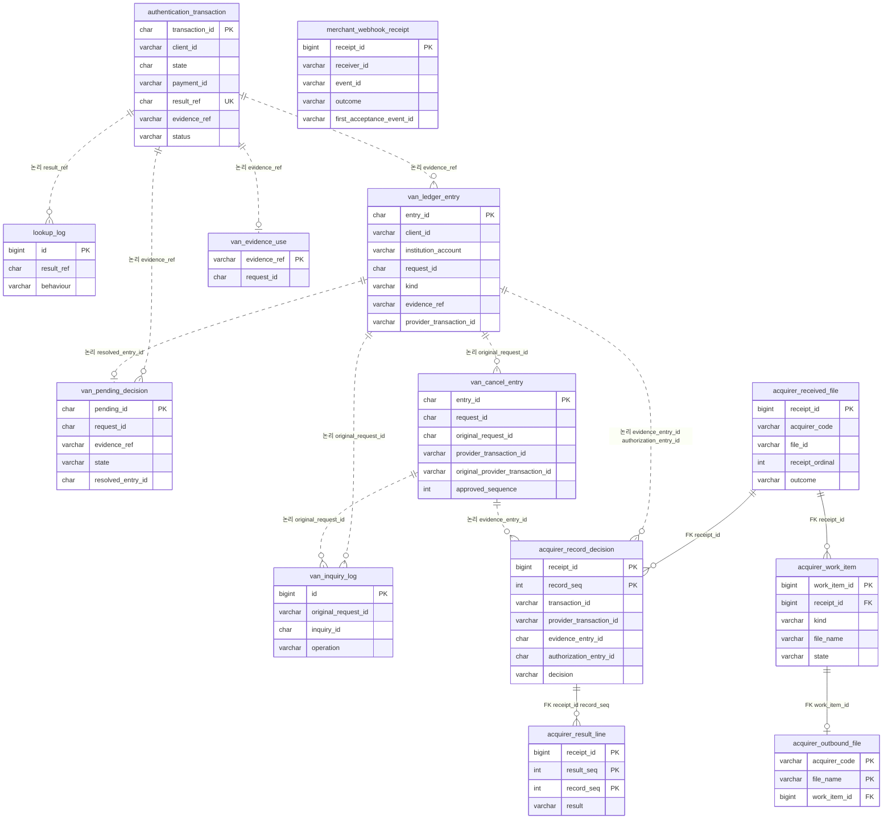

> 검증: paycore_simulator schema from Demo MySQL 8.4.11 컨테이너 `paycore-demo-simulator-mysql-1`(compose project paycore-demo, `~/paycore-demo/db.sh`로 기동)의 information_schema·mysql 권한 표 추출, 2026-11-11T00:32:21+09:00. 적용 migration: flyway_schema_history 전 버전 success=1, 각 행 checksum이 HEAD 1b5538d의 파일 CRC32와 모두 일치(86/86).

# Simulator DB 테이블 명세서 (초안)

초안은 git HEAD 89c6fac + 당시 미커밋 migration(MASTER V9/V10, ADMIN V9/V10) 기준이었다. 이 파일들은 이후 커밋 1b5538d에 포함됐고, 검증본은 HEAD 1b5538d 기준이며 그 migration도 전체 문서 세트에 포함했다. Simulator migration은 모두 커밋된 파일이다.

- 작성일: 2026-11-10
- 소유 앱: `apps/institution-simulator` (가상 기관 Simulator: 가상 인증기관, 가상 VAN, 가상 가맹점 Webhook 수신기, 가상 매입사)
- DB: `paycore_simulator` (MySQL, PayCore 소유 DB인 MASTER·PAYMENT·FINANCIAL과 다른 인스턴스, compose 서비스 `simulator-mysql`. 근거: `docker/simulator-mysql/init/01-simulator-database.sh` 머리 주석)
- 기본 문자셋: 모든 표 `ENGINE = InnoDB`, `utf8mb4` / `utf8mb4_0900_bin` (문자열 열도 모두 같은 bin collation)
- Flyway locations: `classpath:db/migration/simulator,classpath:db/runtime-privilege/simulator` (두 디렉터리의 버전이 하나의 순서로 섞인다. 근거: `apps/institution-simulator/src/main/resources/application.yml`)
- migration 범위: V1 ~ V12
- 이 문서는 V1~V12를 버전 순서대로 모두 적용한 **최종 스키마**를 기술한다.

### migration 파일 목록

경로 접두어: `apps/institution-simulator/src/main/resources/db/`

| 버전 | 파일 경로 | 종류 | 요약 |
|---|---|---|---|
| V1 | `migration/simulator/V1__authentication.sql` | DDL (새 표) | 가상 인증기관 표 `authentication_transaction`, `lookup_log` 생성 |
| V2 | `migration/simulator/V2__van.sql` | DDL (새 표) | 가상 VAN 표 `van_ledger_entry`, `van_pending_decision`, `van_evidence_use`, `van_inquiry_log` 생성 |
| V3 | `migration/simulator/V3__authentication_evidence_index.sql` | DDL (색인 추가) | `authentication_transaction(evidence_ref)` 색인 추가 |
| V4 | `runtime-privilege/simulator/V4__simulator_runtime_privileges.sql` | 권한 | V1·V2 표 6개에 runtime role 표 단위 권한 부여 |
| V5 | `migration/simulator/V5__van_cancel_entry.sql` | DDL (새 표) | 가상 VAN 취소 원장 `van_cancel_entry` 생성 |
| V6 | `migration/simulator/V6__van_inquiry_log_operation.sql` | DDL (ALTER) | `van_inquiry_log.operation` 열과 CHECK 추가 |
| V7 | `runtime-privilege/simulator/V7__van_cancel_runtime_privileges.sql` | 권한 | `van_cancel_entry` SELECT, INSERT |
| V8 | `migration/simulator/V8__merchant_webhook_receipt.sql` | DDL (새 표) | 가상 가맹점 수신 원장 `merchant_webhook_receipt` 생성 |
| V9 | `runtime-privilege/simulator/V9__merchant_webhook_receipt_runtime_privileges.sql` | 권한 | `merchant_webhook_receipt` SELECT, INSERT |
| V10 | `migration/simulator/V10__acquirer.sql` | DDL (새 표) | 가상 매입사 표 5개 생성(`acquirer_received_file`, `acquirer_record_decision`, `acquirer_result_line`, `acquirer_work_item`, `acquirer_outbound_file`) |
| V11 | `migration/simulator/V11__van_provider_transaction_index.sql` | DDL (색인 추가) | `van_ledger_entry`, `van_cancel_entry`에 `(client_id, environment, provider_transaction_id)` 색인 추가 |
| V12 | `runtime-privilege/simulator/V12__acquirer_runtime_privileges.sql` | 권한 | 매입사 표 4개 SELECT, INSERT + `acquirer_work_item` SELECT, INSERT와 열 단위 UPDATE |

DROP, RENAME, 열 삭제, 트리거, 뷰는 V1~V12 어디에도 없다.

---

## 1. 테이블 목록

| 테이블 | 용도 | 도입 버전 | 변경 버전 |
|---|---|---|---|
| `authentication_transaction` | 가상 인증기관의 인증 거래(등록 → 결과 확정 1회) | V1 | V3 (색인), V4 (권한) |
| `lookup_log` | 인증 결과 조회 기록(append-only, 시험 관찰용) | V1 | V4 (권한) |
| `van_ledger_entry` | 가상 VAN 승인 원장: 기관 금융 사실 원본(append-only) | V2 | V4 (권한), V11 (색인) |
| `van_pending_decision` | VAN PENDING 시나리오의 예약 결정(확정 사실 아님) | V2 | V4 (권한) |
| `van_evidence_use` | 인증 증거 사용 기록: 증거 하나 = 요청 ID 하나(append-only) | V2 | V4 (권한) |
| `van_inquiry_log` | VAN 조회 기록: 조회 1회 = 1행(append-only) | V2 | V4 (권한), V6 (`operation` 열 추가) |
| `van_cancel_entry` | 가상 VAN 취소 원장: 기관 금융 사실 원본(append-only) | V5 | V7 (권한), V11 (색인) |
| `merchant_webhook_receipt` | 가상 가맹점의 Webhook 수신 원장(append-only) | V8 | V9 (권한) |
| `acquirer_received_file` | 가상 매입사가 받은 매입 파일 수신 원장(append-only) | V10 | V12 (권한) |
| `acquirer_record_decision` | 수신 파일 레코드별 매입사 판정(append-only) | V10 | V12 (권한) |
| `acquirer_result_line` | 결과 파일 게시 계획(줄 단위, append-only) | V10 | V12 (권한) |
| `acquirer_work_item` | ACK·결과 파일 게시 작업 진행 상태(유일하게 상태 열을 갱신하는 매입사 표) | V10 | V12 (권한, 열 단위 UPDATE) |
| `acquirer_outbound_file` | outbox에 게시한 파일 기록(append-only) | V10 | V12 (권한) |

총 13개 표. 이 밖에 Flyway가 만드는 `flyway_schema_history`가 있다(권한 procedure가 이 표를 대상에서 거부함).

---

## 2. 테이블 상세

공통 표기
- 타입은 SQL 원문 그대로. 문자열 열은 모두 `CHARACTER SET utf8mb4 COLLATE utf8mb4_0900_bin`(표에서는 생략).
- "기본값": SQL에 `DEFAULT`가 있는 열은 하나도 없다. `AUTO_INCREMENT`만 기재한다.
- MySQL CHECK는 NULL로 평가되면 통과하므로 V5·V8·V10의 모양 CHECK는 `IS NULL / IS NOT NULL`을 명시한다(SQL 주석).

### 2.1 `authentication_transaction`

용도: 가상 인증기관 Simulator의 인증 거래. 결과는 한 번 확정되고 바뀌지 않는다. 카드번호·CVC 열 없음(가상 카드 참조만). `state`는 기관이 echo해야 하므로 원문을 보관한다(TEST 전용 대역 값 — PayCore 쪽은 digest만 저장). (V1 SQL 주석, AUTHN-001 §13.2)

| 컬럼명 | 타입 | NULL | 기본값 | 키 | 설명 |
|---|---|---|---|---|---|
| transaction_id | CHAR(26) | NOT NULL | | PK | 인증 거래 ID(26자. ULID 형식으로 보이나 생성 코드는 확인 못함) |
| client_id | VARCHAR(64) | NOT NULL | | UK(client_id, state) | PG client ID(설정 `paycore.simulator.clients[].id`의 값) |
| state | CHAR(43) | NOT NULL | | UK(client_id, state) | PG가 보낸 state 원문(기관이 echo). TEST 전용 값 |
| payment_id | VARCHAR(64) | NOT NULL | | | PayCore Payment ID(논리 참조) |
| merchant_ref | VARCHAR(64) | NOT NULL | | | 가맹점 참조(PayCore MID로 보임 — AUTH-001 S3 "merchantRef(MID)" 기재, 인증 표에 대한 명시는 확인 못함) |
| environment | VARCHAR(4) | NOT NULL | | | 환경. CHECK = 'TEST' |
| amount_minor | BIGINT | NOT NULL | | | 금액(최소 단위), ≥ 1 |
| currency | CHAR(3) | NOT NULL | | | 통화 코드 |
| plan_kind | VARCHAR(12) | NOT NULL | | | 결제 Plan 종류(값 CHECK 없음. VAN 표 기준 LUMP_SUM·INSTALLMENT) |
| installment_months | INT | NULL | | | 할부 개월 |
| card_company | VARCHAR(32) | NOT NULL | | | 카드사 |
| return_url | VARCHAR(2048) | NOT NULL | | | 인증 후 돌아갈 URL |
| status | VARCHAR(16) | NOT NULL | | | REGISTERED·AUTHENTICATED·FAILED·CANCELLED·EXPIRED |
| card_ref | VARCHAR(32) | NULL | | | 가상 카드 참조 |
| result_ref | CHAR(26) | NULL | | UK | 결과 조회 참조(`GET /sim/v1/authentication-results/{resultRef}`) |
| evidence_ref | VARCHAR(128) | NULL | | (색인) | 인증 증거 참조. AUTHENTICATED일 때만 값. VAN이 이 값으로 인증 거래를 찾는다(V3) |
| created_at | DATETIME(3) | NOT NULL | | | 생성 시각 |
| expires_at | DATETIME(3) | NOT NULL | | | 인증 거래 만료 시각 |
| completed_at | DATETIME(3) | NULL | | | 결과 확정 시각 |
| valid_until | DATETIME(3) | NULL | | | 결과 유효 기한(경과 후 조회 outcome = EXPIRED, AUTHN-001 816행) |
| version | BIGINT | NOT NULL | | | 낙관적 잠금(JPA `@Version`), ≥ 0 |

인덱스와 UNIQUE
- PK `pk_authentication_transaction (transaction_id)`
- UNIQUE `uk_authentication_transaction_client_state (client_id, state)`
- UNIQUE `uk_authentication_transaction_result_ref (result_ref)`
- INDEX `ix_authentication_transaction_evidence_ref (evidence_ref)` — V3. 증거 참조는 128bit 난수라 UNIQUE를 가정하지 않는다(둘 이상이면 VAN이 무효로 본다).

CHECK
- `ck_authentication_transaction_status`: status IN ('REGISTERED', 'AUTHENTICATED', 'FAILED', 'CANCELLED', 'EXPIRED')
- `ck_authentication_transaction_completed`: (status = 'REGISTERED') ⇔ result_ref IS NULL ⇔ completed_at IS NULL ⇔ valid_until IS NULL
- `ck_authentication_transaction_evidence`: (status = 'AUTHENTICATED') ⇔ evidence_ref IS NOT NULL
- `ck_authentication_transaction_environment`: environment = 'TEST'
- `ck_authentication_transaction_amount`: amount_minor ≥ 1
- `ck_authentication_transaction_version`: version ≥ 0

FK: 없음.

권한(V4): runtime role `SELECT, INSERT, UPDATE` (DELETE 없음). INSERT = `JpaAuthenticationTransactionRepository.insert`, UPDATE = 결과 확정과 `lockById`(FOR UPDATE). append-only 아님. Entity는 생성 시 불변 열을 `updatable = false`로 두고 status·card_ref·result_ref·evidence_ref·completed_at·valid_until·version만 갱신 가능(DB 권한은 표 단위 UPDATE라 열 제한은 애플리케이션 수준). 트리거 없음.

### 2.2 `lookup_log`

용도: 인증 결과 조회 기록(append-only, 시험 관찰·"한 번만" 시나리오 판정). (V1 SQL 주석)

| 컬럼명 | 타입 | NULL | 기본값 | 키 | 설명 |
|---|---|---|---|---|---|
| id | BIGINT | NOT NULL | AUTO_INCREMENT | PK | 행 ID |
| result_ref | CHAR(26) | NOT NULL | | (색인) | 조회한 결과 참조 → `authentication_transaction.result_ref`(논리) |
| looked_up_at | DATETIME(3) | NOT NULL | | | 조회 시각 |
| behaviour | VARCHAR(16) | NOT NULL | | | 적용된 조회 동작: NORMAL·DELAY·SERVER_ERROR(가상 카드 시나리오 LOOKUP_TIMEOUT_ONCE → DELAY, LOOKUP_5XX_ONCE → SERVER_ERROR — `authentication/domain/VirtualCard.kt`) |

인덱스: PK `pk_lookup_log (id)`, INDEX `ix_lookup_log_result_ref (result_ref)`.
CHECK: `ck_lookup_log_behaviour` behaviour IN ('NORMAL', 'DELAY', 'SERVER_ERROR').
FK: 없음.
권한(V4): `SELECT, INSERT` — **append-only**(INSERT = `JpaLookupLogStore.append`). Entity `@Immutable`.

### 2.3 `van_ledger_entry`

용도: 가상 VAN 승인 원장. 기관 금융 사실 원본이며 PG 재시작·PG DB rollback과 무관하게 남고 수정·삭제하지 않는다. namespace(client·environment·institution_account·operation·request_id)당 한 행 — 결정(DECISION) 또는 무효과 종결 표지(CLOSURE). (V2 SQL 주석, AUTH-001 §5.5)

| 컬럼명 | 타입 | NULL | 기본값 | 키 | 설명 |
|---|---|---|---|---|---|
| entry_id | CHAR(29) | NOT NULL | | PK | 기관 원장 ID. 결정 `vd_`+ULID, 종결 `vc_`+ULID(`SecureRandomVanIdGenerator`) |
| client_id | VARCHAR(64) | NOT NULL | | UK namespace | PG client ID |
| environment | VARCHAR(4) | NOT NULL | | UK namespace | 'TEST'만 |
| institution_account | VARCHAR(64) | NOT NULL | | UK namespace | 기관 가맹점 계정(설정 `van.accounts[].account` → 프로파일 A/B) |
| operation | VARCHAR(16) | NOT NULL | | UK namespace | 'AUTHORIZE'만 |
| request_id | CHAR(29) | NOT NULL | | UK namespace | PG 승인 요청 ID(payment-api가 `ar_`+ULID로 생성 — `SecureRandomAuthorizationIdentifierGenerator`) |
| kind | VARCHAR(8) | NOT NULL | | | DECISION·CLOSURE |
| payload_hash | CHAR(64) | NULL | | | 요청 본문 hash(DECISION만) |
| evidence_ref | VARCHAR(128) | NULL | | (색인) | 사용한 인증 증거 참조(DECISION만) |
| card_ref | VARCHAR(32) | NULL | | | 가상 카드 참조 |
| outcome | VARCHAR(8) | NULL | | | APPROVED·DECLINED(DECISION만) |
| approval_number | VARCHAR(32) | NULL | | | 승인번호(APPROVED만) |
| provider_transaction_id | VARCHAR(64) | NULL | | (색인 V11) | 기관 거래 참조(APPROVED만). 매입 레코드 대조 키 |
| approved_amount_minor | BIGINT | NULL | | | 승인액(APPROVED만), ≥ 1 |
| currency | CHAR(3) | NULL | | | 통화(APPROVED만) |
| plan_kind | VARCHAR(12) | NULL | | | LUMP_SUM·INSTALLMENT(APPROVED만) |
| installment_months | INT | NULL | | | 할부 개월(INSTALLMENT만, 2~99) |
| card_type | VARCHAR(32) | NULL | | | 카드 종류(APPROVED만. 설정상 CREDIT·CHECK 등) |
| institution_transaction_date | DATE | NULL | | | 기관 거래일(APPROVED만) |
| institution_business_date | DATE | NULL | | | 기관 영업일(APPROVED만) |
| decline_category | VARCHAR(32) | NULL | | | 거절 분류(DECLINED만) |
| created_at | DATETIME(3) | NOT NULL | | | 기록 시각 |

인덱스와 UNIQUE
- PK `pk_van_ledger_entry (entry_id)`
- UNIQUE `uk_van_ledger_entry_namespace (client_id, environment, institution_account, operation, request_id)` — 결정과 종결 표지의 동시 INSERT를 하나로 만든다
- INDEX `ix_van_ledger_entry_evidence_ref (evidence_ref)`
- INDEX `ix_van_ledger_entry_provider_transaction (client_id, environment, provider_transaction_id)` — V11, 가상 매입사 대조 읽기용

CHECK
- environment = 'TEST'; operation IN ('AUTHORIZE'); kind IN ('DECISION', 'CLOSURE')
- outcome IS NULL OR IN ('APPROVED', 'DECLINED')
- decline_category IS NULL OR IN ('ISSUER_DECLINED', 'AUTHENTICATION_INVALID', 'PLAN_NOT_SUPPORTED')
- `ck_van_ledger_entry_shape`: DECISION ⇒ payload_hash·evidence_ref·outcome NOT NULL, (outcome = APPROVED) ⇔ approval_number NOT NULL, 승인 조건 묶음(provider_transaction_id·approved_amount_minor·currency·plan_kind·card_type·institution_transaction_date·institution_business_date)은 approval_number와 함께 NULL/NOT NULL, (outcome = DECLINED) ⇔ decline_category NOT NULL. CLOSURE ⇒ card_ref를 제외한 결정 열 전부 NULL
- approved_amount_minor IS NULL OR ≥ 1
- `ck_van_ledger_entry_plan`: plan_kind NULL, 또는 LUMP_SUM이면 installment_months NULL, INSTALLMENT이면 installment_months BETWEEN 2 AND 99

FK: 없음.
권한(V4): `SELECT, INSERT` — **append-only 기관 금융 사실 원본**(INSERT = `JpaVanLedgerStore.insert`만, UPDATE/DELETE는 DB가 1142로 거부). Entity `@Immutable`. 기동 시 `VanLedgerPrivilegeGuard`가 권한을 탐침한다(V7 주석).

### 2.4 `van_pending_decision`

용도: PENDING 시나리오의 예약 결정(rev 0.3 H-3). 확정 사실이 아니다. 결정 확정은 원장 새 DECISION 행(같은 UNIQUE namespace에서 종결 표지와 경합) + 이 행 RESOLVED. (V2 SQL 주석)

| 컬럼명 | 타입 | NULL | 기본값 | 키 | 설명 |
|---|---|---|---|---|---|
| pending_id | CHAR(29) | NOT NULL | | PK | 예약 ID(`vp_`+ULID) |
| client_id | VARCHAR(64) | NOT NULL | | UK namespace | PG client ID |
| environment | VARCHAR(4) | NOT NULL | | UK namespace | 'TEST'만 |
| institution_account | VARCHAR(64) | NOT NULL | | UK namespace | 기관 가맹점 계정 |
| operation | VARCHAR(16) | NOT NULL | | UK namespace | 연산(값 CHECK 없음) |
| request_id | CHAR(29) | NOT NULL | | UK namespace | PG 승인 요청 ID |
| payload_hash | CHAR(64) | NOT NULL | | | 요청 본문 hash |
| evidence_ref | VARCHAR(128) | NOT NULL | | | 인증 증거 참조 |
| card_ref | VARCHAR(32) | NULL | | | 가상 카드 참조 |
| amount_minor | BIGINT | NOT NULL | | | 금액, ≥ 1 |
| currency | CHAR(3) | NOT NULL | | | 통화 |
| plan_kind | VARCHAR(12) | NOT NULL | | | LUMP_SUM·INSTALLMENT |
| installment_months | INT | NULL | | | 할부 개월(INSTALLMENT 2~99) |
| card_type | VARCHAR(32) | NOT NULL | | | 카드 종류 |
| resolve_after | DATETIME(3) | NOT NULL | | | 이 시각 이후 결정 확정 |
| state | VARCHAR(8) | NOT NULL | | | PENDING·RESOLVED |
| resolved_entry_id | CHAR(29) | NULL | | | 확정된 원장 행 → `van_ledger_entry.entry_id`(논리) |
| created_at | DATETIME(3) | NOT NULL | | | 생성 시각 |
| updated_at | DATETIME(3) | NOT NULL | | | 갱신 시각 |

인덱스와 UNIQUE: PK `pk_van_pending_decision (pending_id)`, UNIQUE `uk_van_pending_decision_namespace (client_id, environment, institution_account, operation, request_id)`.
CHECK
- environment = 'TEST'
- `ck_van_pending_decision_state`: state IN ('PENDING', 'RESOLVED') AND (state = 'RESOLVED') ⇔ resolved_entry_id IS NOT NULL
- amount_minor ≥ 1
- plan: (LUMP_SUM AND installment_months NULL) OR (INSTALLMENT AND installment_months BETWEEN 2 AND 99)

FK: 없음.
권한(V4): `SELECT, INSERT, UPDATE`(DELETE 없음). INSERT = 예약, UPDATE = PENDING → RESOLVED 조건부 UPDATE(`state = 'PENDING'`, 경합하면 0행 → 재판정). 갱신 열은 state·resolved_entry_id·updated_at뿐(Entity 주석). append-only 아님.

### 2.5 `van_evidence_use`

용도: 인증 증거 사용 기록(append-only, AUTH-001 §5.3-3 "다른 요청 ID에 쓰이지 않음"). 증거 하나 = 요청 ID 하나. PK가 다른 요청 ID의 동시 사용을 직렬화한다. (V2 SQL 주석)

| 컬럼명 | 타입 | NULL | 기본값 | 키 | 설명 |
|---|---|---|---|---|---|
| evidence_ref | VARCHAR(128) | NOT NULL | | PK | 인증 증거 참조 → `authentication_transaction.evidence_ref`(논리) |
| client_id | VARCHAR(64) | NOT NULL | | | PG client ID |
| environment | VARCHAR(4) | NOT NULL | | | 'TEST'만 |
| institution_account | VARCHAR(64) | NOT NULL | | | 기관 가맹점 계정 |
| operation | VARCHAR(16) | NOT NULL | | | 연산(값 CHECK 없음) |
| request_id | CHAR(29) | NOT NULL | | | 증거를 쓴 PG 요청 ID |
| created_at | DATETIME(3) | NOT NULL | | | 기록 시각 |

인덱스: PK `pk_van_evidence_use (evidence_ref)`. CHECK: environment = 'TEST'. FK: 없음.
권한(V4): `SELECT, INSERT` — **append-only**(INSERT = `JpaVanEvidenceUseStore.insert`만). Entity `@Immutable`.

### 2.6 `van_inquiry_log`

용도: VAN 조회 기록(append-only). 조회 1회 = 1행. request_kind는 종결 요청 여부(LOOKUP·CLOSE_IF_ABSENT). (V2 SQL 주석) V6에서 operation 열 추가(CANCEL-001 CN-26).

| 컬럼명 | 타입 | NULL | 기본값 | 키 | 설명 |
|---|---|---|---|---|---|
| id | BIGINT | NOT NULL | AUTO_INCREMENT | PK | 행 ID |
| client_id | VARCHAR(64) | NOT NULL | | (색인) | PG client ID |
| environment | VARCHAR(4) | NOT NULL | | (색인) | 환경(이 표에는 'TEST' CHECK 없음) |
| institution_account | VARCHAR(64) | NOT NULL | | (색인) | 기관 가맹점 계정 |
| original_request_id | VARCHAR(64) | NOT NULL | | (색인) | 조회 대상 원 요청 ID → `van_ledger_entry.request_id` 또는 `van_cancel_entry.request_id`(논리) |
| inquiry_id | CHAR(29) | NOT NULL | | | PG 조회 ID(payment-api가 승인 `aq_`, 취소 `cq_`+ULID로 생성) |
| request_kind | VARCHAR(16) | NOT NULL | | | LOOKUP·CLOSE_IF_ABSENT |
| result | VARCHAR(24) | NOT NULL | | | FOUND·PENDING·NOT_FOUND·NO_EFFECT_CONFIRMED·UNAVAILABLE |
| operation | VARCHAR(16) | NULL | | | V6 추가. AUTHORIZE·CANCEL. NULL = V6 이전 승인 조회 행(뒤채움 없음) |
| created_at | DATETIME(3) | NOT NULL | | | 조회 시각 |

인덱스: PK `pk_van_inquiry_log (id)`, INDEX `ix_van_inquiry_log_namespace (client_id, environment, institution_account, original_request_id)`.
CHECK
- request_kind IN ('LOOKUP', 'CLOSE_IF_ABSENT')
- result IN ('FOUND', 'PENDING', 'NOT_FOUND', 'NO_EFFECT_CONFIRMED', 'UNAVAILABLE')
- `ck_van_inquiry_log_operation`(V6): operation IS NULL OR IN ('AUTHORIZE', 'CANCEL')

FK: 없음.
권한(V4): `SELECT, INSERT` — **append-only**(INSERT = `JpaVanInquiryLogStore.append`만). Entity `@Immutable`.

### 2.7 `van_cancel_entry`

용도: 가상 VAN 취소 원장(CANCEL-001 §6.5, CN-21). append-only 기관 금융 사실 원본. namespace(client·environment·institution_account·operation CANCEL·request_id)당 한 행 — DECISION 또는 CLOSURE. 같은 원 승인의 승인 취소는 순번 approved_sequence(n + 1)로 직렬화한다(CN-22): UNIQUE(원 승인, 순번) 1062 → 새 TX 재판정. 거절·종결 표지는 순번 NULL. (V5 SQL 주석)

| 컬럼명 | 타입 | NULL | 기본값 | 키 | 설명 |
|---|---|---|---|---|---|
| entry_id | CHAR(29) | NOT NULL | | PK | 기관 원장 ID(결정 `vd_`, 종결 `vc_`) |
| client_id | VARCHAR(64) | NOT NULL | | UK namespace, UK 순번 | PG client ID |
| environment | VARCHAR(4) | NOT NULL | | UK namespace, UK 순번 | 'TEST'만 |
| institution_account | VARCHAR(64) | NOT NULL | | UK namespace, UK 순번 | 기관 가맹점 계정 |
| operation | VARCHAR(16) | NOT NULL | | UK namespace | 'CANCEL'만 |
| request_id | CHAR(29) | NOT NULL | | UK namespace | PG 취소 요청 ID(payment-api `cr_`+ULID) |
| kind | VARCHAR(8) | NOT NULL | | | DECISION·CLOSURE |
| payload_hash | CHAR(64) | NULL | | | 요청 본문 hash(DECISION만) |
| original_request_id | CHAR(29) | NULL | | UK 순번 | 원 승인 요청 ID → `van_ledger_entry.request_id`(논리, DECISION만) |
| card_ref | VARCHAR(32) | NULL | | | 원 승인의 가상 카드 참조 사본(D-S3-2, CLOSURE는 NULL) |
| outcome | VARCHAR(8) | NULL | | | APPROVED·DECLINED |
| cancel_approval_number | VARCHAR(32) | NULL | | | 취소 승인번호(APPROVED라도 NULL 허용 — 기관이 주지 않을 수 있음, n-5) |
| provider_transaction_id | VARCHAR(64) | NULL | | (색인 V11) | 취소 기관 거래 참조(APPROVED만) |
| original_provider_transaction_id | VARCHAR(64) | NULL | | | 원 승인 기관 거래 참조(APPROVED만) |
| cancelled_amount_minor | BIGINT | NULL | | | 취소 금액(APPROVED만), ≥ 1 |
| currency | CHAR(3) | NULL | | | 통화(APPROVED만) |
| institution_transaction_date | DATE | NULL | | | 기관 거래일(APPROVED만) |
| institution_business_date | DATE | NULL | | | 기관 영업일(APPROVED만) |
| approved_sequence | INT | NULL | | UK 순번 | 원 승인 단위 승인 취소 순번(APPROVED만), ≥ 1 |
| decline_category | VARCHAR(32) | NULL | | | 취소 거절 분류(DECLINED만) |
| created_at | DATETIME(3) | NOT NULL | | | 기록 시각 |

인덱스와 UNIQUE
- PK `pk_van_cancel_entry (entry_id)`
- UNIQUE `uk_van_cancel_entry_namespace (client_id, environment, institution_account, operation, request_id)`
- UNIQUE `uk_van_cancel_entry_approved_sequence (client_id, environment, institution_account, original_request_id, approved_sequence)` — NULL 순번은 UNIQUE 대상 아님
- INDEX `ix_van_cancel_entry_original (client_id, environment, institution_account, original_request_id)`
- INDEX `ix_van_cancel_entry_provider_transaction (client_id, environment, provider_transaction_id)` — V11

CHECK
- environment = 'TEST'; operation = 'CANCEL'; kind IN ('DECISION', 'CLOSURE')
- outcome IS NULL OR IN ('APPROVED', 'DECLINED')
- decline_category IS NULL OR IN ('ORIGINAL_NOT_FOUND', 'ORIGINAL_NOT_APPROVED', 'ORIGINAL_MISMATCH', 'CANCEL_PERIOD_EXPIRED', 'PARTIAL_NOT_SUPPORTED', 'EXCEEDS_REMAINING', 'ISSUER_DECLINED')
- `ck_van_cancel_entry_shape`: DECISION ⇒ payload_hash·original_request_id·outcome NOT NULL이고, APPROVED ⇒ provider_transaction_id·original_provider_transaction_id·cancelled_amount_minor·currency·두 기관 일자·approved_sequence NOT NULL, decline_category NULL(cancel_approval_number는 NULL 허용) / DECLINED ⇒ decline_category NOT NULL, 취소 조건·순번·cancel_approval_number 전부 NULL. CLOSURE ⇒ card_ref 포함 결정 열 전부 NULL
- cancelled_amount_minor IS NULL OR ≥ 1
- approved_sequence IS NULL OR ≥ 1

FK: 없음.
권한(V7): `SELECT, INSERT` — **append-only 기관 금융 사실 원본**(INSERT = `JpaVanCancelLedgerStore.insert`만, UPDATE/DELETE 1142, `VanLedgerPrivilegeGuard` 탐침). Entity `@Immutable`.

### 2.8 `merchant_webhook_receipt`

용도: 가상 가맹점 수신 원장(WEBHOOK-001 §9 — Simulator Demo 대역). append-only: 수신 요청 하나당 한 행. 본문은 저장하지 않고 SHA-256만 남긴다. 검증을 통과한 행만 봉투 값·키 ID를 갖는다. eventId 중복 제거는 첫 2xx(ACCEPTED) 행만 `first_acceptance_event_id = event_id`를 갖고 (receiver_id, first_acceptance_event_id) UNIQUE가 동시 첫 수신을 하나로 만든다. (V8 SQL 주석)

| 컬럼명 | 타입 | NULL | 기본값 | 키 | 설명 |
|---|---|---|---|---|---|
| receipt_id | BIGINT | NOT NULL | AUTO_INCREMENT | PK | 수신 순서(업무 식별자 아님, 조회 정렬용 — Entity 주석) |
| receiver_id | VARCHAR(64) | NOT NULL | | UK, (색인) | 가상 가맹점 수신기 ID(URL `{receiverId}`, 설정 `paycore.simulator.merchant.receivers[].id`) |
| outcome | VARCHAR(24) | NOT NULL | | | 수신 판정(아래 CHECK 값) |
| event_id | VARCHAR(64) | NULL | | (색인) | PayCore Webhook 이벤트 ID(봉투 값) |
| event_type | VARCHAR(40) | NULL | | | 이벤트 종류 |
| event_sequence | BIGINT | NULL | | | 이벤트 순번 |
| environment | VARCHAR(8) | NULL | | | 봉투의 환경 값(TEST가 아니면 REJECTED_ENVIRONMENT) |
| key_id | VARCHAR(40) | NULL | | | 서명 키 ID(kid). 키 원문은 저장하지 않음 |
| body_sha256 | CHAR(64) | NOT NULL | | | 수신 본문 SHA-256 |
| response_status | SMALLINT | NOT NULL | | | Simulator가 응답한 HTTP 상태(200~599) |
| first_acceptance_event_id | VARCHAR(64) | NULL | | UK | 첫 ACCEPTED 행만 event_id와 같은 값 |
| received_at | DATETIME(3) | NOT NULL | | | 수신 시각 |

인덱스와 UNIQUE: PK `pk_merchant_webhook_receipt (receipt_id)`, UNIQUE `uk_merchant_webhook_receipt_first_acceptance (receiver_id, first_acceptance_event_id)`, INDEX `ix_merchant_webhook_receipt_event (receiver_id, event_id)`.
CHECK
- outcome IN ('ACCEPTED', 'DUPLICATE', 'SCENARIO_REFUSED', 'REJECTED_MALFORMED', 'REJECTED_STALE', 'REJECTED_SIGNATURE', 'REJECTED_BODY', 'REJECTED_ENVIRONMENT')
- response_status BETWEEN 200 AND 599
- `ck_..._first_acceptance`: ACCEPTED ⇔ first_acceptance_event_id NOT NULL 이고 = event_id
- `ck_..._shape`: ACCEPTED·DUPLICATE·SCENARIO_REFUSED ⇒ 봉투 값 전부 NOT NULL, environment = 'TEST', key_id NOT NULL / REJECTED_ENVIRONMENT ⇒ 봉투 값 NOT NULL, environment ≠ 'TEST', key_id NOT NULL / REJECTED_BODY ⇒ 봉투 값 NULL, key_id NOT NULL / REJECTED_MALFORMED·REJECTED_STALE·REJECTED_SIGNATURE ⇒ 봉투 값과 key_id 모두 NULL

FK: 없음.
권한(V9): `SELECT, INSERT` — **append-only**(INSERT = `JpaMerchantWebhookReceiptStore.append`만, UPDATE/DELETE 1142, `MerchantReceiptPrivilegeGuard` 탐침). Entity `@Immutable`.

### 2.9 `acquirer_received_file`

용도: 가상 매입사 수신 원장(ACQUIRING-001 2-E §7). (매입사, 파일 ID, 내용 hash)당 한 행. receipt_ordinal = 그 파일 ID의 수신 순번(= ACK 순번 nn). 첫 수신(1)이 RECEIVED 또는 FILE_REJECTED, 같은 ID에 다른 내용이 올 때마다 RECEIPT_CONFLICT(2..99). 같은 ID·같은 내용은 새 행 없이 멱등. (V10 SQL 주석)

| 컬럼명 | 타입 | NULL | 기본값 | 키 | 설명 |
|---|---|---|---|---|---|
| receipt_id | BIGINT | NOT NULL | AUTO_INCREMENT | PK | 수신 ID(같은 TX에서 판정·결과 줄·작업이 FK로 사용) |
| acquirer_code | VARCHAR(32) | NOT NULL | | UK 2개 | 매입사 코드(설정 `acquirers[].code`, 예 SIMACQA — `.env.example`) |
| file_id | VARCHAR(64) | NOT NULL | | UK 2개 | 매입 파일 ID(FINANCIAL이 봉인한 파일 ID — 논리) |
| receipt_ordinal | INT | NOT NULL | | UK ordinal | 파일 ID별 수신 순번 1~99 |
| content_sha256 | CHAR(64) | NOT NULL | | UK content | 파일 내용 SHA-256(소문자 hex 64자) |
| content_bytes | BIGINT | NOT NULL | | | 파일 크기(≥ 0) |
| record_count | INT | NULL | | | 레코드 수(RECEIVED만, ≥ 0) |
| outcome | VARCHAR(20) | NOT NULL | | | RECEIVED·FILE_REJECTED·RECEIPT_CONFLICT |
| reason_code | VARCHAR(32) | NULL | | | 거부 사유(FILE_REJECTED는 CONTENT_MISMATCH 이외 값, RECEIPT_CONFLICT는 CONTENT_MISMATCH) |
| received_at | DATETIME(3) | NOT NULL | | | 수신 시각 |

인덱스와 UNIQUE: PK `pk_acquirer_received_file (receipt_id)`, UNIQUE `uk_acquirer_received_file_ordinal (acquirer_code, file_id, receipt_ordinal)`, UNIQUE `uk_acquirer_received_file_content (acquirer_code, file_id, content_sha256)`.
CHECK
- outcome IN ('RECEIVED', 'FILE_REJECTED', 'RECEIPT_CONFLICT')
- receipt_ordinal BETWEEN 1 AND 99 AND (outcome = 'RECEIPT_CONFLICT') ⇔ (receipt_ordinal > 1)
- shape: RECEIVED ⇒ reason_code NULL, record_count ≥ 0 / FILE_REJECTED ⇒ reason_code NOT NULL·≠ 'CONTENT_MISMATCH', record_count NULL / RECEIPT_CONFLICT ⇒ reason_code = 'CONTENT_MISMATCH', record_count NULL
- content: REGEXP_LIKE(content_sha256, '^[0-9a-f]{64}$', 'c') AND content_bytes ≥ 0

FK: 피참조(acquirer_record_decision, acquirer_work_item).
권한(V12): `SELECT, INSERT` — **append-only**(INSERT = `JpaAcquirerReceiptStore` persist + flush만). Entity `@Immutable`, 기동 탐침 `AcquirerLedgerPrivilegeGuard`.

### 2.10 `acquirer_record_decision`

용도: 레코드 판정(기관 내부 사실). RECEIVED 수신의 레코드마다 한 행. 이중 매입 확정 방어 UNIQUE 둘(기관 근거 기준, 거래 ID 기준). (V10 SQL 주석)

| 컬럼명 | 타입 | NULL | 기본값 | 키 | 설명 |
|---|---|---|---|---|---|
| receipt_id | BIGINT | NOT NULL | | PK, FK | 수신 행 → `acquirer_received_file.receipt_id` |
| record_seq | INT | NOT NULL | | PK | 파일 안 레코드 순번(≥ 1) |
| acquirer_code | VARCHAR(32) | NOT NULL | | UK 2개, (색인) | 매입사 코드(수신 행 값의 사본 — 일치 제약 없음) |
| record_type | VARCHAR(8) | NOT NULL | | UK 2개 | SALE·CANCEL |
| transaction_id | VARCHAR(64) | NOT NULL | | (색인) | 매입 레코드의 거래 ID(FINANCIAL 매입 대상 transaction_id로 보임 — ACQUIRING-001 133행, 논리) |
| provider_transaction_id | VARCHAR(64) | NOT NULL | | | 레코드의 기관 거래 참조 → VAN 원장 `provider_transaction_id`(논리) |
| record_amount_minor | BIGINT | NOT NULL | | | 레코드 금액(≥ 1) |
| netted_cancel_amount_minor | BIGINT | NOT NULL | | | SALE의 상계액(CANCEL은 0), ≥ 0 |
| decision | VARCHAR(8) | NOT NULL | | | ACCEPTED·REJECTED(값 목록 CHECK는 shape CHECK로만 강제) |
| reason_code | VARCHAR(32) | NULL | | | 거부 사유(REJECTED만) |
| evidence_entry_id | CHAR(29) | NULL | | | 근거 VAN 원장 행(SALE = `van_ledger_entry.entry_id`, CANCEL = `van_cancel_entry.entry_id`, 논리) |
| authorization_entry_id | CHAR(29) | NULL | | (색인) | 레코드가 속한 원승인 VAN 행 → `van_ledger_entry.entry_id`(논리). 원승인 단위 취소 금액 상한 키 |
| scenario | VARCHAR(32) | NULL | | | 적용된 Demo 시나리오(없으면 NULL) |
| accepted_transaction_id | VARCHAR(64) | NULL | | UK | ACCEPTED일 때만 = transaction_id |
| accepted_evidence_entry_id | CHAR(29) | NULL | | UK | ACCEPTED일 때만 = evidence_entry_id |
| decided_at | DATETIME(3) | NOT NULL | | | 판정 시각 |

인덱스와 UNIQUE
- PK `pk_acquirer_record_decision (receipt_id, record_seq)`
- UNIQUE `uk_acquirer_record_decision_accepted (acquirer_code, record_type, accepted_transaction_id)`
- UNIQUE `uk_acquirer_record_decision_accepted_evidence (acquirer_code, record_type, accepted_evidence_entry_id)` — 같은 기관 근거의 두 번째 ACCEPTED를 거래 ID가 달라도 막는다(리뷰 MJ-1)
- INDEX `ix_acquirer_record_decision_transaction (acquirer_code, transaction_id, record_type)`
- INDEX `ix_acquirer_record_decision_authorization (acquirer_code, authorization_entry_id)`

CHECK
- record_type IN ('SALE', 'CANCEL')
- record_seq ≥ 1 AND record_amount_minor ≥ 1
- shape: (ACCEPTED AND reason_code NULL AND accepted_transaction_id = transaction_id) OR (REJECTED AND reason_code NOT NULL AND accepted_transaction_id NULL)
- evidence: (ACCEPTED AND evidence_entry_id·authorization_entry_id NOT NULL AND accepted_evidence_entry_id = evidence_entry_id) OR (REJECTED AND accepted_evidence_entry_id NULL)
- netted: netted_cancel_amount_minor ≥ 0 AND (record_type = 'SALE' OR netted_cancel_amount_minor = 0)

FK: `fk_acquirer_record_decision_receipt (receipt_id) → acquirer_received_file (receipt_id)` — ON DELETE/ON UPDATE 미지정(MySQL 기본 RESTRICT/NO ACTION).
권한(V12): `SELECT, INSERT` — **append-only**. Entity `@Immutable`, 수신 행과 `@ManyToOne` 연관 없음(receipt_id 값만).

### 2.11 `acquirer_result_line`

용도: 게시 계획(결과 파일 줄). 수신 TX에서 한 번 정해 기록한다(Worker는 이 줄만 게시 — 재게시가 같은 바이트). 결과 중복·상충 시나리오에서는 한 레코드가 두 회차에 나오고 상충 줄은 기관 판정과 다른 결과다. (V10 SQL 주석)

| 컬럼명 | 타입 | NULL | 기본값 | 키 | 설명 |
|---|---|---|---|---|---|
| receipt_id | BIGINT | NOT NULL | | PK, FK | 판정 행 FK의 일부 |
| result_seq | INT | NOT NULL | | PK | 결과 파일 회차(1~99) |
| record_seq | INT | NOT NULL | | PK, FK | 판정 행 FK의 일부 |
| result | VARCHAR(8) | NOT NULL | | | ACCEPTED·REJECTED |
| reason_code | VARCHAR(32) | NULL | | | 거부 사유(REJECTED만) |

인덱스: PK `pk_acquirer_result_line (receipt_id, result_seq, record_seq)`.
CHECK: result_seq BETWEEN 1 AND 99; (result = 'ACCEPTED' AND reason_code NULL) OR (result = 'REJECTED' AND reason_code NOT NULL).
FK: `fk_acquirer_result_line_decision (receipt_id, record_seq) → acquirer_record_decision (receipt_id, record_seq)` — ON DELETE 미지정.
권한(V12): `SELECT, INSERT` — **append-only**. Entity `@Immutable`.

### 2.12 `acquirer_work_item`

용도: Worker 진행(게시 작업). 수신 TX가 ACK·결과 파일마다 PENDING 한 행을 만들고, Worker가 outbox 게시(임시명 → rename) 뒤 PUBLISHED로 바꾼다(@Version 조건부). 가상 매입사 표 중 유일한 갱신 표. (V10 SQL 주석)

| 컬럼명 | 타입 | NULL | 기본값 | 키 | 설명 |
|---|---|---|---|---|---|
| work_item_id | BIGINT | NOT NULL | AUTO_INCREMENT | PK | 작업 ID |
| receipt_id | BIGINT | NOT NULL | | FK, UK slot | 수신 행 → `acquirer_received_file.receipt_id` |
| acquirer_code | VARCHAR(32) | NOT NULL | | UK name | 매입사 코드 |
| kind | VARCHAR(8) | NOT NULL | | UK slot | ACK·RESULT |
| seq | INT | NOT NULL | | UK slot | 순번 1~99 |
| file_name | VARCHAR(128) | NOT NULL | | UK name | 게시 파일명(`ACK|RES.ACQ.<코드>.<TEST|LIVE>.<yyyyMMdd>.<3자리>.<2자리>.dat` 형식) |
| due_at | DATETIME(3) | NOT NULL | | (색인) | 게시 예정 시각(ack-delay·result-delay 설정 반영으로 보임 — 확인 못함) |
| state | VARCHAR(12) | NOT NULL | | (색인) | PENDING·PUBLISHED |
| published_at | DATETIME(3) | NULL | | | 게시 시각(PUBLISHED만) |
| created_at | DATETIME(3) | NOT NULL | | | 생성 시각 |
| updated_at | DATETIME(3) | NOT NULL | | | 갱신 시각 |
| version | BIGINT | NOT NULL | | | 낙관적 잠금(`@Version`) |

인덱스와 UNIQUE: PK `pk_acquirer_work_item (work_item_id)`, UNIQUE `uk_acquirer_work_item_name (acquirer_code, file_name)`, UNIQUE `uk_acquirer_work_item_slot (receipt_id, kind, seq)`, INDEX `ix_acquirer_work_item_due (state, due_at)`.
CHECK
- kind IN ('ACK', 'RESULT') AND seq BETWEEN 1 AND 99
- state IN ('PENDING', 'PUBLISHED') AND (state = 'PUBLISHED') ⇔ published_at IS NOT NULL
- file_name REGEXP `^(ACK|RES)\.ACQ\.[A-Z0-9]{1,32}\.(TEST|LIVE)\.[0-9]{8}\.[0-9]{3}\.[0-9]{2}\.dat$`(대소문자 구분)

FK: `fk_acquirer_work_item_receipt (receipt_id) → acquirer_received_file (receipt_id)` — ON DELETE 미지정.
권한(V12): 표 단위 `SELECT, INSERT` + **열 단위 UPDATE (state, published_at, updated_at, version)**. 식별·계획 열(receipt_id·kind·seq·file_name·due_at·created_at) UPDATE는 1143, DELETE는 1142. 갱신 경로는 `JpaAcquirerPublicationStore.markPublished`(변경 감지 + @Version). 같은 표에 표 단위 procedure를 다시 부르지 않는다(열 권한 회수 방지 — V12 주석).

### 2.13 `acquirer_outbound_file`

용도: 게시 기록(append-only). outbox에 rename으로 게시한(또는 이미 같은 바이트로 있던) 파일 하나당 한 행. 작업 하나당 하나. (V10 SQL 주석)

| 컬럼명 | 타입 | NULL | 기본값 | 키 | 설명 |
|---|---|---|---|---|---|
| acquirer_code | VARCHAR(32) | NOT NULL | | PK | 매입사 코드 |
| file_name | VARCHAR(128) | NOT NULL | | PK | 게시 파일명 |
| work_item_id | BIGINT | NOT NULL | | FK, UK | 게시 작업 → `acquirer_work_item.work_item_id` |
| content_sha256 | CHAR(64) | NOT NULL | | | 게시 파일 SHA-256(소문자 hex) |
| content_bytes | INT | NOT NULL | | | 게시 파일 크기(≥ 1) |
| published_at | DATETIME(3) | NOT NULL | | | 게시 시각 |

인덱스와 UNIQUE: PK `pk_acquirer_outbound_file (acquirer_code, file_name)`, UNIQUE `uk_acquirer_outbound_file_work_item (work_item_id)`.
CHECK: REGEXP_LIKE(content_sha256, '^[0-9a-f]{64}$', 'c') AND content_bytes ≥ 1.
FK: `fk_acquirer_outbound_file_work_item (work_item_id) → acquirer_work_item (work_item_id)` — ON DELETE 미지정.
권한(V12): `SELECT, INSERT` — **append-only**. Entity `@Immutable`.

---

## 3. 권한 요약

### 3.1 계정(근거: `docker/simulator-mysql/init/01-simulator-database.sh`, 비밀번호는 환경변수로만 주입 — 생략)

| 계정/role | 권한 | 용도 |
|---|---|---|
| `paycore_simulator_migration`@'%' | `paycore_simulator.*` ALL PRIVILEGES(GRANT OPTION 없음) + 두 procedure EXECUTE | Flyway 전용(`spring.flyway.user`) |
| `paycore_simulator_runtime`@'%' (role) | 표 단위 권한 + `acquirer_work_item` 4열 열 단위 UPDATE(V12). DB 단위 권한 없음, V4·V7·V9·V12가 procedure로 부여 | runtime 권한 묶음 |
| `paycore_simulator`@'%' | role `paycore_simulator_runtime`만(SET DEFAULT ROLE). 실행 시마다 DB 단위 ALL·GRANT OPTION REVOKE | 앱 runtime 접속(`spring.datasource`) |
| `paycore_simulator_grantor`@'localhost' | ACCOUNT LOCK. `paycore_simulator.*` SELECT·INSERT·UPDATE·DELETE WITH GRANT OPTION | 권한 procedure의 DEFINER |

권한 procedure(DB `paycore_simulator_privilege`)
- `set_runtime_table_privileges(table, privileges)`: 허용 집합('SELECT' / 'SELECT, INSERT' / 'SELECT, INSERT, UPDATE' / 'SELECT, INSERT, UPDATE, DELETE')만, 이 DB의 base table만(`flyway_schema_history` 거부), GRANT 후 여집합 REVOKE(지정 집합으로 교체, 재실행 안전).
- `grant_runtime_column_update(table, columns)`: 존재하는 소문자 열 1~8개에 열 단위 UPDATE 부여만.

### 3.2 테이블 × runtime role 권한

migration 계정은 모든 표에 ALL, grantor는 모든 표에 SELECT·INSERT·UPDATE·DELETE(GRANT OPTION). 아래는 runtime role(`paycore_simulator_runtime`, 즉 `paycore_simulator` 계정) 기준.

| 테이블 | SELECT | INSERT | UPDATE | DELETE | append-only | 부여 버전 |
|---|---|---|---|---|---|---|
| authentication_transaction | O | O | O(표 단위) | X | 아님 | V4 |
| lookup_log | O | O | X | X | 예 | V4 |
| van_ledger_entry | O | O | X | X | 예(기관 금융 사실 원본) | V4 |
| van_pending_decision | O | O | O(표 단위) | X | 아님 | V4 |
| van_evidence_use | O | O | X | X | 예 | V4 |
| van_inquiry_log | O | O | X | X | 예 | V4 |
| van_cancel_entry | O | O | X | X | 예(기관 금융 사실 원본) | V7 |
| merchant_webhook_receipt | O | O | X | X | 예 | V9 |
| acquirer_received_file | O | O | X | X | 예 | V12 |
| acquirer_record_decision | O | O | X | X | 예 | V12 |
| acquirer_result_line | O | O | X | X | 예 | V12 |
| acquirer_work_item | O | O | 열 단위(state, published_at, updated_at, version) | X | 아님 | V12 |
| acquirer_outbound_file | O | O | X | X | 예 | V12 |

DELETE 권한은 어느 표에도 없다. 트리거는 없다(append-only는 권한 + JPA `@Immutable`로 이중 방어).

---

## 4. ERD

---

## 5. 논리 참조 (FK 없음)

| 컬럼 | 참조 대상 | 근거 |
|---|---|---|
| lookup_log.result_ref | authentication_transaction.result_ref (같은 DB) | V1 주석 "결과 조회 기록", 동일 타입 CHAR(26) |
| van_ledger_entry.evidence_ref, van_pending_decision.evidence_ref, van_evidence_use.evidence_ref | authentication_transaction.evidence_ref (같은 DB) | V3 주석 "가상 VAN의 인증 증거 재검증이 증거 참조로 인증 거래를 찾는다" |
| van_pending_decision.resolved_entry_id | van_ledger_entry.entry_id (같은 DB) | V2 주석 "결정 확정은 원장 새 DECISION 행 + 이 행 RESOLVED" |
| van_pending_decision (namespace 5열) | van_ledger_entry (같은 namespace UNIQUE) | V2 주석 "같은 UNIQUE(namespace)에서 종결 표지와 경합" |
| van_cancel_entry.original_request_id | van_ledger_entry.request_id (operation AUTHORIZE, 같은 client·environment·account) | CANCEL-001 471행 "원 승인: van_ledger_entry(client·environment·account·AUTHORIZE·originalRequestId)" |
| van_cancel_entry.original_provider_transaction_id | van_ledger_entry.provider_transaction_id | 열 이름·CANCEL-001 471행 "PTX echo" |
| van_inquiry_log.original_request_id | van_ledger_entry.request_id 또는 van_cancel_entry.request_id(operation으로 구분) | V2·V6 주석, 색인 namespace 구성 |
| acquirer_record_decision.evidence_entry_id | SALE → van_ledger_entry.entry_id, CANCEL → van_cancel_entry.entry_id | V10 주석 |
| acquirer_record_decision.authorization_entry_id | van_ledger_entry.entry_id (원승인) | V10 주석 |
| acquirer_record_decision.provider_transaction_id | van_ledger_entry / van_cancel_entry.provider_transaction_id | V11 주석 "매입 레코드는 기관 거래 참조로 원승인·승인된 취소를 찾는다" |
| acquirer_record_decision.acquirer_code | acquirer_received_file.acquirer_code (사본) | 같은 receipt의 값으로 보이나 일치 제약 없음 |
| acquirer_result_line.(receipt_id, record_seq) | — (실제 FK) | 참고: FK 있음 |
| acquirer_outbound_file.(acquirer_code, file_name) | acquirer_work_item.(acquirer_code, file_name) | V10 주석 "작업 하나당 하나", 동일 UNIQUE 조합. FK는 work_item_id만 |
| *.client_id (인증·VAN 표) | 설정 `paycore.simulator.clients[].id` (DB 표 아님) = PayCore payment-api의 Simulator client | application.yml |
| *.institution_account | 설정 `paycore.simulator.van.accounts[].account` (DB 표 아님) | application.yml |
| merchant_webhook_receipt.receiver_id | 설정 `paycore.simulator.merchant.receivers[].id` (DB 표 아님) | application.yml 주석 |
| authentication_transaction.payment_id | PayCore PAYMENT DB의 Payment ID | 열 이름. PAYMENT 쪽 열 대응은 확인 못함 |
| authentication_transaction.merchant_ref | PayCore MID (추정) | AUTH-001 1088행 "merchantRef(MID)"(VAN 메시지 기준), V11 주석 "D-ACQ-008: merchantRef = PayCore MID" |
| van_ledger_entry.request_id | payment-api 승인 요청 ID(`ar_`+ULID) | `SecureRandomAuthorizationIdentifierGenerator.kt` |
| van_cancel_entry.request_id | payment-api 취소 요청 ID(`cr_`+ULID) | `SecureRandomCancellationIdentifierGenerator.kt` |
| van_inquiry_log.inquiry_id | payment-api 조회 ID(승인 `aq_`, 취소 `cq_`+ULID) | 위 두 생성기 |
| merchant_webhook_receipt.event_id | PayCore Webhook 이벤트 ID(PAYMENT 쪽) | WEBHOOK-001 576행 |
| acquirer_received_file.file_id | FINANCIAL 매입 파일 ID(financial-batch가 봉인·전송) | ACQUIRING-001 134행 SUBMITTED_IN(fileId, seq) |
| acquirer_record_decision.transaction_id | FINANCIAL 매입 대상 거래 ID(원승인 1건 = transaction_id) | ACQUIRING-001 133행 |

---

## 6. PayCore와의 연결

Simulator DB는 PayCore DB와 물리적으로 분리되어 있고(별도 MySQL 인스턴스), PayCore 앱은 Simulator DB에 직접 접속하지 않는다. `institution-simulator`의 `application.yml`에는 "PayCore 소유 DB 접속 정보는 두지 않는다"고 명시되어 있다. 연결은 아래 프로토콜로만 이루어진다.

| 방향 | 프로토콜 / endpoint | 관련 표 | 근거 |
|---|---|---|---|
| payment-api → Simulator | HTTP `POST /sim/v1/authentications` (인증 거래 등록) | authentication_transaction | `payment-api/.../institution/SimulatorCardAuthenticationAdapter.kt` 90행, `simulator/.../SimulatorApiController.kt` 31행 |
| payment-api → Simulator | HTTP `GET /sim/v1/authentication-results/{resultRef}` (결과 조회) | authentication_transaction, lookup_log | 같은 adapter 109행, 컨트롤러 40행 |
| 고객 브라우저 → Simulator | HTTP `GET/POST /sim/authenticate/{id}` (인증 화면, Thymeleaf). payment-api는 응답의 customerUrl이 `${customerBaseUrl}/sim/authenticate/$id`인지 검사 | authentication_transaction | `CustomerAuthenticationController.kt` 22·33행, adapter 156행 |
| payment-api → Simulator | **TCP**(HTTP 아님) 가상 VAN, 계약 `sim-van-1`(승인) / `sim-van-2`(= sim-van-1 + 취소·취소 조회). HMAC 키 인증 | van_ledger_entry, van_pending_decision, van_evidence_use, van_inquiry_log, van_cancel_entry | `SimulatorVanAuthorizationAdapter.kt`(VanSocketConnector), `SimulatorVanCancellationAdapter.kt`, payment-api `application.yml` 83~84행(routes host·port·protocol-version), simulator `application.yml` `paycore.simulator.van.port`, `.env.example` 140행 |
| payment-api → Simulator | HTTP `POST /sim/merchant/v1/webhooks/{receiverId}` (서명 header `PayCore-Signature`). payment-api의 Webhook 전송 대상은 설정 `paycore.webhook.test-endpoints[].url`이며, 이것을 Simulator 수신기로 지정하는 것은 로컬 E2E에서만(코드에 Simulator URL 고정 없음, `.env.example` 기본값은 빈 목록) | merchant_webhook_receipt | `MerchantWebhookReceiverController.kt` 31행, WEBHOOK-001 576·892행, payment-api `application.yml` 88~93행 |
| 시험 클라이언트(PG client) → Simulator | HTTP `GET /sim/merchant/v1/webhooks/{receiverId}/receipts` (Bearer = PG client 키로 인증, 수신 기록 관찰) | merchant_webhook_receipt | 같은 컨트롤러 54행. PayCore 운영 코드에서 호출하는 곳은 확인 못함 |
| financial-batch → Simulator | **SFTP**(HTTP 아님). Simulator 내장 SFTP 서버의 `{code}/inbox`에 매입 파일 업로드(임시명 → rename), `{code}/outbox`에서 ACK·결과 파일 수신. 클라이언트 키 인증 + host key 지문 고정 | acquirer_received_file, acquirer_record_decision, acquirer_result_line, acquirer_work_item, acquirer_outbound_file | `financial-batch/.../SftpAcquirerFileChannel.kt`, `AcquisitionTransmissionService.kt` 37~40행, `AcquirerResponseService.kt`, financial-batch `application.yml` 89~100행, `.env.example` 112·168행 |
| Simulator 내부 | 가상 매입사가 같은 DB의 VAN 원장을 읽어 레코드 판정(`JpaVanAcquiringEvidenceStore`, V11 색인) | van_ledger_entry, van_cancel_entry → acquirer_record_decision | V11 주석, ACQUIRING-001 I-31 |

**financial-batch와 Simulator 사이의 HTTP 연결은 확인하지 못했다**(SFTP만 확인). master-api·internal-admin과 Simulator 사이의 직접 연결도 확인하지 못했다.

### Simulator와 REAL/LIVE 격리 확인 사항

- DB 수준: 인증·VAN 표는 `environment = 'TEST'` CHECK(authentication_transaction, van_ledger_entry, van_pending_decision, van_evidence_use, van_cancel_entry). merchant_webhook_receipt는 TEST가 아닌 봉투를 `REJECTED_ENVIRONMENT`로만 기록. `van_inquiry_log.environment`에는 CHECK 없음.
- payment-api 기동 검사: 인증 backend type은 SIMULATOR만, SIMULATOR는 TEST 환경만(LIVE·REAL 거부); 승인 backend도 REAL·LIVE SIMULATOR는 기동 거부, loopback 밖 Simulator host는 허용 목록 필요(payment-api `application.yml` 75~78·83행, AUTH-001 §5.6).
- Webhook: test-endpoints·test-signing-keys는 TEST 환경 Demo만, LIVE는 원천 없음(fail-closed).
- financial-batch: lanes environment는 TEST만(D-ACQ-008), LIVE 파일은 봉인부터 막히고 전송도 fail-closed로 거부(`AcquisitionTransmissionService.kt` 85행).
- Simulator 쪽 기본값: 가맹점 수신기 0개(모든 수신 404), 매입사 0개(SFTP 포트를 열지 않고 Worker도 안 돈다). 운영 기본값 없이 환경변수가 없으면 기동 실패.
- 비밀: Simulator는 PG client 키를 SHA-256 digest로만 설정에 둔다(값은 비밀 값 — 생략). VAN HMAC 키·Webhook 서명 키·SFTP 키는 환경변수/파일 경로로만 주입되고 DB 표에 키 원문 열은 없다. 카드번호·CVC 열 없음.

---

## 7. 애매한 점·문서와 SQL 불일치

### 애매한 점

1. `acquirer_work_item.file_name` CHECK 정규식은 `(TEST|LIVE)`를 허용한다. 반면 매입 lane은 TEST만(D-ACQ-008)이고 LIVE 파일은 PayCore 쪽에서 막힌다. DB 수준에서는 LIVE 파일명이 막히지 않는다.
2. `van_inquiry_log.environment`에는 다른 VAN 표와 달리 `environment = 'TEST'` CHECK가 없다. `van_pending_decision.operation`, `van_evidence_use.operation`에도 값 CHECK가 없다.
3. `van_inquiry_log.original_request_id`는 VARCHAR(64)이고 원장 `request_id`는 CHAR(29)이다. 형식이 맞지 않는 조회 ID도 기록할 수 있도록 넓게 둔 것으로 보이나 근거는 확인하지 못했다.
4. `authentication_transaction`, `van_pending_decision`의 UPDATE 권한은 표 단위다. 불변 열 보호는 JPA `updatable = false`(애플리케이션 수준)뿐이고, DB에서 열 단위로 제한하는 것은 `acquirer_work_item`뿐이다.
5. `acquirer_record_decision.acquirer_code`는 수신 행의 `acquirer_code` 사본이지만 둘이 같아야 한다는 제약(복합 FK)은 없다. `acquirer_outbound_file.(acquirer_code, file_name)`과 `acquirer_work_item.(acquirer_code, file_name)`의 일치도 FK로 강제되지 않는다(work_item_id FK만 있음).
6. `acquirer_received_file.content_bytes`는 BIGINT, `acquirer_outbound_file.content_bytes`는 INT로 타입이 다르다.
7. `authentication_transaction.state`는 원문으로 저장된다(TEST 전용 대역 값이라고 SQL 주석이 설명). PayCore 쪽은 digest만 저장.
8. `authentication_transaction.transaction_id`, `result_ref`(CHAR(26))의 생성 형식은 확인하지 못했다(ULID로 추정). `plan_kind`, `card_company`의 허용 값은 이 표에 CHECK가 없다.
9. `acquirer_record_decision.decision`에는 값 목록 CHECK가 따로 없다. shape CHECK의 두 분기('ACCEPTED'/'REJECTED')로만 사실상 제한된다.
10. V10 SQL 주석에는 "V10~V13", "rev 0.7의 V13을 이 파일에 합쳤다"는 이력 설명이 있다. 실제 V13 파일은 없다.
11. V12는 init 스크립트(열 권한 procedure 추가)를 다시 실행해야만 기존 볼륨에서 돌 수 있다(V12 주석, init 스크립트 주석). 운영 절차 문제이고 스키마 결과에는 영향이 없다.

### 문서와 SQL 불일치

1. **CANCEL-001 503~506행**: "Simulator V5 = `van_cancel_entry` + `van_inquiry_log`에 `operation` 열(NULL = V5 이전 …)", "Simulator V6(`db/runtime-privilege/simulator`) = `van_cancel_entry` SELECT·INSERT"라고 적혀 있다. 실제로는 V5 = 새 표, V6 = `van_inquiry_log` ALTER(migration 디렉터리), V7 = 권한이다. SQL 주석은 "NULL = V6 이전"이라고 한다. 같은 문서의 1039·1261·1280행은 실제(V5/V6/V7)와 일치하므로 문서 안에서도 서로 어긋난다.
2. **AUTH-001 520행**: runtime 권한 목록에 `van_evidence_use`가 없다(`authentication_transaction` SELECT·INSERT·UPDATE, `lookup_log`·`van_ledger_entry`·`van_inquiry_log` SELECT·INSERT, `van_pending_decision` SELECT·INSERT·UPDATE). V4 SQL은 `van_evidence_use`에도 SELECT, INSERT를 준다. 같은 문서의 1403~1404행은 `van_evidence_use`를 포함한다.
3. **WEBHOOK-001 576행**: 수신 원장 `merchant_webhook_receipt`에 "수신 횟수"를 기록한다고 적었지만, V8 표에는 수신 횟수 열이 없다(요청당 한 행이라 행 개수로만 알 수 있음). "검증 결과"는 `outcome` 열에 대응한다.
4. **ACQUIRING-001 488행** 표는 `acquirer_record_decision`의 UNIQUE로 `accepted_transaction_id` 하나만 적었다. 실제 V10에는 `accepted_evidence_entry_id` UNIQUE도 있다. 이 내용은 같은 문서 493행에 "rev 0.9에서 V10에 합침"으로 설명되어 있어 문서 안에서는 보완된다.

---

## 부록 V. 실제 스키마 대조 결과(검증본 추가)

- 대상: `paycore_simulator`. 추출 시각 2026-11-11T00:32:21+09:00. 비교 스크립트(저장소 밖 일회성 도구): `compare.py`(열·타입·NULL·기본값·생성 열·PK 열·인덱스 이름과 열 순서·CHECK 이름과 값 목록·FK 대상·runtime role 표/열 권한), `privsum.py`(권한 요약 표).
- 실제 개수(flyway_schema_history 제외): 표 13, 열 165, 인덱스 39(PRIMARY 13 포함), CHECK 50, FK 4. 트리거 0, VIEW 0, EVENT 0.
- **PK 이름**: SQL의 `CONSTRAINT pk_<표> PRIMARY KEY`는 MySQL에서 무시되고 실제 이름은 항상 `PRIMARY`다. 본문의 `pk_*` 표기는 SQL 원문 이름이며 information_schema에는 없다(PK 열 구성은 전 표 일치).
- 본문에 이름 없이 내용만 적은 CHECK·FK도 값 목록·대상 표는 모두 실제와 일치했다(이름 목록은 information_schema.CHECK_CONSTRAINTS로 조회).

### FK 때문에 MySQL이 암묵 생성한 인덱스(1개, 이름 = FK 제약 이름)

FK 열 앞부분을 덮는 명시 인덱스가 없어 생긴 인덱스다. 본문 인덱스 목록에는 없다.

| 표 | 인덱스(=FK) | 열 |
|---|---|---|
| acquirer_result_line | `fk_acquirer_result_line_decision` | receipt_id, record_seq |

### "애매한 점·문서와 SQL 불일치" 항목의 실제 스키마 판정

| 항목 | 판정 | 실제 스키마 근거 |
|---|---|---|
| 애매 1 | 맞음 | `ck_acquirer_work_item_name` 정규식에 `(TEST|LIVE)` |
| 애매 2 | 맞음 | `van_inquiry_log` CHECK = operation·request_kind·result(environment 없음). `van_pending_decision`·`van_evidence_use`에 operation CHECK 없음 |
| 애매 3 | 맞음 | `van_inquiry_log.original_request_id` varchar(64), `van_ledger_entry.request_id` char(29) |
| 애매 4 | 맞음 | 열 단위 UPDATE는 `acquirer_work_item`(state, published_at, updated_at, version) 4열뿐 |
| 애매 5 | 맞음 | `acquirer_record_decision` FK는 receipt_id 하나, `acquirer_outbound_file` FK는 work_item_id 하나 |
| 애매 6 | 맞음 | content_bytes: received bigint, outbound int |
| 애매 9 | 맞음 | `acquirer_record_decision` CHECK = evidence·netted·seq·shape·type(decision 값 목록 CHECK 없음) |
| 불일치 3 WEBHOOK-001 | SQL 쪽 맞음 | `merchant_webhook_receipt` 열에 수신 횟수 없음(receipt_id … received_at 12열) |
| 불일치 4 ACQUIRING-001 | SQL 쪽 맞음 | UNIQUE `uk_acquirer_record_decision_accepted`·`uk_acquirer_record_decision_accepted_evidence` 둘 다 있음 |
