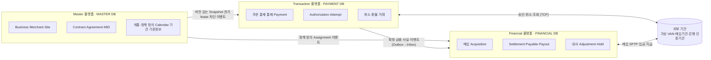

# PayCore 도메인 정의서 (서비스 도메인·용어사전)

작성 2026-10-06 KST. 흩어져 있던 채택 문서의 도메인 정의를 한곳에 모은 **색인 문서**다. 새 업무 정책을 정하지 않는다. 내용이 근거 문서와 다르면 근거 문서가 우선하며, 이 문서를 고친다.

## 0. 읽는 법

| 표시 | 뜻 |
|---|---|
| **확정** | 사용자가 채택한 업무 규칙(`docs/BASELINE-INDEX.md` "채택된 정책", `docs/DECISIONS.md`) |
| **초안** | 구현 검토용 기술 계약 후보. 업무 규칙은 확정 문서를 따르고 이름·구조는 바뀔 수 있다 |
| **관례** | 가역적인 구현 선택(`docs/repository/*`) |
| **미결** | 아직 정하지 않음. 관련 질문 ID 또는 후속 작업을 함께 적는다 |

근거 약어:

| 약어 | 문서 |
|---|---|
| 초기 | `docs/baseline/PayCore-초기-확정사항.md` |
| 시도 | `docs/baseline/PayCore-결제시도-규칙-권장안.md` (확정) |
| 허용 | `docs/baseline/PayCore-결제허용-기관연동-권장안.md` (확정) |
| 구조 | `docs/baseline/PayCore-v0.1-도메인구조-Seed-MID-Site-확정.md` (확정) |
| 정산 | `docs/baseline/PayCore-Settlement-Control-Policy-v0.1.md` (확정) |
| 범위 | `docs/baseline/PayCore-최초구현범위-권장안.md` (**채택 전**) |
| CP계약 | `docs/baseline/PAYCORE-CREATE-PAYMENT-IMPLEMENTATION-CONTRACT-v0.1.md` (초안) |
| A00~A10 | `docs/baseline/architecture/00~10` (아키텍처 자료) |
| 관례 | `docs/repository/ARCHITECTURE-CONVENTIONS.md` |

## 1. 서비스 정의

PayCore는 가맹점에 카드 결제를 직접 제공하는 **1차 PG**다(초기 확정).

- 최초 결제수단: **국내 신용카드**. 다른 결제수단·해외결제는 경계만 열어 둔다.
- 외부 기관(VAN·매입기관·은행·인증기관)은 실제 기관 대신 **별도 프로세스의 가상 기관(Simulator)** 으로 개발한다. 가상 기관 성공은 실서비스 인증이 아니다(허용 §5.6).
- 결제 흐름: 가맹점 주문 → 결제 생성 → (고객 인증) → 기관 승인 → 매입 → 기관 입금 → 정산 → 가맹점 지급, 그리고 각 단계의 대사.
- 통화: KRW + 일부 외화. 허용 통화는 MID·기관 계약별 기준정보로 활성화하고 초기 구현·검증은 KRW·USD(D-CP-002). 외화 거래의 정산 통화·환율은 미결(Q-SETTLE-CURRENCY).
- 미결: 일시불/할부·체크카드·고객 인증 흐름(Q-AUTH-SCOPE). "범위" 문서의 체크카드·할부 안은 채택 전이다.

## 2. 컨텍스트 지도

### 2.1 플랫폼(바운디드 컨텍스트 묶음)과 소유 DB — 확정(A00, A02)



| 플랫폼 | 책임 | 원본 DB | 실행 단위(현재 저장소) |
|---|---|---|---|
| Master | Business, Merchant, MerchantSite, Contract/Agreement, MID, 개통, 기관 기준정보, 정책 정의·버전, Credential 메타데이터 | MASTER | **없음(미결)**: 실행 단위가 아직 없다 |
| Transaction | 주문 결제 통제, Payment, Authorization/Attempt, 취소·환불 거래 상태, 기관 거래 식별자, Routing 실행 결과 | PAYMENT | `apps/payment-api` (`com.paycore.payment`) |
| Financial | Acquisition, Settlement, AgentSettlement, Payable, Payout, Adjustment, 대사 결과, Hold | FINANCIAL | `apps/financial-batch` (`com.paycore.financial`) |
| (화면) | 내부 관리자 화면. 데이터는 소유 플랫폼 API에 위임 | 없음 | `apps/internal-admin` (인증 방식 미결: Q-ADMIN-AUTH) |

규칙(확정·불변식, A02·A10·CLAUDE.md):

- 다른 플랫폼 DB를 직접 SELECT/JOIN/UPDATE하지 않는다. 공유 JPA Entity, XA/2PC, 복수 DataSource 원자성 가정은 금지다.
- 다른 플랫폼 데이터는 **버전 있는 이벤트·Snapshot의 로컬 투영(Projection)** 으로만 쓴다. 투영은 원본 Aggregate가 아니다.
- 업무 효과·요청 결과·Outbox는 소유 DB의 **같은 로컬 TX**로 커밋한다. Inbox 처리도 같은 로컬 TX다.
- 외부 기관 호출은 **DB TX 밖**에서 한다.

### 2.2 실행 단위 안의 모듈 — 관례

각 실행 단위 안에서 `com.paycore.<app>.<module>`이 Spring Modulith 모듈(바운디드 컨텍스트)이고, 그 안을 `domain` / `application(provided, required)` / `adapter(web, persistence, query, integration, batch)`로 나눈다(관례 §2). 업무 모듈 이름은 해당 작업에서 정한다. 첫 모듈은 CP-DOMAIN-001에서 payment-api에 생긴다.

## 3. 컨텍스트별 정의

### 3.1 Master — 가맹점·계약·MID·정책 원본

| 개념 | 정의 | 핵심 규칙 | 상태 |
|---|---|---|---|
| Business | 법적 사업 주체. Merchant/Agent/Seller 역할을 가질 수 있다 | 하나의 Business가 복수 Merchant를 가질 수 있다. 같은 사업자의 모든 브랜드를 한 Merchant로 강제하지 않는다 | 확정(초기) |
| Merchant | PG 서비스를 받는 가맹점 단위 | Merchant 1:N MerchantSite, 1:N MerchantAccount(MID) | 확정(구조 §13) |
| MerchantSite | 결제가 일어나는 채널(웹·앱 등) | 같은 Merchant 소속 MID와만 연결 | 확정 |
| MerchantAccount (MID) | 계약 단위 결제 계정. 발급 근거 계약 서비스 하나와 Revision을 명시한다 | 하나의 Merchant에만 속한다(다른 Merchant 간 공유 금지). BusinessId·카드사 가맹점번호·GID와 다른 개념 | 확정(초기·구조 §8) |
| Default MID | Merchant의 기본 계정 선택용 MID | 계약·권한·정산 조건을 자동 상속하지 않는다. 최초 Default 발급은 MID·Default 지정·최초 SiteAssignment·요청 결과·Outbox를 같은 MASTER TX로 저장. 교체·종료 규칙은 미결 | 확정 + 잔여 미결 |
| MerchantAccountSiteAssignment | MID–Site 연결(N:M 수용) | 기본 1:1. 복수 Site 공유는 동일 Merchant·Agreement·개통 적용 가능·정산 정책·기관 심사 허용을 모두 만족할 때만. 역할 PRIMARY/ADDITIONAL, EffectivePeriod·이력 보존. Production MID는 최초 Site 연결 필수 | 확정(구조 §6–10) |
| Contract / ContractServiceAgreement | 당사자·Scope·Revision과 서비스 권리 | 초기 Scope는 Merchant 또는 MerchantSite. GID 자동 상속 없음. 철회 시 신규 결제 차단, 재승인만으로 자동 재활성화 안 함 | 확정(초기) |
| PaymentMethodActivation (개통) | MID(향후 +Site)의 결제수단·카드사·Route 사용 승인 | 발급과 개통은 별개. Phase 1은 MID 단위, Site Scope로 확장 가능하게 | 확정(구조 §11–12) |
| 정책 정의 | FeeSchedule/FeeRule, SettlementPolicy, AdvancePayoutPolicy, AutoCorrectionPolicy, BusinessCalendar와 각 Assignment | 원본은 MASTER, 적용 Snapshot·계산은 FINANCIAL, 승인 당시 근거 버전은 PAYMENT가 보존. 변경은 UPDATE가 아니라 새 Version | 확정(구조 기존결정 §3) |
| 권리 Snapshot·lease | PAYMENT가 신규 승인 판정에 쓰는 로컬 권리 사본과 만료 있는 허용 기간 | 만료·누락·확인 불가 버전은 신규 승인 차단. 긴급 차단 우선 전파·ACK. 전파 지연·lease 수치는 미결 | 확정 + 수치 미결 |

### 3.2 Transaction — 주문 결제 통제·승인·취소

| 개념 | 정의 | 핵심 규칙 | 상태 |
|---|---|---|---|
| OrderKey (주문 키) | (environment, merchantAccountId, merchantOrderId) | 주문은 MID 범위. environment는 **TEST/LIVE**(D-CPD-001). 다른 MID로 옮기면 다른 주문. ID는 trim·대소문자 변환 없이 입력 그대로 비교하고 DB는 NO PAD binary collation(D-CP-001). 허용 문자·길이는 CP-CONTRACT-001 API 계약 | 확정 |
| 주문 결제 통제 (OrderPaymentControl) | 한 OrderKey의 활성 Payment 슬롯·고정 주문 입력(OrderIntentFingerprint)·generation·과거 승인·incident hold를 관리하는 Root. 판정 결과는 PaymentSlotDecision(CreateNewPayment / UseExistingPayment / FixedIntentConflict / Blocked) | 가맹점 상품 주문 전체를 PG로 가져오지 않는다. 규칙 확정(시도 §1·§5, D-CPD-003·004). 코드 `com.paycore.payment.payment.domain`(CP-DOMAIN-001) | 규칙 확정 / 구현 관례 |
| Payment | 고객의 한 결제 시도 | 주문 1:N Payment 이력. 새 시도는 새 paymentId/paymentKey. REQUESTED 포함 **활성 하나**. 승인된 주문의 금액·통화·MID·Site는 바꾸지 않는다 | 확정(시도 §1·§3) |
| Payment 상태 | REQUESTED, AUTHORIZING, UNKNOWN, AUTHORIZED, FAILED, EXPIRED | §4.1 표 참조 | 확정(시도 §2) |
| Authorization | Payment의 논리 승인. 초기에는 Payment당 하나 | 요청 전액 승인만. 부분 승인·다중 수단 분할 미지원 | 확정(시도 §1) |
| AuthorizationAttempt | 승인 실행 시도(기관 요청 ID·Route·권리 버전·판정 입력 연결) | 여러 Attempt 가능, 동시 실행 중인 외부 승인은 하나. TX1에서 영속화 후 TX 밖에서 전송 | 확정(시도 §1·§5, 허용 §5.3) |
| 안전한 종료 근거 (TerminationEvidence) | 같은 주문에 새 Payment를 허용하는 근거 | 상태–근거 짝이 표와 맞을 때만 인정하고 교차 조합은 불인정(D-CPD-003). FAILED: 기관 확정 거절 / 전송 전 실패 확정 / 기관 무효과 종결 확인. EXPIRED: (미전송 그리고 인증·세션 폐기) / 기관 무효과 종결 확인. timeout·조회 NOT_FOUND·lease 만료·근거 없음은 불충분 | 확정(D-CPD-002) |
| Incident hold (IncidentHold) | 확정 거절/만료 뒤 늦은 성공 같은 계약 가정 위반 시 주문의 추가 승인 차단 | hold 중 같은 입력 재요청은 Blocked(INCIDENT_HOLD) + 기존 paymentId 참조(D-CPD-004). 자동 보상취소 여부·해제 규칙은 미결 | 확정 + 미결 |
| IdempotencyRequest | API 요청 멱등 기록. 범위는 (environment, 인증된 MID, operation, key) + payload fingerprint | 같은 키·같은 내용은 저장된 최초 생성 결과만 반환하고 현재 상태는 조회 API로 제공(D-CP-003), 다른 내용은 충돌. 재조회에도 현재 권한 검사. 보존 기간 미결 | 규칙 확정 / 물리 초안 |
| Cancellation (승인취소) | 카드 승인 거래의 취소 | 신규 승인 권리와 분리된 반환 권한·원 경로로 처리(허용 §4.3). 부분취소 누적은 잠금/버전으로 보호(A02) | 방향 확정 / 상세 미결 |
| Refund (환불) | 결제수단별 승인취소와 구분되는 반환(계좌환불 등). 거래 상태 원본은 PAYMENT, 실제 지급 실행 원본은 FINANCIAL | Refund 완료일은 외부 반환 사실의 업무시각 기준 | 방향 확정 / 상세 미결 |
| PaymentTransaction | 승인·취소 등 PAYMENT 확정 금융 사실 기록으로 언급됨(시도 §5, 정산 §16) | **정의 문서 없음** — §6 갭 G-2 | 미결 |
| AuthenticationSession | 고객 카드 인증 lifecycle(CREATED/IN_PROGRESS/VERIFIED/FAILED/EXPIRED). 인증 성공 ≠ 승인 성공 | "범위" 문서 안이며 **채택 전**(Q-AUTH-SCOPE) | 미결 |
| Route / 기관 프로파일 | 거래에 쓰는 기관·계정·operation별 Adapter·프로토콜 버전·Capability | 당시 기관/프로파일/버전을 Attempt에 보존. Simulator/REAL은 Route 축(D-CPD-001) | 확정(허용 §5.1) |

### 3.3 Financial — 매입·정산·지급·대사

| 개념 | 정의 | 핵심 규칙 | 상태 |
|---|---|---|---|
| Payment Projection | PAYMENT 확정 금융 사실의 FINANCIAL 로컬 투영 | 원본이 아니며 이벤트로만 갱신 | 확정(A02) |
| Acquisition (매입) | 승인/취소 거래를 매입기관에 제출하고 결과를 받는 업무 | 원 SALE 결과 불명확이면 취소 매입 HOLD | 확정(허용 §5.4) |
| AcquisitionSubmission | 매입 제출 단위(파일 membership·회차·건수·총액·checksum·checkpoint) | 같은 Submission은 확정된 bytes/hash 유지. 업로드·수신 ACK·레코드별 ACCEPTED는 서로 다른 상태 | 확정(허용 §5.4) |
| 매입 전송 완료 | 선지급 기준 중 "매입 요청"의 인정 시점 | **외부기관에 전송 완료**. 내부 저장·파일 생성만으로는 아니며, 불명확하면 인정하지 않음 | 확정(초기) |
| Settlement / SettlementEntry | 거래별 정산 계산. 승인·취소는 각각 독립 Entry | transactionDate → settlementBaseDate → settlementDueDate 순서 계산, 계산 결과 Snapshot 보존 | 확정(정산 §3–7) |
| SettlementStatement | 정산 확정 묶음 | 선택한 거래 단계에 맞춘 적격성 판정 후 확정 | 확정(정산 기존결정 A) |
| Payable | 가맹점 지급 채무 | 금액을 바꾸지 않는다. 선지급은 Early Release Eligibility로만 | 확정(정산 §10) |
| Payout | 가맹점 지급 실행 | 단일 활성 실행/fencing. lease 만료만으로 미호출 가정 금지. DB에 기록 없음만으로 재지급 금지 | 확정(A06) |
| 지급 모드 | 입금 후 지급 / 기관 입금 전 선지급 — 정책으로 선택 | 둘 다 지원. 선지급 기준: 승인 완료 / 매입 전송 완료 / 매입 확정. 재원·일정 조건은 별도 판정 | 확정(초기) |
| AdvancePayoutPolicy·Eligibility | 선지급 허용 여부·건당/일 한도 | 한도 수치는 Demo Seed만 있고 운영값 미결 | 구조 확정 / 값 미결 |
| SettlementHold / PayoutHold | 정산·지급 보류. 범위 ADVANCE_ONLY / ALL_PAYOUT | 여러 Hold 중 하나 해제로 다른 Hold가 사라지지 않음 | 확정(정산 §13–14) |
| ReconciliationCase | 대사 차이 사건 | Risk LOW→자동 Recovery/제한 Adjustment, MEDIUM→수동, HIGH/CRITICAL→Hold+수동. 보정 후 재대사 MATCH 전 RESOLVED 금지 | 확정(정산 §15–21) / 자동 범위 값 미결(Q-CORRECTION) |
| Auto Recovery | 존재하는 금융 사실의 누락된 상태 반영을 복구 | 원장 변경 없음, 멱등 | 확정(정산 §16) |
| Adjustment | 확정 금융금액의 차액 보정 기록 | 기존 원장 UPDATE 금지. (caseId, correctionType) 등 업무 유일키 | 확정(정산 §16·§22) |
| BusinessCalendar | 영업일 기준정보(초기 PAYCORE_KR) | 버전 관리. 사후 변경이 기존 Entry 날짜를 자동으로 바꾸지 않음. timezone·D 포함 여부·cutoff 미결(Q-CALENDAR) | 확정 + 미결 |
| SettlementCycle | 기준일에서 지급 예정일까지의 주기 | 첫 엔진 DAILY_OFFSET(D+N 영업일). D+2는 Demo | 확정(구조 기존결정 §4) |
| AgentSettlement, Seller | 대리점 정산·하위 판매자 | Marketplace/지급대행 요구가 구체화될 때 상세화 | 미결(A00) |

### 3.4 외부 기관과 Simulator — 확정(허용 §5)

| 기관 역할 | 업무 | 소유 플랫폼 | 최초 가상 전송 |
|---|---|---|---|
| VAN | 카드 승인·취소·결과 조회 | PAYMENT | TCP 소켓 |
| 매입기관 | 매입 제출·결과 수신 | FINANCIAL | SFTP 파일 |
| 기관 입금 | 기관→PG 입금내역 | FINANCIAL | 결과/입금 파일 Simulator |
| 은행 | 가맹점 지급·결과 | FINANCIAL | 가상 은행 |
| 인증기관 | 고객 카드 인증 | PAYMENT | 미결(범위 문서 채택 전) |

- Domain은 업무 의도(authorize/cancel/inquire/submitAcquisition 등)만 다룬다. Socket/SFTP/기관 DTO는 `adapter.integration`에만 둔다(관례 §3).
- 기관 결과 분류: APPROVED / DECLINED / 확정 무효과 기술 실패 / PENDING / UNKNOWN / 조회 NOT_FOUND. NOT_FOUND는 기관 확정성 규칙 없이는 실패가 아니다.
- Simulator는 PG와 별도 프로세스·영속 저장소를 갖는다. 운영 기관 송신은 네트워크·설정에서 차단한다.

## 4. 상태와 흐름

### 4.1 Payment 상태와 같은 주문의 새 시도 — 확정(시도 §2, CP계약 §4, D-CPD-002)

| 현재 Payment | 같은 OrderKey·같은 고정 입력 | 다른 고정 입력 |
|---|---|---|
| (없음) | 새 REQUESTED + 슬롯 점유 | — |
| REQUESTED | 기존 Payment 재사용 | 충돌 |
| AUTHORIZING / UNKNOWN | 새 Payment 금지, 기존 결과 확인(조회·통보·대사) | 충돌 |
| AUTHORIZED 또는 과거 승인 성공 | 새 Payment 금지(전액 취소·환불 후에도). 재구매는 새 주문번호 | 충돌·새 주문 요구 |
| FAILED / EXPIRED + 안전한 종료 근거 | 새 요청키면 새 Payment(같은 요청키는 과거 결과) | 새 주문 요구 |
| FAILED / EXPIRED 근거 없음·불충분·상충, incident hold | 새 Payment 금지, 확인·복구 | 거절 |

- 이미 전송했거나 전송 여부가 불명확한 Attempt는 시간 경과만으로 EXPIRED/FAILED가 되지 않는다.
- 슬롯 해제는 currentPaymentId + generation이 맞을 때만 한다. 오래된 결과가 새 점유를 풀지 못한다.
- 결제창 만료 시간 수치는 정하지 않았다(기관 인증 규약 확인 후).

### 4.2 승인 흐름 — 확정(A02, 허용 §5.3)

```text
PAYMENT TX1: 슬롯·Attempt·기관 요청 ID·Route/권리 버전·요청 예약 커밋
  → 전송 게이트(차단·lease 재확인)
  → 기관 호출 (DB TX 밖)
PAYMENT TX2: Authorization/Attempt 결과 + Payment 요약 + 요청 결과 + Outbox 커밋
  → Outbox Relay (at-least-once)
FINANCIAL TX: Inbox 기록 + Projection + 정산 후보 커밋
```

TX2 실패나 응답 유실 시에는 새 승인을 보내지 않는다. 원 Attempt의 기관 요청 ID로 조회해 복구한다. DB Rollback이 기관 승인을 취소하지 않는다.

### 4.3 서로 독립인 상태 — 확정

- 전송 성공 ≠ 파일 업로드 ≠ 기관 수신 ACK ≠ 매입 ACCEPTED ≠ 기관 입금 ≠ 가맹점 지급(허용 §5.4, 초기).
- 정산 계산 ≠ 지급채무 확정 ≠ 지급 실행 ≠ 기관 입금(초기).
- 인증 성공 ≠ 승인 성공(범위 §3 — 원칙은 승인 흐름 규칙과 일치하지만 문서 자체는 채택 전).

## 5. 용어사전

| 용어 | 코드/영문 | 정의 | 혼동 주의 | 근거 |
|---|---|---|---|---|
| 1차 PG | — | 가맹점과 직접 계약하고 기관과 직접 연동하는 PG | — | 초기 |
| 가맹점 | Merchant | PG 서비스를 받는 가맹 단위. Business의 역할 | Business(법적 주체)와 다름 | 초기, A00 |
| 사업 주체 | Business | 법적 사업 주체. Merchant/Agent/Seller 역할 | — | A00 |
| 사이트 | MerchantSite | 결제 채널(웹·앱) | — | 구조 |
| MID | MerchantAccount, merchantAccountId | 계약 단위 결제 계정 | 카드사 가맹점번호·BusinessId·GID 아님 | 초기 |
| Default MID | — | 기본 계정 선택용 MID | Site 연결의 PRIMARY와 다른 개념. 조건을 자동 상속하지 않음 | 초기, 구조 |
| PRIMARY / ADDITIONAL | Assignment role | MID–Site 연결의 첫 연결 / 추가 채널 | Default MID와 다름 | 구조 §9 |
| GID | — | 여러 Business/MID를 묶는 그룹 식별자 | 계약·수수료·정산·권한을 상속하지 않음 | 초기, 정산 §11·§28 |
| 계약 / 서비스 계약 | Contract, ContractServiceAgreement | 당사자·Scope·Revision과 서비스 권리 | 승인 ≠ 효력 시작(효력 전 MID 선발급 가능, 결제 불가) | 초기 |
| 발급 | issuance | MID 생성 | 발급 ≠ 개통 ≠ 결제 허용 | 초기, 구조 §11 |
| 개통 | PaymentMethodActivation | 결제수단·카드사·Route 사용 승인 | — | 구조 |
| 권리 lease | — | PAYMENT의 만료 있는 승인 허용 기간 | 만료 시 신규 승인 차단 | 허용 §4.2 |
| 긴급 차단 | — | MID·키 신규 결제 즉시 중지 | 전역 효력 확인은 ACK/lease 만료 후. 기존 거래 처리와 분리 | 허용 §4.2–4.3 |
| 환경 | environment: TEST / LIVE | 가맹점 연동 논리 환경. OrderKey 구성요소 | 실행 backend SIMULATOR/REAL과 별도 축 | D-CPD-001, 허용 §5.5 |
| 실행 backend | SIMULATOR / REAL | 기관 Route가 가상 기관인지 실기관인지 | environment가 아님. 초기에는 모두 SIMULATOR | 허용 §5.5 |
| 주문 | — | 가맹점의 구매 단위. PG는 상품 주문 전체를 소유하지 않음 | — | CP계약 §2 |
| 주문 키 | OrderKey | (environment, MID, merchantOrderId) | Payment 키가 아님. Payment는 주문당 N개 | 시도 §1 |
| 고정 주문 입력 | order intent fingerprint | 주문의 금액·통화·Site·MID 등 바뀌면 안 되는 입력 | 구성 필드와 정규화는 미결(CP-CONTRACT-001) | 시도 §3, CP계약 §2 |
| 결제 시도 | Payment | 고객의 한 결제 시도 | 주문이 아님 | 시도 §1 |
| 활성 Payment | — | REQUESTED·AUTHORIZING·UNKNOWN 상태의 Payment. 주문당 하나 | REQUESTED도 활성. AUTHORIZED·과거 승인 성공은 활성이 아니라 **성공 점유**로 새 시도를 영구 차단 | 시도 §1–2, CP계약 §2 |
| 승인 | Authorization | Payment의 논리 승인 | Attempt와 다름 | 시도 §1 |
| 승인 시도 | AuthorizationAttempt | 기관에 보낸(또는 보내려는) 승인 실행 | 새 Attempt ≠ 새 기관 요청 ID(기관 규약을 따름) | 시도 §4 |
| 기관 요청 ID | providerRequestId | 기관 namespace(기관+환경+계약계정+operation) 안의 요청 식별자 | 내부 업무 ID와 별도 보존 | 허용 §5.2 |
| 승인번호 | — | 기관이 준 승인 식별 값 | 전역 UNIQUE로 가정 금지 | 허용 §5.2 |
| UNKNOWN | — | 기관 결과 불명확 | 실패가 아님. 원 Attempt 조회·대사 우선, 새 승인·failover 금지 | 시도 §4 |
| DECLINED | — | 기관의 확정 거절 | Payment FAILED와 같은 말이 아님(FAILED는 근거가 필요) | 시도 §2 |
| NOT_FOUND | — | 기관 조회 결과 없음 | 무효과 근거가 아님 | 시도 §2, 허용 §5.2 |
| 안전한 종료 근거 | — | 새 Payment 허용 근거 | §3.2 표 | D-CPD-002 |
| 늦은 성공 | — | 확정 거절/만료 뒤 도착한 성공 | 계약 가정 위반 사건 → incident hold | 시도 §4 |
| 멱등키 | idempotencyKey | 가맹점이 보낸 요청 재시도 키 | 같은 키·다른 내용은 충돌. 주문 키와 다름 | 시도 §5 |
| 승인취소 | Cancellation | 카드 승인 취소 | 계좌환불(Refund)과 구분 | A00 |
| 환불 | Refund | 결제수단별 반환 | 거래 상태는 PAYMENT, 지급 실행은 FINANCIAL | A00 |
| 매입 | Acquisition | 승인·취소 거래의 매입기관 제출과 결과 | 매입 전송 완료 ≠ 매입 확정 | 허용 §5.4 |
| 매입 전송 완료 | — | 외부기관에 실제 전송 완료 | 내부 파일 생성·접수 ACK와 다름 | 초기 |
| 매입 확정 | ACCEPTED | 레코드별 매입 수락 | 입금이 아님 | 허용 §5.4 |
| 거래일 | transactionDate | 승인일 / 취소일 / Refund 완료일 | 기준일·예정일과 구분 | 정산 §3 |
| 정산 기준일 | settlementBaseDate | 거래일이 영업일이면 그날, 아니면 다음 영업일 | — | 정산 §4 |
| 정산 예정일 | settlementDueDate | 기준일 + SettlementCycle | — | 정산 §5 |
| 수수료 적용일 | — | 원 승인일. 취소는 원 FeeCalculation Snapshot 참조 | 취소 정산 거래일(취소일)과 구분 | 정산 §1 |
| 지급채무 | Payable | 가맹점에 줄 확정 채무 | 금액 불변. 선지급은 Eligibility로만 | 정산 §10 |
| 지급 | Payout | 지급 실행 | — | A06 |
| 선지급 | Advance payout (Early Release) | 예정일 전 지급 | 별도 Financing Domain 없음. 기관 입금 전 지급 모드와 별도 축 | 정산 §10, 기존결정 A |
| 보류 | SettlementHold / PayoutHold | 정산·지급 보류 | ADVANCE_ONLY ≠ ALL_PAYOUT | 정산 §13 |
| 대사 사건 | ReconciliationCase | 대사 차이 사건과 위험 판정 | 보정 완료 ≠ 해결(MATCH 필요) | 정산 §15·§21 |
| 자동 복구 | Auto Recovery | 존재하는 사실의 누락 반영 | Adjustment와 다름 | 정산 §16 |
| 조정 | Adjustment | 확정 금액 차액 보정 기록 | 원장 UPDATE 아님 | 정산 §16 |
| 영업일 달력 | BusinessCalendar | 영업일 기준정보 | 단순 주말 계산 아님 | 정산 §6 |
| Demo Seed | DEMO DATA | Simulator 전용 예시 값(요율 2.8%, VAT 10%, D+2 등) | 운영값 아님. 운영 migration에 넣지 않음 | 구조 기존결정 §3 |
| Snapshot | — | 거래 시점 정책·권리·관계 근거 사본 | 사후 정책 변경으로 덮어쓰지 않음 | A02 |
| Projection | — | 다른 플랫폼 데이터의 로컬 투영 | 원본 Aggregate 아님 | A02 |
| Outbox / Inbox | — | 업무 변경과 같은 TX의 발행 기록 / (consumer, eventId) 중복 제거 수신 기록 | DLQ는 완료 상태 아님 | A03 |
| 가상 기관 | Simulator | 별도 프로세스의 가상 VAN·매입기관·은행·인증기관 | 성공이 실서비스 인증이 아님 | 허용 §5.5 |

## 6. 갭과 미결

### 6.1 등록된 질문(harness/questions.json)

| ID | 내용 | 막히는 작업 |
|---|---|---|
| Q-SETTLE-CURRENCY | 외화 거래의 가맹점 정산 통화·환율(사용자: 나중에 결정) | SETTLEMENT-CONTRACT-001 |
| Q-AUTH-SCOPE | 할부·체크카드·고객 인증 범위 | AUTH-CONTRACT-001 |
| Q-CALENDAR | D+N 계산·마감·시간대·휴일 변경 적용 | SETTLEMENT-CONTRACT-001 |
| Q-CORRECTION | 자동 보정 허용 범위·고위험 차단 기준 | RECON-CONTRACT-001 |
| Q-ADMIN-AUTH | 관리자 화면 인증·권한 | 관리자 화면 작업 |
| Q-BATCH-META, Q-BATCH-JOBPARAM | Batch metadata 위치, Job 식별 파라미터 | 첫 financial Job |

### 6.2 이 정리에서 발견한 갭(질문 후보, 해당 작업 착수 시 확인)

- **G-1 Master 실행 단위 없음.** Master 플랫폼(MASTER DB)의 실행 단위·작업이 `harness/tasks.json`에 없다. PAYMENT의 신규 승인 판정(허용 §4.1)은 MASTER가 발행하는 권리 Snapshot을 전제로 한다. AUTH 작업 전에 Master 작업 등록, 또는 Demo fixture로 대체할 범위를 정해야 한다.
- **G-2 PaymentTransaction 정의 없음.** "시도 §5"와 "정산 §16"에 나오지만, Authorization·Cancellation과의 관계와 금융 사실의 단위가 정의돼 있지 않다. Financial 이벤트 계약의 핵심 단위라 AUTH-CONTRACT-001에서 정의가 필요하다(금융 의미가 있어 사용자 확인 대상).
- **G-3 계약 용어 변형.** Contract / ServiceAgreement / ContractServiceAgreement가 문서마다 섞여 쓰인다. 같은 개념인지, Contract 아래 ServiceAgreement가 있는 구조인지 Master 작업에서 확정해야 한다.
- **G-4 incident hold 해제와 자동 보상취소.** 늦은 성공에 대한 처리 정책이 없다(시도 §4에서 "별도 정책"으로 명시).
- **G-5 Cancellation / Refund 상세.** 부분취소, 반환 가능 금액 불변식, 계좌환불 흐름의 상태 모델이 아직 없다.

## 7. 갱신 규칙

- 새 사용자 결정(DECISIONS.md)이나 채택 문서가 바뀌면 같은 변경에서 이 문서의 해당 행을 고친다.
- 코드에 Aggregate/모듈이 생기면 "코드/영문" 열에 실제 타입 이름을 맞춘다(CP-DOMAIN-001: OrderKey, Environment, OrderIntentFingerprint, PaymentId, Payment, PaymentStatus, TerminationEvidence, OrderPaymentControl, PaymentSlotDecision, BlockReason, IncidentHold).
- 이 문서만 근거로 정책을 판단하지 않는다. 항상 근거 열의 원문을 확인한다.
