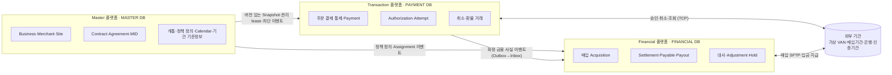

# PayCore 도메인 정의서 (서비스 도메인·용어사전)

작성 2026-10-06 KST. 흩어져 있던 채택 문서의 도메인 정의를 한곳에 모은 **색인 문서**다. 새 업무 정책을 정하지 않는다. 내용이 근거 문서와 다르면 근거 문서가 우선하며, 이 문서를 고친다.

## 0. 읽는 법

| 표시 | 뜻 |
|---|---|
| **확정** | 사용자가 채택한 업무 규칙(`docs/BASELINE-INDEX.md` "채택된 정책", `docs/DECISIONS.md`) |
| **초안** | 구현 검토용 기술 계약 후보. 업무 규칙은 확정 문서를 따르고 이름·구조는 바뀔 수 있다 |
| **관례** | 가역적인 구현 선택(`docs/repository/*`) |
| **미결** | 아직 정하지 않음. 관련 질문 ID 또는 후속 작업을 함께 적는다 |

근거 약어:

| 약어 | 문서 |
|---|---|
| 초기 | `docs/baseline/PayCore-초기-확정사항.md` |
| 시도 | `docs/baseline/PayCore-결제시도-규칙-권장안.md` (확정) |
| 허용 | `docs/baseline/PayCore-결제허용-기관연동-권장안.md` (확정) |
| 구조 | `docs/baseline/PayCore-v0.1-도메인구조-Seed-MID-Site-확정.md` (확정) |
| 정산 | `docs/baseline/PayCore-Settlement-Control-Policy-v0.1.md` (확정) |
| 범위 | `docs/baseline/PayCore-최초구현범위-권장안.md` (§1~§3 **채택 — D-AUTH-001**, 2026-10-15) |
| CP계약 | `docs/baseline/PAYCORE-CREATE-PAYMENT-IMPLEMENTATION-CONTRACT-v0.1.md` (초안) |
| A00~A10 | `docs/baseline/architecture/00~10` (아키텍처 자료) |
| 관례 | `docs/repository/ARCHITECTURE-CONVENTIONS.md` |

## 1. 서비스 정의

PayCore는 가맹점에 카드 결제를 직접 제공하는 **1차 PG**다(초기 확정).

- 최초 결제수단: **국내 신용카드**. 다른 결제수단·해외결제는 경계만 열어 둔다.
- 외부 기관(VAN·매입기관·은행·인증기관)은 실제 기관 대신 **별도 프로세스의 가상 기관(Simulator)** 으로 개발한다. 가상 기관 성공은 실서비스 인증이 아니다(허용 §5.6).
- 결제 흐름: 가맹점 주문 → 결제 생성 → (고객 인증) → 기관 승인 → 매입 → 기관 입금 → 정산 → 가맹점 지급, 그리고 각 단계의 대사.
- 통화: KRW + 일부 외화. 허용 통화는 MID·기관 계약별 기준정보로 활성화하고 초기 구현·검증은 KRW·USD(D-CP-002). 외화 거래의 정산 통화·환율은 미결(Q-SETTLE-CURRENCY).
- 확정(D-AUTH-001, 2026-10-15): KRW, 국내 발급 신용+체크카드(기관 프로파일 allowlist), 일시불 + 일반 유이자 할부(체크카드 할부 금지), 고객 인증은 PG 결제창 → 인증기관 → 가맹점 서버 confirm → PG 승인. 할부 개월·최소금액 등 운영 수치는 Demo(D-AUTH-009). 승인 계약은 `docs/repository/AUTH-CONTRACT-001-AUTHORIZATION-CONTRACT.md`.

## 2. 컨텍스트 지도

### 2.1 플랫폼(바운디드 컨텍스트 묶음)과 소유 DB — 확정(A00, A02)



| 플랫폼 | 책임 | 원본 DB | 실행 단위(현재 저장소) |
|---|---|---|---|
| Master | Business, Merchant, MerchantSite, Contract/Agreement, MID, 개통, 기관 기준정보, 정책 정의·버전, Credential 메타데이터 | MASTER | `apps/master-api` (`com.paycore.master`, MASTER-BOOT-001에서 생성 — D-CPC-006). 첫 업무 모듈 `com.paycore.master.merchant`·MASTER V1 표(MASTER-DOMAIN-001, 관례 §10) |
| Transaction | 주문 결제 통제, Payment, Authorization/Attempt, 취소·환불 거래 상태, 기관 거래 식별자, Routing 실행 결과 | PAYMENT | `apps/payment-api` (`com.paycore.payment`) |
| Financial | Acquisition, Settlement, AgentSettlement, Payable, Payout, Adjustment, 대사 결과, Hold | FINANCIAL | `apps/financial-batch` (`com.paycore.financial`) |
| (화면) | 내부 관리자 화면. 데이터는 소유 플랫폼 API에 위임 | 없음 | `apps/internal-admin` (인증 방식 미결: Q-ADMIN-AUTH) |

규칙(확정·불변식, A02·A10·CLAUDE.md):

- 다른 플랫폼 DB를 직접 SELECT/JOIN/UPDATE하지 않는다. 공유 JPA Entity, XA/2PC, 복수 DataSource 원자성 가정은 금지다.
- 다른 플랫폼 데이터는 **버전 있는 이벤트·Snapshot의 로컬 투영(Projection)** 으로만 쓴다. 투영은 원본 Aggregate가 아니다.
- 업무 효과·요청 결과·Outbox는 소유 DB의 **같은 로컬 TX**로 커밋한다. Inbox 처리도 같은 로컬 TX다.
- 외부 기관 호출은 **DB TX 밖**에서 한다.

### 2.2 실행 단위 안의 모듈 — 관례

각 실행 단위 안에서 `com.paycore.<app>.<module>`이 Spring Modulith 모듈(바운디드 컨텍스트)이고, 그 안을 `domain` / `application(provided, required)` / `adapter(web, persistence, query, integration, batch)`로 나눈다(관례 §2). 업무 모듈 이름은 해당 작업에서 정한다. 첫 모듈은 CP-DOMAIN-001에서 payment-api에 생긴다.

## 3. 컨텍스트별 정의

### 3.1 Master — 가맹점·계약·MID·정책 원본

> 상세 Aggregate·불변식·TX·질문(Q-MD-01~05·11~17·19 답변 = D-MD-003~015, Q-MD-06~10·18 미결): `docs/repository/MASTER-DOMAIN-001-MASTER-DOMAIN.md` (MASTER-DOMAIN-001 명세·구현 기록).

| 개념 | 정의 | 핵심 규칙 | 상태 |
|---|---|---|---|
| Business | 법적 사업 주체. Merchant/Agent/Seller 역할을 가질 수 있다 | 하나의 Business가 복수 Merchant를 가질 수 있다. 같은 사업자의 모든 브랜드를 한 Merchant로 강제하지 않는다. 국내 사업자등록번호로 하나(10자리 숫자, 평문 로그·이벤트 금지·이력은 마스킹, D-MD-008). 계약 당사자(D-MD-004). 생명주기 ACTIVE/TERMINATED + 별도 신규 결제 차단 기록(D-MD-006) | 확정(초기, D-MD-004·006·008) |
| Merchant | PG 서비스를 받는 가맹점 단위 | Merchant 1:N MerchantSite, 1:N MerchantAccount(MID) | 확정(구조 §13) |
| MerchantSite | 결제가 일어나는 채널(웹·앱 등) | 같은 Merchant 소속 MID와만 연결. 활성 채널 식별값은 같은 Merchant 안·다른 Merchant와 중복 거절(D-MD-008, 예외 승인 기록은 후속). 식별값은 소문자 정규형만(WEB = 도메인 host만, IP 리터럴 거절, 서브도메인은 다른 채널 — D-MD-009·014) | 확정 |
| MerchantAccount (MID) | 계약 단위 결제 계정. 발급 근거 계약 서비스 하나와 Revision을 명시한다 | 하나의 Merchant에만 속한다(다른 Merchant 간 공유 금지). BusinessId·카드사 가맹점번호·GID와 다른 개념. MID 하나 = 계약 계정이고 TEST/LIVE는 Credential·요청 축, 발급 MID는 모두 Production MID(계약 승인 필수, D-MD-003). 생명주기 ACTIVE/TERMINATED(비가역) + 별도 차단 기록(D-MD-006) | 확정(초기·구조 §8, D-MD-003·006) |
| Default MID | Merchant의 기본 계정 선택용 MID | 계약·권한·정산 조건을 자동 상속하지 않는다. 최초 Default 발급은 MID·Default 지정·최초 SiteAssignment·요청 결과·Outbox를 같은 MASTER TX로 저장. 교체·종료 규칙은 미결 | 확정 + 잔여 미결 |
| MerchantAccountSiteAssignment | MID–Site 연결(N:M 수용) | 기본 1:1. 복수 Site 공유는 동일 Merchant·Agreement·개통 적용 가능·정산 정책·기관 심사 허용을 모두 만족할 때만(증거·승인 방식은 Q-MD-08 미결). 역할 PRIMARY/ADDITIONAL, Production MID는 최초 Site 연결 필수. 기간 UTC [from, to)·같은 MID–Site 중첩 금지·소급 금지·미래 종료 예약 허용·상태 ACTIVE/SUSPENDED/ENDED(D-MD-005). MID당 유효 PRIMARY 하나·교체는 종료+시작 한 TX·자동 승격 없음·ADDITIONAL만 남으면 신규 결제 차단(D-MD-007) | 확정(구조 §6–10, D-MD-005·007) |
| Contract / ContractServiceAgreement | 당사자·Scope·Revision과 서비스 권리 | Contract 1:N CSA(D-MD-001), CSA 1건 = 서비스 종류 1개(D-MD-002). 당사자 = Business, Scope MERCHANT 또는 SITES(≥1)·변경은 새 Revision, Revision 내용 불변·승인 사실 append-only·효력 [from, to), 철회 ≠ 종료·CSA 단위 철회, 재활성화 = 새 Revision 승인 + 명시 명령, 같은 CSA 갱신은 MID 유지(D-MD-004). 한 계약의 모든 Revision은 같은 Merchant(D-MD-013), SITES Scope는 한 Merchant의 Site만(D-MD-010). 시각 t에 적용되는 Revision = t를 포함하는 승인 Revision 중 번호 최대(D-MD-011), MID 발급 근거는 발급 시각의 적용 Revision만(D-MD-012), 효력 전에는 자기 시작 시각에 적용될 승인 Revision으로 선발급(D-MD-015), 끝난 Revision 승인 거절(D-MD-014). GID 자동 상속 없음 | 확정(초기, D-MD-001·002·004·010~015) |
| PaymentMethodActivation (개통) | MID(향후 +Site)의 결제수단·카드사·Route 사용 승인 | 발급과 개통은 별개. Phase 1은 MID 단위, Site Scope로 확장 가능하게 | 확정(구조 §11–12) |
| 정책 정의 | FeeSchedule/FeeRule, SettlementPolicy, AdvancePayoutPolicy, AutoCorrectionPolicy, BusinessCalendar와 각 Assignment | 원본은 MASTER, 적용 Snapshot·계산은 FINANCIAL, 승인 당시 근거 버전은 PAYMENT가 보존. 변경은 UPDATE가 아니라 새 Version | 확정(구조 기존결정 §3) |
| 권리 Snapshot·lease | PAYMENT가 신규 승인 판정에 쓰는 로컬 권리 사본과 만료 있는 허용 기간 | 만료·누락·확인 불가 버전은 신규 승인 차단. 긴급 차단 우선 전파·ACK. 전파 지연·lease 수치는 미결 | 확정 + 수치 미결 |

### 3.2 Transaction — 주문 결제 통제·승인·취소

| 개념 | 정의 | 핵심 규칙 | 상태 |
|---|---|---|---|
| OrderKey (주문 키) | (environment, merchantAccountId, merchantOrderId) | 주문은 MID 범위. environment는 **TEST/LIVE**(D-CPD-001). 다른 MID로 옮기면 다른 주문. merchantOrderId는 trim·대소문자 변환 없이 입력 그대로 비교하고 DB는 NO PAD binary collation(D-CP-001), 형식은 1~64자 [A-Za-z0-9-_.:]·공백/비ASCII/제어문자 거절·대소문자 구분(D-CPC-002, domain 생성자에서 강제). merchantAccountId(MID)의 비정규화·그대로 비교는 사용자 결정이 아니라 구현 관례(fail-closed, PG 발급 값)이며 MID 형식은 MASTER 발급 규칙(MASTER-DOMAIN-001) | 확정 + 관례(MID) |
| 주문 결제 통제 (OrderPaymentControl) | 한 OrderKey의 활성 Payment 슬롯·고정 주문 입력(OrderIntentFingerprint)·generation·과거 승인·incident hold를 관리하는 Root. 판정 결과는 PaymentSlotDecision(CreateNewPayment / UseExistingPayment / FixedIntentConflict / Blocked) | 가맹점 상품 주문 전체를 PG로 가져오지 않는다. 규칙 확정(시도 §1·§5, D-CPD-003·004). 코드 `com.paycore.payment.payment.domain`(CP-DOMAIN-001) | 규칙 확정 / 구현 관례 |
| Payment | 고객의 한 결제 시도 | 주문 1:N Payment 이력. 새 시도는 새 paymentId/paymentKey. REQUESTED 포함 **활성 하나**. 승인된 주문의 금액·통화·MID·Site는 바꾸지 않는다 | 확정(시도 §1·§3) |
| Payment 상태 | REQUESTED, AUTHORIZING, UNKNOWN, AUTHORIZED, FAILED, EXPIRED | §4.1 표 참조 | 확정(시도 §2) |
| Authorization | Payment의 논리 승인. 초기에는 Payment당 하나 | 요청 전액 승인만. 부분 승인·다중 수단 분할 미지원 | 확정(시도 §1) |
| AuthorizationAttempt | 승인 실행 시도(기관 요청 ID·Route·권리 버전·판정 입력 연결) | 여러 Attempt 가능, 동시 실행 중인 외부 승인은 하나. TX1에서 영속화 후 TX 밖에서 전송 | 확정(시도 §1·§5, 허용 §5.3) |
| 안전한 종료 근거 (TerminationEvidence) | 같은 주문에 새 Payment를 허용하는 근거 | 상태–근거 짝이 표와 맞을 때만 인정하고 교차 조합은 불인정(D-CPD-003). FAILED: 기관 확정 거절 / 전송 전 실패 확정 / 기관 무효과 종결 확인. EXPIRED: (미전송 그리고 인증·세션 폐기) / 기관 무효과 종결 확인. timeout·조회 NOT_FOUND·lease 만료·근거 없음은 불충분 | 확정(D-CPD-002) |
| Incident hold (IncidentHold) | 늦은 성공(SUCCESS_AFTER_TERMINATION)·기관 상충 결과(CONFLICTING_INSTITUTION_RESULT) 시 주문의 추가 승인 차단 | hold 중 같은 입력 재요청은 Blocked(INCIDENT_HOLD) + 기존 paymentId 참조(D-CPD-004). 자동 보상취소 없음, 해제는 2인 승인(요청자≠승인자) + 재대사 MATCH(`IncidentHoldRelease`, 기록 append-only), 실제 승인 확인 시 주문 승인 성공 이력(D-AUTH-002, AUTH-CONTRACT-001 §8) | 확정(취소 사건 사유 CANCEL_RESULT_CONFLICT = 그 Payment의 추가 가맹점 취소 차단, 해제는 RECON-CONTRACT-001 전까지 거절 — D-CANCEL-006) |
| IdempotencyRequest | API 요청 멱등 기록. 범위는 (environment, 인증된 MID, operation, key) + payload fingerprint | 같은 키·같은 내용은 저장된 최초 생성 결과만 반환하고 현재 상태는 조회 API로 제공(D-CP-003), 다른 내용은 충돌. 재조회에도 현재 권한 검사. 보존 30일(D-CPC-004), 409 업무 거절도 결과로 저장·재생(D-CPC-007) | 규칙 확정 / 물리 초안 |
| Cancellation (승인취소) | 카드 승인 거래의 전액·부분취소. 코드 `PaymentCancellation`(취소 요청 1건 = 1 operation, Payment 1:N)·`ReturnBalance`(Payment 1:1 반환 가능 금액)·`CancelStart`·`CancellationResolution` | 신규 승인 권리와 분리된 반환 권한·원 경로(허용 §4.3). 반환 가능 금액 = max(0, 승인 − 완료 − 진행 중 − FORCED), 완료 + 진행 중 ≤ 승인. 업무 키 (Payment, merchantCancelId)·운영자 approvalId(영구), Payment당 진행 중 1건(UNKNOWN도 차단), 이 Payment 대상 hold면 가맹점 거절·운영자 보정 허용(2인, 승인 대상 fingerprint), PG 자체 기한 없음, 상충·늦은 성공은 CANCEL_RESULT_CONFLICT hold + FORCED, 수수료·VAT는 원승인 Snapshot 누적 비례(계산 SETTLEMENT), 일 한도 미복원, 정산 거래일 = 기관 취소 거래일. 이중 승인 보정은 늦게 확정된 P1을 운영자 보정 취소(P1 Payment는 FAILED/EXPIRED 유지, RECON이 거래 기록 — 그 TX의 PaymentAuthorized는 D-CANCEL-012 예외). `docs/repository/CANCEL-CONTRACT-001-CANCELLATION-CONTRACT.md`. 실행(CANCEL-001): 가맹점 `POST /v1/payments/{paymentId}/cancel`(TX1 → TXd → TX 밖 가상 VAN `sim-van-2` → TX2), 취소 UNKNOWN 회복(원 취소 요청 ID 조회만, 예산 소진 → `CancellationOutcomeUnresolved` — 상태·예약 유지, 임시 출구 없음 D-CANCEL1-003), 운영자 보정 취소는 provided Use Case만(진입점 없음 D-CANCEL1-001) — `docs/repository/CANCEL-001-CANCELLATION.md` | 확정(D-CANCEL-001~013, D-CANCEL1-001~008) |
| Refund (환불) | 결제수단별 승인취소와 구분되는 반환(계좌환불 등). 거래 상태 원본은 PAYMENT, 실제 지급 실행 원본은 FINANCIAL | **v1 범위 밖**(카드 반환은 카드 취소로만, API·운영 안내에 미지원 표시 — 안내 문구는 CANCEL-001 §4.11). Refund 완료일은 외부 반환 사실의 업무시각 기준 | 확정(D-CANCEL-007) |
| PaymentTransaction | 기관이 확정한 금융 효과 1건(append-only). 승인 성공 = `AuthorizationTransaction`, 취소·부분취소 = 각각 `CancelTransaction`(원 AUTHORIZATION 거래 참조, CANCEL-CONTRACT-001) | 거절·무효과·UNKNOWN·중복 수신은 거래가 아니라 관찰(InstitutionObservation·CancelObservation). PaymentAuthorized·PaymentCancelled 1건 = 거래 1건, FINANCIAL 업무 키 = transactionId. 늦은/상충 결과는 hold 해제 판정 전 미생성 | 확정(D-AUTH-003) |
| AuthenticationSession | 고객 카드 인증 lifecycle(CREATED/IN_PROGRESS/VERIFIED/FAILED/EXPIRED). 인증 성공 ≠ 승인 성공 | 인증 근거는 하나의 논리 승인 operation에만 귀속(한 번, 되돌리지 않음), 귀속 뒤 TTL 만료가 승인을 바꾸지 않음. 승인 시작 거절 시 미귀속(D-AUTH-005). AUTHN-001: VERIFIED는 서버 간 결과 조회로만(state 256bit·바인딩 paymentId·금액·통화·MID·환경·Plan·카드사·유효기간 대조, 조회 실패·timeout은 IN_PROGRESS 유지 — 효과 없음 단정 금지, D-AUTHN-003), 만료 원인 `AuthenticationExpiryCause`(SUPERSEDED/TTL_ELAPSED/PAYMENT_CLOSED), 대체·만료된 VERIFIED 증거 보존, 전이 이벤트 append-only(`authentication_session_event`). 코드 `payment.domain.AuthenticationSession`·`AuthenticationResultCheck`·`AuthenticationSessionStart` | 확정(D-AUTH-001, D-AUTHN-003) |
| 결제창 시각 (CheckoutWindow) | Payment의 절대 결제창 만료 시각과 그 유효기간 설정 버전(`Payment.checkoutWindow` = `CheckoutWindow(expiresAt, validityVersion)`) | 생성 시 `created_at + 버전 있는 결제 유효기간`(Demo `checkout-validity-demo-1`·PT30M — 운영값 아님)으로 한 번 고정 저장, 재사용·채우기로 연장하지 않음. 토큰·결제창 세션·인증 세션 만료는 이 시각을 넘지 않게 자름. V7 이전 REQUESTED 행은 기동 migration 전략이 고정(pin)한 배포 시점 설정 버전으로 채운 뒤 CHECK(D-AUTHN-007). 시각이 지나면 control을 쥔 경로(주기 작업·CreatePayment·토큰 발급 inline)만 Payment를 EXPIRED로 바꾸고, control 미보유 경로(교환·화면·인증 시작·복귀·취소)는 Payment를 바꾸지 않고 자기 세션만 닫는다 | 확정(D-AUTHN-005·007) |
| 결제창 토큰 / 결제창 세션 (checkout token / checkout session) | 가맹점 서버가 MID 인증 API로 발급하는 짧은 만료 1회용 토큰(256bit, DB에는 digest만)과 교환 뒤 handle별 쿠키 세션(HttpOnly·Secure·SameSite, CSRF) | 웹 프로토콜 기록이며 Aggregate가 아니다(application.required `CheckoutTokenStore`·`CheckoutSessionStore`, 상태 `CheckoutTokenStatus`·`CheckoutSessionStatus`/`CloseReason`). 1회 교환, 같은 Payment의 새 교환은 이전 결제창 세션을 REVOKED(SUPERSEDED). Payment 쪽 사유로 닫힌 결제창(EXPIRED(PAYMENT_CLOSED)·COMPLETED(PAYMENT_NOT_AVAILABLE))은 가맹점 failUrl(code=CHECKOUT_EXPIRED / PAYMENT_NOT_AVAILABLE)로 안내 | 확정(D-AUTHN-001·006) / 관례(이름) |
| PaymentExpired | REQUESTED → EXPIRED(NOT_TRANSMITTED_AND_SESSION_DISCARDED)를 알리는 비금융 통합 이벤트 | 만료와 같은 PAYMENT 로컬 TX에서 Outbox append(INTEGRATION_NON_FINANCIAL, effect_key `PaymentExpired:{paymentId}` — 중복 만료에도 1건, rollback이면 0건). payload에 paymentKey·카드정보·Secret·개인정보 없음, causation(요청·작업 회차) 기록. 금융 사실이 아니다(미전송) | 확정(D-AUTHN-008) |
| PaymentAuthorization / AuthorizationAttempt | Payment의 논리 승인(1:1)과 기관 승인 실행 시도. Attempt dispatch 상태 PREPARED/DISPATCHING/ABANDONED_BEFORE_DISPATCH/OUTCOME_UNKNOWN/RESOLVED | Authorization당 dispatch Attempt 1개(초기), 전송 전 포기만 PRE_TRANSMISSION_FAILURE_CONFIRMED의 출처, 전송 뒤 실패는 UNKNOWN | 확정(시도 §1·§4, 허용 §5.3) / 이름 관례 |
| PaymentPlan / CardType | 일시불(LumpSum)·일반 할부(Installment(months)) / CREDIT·CHECK | 체크카드 할부는 승인 시작에서 거절, 기관도 재검증. 허용 개월·최소금액은 버전 있는 정책(Demo) | 확정(D-AUTH-001) |
| TransactionLimitPolicy / DailyLimitUsage | 거래 한도(건당·일)와 일 한도 사용량 | 범위 MID+통화, 사용량 환경별, 정책 없음/모호 차단, 무제한 명시 값만(D-AUTH-006). 날짜 = 승인 시작 Asia/Seoul, 취소 미복원(D-AUTH-007) | 확정 |
| Route / 기관 프로파일 | 거래에 쓰는 기관·계정·operation별 Adapter·프로토콜 버전·Capability | 당시 기관/프로파일/버전을 Attempt에 보존. Simulator/REAL은 Route 축(D-CPD-001) | 확정(허용 §5.1) |
| 종료 근거 출처 (TerminationEvidenceSource) | 종료 근거가 **무엇에서** 나왔는지와 기록 시각·기록 주체. 종류 `TerminationEvidenceSourceKind`: OBSERVATION(기관 결과 관찰 — 확정 거절·무효과 확정의 유일 출처, ref = 관찰 키) / ATTEMPT_ABANDON(전송 전 포기 — 전송 전 실패 확정의 유일 출처, ref = attemptId) / CHECKOUT_EXPIRY(REQUESTED 결제창 만료, ref = paymentId). 자동 경로의 기록 주체는 `system:payment-api` | REQUESTED에서는 기관·전송 근거로 종료할 수 없다(AUTH-001 L-3 — 미전송·세션 폐기만). 출처 없는 행(`TerminationEvidenceRecord.source = null`)은 AUTH-001 이전 legacy 행뿐(V11 출처 4열 넷 다 NULL). 원문 비밀·카드정보 없음. 코드 `payment.domain.TerminationEvidenceSource` | 확정(AC1 §5.5) / 관례(이름) |
| 관찰 식별 (ObservationRef) / hold 출처 | 기록된 기관 관찰 한 건 = 관찰 키(attemptId, 출처, 기관 결과 ID) + `variant`(0 = 그 키의 첫 관찰, n ≥ 1 = 같은 키·다른 내용의 n번째 상충 증거). `IncidentHold.sourceObservation`은 그 hold를 **연** 관찰 | hold의 같음은 (paymentId, reason, occurrence)이고 출처는 속성. 승인 관찰 경로의 hold 개설은 출처 필수, 출처 없는 legacy hold는 아무 승인도 설명하지 않는다(fail-closed). 해제 판정(REAL·DOUBLE)이 설명하는 승인은 그 hold를 연 관찰의 terms와 기록된 거래 terms뿐이고, 설명되지 않은 흡수 승인이 남으면 해제와 같은 연산에서 hold occurrence + 1을 연다 — 해제 판정 종류와 무관(D-AUTH1-005·006) | 확정(D-AUTH-012·013, D-AUTH1-005·006) / 관례(이름) |
| 승인 회복 일정 (RecoverySchedule) | Attempt 하나의 회복 bookkeeping: 다음 점검 시각·dispatch lease 기한·조회 수·대사 이관 시각·종료 시각·회복 설정 버전(`authorization_recovery_schedule`) | **금융 판단의 근거가 아니다**(판단은 잠근 Aggregate). TX1이 Attempt와 함께 만들고 행을 지우지 않는다. 예산·연령 소진은 `AuthorizationOutcomeUnresolved`(대사 이관, 사유 BUDGET·MAX_AGE, 설정 버전)만 남기고 Payment·Authorization은 UNKNOWN 그대로(D-AUTH-009). 수치는 버전 있는 Demo 설정. 코드 application.required `RecoverySchedule`·`AuthorizationRecoveryScheduleStore` | 확정(D-AUTH-009) / 관례(이름·표) |
| 가상 VAN 원장 (VanLedgerEntry) | Simulator `van` 모듈의 기관 금융 사실 원본: 요청 namespace(client·environment·기관 계정·operation·요청 ID)당 한 행, DECISION(승인·거절) 또는 CLOSURE(무효과 종결 표지) | append-only(runtime 권한 SELECT·INSERT만, AU-20), PG 재시작·rollback과 무관. 같은 요청 ID 재전송은 기록된 결정, 다른 내용은 충돌. 종결 표지가 있으면 늦은 원 요청은 `REJECTED_CLOSED`. TEST 환경만. 무효과 종결 표지는 **가상 규격**이며 실제 VAN에도 있다고 가정하지 않는다 | 확정(허용 §5.5) / Simulator 관례 |

### 3.3 Financial — 매입·정산·지급·대사

| 개념 | 정의 | 핵심 규칙 | 상태 |
|---|---|---|---|
| Payment Projection | PAYMENT 확정 금융 사실의 FINANCIAL 로컬 투영 | 원본이 아니며 이벤트로만 갱신 | 확정(A02) |
| Acquisition (매입) | 승인/취소 거래를 매입기관에 제출하고 결과를 받는 업무 | 원 SALE 결과 불명확이면 취소 매입 HOLD | 확정(허용 §5.4) |
| AcquisitionSubmission | 매입 제출 단위(파일 membership·회차·건수·총액·checksum·checkpoint) | 같은 Submission은 확정된 bytes/hash 유지. 업로드·수신 ACK·레코드별 ACCEPTED는 서로 다른 상태 | 확정(허용 §5.4) |
| 매입 전송 완료 | 선지급 기준 중 "매입 요청"의 인정 시점 | **외부기관에 전송 완료**. 내부 저장·파일 생성만으로는 아니며, 불명확하면 인정하지 않음 | 확정(초기) |
| Settlement / SettlementEntry | 거래별 정산 계산. 승인·취소는 각각 독립 Entry | transactionDate → settlementBaseDate → settlementDueDate 순서 계산, 계산 결과 Snapshot 보존 | 확정(정산 §3–7) |
| SettlementStatement | 정산 확정 묶음 | 선택한 거래 단계에 맞춘 적격성 판정 후 확정 | 확정(정산 기존결정 A) |
| Payable | 가맹점 지급 채무 | 금액을 바꾸지 않는다. 선지급은 Early Release Eligibility로만 | 확정(정산 §10) |
| Payout | 가맹점 지급 실행 | 단일 활성 실행/fencing. lease 만료만으로 미호출 가정 금지. DB에 기록 없음만으로 재지급 금지 | 확정(A06) |
| 지급 모드 | 입금 후 지급 / 기관 입금 전 선지급 — 정책으로 선택 | 둘 다 지원. 선지급 기준: 승인 완료 / 매입 전송 완료 / 매입 확정. 재원·일정 조건은 별도 판정 | 확정(초기) |
| AdvancePayoutPolicy·Eligibility | 선지급 허용 여부·건당/일 한도 | 한도 수치는 Demo Seed만 있고 운영값 미결 | 구조 확정 / 값 미결 |
| SettlementHold / PayoutHold | 정산·지급 보류. 범위 ADVANCE_ONLY / ALL_PAYOUT | 여러 Hold 중 하나 해제로 다른 Hold가 사라지지 않음 | 확정(정산 §13–14) |
| ReconciliationCase | 대사 차이 사건 | Risk LOW→자동 Recovery/제한 Adjustment, MEDIUM→수동, HIGH/CRITICAL→Hold+수동. 보정 후 재대사 MATCH 전 RESOLVED 금지 | 확정(정산 §15–21) / 자동 범위 값 미결(Q-CORRECTION) |
| Auto Recovery | 존재하는 금융 사실의 누락된 상태 반영을 복구 | 원장 변경 없음, 멱등 | 확정(정산 §16) |
| Adjustment | 확정 금융금액의 차액 보정 기록 | 기존 원장 UPDATE 금지. (caseId, correctionType) 등 업무 유일키 | 확정(정산 §16·§22) |
| BusinessCalendar | 영업일 기준정보(초기 PAYCORE_KR) | 버전 관리. 사후 변경이 기존 Entry 날짜를 자동으로 바꾸지 않음. timezone·D 포함 여부·cutoff 미결(Q-CALENDAR) | 확정 + 미결 |
| SettlementCycle | 기준일에서 지급 예정일까지의 주기 | 첫 엔진 DAILY_OFFSET(D+N 영업일). D+2는 Demo | 확정(구조 기존결정 §4) |
| AgentSettlement, Seller | 대리점 정산·하위 판매자 | Marketplace/지급대행 요구가 구체화될 때 상세화 | 미결(A00) |

### 3.4 외부 기관과 Simulator — 확정(허용 §5)

| 기관 역할 | 업무 | 소유 플랫폼 | 최초 가상 전송 |
|---|---|---|---|
| VAN | 카드 승인·취소·결과 조회 | PAYMENT | TCP 소켓 |
| 매입기관 | 매입 제출·결과 수신 | FINANCIAL | SFTP 파일 |
| 기관 입금 | 기관→PG 입금내역 | FINANCIAL | 결과/입금 파일 Simulator |
| 은행 | 가맹점 지급·결과 | FINANCIAL | 가상 은행 |
| 인증기관 | 고객 카드 인증 | PAYMENT | 미결(범위 문서 채택 전) |

- Domain은 업무 의도(authorize/cancel/inquire/submitAcquisition 등)만 다룬다. Socket/SFTP/기관 DTO는 `adapter.integration`에만 둔다(관례 §3).
- 기관 결과 분류: APPROVED / DECLINED / 확정 무효과 기술 실패 / PENDING / UNKNOWN / 조회 NOT_FOUND. NOT_FOUND는 기관 확정성 규칙 없이는 실패가 아니다.
- Simulator는 PG와 별도 프로세스·영속 저장소를 갖는다. 운영 기관 송신은 네트워크·설정에서 차단한다.

## 4. 상태와 흐름

### 4.1 Payment 상태와 같은 주문의 새 시도 — 확정(시도 §2, CP계약 §4, D-CPD-002)

| 현재 Payment | 같은 OrderKey·같은 고정 입력 | 다른 고정 입력 |
|---|---|---|
| (없음) | 새 REQUESTED + 슬롯 점유 | — |
| REQUESTED | 기존 Payment 재사용 | 충돌 |
| AUTHORIZING / UNKNOWN | 새 Payment 금지, 기존 결과 확인(조회·통보·대사) | 충돌 |
| AUTHORIZED 또는 과거 승인 성공 | 새 Payment 금지(전액 취소·환불 후에도). 재구매는 새 주문번호 | 충돌·새 주문 요구 |
| FAILED / EXPIRED + 안전한 종료 근거 | 새 요청키면 새 Payment(같은 요청키는 과거 결과) | 새 주문 요구 |
| FAILED / EXPIRED 근거 없음·불충분·상충, incident hold | 새 Payment 금지, 확인·복구 | 거절 |

- 이미 전송했거나 전송 여부가 불명확한 Attempt는 시간 경과만으로 EXPIRED/FAILED가 되지 않는다.
- 슬롯 해제는 currentPaymentId + generation이 맞을 때만 한다. 오래된 결과가 새 점유를 풀지 못한다.
- 결제창 만료: Payment 생성 시 절대 만료 시각을 고정 저장한다(D-AUTHN-005, AUTHN-001). 유효기간 수치는 버전 있는 설정이며 현재 값은 Demo(PT30M — 운영값 아님, 기관 인증 규약 확인 후 정한다). 시각이 지난 REQUESTED는 미전송이므로 EXPIRED(NOT_TRANSMITTED_AND_SESSION_DISCARDED)가 되고 같은 주문에 새 요청키로 새 Payment(generation+1)를 허용한다(D-CPD-002).

### 4.2 승인 흐름 — 확정(A02, 허용 §5.3)

```text
PAYMENT TX1: 슬롯·Attempt·기관 요청 ID·Route/권리 버전·요청 예약 커밋
  → 전송 게이트(차단·lease 재확인)
  → 기관 호출 (DB TX 밖)
PAYMENT TX2: Authorization/Attempt 결과 + Payment 요약 + 요청 결과 + Outbox 커밋
  → Outbox Relay (at-least-once)
FINANCIAL TX: Inbox 기록 + Projection + 정산 후보 커밋
```

TX2 실패나 응답 유실 시에는 새 승인을 보내지 않는다. 원 Attempt의 기관 요청 ID로 조회해 복구한다. DB Rollback이 기관 승인을 취소하지 않는다.

### 4.3 서로 독립인 상태 — 확정

- 전송 성공 ≠ 파일 업로드 ≠ 기관 수신 ACK ≠ 매입 ACCEPTED ≠ 기관 입금 ≠ 가맹점 지급(허용 §5.4, 초기).
- 정산 계산 ≠ 지급채무 확정 ≠ 지급 실행 ≠ 기관 입금(초기).
- 인증 성공 ≠ 승인 성공(범위 §3 — 원칙은 승인 흐름 규칙과 일치하지만 문서 자체는 채택 전).

## 5. 용어사전

| 용어 | 코드/영문 | 정의 | 혼동 주의 | 근거 |
|---|---|---|---|---|
| 1차 PG | — | 가맹점과 직접 계약하고 기관과 직접 연동하는 PG | — | 초기 |
| 가맹점 | Merchant | PG 서비스를 받는 가맹 단위. Business의 역할 | Business(법적 주체)와 다름 | 초기, A00 |
| 사업 주체 | Business | 법적 사업 주체. Merchant/Agent/Seller 역할 | — | A00 |
| 사이트 | MerchantSite | 결제 채널(웹·앱) | — | 구조 |
| MID | MerchantAccount, merchantAccountId | 계약 단위 결제 계정 | 카드사 가맹점번호·BusinessId·GID 아님 | 초기 |
| Default MID | — | 기본 계정 선택용 MID | Site 연결의 PRIMARY와 다른 개념. 조건을 자동 상속하지 않음 | 초기, 구조 |
| PRIMARY / ADDITIONAL | Assignment role | MID–Site 연결의 첫 연결 / 추가 채널 | Default MID와 다름 | 구조 §9 |
| GID | — | 여러 Business/MID를 묶는 그룹 식별자 | 계약·수수료·정산·권한을 상속하지 않음 | 초기, 정산 §11·§28 |
| 계약 / 서비스 계약 | Contract, ContractServiceAgreement | 당사자·Scope·Revision과 서비스 권리 | 승인 ≠ 효력 시작(효력 전 MID 선발급 가능, 결제 불가) | 초기 |
| 발급 | issuance | MID 생성 | 발급 ≠ 개통 ≠ 결제 허용 | 초기, 구조 §11 |
| 개통 | PaymentMethodActivation | 결제수단·카드사·Route 사용 승인 | — | 구조 |
| 권리 lease | — | PAYMENT의 만료 있는 승인 허용 기간 | 만료 시 신규 승인 차단 | 허용 §4.2 |
| 긴급 차단 | — | MID·키 신규 결제 즉시 중지 | 전역 효력 확인은 ACK/lease 만료 후. 기존 거래 처리와 분리 | 허용 §4.2–4.3 |
| 환경 | environment: TEST / LIVE | 가맹점 연동 논리 환경. OrderKey 구성요소 | 실행 backend SIMULATOR/REAL과 별도 축 | D-CPD-001, 허용 §5.5 |
| 실행 backend | SIMULATOR / REAL | 기관 Route가 가상 기관인지 실기관인지 | environment가 아님. 초기에는 모두 SIMULATOR | 허용 §5.5 |
| 주문 | — | 가맹점의 구매 단위. PG는 상품 주문 전체를 소유하지 않음 | — | CP계약 §2 |
| 주문 키 | OrderKey | (environment, MID, merchantOrderId) | Payment 키가 아님. Payment는 주문당 N개 | 시도 §1 |
| 고정 주문 입력 | OrderIntent, OrderIntentFingerprint | 같은 OrderKey에서 바뀌면 안 되는 입력 = merchantSiteId + amount + currency(D-CPC-001). MID·environment는 OrderKey 자체라 별도 비교 대상이 아니다 | 결제수단·주문명 등 표시 정보는 비교하지 않음(최초 값 저장). fingerprint v1 정의·버전 규칙은 `docs/repository/CP-CONTRACT-001-CREATE-PAYMENT.md` §6. 멱등 요청 fingerprint(요청 전체)와 다름 | D-CPC-001, 시도 §3 |
| 결제 시도 | Payment | 고객의 한 결제 시도 | 주문이 아님 | 시도 §1 |
| 활성 Payment | — | REQUESTED·AUTHORIZING·UNKNOWN 상태의 Payment. 주문당 하나 | REQUESTED도 활성. AUTHORIZED·과거 승인 성공은 활성이 아니라 **성공 점유**로 새 시도를 영구 차단 | 시도 §1–2, CP계약 §2 |
| 승인 | Authorization | Payment의 논리 승인 | Attempt와 다름 | 시도 §1 |
| 승인 시도 | AuthorizationAttempt | 기관에 보낸(또는 보내려는) 승인 실행 | 새 Attempt ≠ 새 기관 요청 ID(기관 규약을 따름) | 시도 §4 |
| 기관 요청 ID | providerRequestId | 기관 namespace(기관+환경+계약계정+operation) 안의 요청 식별자 | 내부 업무 ID와 별도 보존 | 허용 §5.2 |
| 승인번호 | — | 기관이 준 승인 식별 값 | 전역 UNIQUE로 가정 금지 | 허용 §5.2 |
| UNKNOWN | — | 기관 결과 불명확 | 실패가 아님. 원 Attempt 조회·대사 우선, 새 승인·failover 금지 | 시도 §4 |
| DECLINED | — | 기관의 확정 거절 | Payment FAILED와 같은 말이 아님(FAILED는 근거가 필요) | 시도 §2 |
| NOT_FOUND | — | 기관 조회 결과 없음 | 무효과 근거가 아님 | 시도 §2, 허용 §5.2 |
| 안전한 종료 근거 | — | 새 Payment 허용 근거 | §3.2 표 | D-CPD-002 |
| 늦은 성공 | — | 확정 거절/만료 뒤 도착한 성공 | 계약 가정 위반 사건 → incident hold | 시도 §4 |
| 멱등키 | idempotencyKey | 가맹점이 보낸 요청 재시도 키 | 같은 키·다른 내용은 충돌. 주문 키와 다름 | 시도 §5 |
| 승인취소 | Cancellation | 카드 승인 취소 | 계좌환불(Refund)과 구분 | A00 |
| 환불 | Refund | 결제수단별 반환 | 거래 상태는 PAYMENT, 지급 실행은 FINANCIAL | A00 |
| 매입 | Acquisition | 승인·취소 거래의 매입기관 제출과 결과 | 매입 전송 완료 ≠ 매입 확정 | 허용 §5.4 |
| 매입 전송 완료 | — | 외부기관에 실제 전송 완료 | 내부 파일 생성·접수 ACK와 다름 | 초기 |
| 매입 확정 | ACCEPTED | 레코드별 매입 수락 | 입금이 아님 | 허용 §5.4 |
| 거래일 | transactionDate | 승인일 / 취소일 / Refund 완료일 | 기준일·예정일과 구분 | 정산 §3 |
| 정산 기준일 | settlementBaseDate | 거래일이 영업일이면 그날, 아니면 다음 영업일 | — | 정산 §4 |
| 정산 예정일 | settlementDueDate | 기준일 + SettlementCycle | — | 정산 §5 |
| 수수료 적용일 | — | 원 승인일. 취소는 원 FeeCalculation Snapshot 참조 | 취소 정산 거래일(취소일)과 구분 | 정산 §1 |
| 지급채무 | Payable | 가맹점에 줄 확정 채무 | 금액 불변. 선지급은 Eligibility로만 | 정산 §10 |
| 지급 | Payout | 지급 실행 | — | A06 |
| 선지급 | Advance payout (Early Release) | 예정일 전 지급 | 별도 Financing Domain 없음. 기관 입금 전 지급 모드와 별도 축 | 정산 §10, 기존결정 A |
| 보류 | SettlementHold / PayoutHold | 정산·지급 보류 | ADVANCE_ONLY ≠ ALL_PAYOUT | 정산 §13 |
| 대사 사건 | ReconciliationCase | 대사 차이 사건과 위험 판정 | 보정 완료 ≠ 해결(MATCH 필요) | 정산 §15·§21 |
| 자동 복구 | Auto Recovery | 존재하는 사실의 누락 반영 | Adjustment와 다름 | 정산 §16 |
| 조정 | Adjustment | 확정 금액 차액 보정 기록 | 원장 UPDATE 아님 | 정산 §16 |
| 영업일 달력 | BusinessCalendar | 영업일 기준정보 | 단순 주말 계산 아님 | 정산 §6 |
| Demo Seed | DEMO DATA | Simulator 전용 예시 값(요율 2.8%, VAT 10%, D+2 등) | 운영값 아님. 운영 migration에 넣지 않음 | 구조 기존결정 §3 |
| Snapshot | — | 거래 시점 정책·권리·관계 근거 사본 | 사후 정책 변경으로 덮어쓰지 않음 | A02 |
| Projection | — | 다른 플랫폼 데이터의 로컬 투영 | 원본 Aggregate 아님 | A02 |
| Outbox / Inbox | — | 업무 변경과 같은 TX의 발행 기록 / (consumer, eventId) 중복 제거 수신 기록 | DLQ는 완료 상태 아님 | A03 |
| 가상 기관 | Simulator | 별도 프로세스의 가상 VAN·매입기관·은행·인증기관 | 성공이 실서비스 인증이 아님 | 허용 §5.5 |
| 승인 확정 요청 | confirm(`POST /v1/payments/{paymentId}/confirm`) | 가맹점 서버가 VERIFIED 인증 뒤 승인 실행을 요청하는 API. TX1(승인 시작) → TXd(전송 게이트) → TX 밖 기관 호출 → TX2(결과 반영) | 202는 실패가 아님(진행 중·UNKNOWN — 새 키·새 Payment 금지) | AC1 §10.1, AUTH-001 |
| 전송 게이트 | TXd | 기관 전송 직전 권리 재판정(A0~A2) + Attempt PREPARED → DISPATCHING 커밋. 커밋이 확인될 때만 전송 | 인증 증거 유효기간은 보지 않음(기관이 재검증 — D-AUTH1-004). 기한(preparedAt + preparedDeadline) 뒤에는 통과하지 않고 회복 fencing에 맡김 | AUTH-001 §4.4 |
| fencing | `abandonBeforeDispatch(FENCED_BY_RECOVERY)` | 회복 Worker가 기한 지난 PREPARED Attempt를 전송 전 포기로 확정 | TXd와 같은 행을 잠그고 재판정하므로 둘 중 하나만 이긴다. 전송 전 실패 확정(PRE_TRANSMISSION)의 출처 | AC1 §5.5, AUTH-001 §6.1 |
| dispatch lease | `dispatch_lease_until` | TXd 통과 뒤 전송자가 결과를 반영할 기한(회복 일정 행) | lease 만료 = "호출 안 함"이 아니다 → OUTCOME_UNKNOWN(DISPATCH_LEASE_EXPIRED), 조회로 확인 | A06, AUTH-001 D-S6-1 |
| 무효과 종결 요청 | closeIfAbsent | 조회 때 원 요청이 기관에 없으면 그 요청 ID를 종결(이후 원 요청 무효)해 달라는 요청 — Capability `confirmsNoEffect` 프로파일만, closableAfter ≤ 연령 < 조회 보존기간, 그리고 Attempt에 전송 때 고정한 Route 프로파일 버전(`route_profile_version`) = 현재 등록부 버전일 때만(다르거나 NULL이면 종결 요청 없이 조회·이관 — D-AUTH1-007) | 응답 NO_EFFECT_CONFIRMED만 무효과 확정(FAILED 근거). NOT_FOUND는 아님 | 허용 §5.2, AUTH-001 §5.4·§6.1 |
| 대사 이관 | `AuthorizationOutcomeUnresolved` | 회복 예산·최대 연령 소진 시 대사로 넘기는 운영 위험 이벤트 | 상태 변경 아님(UNKNOWN 유지). 이관 뒤에도 보존기간까지 느린 조회 계속(AU-22) | D-AUTH-009 |

## 6. 갭과 미결

### 6.1 등록된 질문(harness/questions.json)

| ID | 내용 | 막히는 작업 |
|---|---|---|
| Q-SETTLE-CURRENCY | 외화 거래의 가맹점 정산 통화·환율(사용자: 나중에 결정) | SETTLEMENT-CONTRACT-001 |
| Q-AUTH-SCOPE | 할부·체크카드·고객 인증 범위 | AUTH-CONTRACT-001 |
| Q-CALENDAR | D+N 계산·마감·시간대·휴일 변경 적용 | SETTLEMENT-CONTRACT-001 |
| Q-CORRECTION | 자동 보정 허용 범위·고위험 차단 기준 | RECON-CONTRACT-001 |
| Q-ADMIN-AUTH | 관리자 화면 인증·권한 | 관리자 화면 작업 |
| Q-BATCH-META, Q-BATCH-JOBPARAM | Batch metadata 위치, Job 식별 파라미터 | 첫 financial Job |

### 6.2 이 정리에서 발견한 갭(질문 후보, 해당 작업 착수 시 확인)

- **G-1 Master 실행 단위 없음 → 결정(D-CPC-006: Master 먼저 구현).** MASTER-BOOT-001 / MASTER-DOMAIN-001 / MASTER-SNAPSHOT-001을 등록했고, CP-API-001·AUTH-001은 MASTER-SNAPSHOT-001 이후로 둔다.
- ~~G-2 PaymentTransaction 정의 없음.~~ **해결(D-AUTH-003, 2026-10-15).** 기관 확정 금융 효과 1건 = 거래 1건(append-only), 관찰과 분리.
- ~~G-3 계약 용어 변형.~~ **해결(D-MD-001·D-MD-002, 2026-10-08).** Contract 1:N ContractServiceAgreement 2단 구조, ServiceAgreement·Agreement는 ContractServiceAgreement 줄임말. ContractServiceAgreement 1건 = 서비스 종류 1개, 결제수단은 PaymentMethodActivation, 통화는 Assignment 범위.
- ~~G-4 incident hold 해제와 자동 보상취소.~~ **해결(D-AUTH-002, 2026-10-15).** 자동 보상취소 없음, hold + 대사 Case(HIGH/CRITICAL) 수동 검토, 해제는 2인 승인 + 재대사 MATCH. 해제 실행 Use Case는 RECON-CONTRACT-001·Q-ADMIN-AUTH 이후.
- ~~G-5 Cancellation / Refund 상세.~~ **해결(D-CANCEL-001~012, 2026-10-17).** 전액·부분취소·반환 가능 금액 불변식·취소 UNKNOWN 회복·hold·운영자 보정은 CANCEL-CONTRACT-001(2단계 domain 구현), 계좌환불은 v1 범위 밖. 영속·API·가상 VAN 취소·취소 UNKNOWN 회복은 CANCEL-001에서 구현(D-CANCEL1-001~008). 남은 것: CANCEL_RESULT_CONFLICT 해제 판정·FORCED 출구·이관된 취소 UNKNOWN 확정·P1 거래 기록 Use Case(RECON-CONTRACT-001 — 모양은 D-CANCEL-011, PaymentAuthorized 예외는 D-CANCEL-012, LIVE Gate 조건 D-CANCEL1-003), 운영자 보정 취소 진입점(ADMIN-BOOT-001).

## 7. 갱신 규칙

- 새 사용자 결정(DECISIONS.md)이나 채택 문서가 바뀌면 같은 변경에서 이 문서의 해당 행을 고친다.
- 코드에 Aggregate/모듈이 생기면 "코드/영문" 열에 실제 타입 이름을 맞춘다(CP-DOMAIN-001: OrderKey, Environment, OrderIntentFingerprint, PaymentId, Payment, PaymentStatus, TerminationEvidence, OrderPaymentControl, PaymentSlotDecision, BlockReason, IncidentHold; MASTER-DOMAIN-001: Business, BusinessRegistrationNumber, Merchant, MerchantSite, SiteChannel, Contract, ContractRevision, ContractScope, ContractServiceAgreement, MerchantAccount, DefaultDesignation, SiteAssignment, SiteAssignmentRole/Status, PaymentMethodActivation, MerchantAccountIssuance; AUTH-CONTRACT-001: PaymentPlan, CardType, AuthenticationSession, AuthenticationStatus, PaymentAuthorization, AuthorizationAttempt, AttemptState, InstitutionObservation, PaymentTransaction, TransactionLimitPolicy, DailyLimitUsage, LimitReservation, IncidentHoldRelease, AuthorizationStart, AuthorizationResolution, RequestedPaymentExpiry; AUTHN-001: CheckoutWindow, AuthenticationResultCheck, AuthenticationSessionStart, AuthenticationRef, AuthenticationEventKind, MerchantReturnUrl, ProviderResultLookup, SecretDigest — 결제창 토큰·세션은 domain이 아니라 application.required 기록 타입; CANCEL-CONTRACT-001: AuthorizationTransaction, CancelTransaction, PaymentCancellation, CancelAttempt, CancelObservation, CancelConfirmedTerms, CancelScope, CancelInitiator, CancelRequestKey, OperatorCancelPurpose, OperatorCancelTarget, OperatorApprovalId, MerchantCancelId, ReturnBalance, ReturnReservation, ReturnStatus, CancelCapability, CancelStart, CancellationResolution, IncidentReason.CANCEL_RESULT_CONFLICT; AUTH-001: TerminationEvidenceSource, TerminationEvidenceSourceKind, TerminationEvidenceRecord, ObservationRef, IncidentHold.sourceObservation·occurrence, Payment.authorizationStarted, ApprovedTerms.institutionBusinessDate, PaymentAuthorization.reconstitute, AuthorizationStart.preflight — application.required 기록·값 타입 RecoverySchedule, AuthorizationCallResult, InquiryCallResult, InstitutionRouteProfile, RouteCapabilities, EscalationReason; Simulator van: VanAuthorization, VanInquiry, VanLedgerEntry, VanPendingDecision, VanProfile, VanNamespace; CANCEL-001: PaymentCancellation.reconstitute·incidentCount, CancelAttempt.routeProfileVersion, CancelResolutionOutcome.Incident(incidentSeq), ReturnExcess, CancelCapabilityResolution — application.required 기록·값 타입 CancellationRecoverySchedule, CancellationCallResult, CancelInquiryCallResult, RouteCancelCapabilities, OperatorCancelRejection; Simulator van 취소: VanCancellation, VanCancelInquiry, VanCancelEntry, VanCancelProfile, VanCancelBehaviour, VanCancelJudgement, VanCancelInquiryJudgement).
- 코드 이름 대응(ARCH-STRUCTURE-001, 관례): 용어사전의 MerchantAccountSiteAssignment는 코드 `SiteAssignment`(`master.merchant.domain`)다. Domain 이름은 그대로 두고 Port 이름만 역할에 맞췄다(Aggregate 저장 `…Repository`, 기록 저장 `…Store`) — `docs/repository/ARCH-STRUCTURE-001-MAPPING.md` §1·§6.
- 이 문서만 근거로 정책을 판단하지 않는다. 항상 근거 열의 원문을 확인한다.
